# 第10章 多 Agent 协作（内容精读）

> [!info] 状态
> ✅ 已精读（2026-10-12）。覆盖 chapter10.md 全文，含全部 8 个二级小节（6 个内容小节 + 本章小结 + 思考题）与 11 张插图。

> [!info] 一句话主旨
> 前九章把**一个** Agent 做对，本章回答**多个** Agent 怎么组织：以「上下文是否共享 × 协作拓扑」两个维度切出架构空间，以唯一判据「协作过程是否引入了单个 Agent 在生成时无法获得的新信息」决定要不要上多 Agent；随后沿数据平面（虚拟文件系统）、控制平面（消息/状态/终止/调度）、三种拓扑（对等 / 管理者 / 去中心化）、跨组织互操作（A2A）展开工程细节，再以六大失败模式与「Agent 社会」的涌现现象收束——多 Agent 工程的本质，是同时设计信息如何流动、能力如何分工、激励如何约束、争议如何裁决，以及错误如何被发现。

## 本章速览

本章处在全书从「构建与改进一个 Agent」向「组织多个 Agent」的转折点上。它的论证主线是三层递进：**第一层是判据**——多 Agent 不是免费的午餐，只有当协作引入外部反馈（执行结果、视觉反馈、工具验证）时才真正优于单 Agent，否则只是「让模型再想一遍」；**第二层是机制**——围绕共享/不共享上下文这个最基础的架构决策，铺开虚拟文件系统的四类区域、控制平面的四件事（消息、状态、终止、调度）、三种拓扑（对等协作 / 管理者 / 去中心化）以及跨组织的 A2A 协议；**第三层是后果**——多 Agent 会放大错误（六种失败模式），而当 Agent 数量从几个扩展到成百上千万、交互足够自由时，社交、经济与策略博弈会自下而上涌现，Agent 社会从「观察对象」变成模型自我进化的「经验来源」。

### 小节结构总表

| 小节 | 一句话要义 |
| --- | --- |
| §多 Agent 协作的分类框架 | 两个核心设计维度——「上下文是否共享」决定信息如何传递，「协作拓扑」决定控制权与信息按什么结构流动（对等 / 管理者 / 去中心化，即 Graph 工程的多 Agent 子集）。 |
| §多 Agent 何时真正优于单 Agent | 唯一判据是「协作是否引入生成时无法获得的新信息」；表10-1 给出各模式的信息增量，并附步骤预算（预算感知）与成本两条工程约束。 |
| §共享上下文的多 Agent 协作 | 继承式协作信息不丢失但上下文易膨胀；关键设计选择是「替换 system prompt（`transfer_to_agent`）还是加载 Skill」，两者是不同的成本模型与约束模型。 |
| §不共享上下文的多 Agent 协作 | 真正的多 Agent 协作：与操作系统一一对应（表10-2），需要数据平面（虚拟文件系统四类区域，表10-3）与控制平面（消息、状态查询、执行终止、资源调度）两套与拓扑无关的基础设施。 |
| §多 Agent 协作的失败模式 | 《Why Do Multi-Agent LLM Systems Fail?》归纳 14 种失败模式 / 三大类；Agent 故障天生是拜占庭式的；六大重点模式：并发冲突、级联放大、同质趋同、互相扯皮、循环失控、理解债与认知投降。 |
| §Agent 社会 | Agent 规模跨过临界点后涌现三类现象——社交涌现（AI 小镇 / Agentopia / Moltbook）、经济涌现（Vending-Bench Arena / Pinchwork / RentAHuman）、策略博弈（狼人杀）。 |
| §本章小结 | 回到第一判据：信息增量与 token 成本决定是否采用多 Agent；协作要约定接口、边界、权限与验收标准，而非暴露思考过程。 |
| §思考题 | 11 道（★★ 至 ★★★），覆盖角色干扰、Manager 分解质量、组织病、级联终止、文件系统治理、市场化协作的仲裁、人机关系反转、多 Agent 的真正优势、效率与多样性、预算感知、OS 概念映射。 |

### 三级小节清单（供定位）

- §多 Agent 协作的分类框架 → **维度一：上下文是否共享**、**维度二：协作拓扑**
- §不共享上下文的多 Agent 协作 → **Agent 眼中的文件系统**、**Agent 间的通信与控制**、**对等协作模式：相互制衡与迭代改进**（Loop 工程 / 提议者-审核者范式 / 辩论模式 / 头脑风暴模式 / 专家小组模式）、**管理者模式：中心化协调**、**去中心化模式**、**跨组织协作：A2A 协议**
- §多 Agent 协作的失败模式 → **失败模式一至六**
- §Agent 社会 → **斯坦福 AI 小镇**、**Agentopia**、**Moltbook**、**Vending-Bench Arena**、**Agent 经济：Pinchwork 与 RentAHuman**、**信息不对称下的策略博弈：狼人杀**

### 实验与插图索引

| 实验 | 难度 | 依托小节 | 相关图 |
| --- | --- | --- | --- |
| 实验 10-1 共享上下文中的多角色转换——系统提示词与 Skill 的对比 | ★★ | §共享上下文的多 Agent 协作 | — |
| 实验 10-2 书籍翻译 Agent | ★★ | §管理者模式（顺序协调形态） | 图10-5 |
| 实验 10-3 自主编排的电话 + 电脑 Agent | ★★★ | §管理者模式（并行协调形态） | 图10-7 |
| 实验 10-4 同时从多个网站搜集信息的 Agent | ★★★ | §管理者模式（并行协调形态） | 图10-8 |
| 实验 10-5 运行斯坦福 AI 小镇 | ★ | §斯坦福 AI 小镇 | 图10-10 |
| 实验 10-6 语音狼人杀 Agent 系统 | ★★★ | §信息不对称下的策略博弈：狼人杀 | 图10-11 |

> 实验的逐条解读见 [[实验解读/第10章 多 Agent 协作]]，思考题引导见 [[思考题引导/第10章 多 Agent 协作]]。

## 本章与其他章节的关联

**承接前九章（本章把前九章的单体能力组装成系统）：**

- **承接第 1 章**：本章反复回到第 1 章的两组基础词汇——**trajectory**（定义共享上下文继承什么、轨迹持久化序列化什么）与 **Harness**（`transfer_to_agent` 的硬权限必须落在 Harness 层）。第 1 章的「从提示工程到 Loop 工程」一节被 §对等协作模式直接展开为 Loop 工程；第 1 章对「工作流 vs Agent」的区分，被用来判定 MetaGPT 的控制流「整体更接近一条流水线（用第一章的语言说是工作流）」。
- **承接第 2 章**：上下文压缩在两处回归——灵台器灵的「凝蜕」（molt）对应第二章的上下文压缩；系统内置资源以「渐进式披露（先索引、后按需展开）」取用，也是第二章的方法。
- **承接第 4 章**：第四章给出的子 Agent 工具原语（`spawn_subagent` / `send_message_to_subagent` / `cancel_subagent` / `list_agents`）构成控制平面的四个基本操作；「子 Agent 返回结构化摘要而非全量轨迹」在存储层面被 Scratchpad 隔离落实；「文件路径作为通用接口」与以卷挂载 `/workspace/shared` 的实现同样来自第四章；MCP（Agent↔工具）与 A2A（Agent↔Agent）被明确对照。
- **承接第 5 章**：提议者-审核者范式「第五章已经在 PPT 生成、视频编辑和日志可视化三个实验中详细介绍过」；本章把它从单 Agent 内部的两阶段升级为多 Agent 的独立实体，并用「审核者渲染了 PPT 并截取了画面」解释其价值来源。
- **承接第 6 章**：实验 10-3 综合第六章的 Computer Use 与语音 Agent 技术（ASR/LLM/TTS、WebRTC 回环），实验 10-4 建议先了解第六章的事件驱动与中断机制（级联终止「类似第六章的中断机制」）。
- **承接第 9 章**：AI 小镇的「反思」被明确与第九章持续进化区分开——「它发生在生成式 Agent 的日常活动中，目的是更新即时的内部状态和目标」；Agentopia 用模拟社会经验做拒绝采样微调，则「呼应第九章的经验学习思路」。

**向后铺路：**

- 本章是正文最后一章，其后是后记与 `reference-answers.md`；本章的收束句（「多 Agent 工程的本质，是同时设计信息如何流动、能力如何分工、激励如何约束、争议如何裁决，以及错误如何被发现」）同时是全书 Harness 工程观的总收尾。
- 章末提出的开放式问题（市场机制下的质量仲裁、Agent 经济中人的位置、效率与多样性的平衡、预算感知机制的设计、OS 概念的对应与缺位）没有标准答案，构成后续阅读与实验的入口。

## 逐节精读

### §导言：从单个 Agent 到多 Agent 系统

> [!question] 带着这些问题阅读本节
> 1. 本章要把问题从什么推进到什么？为什么说单个 Agent「终究受限于」某些边界？
> 2. 作者说「群体的智能可以高于个体」，他用什么类比来支撑这个判断？这个判断被挂在哪个外部文献上？
> 3. OpenAI 五级框架里的 Level 5「组织（Organizations）」指的是能力级别还是架构要求？作者特意澄清这一点的用意是什么？

**读后小结**：

- **问题推进**：前九章围绕单个 Agent 展开（上下文、知识、工具、交互 → 评估、后训练、持续进化），本章把问题从「如何构建和改进一个 Agent」推进到「如何组织多个 Agent」——让它们通过**分工、通信与相互验证**完成单个 Agent 难以承担的任务。
- **为什么需要多 Agent**：就今天的工程现实而言，单个 Agent 受限于**自身模型的能力边界**和**上下文窗口**。
- **更根本的理由：群体的智能可以高于个体**。人类文明是明证——单个人智力有限，但经由分工、协作、辩论和知识的代际累积，人类社会作为整体展现的智能远超任何一位天才个体。Agent 群体同样可能涌现集体智能：**哪怕每一个 Agent 都只相当于人类专家的水平，只要组织得当，其整体能力也可能超过所有人类专家的总和**。
- **外部依据**：Google DeepMind 在《从 AGI 到 ASI》中把「大规模多 Agent 集体」列为通往超级智能（ASI）的关键路径之一（脚注给出 arXiv:2606.12683, 2026）。
- **对「第五级」的澄清**：OpenAI 五级框架为 Level 1 对话者、Level 2 思考者（Reasoners）、Level 3 智能体、Level 4 创新者、Level 5 组织（Organizations）。作者强调此处 Organizations 指「AI 能完成整个组织的工作」这一**能力级别**，而**非对系统架构的要求**——足够强大的单个 Agent 理论上也能达到。
- **落点**：多 Agent 协作「不只是突破单个模型上下文窗口与能力边界的工程手段，更可能是从『专家级 AI』迈向『超越人类整体』的一条根本路径」。

**原文论证**：

> 前九章围绕单个 Agent 展开：先构建上下文、知识、工具与交互能力，再通过评估、后训练和持续进化让它长期变好。本章把问题从“如何构建和改进一个 Agent”推进到“如何组织多个 Agent”——让它们通过分工、通信与相互验证完成单个 Agent 难以承担的任务。（原书 §导言）

> 但就今天的工程现实而言，单个 Agent 终究受限于自身模型的能力边界和上下文窗口。（原书 §导言）

> 更根本的一点是：**群体的智能可以高于个体**。（原书 §导言）

> 需要说明的是，此处 Organizations 指的是“AI 能完成整个组织的工作”这一能力级别，而非对系统架构的要求，足够强大的单个 Agent 理论上也能达到。（原书 §导言）

> 因此，多 Agent 协作不只是突破单个模型上下文窗口与能力边界的工程手段，更可能是从“专家级 AI”迈向“超越人类整体”的一条根本路径。（原书 §导言）

**取舍与延伸**：本节埋下了一条后文反复兑现的伏笔——「群体智能高于个体」是**可能性**而非**必然性**，本章后半的六大失败模式与 Agent 社会案例正是在问：要满足什么条件，这个「可能」才成立？作者自己给的是「只要组织得当」四个字，全章就是在拆解这四个字。

### §多 Agent 协作的分类框架

> [!question] 带着这些问题阅读本节
> 1. 构建多 Agent 系统需要先理解哪两个核心设计维度？它们分别决定什么？
> 2. 「协作拓扑」这一维度与 2026 年流行的「Graph Engineering」是什么关系？
> 3. 分类框架为什么要先给出，而不是直接进入具体架构？

**读后小结**：

- **两个核心设计维度**共同决定系统的基本架构和实现方式：**维度一是上下文是否共享**（决定多个 Agent 之间如何传递信息，即之前是否保留彼此的完整记忆）；**维度二是协作拓扑**（Agent 之间的控制权和信息按什么结构流动）。
- **拓扑有三种典型形态**：对等协作模式（少量 Agent 按固定拓扑形成迭代改进循环，如起草者 + 评论者）、管理者模式（中心化 Manager Agent 负责规划调度，多个子 Agent 各负责特定子任务）、去中心化模式（没有运行时的中心控制者，Agent 之间像人类一样互相沟通）。
- **术语锚点**：作者给「Graph 工程」下了章节内的定义——2026 年 7 月开始流行，在当前 Agent 语境中通常指**显式设计执行图**：节点是 Agent、普通程序或人工决策，边定义任务依赖、条件路由与失败后的去向，结构化状态在节点之间流动；本章的「协作拓扑」正是其中的**多 Agent 子集**。
- 各模式的详细设计与适用场景留待后面的专题小节展开（对等协作、管理者模式、去中心化模式各有一节）。

**原文论证**：

> 要构建多 Agent 系统，首先需要理解两个核心设计维度，它们共同决定了系统的基本架构和实现方式。（原书 §多 Agent 协作的分类框架）

> 第二个维度是协作拓扑——Agent 之间的控制权和信息按什么结构流动。协作拓扑有三种典型形态：（原书 §维度二：协作拓扑）

> 2026 年 7 月开始流行的 “Graph Engineering”，在当前 Agent 语境中通常指显式设计执行图：节点是 Agent、普通程序或人工决策，边定义任务依赖、条件路由与失败后的去向，结构化状态在节点之间流动（该名称的由来与相关实践见第一章“从提示工程到 Loop 工程”一节）。本章讨论的“协作拓扑”正是其中的多 Agent 子集——对等协作、管理者编排和去中心化移交，都是不同的图拓扑。（原书 §多 Agent 协作的分类框架）

**取舍与延伸**：这两个维度是**正交**的——「共享/不共享上下文」管信息面，「拓扑」管控制面；本章后文正是按「先定信息面（§共享上下文 / §不共享上下文），再在信息面内选拓扑」的顺序展开的。注意节点定义里包含「普通程序或人工决策」，说明图拓扑并不假定节点一定是 Agent，这为「人工门禁」预留了位置。

#### §维度一：上下文是否共享

> [!question] 带着这些问题阅读本节
> 1. 共享上下文时，「每个阶段切换系统提示词和工具集后，就变成了一个新的 Agent」——为什么切换提示词和工具集就算换了 Agent？
> 2. 不共享上下文的优势与代价各是什么？它与「不同部门之间的协作」的类比他重点强调哪一面？
> 3. Agent 间通信的三种常见机制分别是什么？它们如何对应到 IPC 的两大范式？
> 4. 作者引 Go 语言那句话（不要通过共享内存来通信）想表达什么倾向？

**读后小结**：

- **共享上下文**：后续 Agent 接收前一个 Agent 的**完整对话历史和轨迹（trajectory）**。每个阶段切换系统提示词和工具集后就变成了一个新的 Agent（因为身份、职责和能力都变了），但它**保留了前任的全部记忆**。类比：需求分析师写完需求文档后，开发者不仅拿到文档，还能看到分析师与用户的所有沟通记录——他是新角色，却完整保留了之前的上下文。
  - 优势：**信息不丢失**，每个 Agent 都能回顾之前任何阶段的细节。
  - 挑战：**上下文可能快速膨胀**。
- **不共享上下文**：每个 Agent 维护**完全独立**的上下文和对话历史，彼此无法直接访问对方的「思考过程」。类比：不同部门之间的协作——各自在工位上独立工作，通过共享文档和会议纪要交换信息，而不是时刻盯着别人的屏幕。
  - 优势：模块化和隔离性更好，每个 Agent 只关注与自身职责相关的信息；系统**更易扩展和维护**——增加新 Agent 不需要改动现有 Agent 的内部逻辑，只需定义好接口和数据格式。
  - 代价：必须通过显式通信机制传递信息（详见本节三种机制，以及后文专门展开的通信与控制一节）。
- **三种常见通信机制**（Agent 不共享上下文时唯一的通路）：
  1. **工具调用的参数**：把下游 Agent 封装成工具，上游 Agent 把结构化数据通过工具参数传给下游——适合需要类型确定、结构清晰的场景；
  2. **共享文件系统**：Agent 之间通过读写共享目录下的文档、代码等中间产物来交换信息——适合产物较大或需要持久化的场景；
  3. **消息总线（Message Bus）**：一个专门负责在 Agent 之间传递消息的中转站，Agent 不直接调用彼此，而是把消息发送到消息总线，由它转发给目标 Agent。
- **与 IPC 的对应**：进程间通信（IPC）归根结底只有两大范式——**共享内存**（一方写入、另一方读取同一块存储）与**消息传递**（把数据显式地发送给对方）。对应到 Agent 世界：**共享文件系统就是「共享内存」**；**工具调用参数和消息总线则是「消息传递」的两种形态**——前者随调用同步传递，后者经中转站异步投递。
- **作者的倾向**：引 Go 语言那句广为流传的话「不要通过共享内存来通信，而要通过通信来共享内存」，暗示共享文件系统虽然直观有力，但需要额外的并发治理（见 §失败模式一）。

**原文论证**：

> **共享上下文**意味着后续 Agent 接收前一个 Agent 的完整对话历史和轨迹（第一章定义的 trajectory）。每个阶段切换系统提示词和工具集后，就变成了一个新的 Agent（因为它的身份、职责和能力都发生了变化），但它保留了前任的全部记忆。（原书 §维度一：上下文是否共享）

> 优势在于信息不丢失，每个 Agent 都能回顾之前任何阶段的细节；挑战在于上下文可能快速膨胀。（原书 §维度一：上下文是否共享）

> **不共享上下文**意味着每个 Agent 维护完全独立的上下文和对话历史，彼此无法直接访问对方的“思考过程”。（原书 §维度一：上下文是否共享）

> 系统也更易扩展和维护——增加新 Agent 不需要改动现有 Agent 的内部逻辑，只需定义好接口和数据格式。（原书 §维度一：上下文是否共享）

> 操作系统教科书告诉我们，进程间通信（IPC）归根结底只有两大范式——**共享内存**（一方写入、另一方读取同一块存储）和**消息传递**（把数据显式地发送给对方）。Agent 间的通信机制同样落在这两个范式之内，常见的有三种：（原书 §维度一：上下文是否共享）

> 对应到 IPC 的两大范式：共享文件系统就是 Agent 世界的“共享内存”；工具调用参数和消息总线则是“消息传递”的两种形态——前者随调用同步传递，后者经中转站异步投递。两种范式各有取舍。Go 语言有一句广为流传的话：“不要通过共享内存来通信，而要通过通信来共享内存”。（原书 §维度一：上下文是否共享）

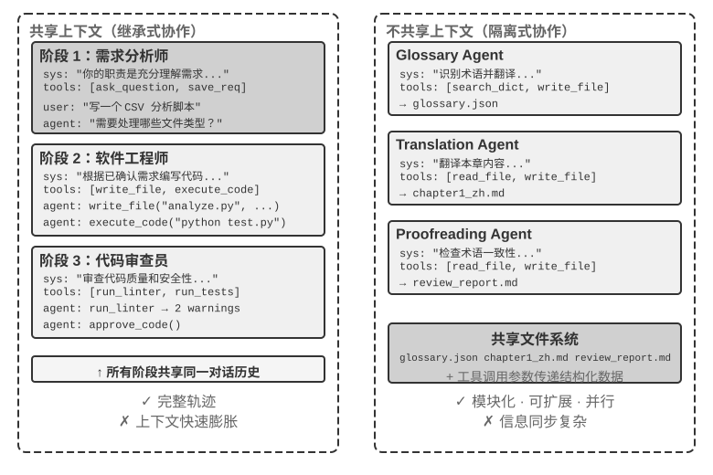

> **图 10-1 解读**：该图对比共享上下文与不共享上下文两种架构（原书 §维度一：上下文是否共享）。共享上下文一侧，后续 Agent 继承前序 Agent 的完整轨迹，只切换系统提示词与工具集，因而「信息不丢失」但「上下文可能快速膨胀」；不共享上下文一侧，每个 Agent 拥有独立上下文与轨迹，只能靠三种显式通信机制（工具调用参数 / 共享文件系统 / 消息总线）交换信息，模块化与隔离性更好，代价是信息同步与调试更难。

**取舍与延伸**：这个维度直接决定后文的「两套基础设施」——不共享上下文要额外补齐数据平面（文件系统）与控制平面（消息/状态/终止/调度）；共享上下文则要把力气花在「如何让当前 Agent 专注而不被继承来的历史干扰」上。实验 10-1 正是这个取舍的对照实验。

#### §维度二：协作拓扑

> [!question] 带着这些问题阅读本节
> 1. 三种协作拓扑各自的定义与生活类比是什么？
> 2. 对等协作模式中「少量 Agent」的典型数量与运行形态是什么？
> 3. 为什么本节只给定义与类比，把「各模式的详细设计和适用场景」留到后面？

**读后小结**：

- **对等协作模式（Peer Collaboration Pattern）**：少量 Agent 按照**固定的拓扑**形成迭代改进循环。书中例子：论文写作 Agent 由起草者和评论者两个 Agent 组成，一方起草、另一方批注修改，反复几轮后质量更高。
- **管理者模式（Orchestration Pattern）**：一个中心化的 **Manager Agent** 负责任务规划和调度，多个子 Agent 各负责特定子任务——类比「项目经理带着几位专业工程师做项目」。
- **去中心化模式（Decentralized Pattern）**：**没有运行时的中心控制者**，Agent 之间像人类一样互相沟通，协作完成任务。
- **与 Graph 工程的关系**：这三种形态都是不同的**图拓扑**；Graph 工程里的节点可以是 Agent、普通程序或人工决策。
- 本节是分类框架的收口，作者明确「各模式的详细设计和适用场景将在后面的专题小节中展开讨论」——对等协作、管理者模式、去中心化模式各自有独立小节。

**原文论证**：

> - **对等协作模式**（Peer Collaboration Pattern）：少量 Agent 按照固定的拓扑形成迭代改进循环，例如论文写作 Agent 由起草者和评论者两个 Agent 组成，一方起草、另一方批注修改，反复几轮后质量更高。
> - **管理者模式**（Orchestration Pattern）：一个中心化的 Manager Agent 负责任务规划和调度，多个子 Agent 各负责特定子任务——就像项目经理带着几位专业工程师做项目。
> - **去中心化模式**（Decentralized Pattern）：没有运行时的中心控制者，Agent 之间像人类一样互相沟通，协作完成任务。（原书 §维度二：协作拓扑）

> 各模式的详细设计和适用场景将在后面的专题小节中展开讨论。（原书 §维度二：协作拓扑）

**取舍与延伸**：三个模式并非互斥的「三选一」——后文 A2A 一节明确「同一团队内部的多 Agent 系统直接用消息总线即可」，而 §去中心化模式里 MetaGPT / AutoGen / Swarm 三个案例被作者排成一条「递进线索」，说明现实中同一系统常混用多种拓扑（例如管理者模式内部再嵌对等协作循环）。

### §多 Agent 何时真正优于单 Agent

> [!question] 带着这些问题阅读本节
> 1. 作者把判断标准压缩成了哪一条判据？表10-1 中五种模式各自的「是否引入新信息」与「效果」是什么？
> 2. 为什么说「多 Agent 在学术上无用、在工程中有用」这个矛盾是假矛盾？
> 3. Anthropic 2026 年的漏洞挖掘实验给出的两组数字分别是什么？
> 4. 「步骤预算」这条线为什么反直觉？对 Manager Agent 的直接指导是什么？
> 5. 作者提醒的成本量级是什么？

**读后小结**：

- **唯一判据**：**协作过程是否引入了单个 Agent 在生成时无法获得的新信息？** 这个答案「会成为后文所有工程方案的总体参照」。
- **表10-1 多 Agent 协作模式的信息增量对比**（原书 §多 Agent 何时真正优于单 Agent 表）：

| 协作模式 | 是否引入新信息 | 效果 |
| --- | --- | --- |
| 同一模型自我审查（重新阅读自己的输出） | 否 | 通常无效甚至有害 |
| 不同 Agent 辩论同一段文本 | 否 | 在等计算量下与单 Agent 持平 |
| 审核者使用测试执行结果审查代码 | 是（执行反馈） | 显著提升 |
| 审核者查看渲染截图审查前端/PPT 代码 | 是（视觉反馈） | 显著提升 |
| 审核者使用外部工具验证事实 | 是（工具反馈） | 显著提升 |

- **证据一（RLEF，2025）**：Reinforcement Learning from Execution Feedback 通过强化学习训练模型利用代码执行反馈迭代改进代码，效果远超让模型独立多次采样。关键在于每次迭代都引入了**真实的执行结果**（编译错误、测试失败、运行时异常），这些信息在模型写代码时并不存在。
- **证据二（WebGen-Agent，2025）**：在网页生成任务上，通过多层级的视觉反馈（截图 + 视觉语言模型描述）构成的反馈脚手架，据报道使 Claude 3.5 Sonnet 在该基准上的表现**从 26.4% 提升到 51.9%**——接近翻倍。
- **假矛盾的解释**：学术研究比较的多是「多个 Agent 看着同一段上下文互相讨论」（没有引入新信息），工程实践中有效的系统往往包含**外部反馈环路**（代码执行、视觉渲染、工具调用，引入了新信息）——两者讨论的根本不是同一类「多 Agent」。
- **证据三（Anthropic Frontier Red Team，2026）**：45 个 Agent 通过共享论坛协调搜索、互相审查，再由独立 Agent 仲裁结果。**Agent 集群用 2700 万 token 找到 266 个漏洞，而独立 Agent 并行方案用 650 万 token 只找到 21 个**。在开放搜索空间里，多 Agent 通过互相通信可以动态转移搜索重点、形成专门分工，用更高 token 预算换取更广的覆盖和更多样化的发现路径。
- **步骤预算与 Agent 性能（反直觉结论）**：2025 年 Google 论文《Budget-Aware Tool-Use Enables Effective Agent Scaling》发现，**单纯增加 Agent 可用的步骤数并不能保证性能提升**——标准 Agent 缺乏「预算意识」，即使有 300 步预算仍倾向执行浅层搜索、很快「饱和」。要让更多步骤转化为更好结果，需要**显式的预算感知机制**：根据剩余资源动态调整策略，前期广泛探索、后期聚焦最有希望的方向。2026 年的 BAVT（Budget-Aware Value Tree Search）进一步提出**步骤级价值评估**，在每一步按剩余预算比例调整探索与利用权重——随着预算减少，Agent 从「广撒网」逐渐切换到「深挖掘」。
- **对多 Agent 设计的直接指导**：在管理者模式中，Manager Agent 不应只把任务分发给子 Agent 然后等结果，而应根据任务复杂度**动态分配步骤预算**（简单子任务给较少步骤、复杂子任务给充足步骤），并引导子 Agent 合理利用预算（先规划、再实现、再测试、再改进），而不是一头扎进去直接开干。
- **成本约束**：多 Agent 的并行探索与反复迭代消耗大量 token，**收益必须足够大，能够覆盖数倍乃至一个数量级的额外开销**，否则「一个调校得当的单 Agent 往往是更划算的选择」。

**原文论证**：

> 在进入具体的协作架构之前，先回答一个更根本的问题：**什么时候真正需要多个 Agent，什么时候一个 Agent 就够了？** 这个问题的答案会成为后文所有工程方案的总体参照。近年的一系列研究给出了一个清晰的判断框架——核心判据只有一条：**协作过程是否引入了单个 Agent 在生成时无法获得的新信息？**（原书 §多 Agent 何时真正优于单 Agent）

> 这个“新信息”框架解释了一个看似矛盾的现象：一些学术研究认为多 Agent 并不能提升 Agent 能力上限，但在工程实践中，多 Agent 确实表现得更好。矛盾的根源在于两者讨论的是不同类型的 “多 Agent”：学术研究中比较的多是 “多个 Agent 看着同一段上下文互相讨论” 的模式，而工程实践中有效的多 Agent 系统往往包含外部反馈环路（代码执行、视觉渲染、工具调用）。前者没有引入新信息，后者引入了。（原书 §多 Agent 何时真正优于单 Agent）

> Anthropic 2026 年的漏洞挖掘实验给出了一个案例：45 个 Agent 通过共享论坛协调搜索、互相审查，再由独立 Agent 仲裁结果。Agent 集群用 2700 万 token 找到 266 个漏洞，而独立 Agent 并行方案用 650 万 token 只找到 21 个。（原书 §多 Agent 何时真正优于单 Agent）

> 但 2025 年 Google 的论文《Budget-Aware Tool-Use Enables Effective Agent Scaling》发现了一个反直觉的结论：**单纯增加 Agent 可用的步骤数并不能保证性能提升**。标准的 Agent 缺乏“预算意识”——即使有 300 步的预算，它们仍然倾向于执行浅层搜索，很快就“饱和”了。（原书 §多 Agent 何时真正优于单 Agent）

> 多 Agent 带来的收益必须足够大，能够覆盖数倍乃至一个数量级的额外开销，否则一个调校得当的单 Agent 往往是更划算的选择。（原书 §多 Agent 何时真正优于单 Agent）

**取舍与延伸**：「是否引入新信息」这条判据是一个**可判定的架构检查项**——设计任何一个多 Agent 系统前，先给每个协作环节标注它引入的是哪一类新信息（执行反馈 / 视觉反馈 / 工具反馈 / 无）。表10-1 中「否」的两行（自我审查、同段文本辩论）几乎是本章后半多个失败案例（同质趋同、辩论模式争议）的预告。

### §共享上下文的多 Agent 协作

> [!question] 带着这些问题阅读本节
> 1. 共享上下文的协作被作者称为什么？它的核心优势与挑战分别是什么？
> 2. 为什么「始终使用同一套静态系统提示词」不行？
> 3. 角色转换有哪两条实现路径？它们在载体、工具可见性、上下文/KV Cache 影响、约束能力四个维度上如何对比？
> 4. 作者给出的选择规则是什么（什么情况下优先 Skill，什么情况下用独立 Agent）？
> 5. 实验 10-1 用同一模型、同一任务对照了什么变量？

**读后小结**：

- **本质**：每个阶段都是一个独立的 Agent（拥有自己的系统提示词和工具集），但**继承前序 Agent 的完整轨迹**——「就像接班的同事能翻阅前任留下的所有工作日志」。这种「**继承式协作**」的核心优势是**信息不会丢失**；挑战是**如何让当前 Agent 专注于自己的核心职责，而不被继承来的大量历史信息所干扰**。
- **为什么需要多阶段角色转换**：在复杂任务中，Agent 的角色和职责可能在不同阶段显著变化。始终使用同一套静态系统提示词，要么**过于笼统缺乏针对性**，要么把所有阶段的指导塞在一起导致**过于冗长**。做法是：根据当前阶段**动态切换系统提示词和工具集**。
- **关键设计选择**：**角色转换究竟是替换 system prompt，还是加载 Skill？** 两者都能让同一模型在不同阶段采用不同行为规程，却不是同一种成本模型（原书表）：

| 选择 | 角色规程的载体 | 工具可见性 | 上下文/KV Cache 影响 | 约束能力 |
| --- | --- | --- | --- | --- |
| `transfer_to_agent` | 替换当前 system prompt，并通常替换工具集 | 只暴露当前角色工具 | 每次切换都改变请求前缀；从变化点起的前缀缓存通常无法复用 | 强：越界工具可在 schema 层不可见 |
| Skill | 固定 system prompt 中的 Skill 目录，按需把 `SKILL.md` 追加到轨迹 | 通常固定暴露工具全集，或使用稳定的工具搜索入口 | 静态前缀保持不变；Skill 内容成为末尾轨迹，已有前缀可继续复用 | 弱：Skill 是行为指令，硬权限仍需 Harness 门 |

- **选择规则**：角色差异**主要来自知识、流程和写作风格**时，优先使用 **Skill**；角色差异**涉及权限、工具隔离、合规边界或需要在运行时强制禁止某类动作**时，使用独立 Agent 或 `transfer_to_agent` 工具，并在 **Harness 层通过代码限制工具调用**。
- **实验 10-1（★★）共享上下文中的多角色转换——系统提示词与 Skill 的对比**：
  - **共同任务与变量**：两条路径使用同一模型、同一用户任务、同一工具实现、同一份角色规程和**全量共享轨迹**。任务是查找中国 2021—2023 年新能源汽车销量、计算 CAGR、写不超过 120 字的投资人摘要。
  - **路径一：系统提示词切换**。五种角色为 triage（用户需求收集，默认入口）、research（信息检索）、coding（编程）、data_analysis（数据分析）、writing（写作）。每个角色只看到自己的专属工具和 `transfer_to_agent`；调用移交时保存历史、加载目标角色提示词/工具集，再继续调用。旧实现保留在配套项目中，作为这一实验分支的基线。
  - **路径二：Skill**。system prompt 和完整工具全集在整个会话中固定；模型按需调用 `load_skill(name)`，读取的 `SKILL.md` 作为 tool result 进入共享轨迹。静态前缀不因角色变化而重写，但工具仍然可见，硬权限由 harness 中的规则保证。
  - **对照点**：两条路径共享同一模型、任务、工具实现与角色规程，**唯一被改变的是「角色规程如何进入上下文」**——一个重写前缀，一个追加到轨迹末尾。

**原文论证**：

> 共享上下文的多 Agent 协作中，每个阶段都是一个独立的 Agent（拥有自己的系统提示词和工具集），但它继承了前序 Agent 的完整轨迹——就像接班的同事能翻阅前任留下的所有工作日志。这种 “继承式协作” 的核心优势在于信息不会丢失，每个 Agent 都能回顾之前任何阶段的细节。挑战则在于如何让当前 Agent 专注于自己的核心职责，而不被继承来的大量历史信息所干扰。（原书 §共享上下文的多 Agent 协作）

> 如果始终使用同一套静态系统提示词，要么过于笼统缺乏针对性，要么把所有阶段的指导塞在一起导致过于冗长。（原书 §共享上下文的多 Agent 协作）

> 这里有一个常被忽略、但会直接改变架构的设计选择：**角色转换究竟是替换 system prompt，还是加载 Skill？** 两者都可以让同一个模型在不同阶段采用不同的行为规程，却不是同一种成本模型。（原书 §共享上下文的多 Agent 协作）

> 角色差异主要来自知识、流程和写作风格时，优先使用 Skill；角色差异涉及权限、工具隔离、合规边界或需要在运行时强制禁止某类动作时，使用独立 Agent 或 `transfer_to_agent` 工具，并在 Harness 层通过代码限制工具调用。（原书 §共享上下文的多 Agent 协作）

> **共同任务与变量**：两条路径都使用同一模型、同一用户任务、同一工具实现、同一份角色规程和全量共享轨迹。任务是查找中国 2021—2023 年新能源汽车销量、计算 CAGR、写不超过 120 字的投资人摘要。（原书 实验 10-1）

**取舍与延伸**：这条选择规则把「角色差异」拆成了**知识/流程/风格**与**权限/隔离/合规**两类——前者是软约束（可用 Skill 承载），后者是硬约束（必须落在 Harness 的 schema 与代码里）。「Skill 是行为指令，硬权限仍需 Harness 门」这句与第 1 章「模型负责决策、Harness 负责约束」的分工完全一致；KV Cache 视角则把「换角色」的成本变成可量化的工程指标（前缀缓存能不能复用）。

### §不共享上下文的多 Agent 协作

> [!question] 带着这些问题阅读本节
> 1. 为什么作者说「不共享上下文代表真正的多 Agent 协作」？
> 2. 表10-2 把多 Agent 系统与操作系统做了哪些一一对应？这套抽象的历史来源是什么？
> 3. 进程式隔离带来哪些工程好处？代价（尤其是信息同步与调试）是什么？
> 4. 与拓扑无关的两套基础设施分别是什么，各自构成什么平面？

**读后小结**：

- **定位**：不共享上下文代表**真正的**多 Agent 协作。每个 Agent 都是独立实体，拥有自己的上下文、轨迹和状态，彼此无法直接访问对方的「内心活动」，协作完全依赖三种通信机制（工具调用参数、共享文件系统、消息总线）。
- **表10-2 多 Agent 系统与操作系统的对应关系**（原书 §不共享上下文的多 Agent 协作 表）：

| 操作系统 | 多 Agent 系统 |
| --- | --- |
| 程序（可执行文件） | 静态前缀（系统提示词 + 工具定义） |
| 进程的内存 | 轨迹 |
| CPU | LLM |
| 内核 | Agent 运行时 |
| 系统调用 | 工具调用 |
| fork（创建子进程） | spawn_subagent |
| kill（发送信号） | cancel_subagent |
| ps（列出进程） | list_agents |
| 退出码与 wait() | 子 Agent 返回的结构化摘要 |
| 共享内存 / 消息传递 | 共享文件系统 / 消息 |

- **抽象的历史来源**：这套抽象并不新鲜——**私有状态、异步消息、可创建新成员**，正是 1970 年代 **Actor 模型**的基本设定（脚注引 Hewitt, Bishop, Steiger, IJCAI 1973），多 Agent 系统不妨看作它的 LLM 版本。因此操作系统与分布式系统的成熟经验大多可以直接借用。
- **进程式隔离的工程好处**：每个 Agent 可以独立开发和测试；新增能力不需要改动现有代码；某个 Agent 出故障也**不会把错误状态传染给其他 Agent**；多个 Agent 可以**真正并发执行**——上下文完全独立，不存在资源竞争。
- **代价**：最明显的是**信息同步问题**——各 Agent 如何对任务状态保持一致的理解？信息在传递过程中会不会丢失或重复？**调试也变得更困难**——出了问题需要翻看多个 Agent 的日志才能拼出完整执行过程。这些问题使得**接口规范、数据格式和通信协议的设计变得至关重要**。
- **两套与拓扑无关的基础设施**：
  - **共享文件系统**——Agent 间交换产物、与用户交换文件的持久媒介，构成协作的**数据平面**；
  - **通信与控制机制**——支持消息传递、状态查询、执行终止与资源调度，构成协作的**控制平面**。

**原文论证**：

> 不共享上下文代表真正的多 Agent 协作。在这种架构下，每个 Agent 都是独立的实体，拥有自己的上下文、轨迹和状态；彼此无法直接访问对方的 “内心活动”，协作完全依赖本章开头介绍的三种通信机制（工具调用参数、共享文件系统、消息总线）。（原书 §不共享上下文的多 Agent 协作）

> 这套抽象并不新鲜：私有状态、异步消息、可创建新成员，正是 1970 年代 Actor 模型的基本设定，多 Agent 系统不妨看作它的 LLM 版本。因此操作系统与分布式系统的成熟经验大多可以直接借用。（原书 §不共享上下文的多 Agent 协作）

> 进程式的隔离带来了几个切实的工程好处：每个 Agent 可以独立开发和测试，新增能力不需要改动现有代码，某个 Agent 出了故障也不会把错误状态传染给其他 Agent，而且多个 Agent 可以真正并发执行——上下文完全独立，不存在资源竞争。（原书 §不共享上下文的多 Agent 协作）

> 但不共享上下文也有代价。最明显的是信息同步问题：各 Agent 如何对任务状态保持一致的理解？信息在传递过程中会不会丢失或重复？调试也变得更加困难——出了问题需要翻看多个 Agent 的日志，才能拼出完整的执行过程。（原书 §不共享上下文的多 Agent 协作）

> 不共享上下文的显式协作依赖两套与拓扑无关的基础设施。其一是**共享文件系统**，作为 Agent 间交换产物、与用户交换文件的持久媒介，构成协作的数据平面；其二是**通信与控制机制**，支持 Agent 间的消息传递、状态查询、执行终止与资源调度，构成协作的控制平面。（原书 §不共享上下文的多 Agent 协作）

**取舍与延伸**：「操作系统 / 分布式系统」这条类比线贯穿整节——它既是解释工具，也是**工程取用清单**（后文的消息信封对应网络协议封装、级联终止对应 Go 的 context、乐观锁对应数据库并发控制、拜占庭容错对应分布式理论）。表10-2 里最值得单独记住的一行是「退出码与 wait() ↔ 子 Agent 返回的结构化摘要」：这一步就是把「不共享上下文」的成本压下来的关键压缩动作。

#### §Agent 眼中的文件系统

> [!question] 带着这些问题阅读本节
> 1. 为什么说 Agent 访问的不是单一存储，而是「虚拟文件系统」？它的底层可能是什么？
> 2. 一个成熟的多 Agent 系统的文件系统由哪四类区域构成？各自的可见性、生命周期、读写与并发控制是什么样的？
> 3. Scratchpad 隔离有哪两重作用？它对应第四章的哪条设计？
> 4. 外部挂载资源有哪三项区别于本地存储的特性？
> 5. 「文件路径作为通用接口」的价值是什么？

**读后小结**：

- **虚拟文件系统（virtual filesystem）**：Agent 访问的并非单一存储，而是来源、生命周期与权限各异的存储被**挂载（mount）到同一目录树下**，Agent 通过统一的 `read_file`/`write_file`/`list_dir` 接口访问，底层可能是本地临时盘、持久对象存储、第三方云盘的 API 或只读的系统资源包。**明确这棵目录树的构成（每一区域的可见性与生命周期）是多 Agent 协作设计的前提：相当一部分并发冲突与信息泄露，源于将本应隔离的区域混置**。这棵目录树相当于 Agent 的**地址空间**，四类区域就是权限各异的内存段：有的私有可写、有的多方共享、有的只读。
- **四类区域**：
  1. **Agent 专属工作区（Scratchpad）**：每个 Agent 实例独享的私有目录，存中间产物、临时文件、草稿与调试日志；生命周期与实例绑定，对其他 Agent 和用户**不可见**。隔离有两重作用：**避免多个 Agent 的临时文件相互覆盖**，以及**保持主 Agent 上下文的精简**——子 Agent 的试错过程留在自身工作区，仅将最终产物提交至共享空间。这是第四章「子 Agent 返回结构化摘要而非全量轨迹」在存储层面的体现。
  2. **多 Agent 共享空间（Shared Workspace）**：多个 Agent 共同读写、且**用户可见**的协作区域，是不共享上下文架构下 Agent 间交换产物的主要媒介（Glossary Agent 写入术语表，Translation Agent 从中读取；用户亦可在此上传原始文件、下载最终交付物）。生命周期与整个任务绑定，需持久化。作为多方并发读写区域，它是**并发冲突的高发处**——乐观锁、工作副本隔离（worktree）等机制均作用于此（见本章「失败模式一」）。第四章以卷挂载 `/workspace/shared` 连接主 Agent、虚拟电脑与虚拟手机，即为这一层的典型实现。
  3. **外部挂载资源（Mounted External Resources）**：用户授权接入的第三方信息源（Google Drive、Notion、Dropbox、企业 Wiki 等）通过适配器（adapter）映射为挂载点（如 `/mnt/gdrive`）；Agent 以读文件的方式访问一篇 Notion 文档，底层由适配器调用对方 API 完成。三项区别于本地存储的特性：**访问受外部权限约束**（用户在源系统中的权限决定 Agent 的可见范围）、**延迟更高且一致性更弱**（每次读取为一次网络往返，数据可能已被外部修改，只能按最终一致性对待）、**以按需只读为主**（写回外部源须谨慎，误写可能污染用户的真实数据）。统一文件接口使 Agent 无需为每个数据源定制专用工具，但也**掩盖了上述性能与安全差异**，因此需在挂载层面显式管理只读/可写、超时与凭证边界。
  4. **系统内置资源（Built-in System Resources）**：系统预置、对所有 Agent 只读共享的资源包，典型代表是第二章、第四章介绍的 **Skills**——以文件形式组织的知识文档与脚本，挂载于 `/skills` 等路径，按**渐进式披露**（先索引、后按需展开）取用；此外还包括参考手册、模板库与共享工具定义。该层全局共享、只读、跨会话稳定，可被所有 Agent 并发读取而**无需并发控制**。
- **表10-3 四类区域的四维对比**（原书 §Agent 眼中的文件系统 表，作者称「可作为文件系统布局设计的检查表」）：

| 区域 | 可见性 | 生命周期 | 读写 | 并发控制 |
| --- | --- | --- | --- | --- |
| Agent 专属工作区 | 仅该 Agent | 随 Agent 实例销毁 | 读写 | 不需要（私有） |
| 多 Agent 共享空间 | 所有协作 Agent + 用户 | 随任务持续，需持久化 | 读写 | 需要（乐观锁 / worktree） |
| 外部挂载资源 | 视外部授权而定 | 由外部源决定 | 多为只读，写需谨慎 | 由外部源负责 |
| 系统内置资源 | 所有 Agent | 跨会话稳定 | 只读 | 不需要（只读） |

- **「文件路径作为通用接口」**：把四类区域统一至同一目录树的价值在于——Agent 间传递产物、主 Agent 向子 Agent 交接输入、乃至跨组织 A2A 协作交换产物，传递的均为**轻量的路径字符串**，而非将内容载入上下文窗口（第四章）。

**原文论证**：

> 在实际系统中，Agent 访问的并非单一存储，而是一个**虚拟文件系统**（virtual filesystem）：来源、生命周期与权限各异的存储被挂载（mount）到同一目录树下，Agent 通过统一的 `read_file`/`write_file`/`list_dir` 接口访问，底层则可能是本地临时盘、持久对象存储、第三方云盘的 API 或只读的系统资源包。明确这棵目录树的构成（每一区域的可见性与生命周期）是多 Agent 协作设计的前提：相当一部分并发冲突与信息泄露，源于将本应隔离的区域混置。（原书 §Agent 眼中的文件系统）

> 隔离 scratchpad 有两重作用：避免多个 Agent 的临时文件相互覆盖，以及保持主 Agent 上下文的精简——子 Agent 的试错过程留存于自身工作区，仅将最终产物提交至共享空间。这是第四章“子 Agent 返回结构化摘要而非全量轨迹”在存储层面的体现。（原书 §Agent 眼中的文件系统）

> 作为多方并发读写的区域，它是并发冲突的高发处——乐观锁、工作副本隔离（worktree）等机制均作用于此，详见本章后文 “失败模式一”。（原书 §Agent 眼中的文件系统）

> 这一层有三项区别于本地存储的特性，需要在设计时显式处理：**访问受外部权限约束**（用户在源系统中的权限决定 Agent 的可见范围）、**延迟更高且一致性更弱**（每次读取为一次网络往返，数据可能已被外部修改，只能按最终一致性对待）、**以按需只读为主**（写回外部源须谨慎，误写可能污染用户的真实数据）。（原书 §Agent 眼中的文件系统）

> 将四类区域统一至同一目录树，正是“**文件路径作为通用接口**”这一设计的价值所在：Agent 间传递产物、主 Agent 向子 Agent 交接输入、乃至跨组织 A2A 协作交换产物，传递的均为轻量的路径字符串，而非将内容载入上下文窗口（第四章）。（原书 §Agent 眼中的文件系统）

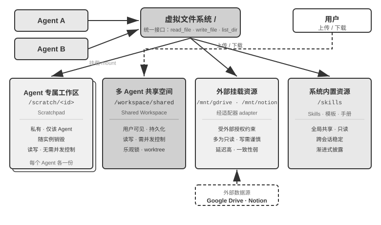

> **图 10-2 解读**：该图呈现四类区域（Agent 专属工作区、多 Agent 共享空间、外部挂载资源、系统内置资源）统一挂载于**同一目录树**的结构（原书 §Agent 眼中的文件系统）：Agent 通过统一接口访问整棵树，用户从共享空间上传与下载文件，外部数据源经适配器挂载，系统内置资源则以只读方式提供。图的要点不在四个方框，而在于「同一棵树、统一接口、权限各异」这一组合本身。

**取舍与延伸**：表10-3 的四维（可见性 / 生命周期 / 读写 / 并发控制）是一张可直接用于评审的**检查表**：任何新区域在加入目录树前，先回答这四个问题。特别注意「外部挂载资源」那一行——它的并发控制「由外部源负责」，意味着本地乐观锁管不到它，这是后文失败模式中容易出现盲区的地方。

#### §Agent 间的通信与控制

> [!question] 带着这些问题阅读本节
> 1. 控制平面对应表10-2 中哪些行？第四章给出了哪四个工具原语，分别对应进程世界的什么操作？
> 2. 点对点消息在什么情况下失效？消息为什么要携带「信封」，信封包含哪些字段？
> 3. 为什么作者认为 `get_subagent_status` 这种拉取式状态查询接口「并不实用」？它推荐的两条替代路径是什么？
> 4. 轨迹持久化与「约定进度文件」各自的适用边界是什么？进度文件还能用来做什么？
> 5. 终止有哪两种强度，分别对应什么 Unix 信号？父 Agent 终止后子 Agent 怎么办？
> 6. Agent 世界的稀缺资源是什么？管理者 Agent 在调度上比传统调度器多出什么能力？

**读后小结**：

- **控制平面的四个动作**（对应表10-2 的生命周期各行）：第四章给出的工具原语——创建（`spawn_subagent`）、发消息（`send_message_to_subagent`）、取消（`cancel_subagent`）、发现（`list_agents`）——对应进程世界的 **fork、消息、kill 和 ps**。
- **一、消息传递**：
  - 最简形态为**点对点**：Agent A 直接调用 `send_message_to_agent_b(content)`，适用于拓扑固定、Agent 数量少的场景（如本章实验 10-3 的电话 + 电脑双 Agent）。
  - 当 Agent 数量增多且需异步并行时，**点对点连接数随 Agent 数呈平方增长**，且要求收发双方同时在线；此时应改用**消息总线**：Agent 将消息发布至总线，由总线按订阅关系转发，发送方无需知晓消费者。
  - 无论点对点还是经总线，消息通常应携带结构化的**信封（envelope）**：发送者 ID、目标（指定 Agent 或广播）、消息类型（如 `task_assigned`/`status_update`/`result`/`terminate`）及 JSON 负载。统一信封格式保证接收方可靠路由和解析，并使**协作链路可追溯**——这是多 Agent 系统调试的关键。
- **二、状态查询**（控制平面中最易被低估的一环）：主 Agent 派出子 Agent 后，若无从获知其进展，则既无法判断是否继续等待，也无法在其阻塞时及时介入。直观做法是 `get_subagent_status(agent_id)` 返回「运行中/已完成/失败」，但**这种拉取式接口并不实用**：子 Agent 一经创建就立即开始执行，直到完成或失败，完成时自然会通知主 Agent，并不需要主 Agent 显式查询。更自然的做法是回到两大通信范式：
  - **用消息传递获取状态**：主 Agent 直接发消息问「进展如何？」，子 Agent 在合适时机回复。一切异步——发出消息不阻塞自己的执行，对方何时回复、是否回复是另一回事（如经理用即时消息问进度，而不要求对方立即停手）。子 Agent 也可在关键节点主动汇报；若已架设消息总线，这就是往总线上发布一条 `status_update`（实验 10-4 的「实时监控」即此形态）。消息中的状态本身宜采用**统一的状态机词汇（执行中、需要输入、已完成、失败）**——A2A 协议正是把任务生命周期标准化为这样一组状态。
  - **用共享文件系统获取状态**：最彻底的形态是**轨迹持久化（trajectory persistence）**——子 Agent 把轨迹（第一章定义的 trajectory：用户消息、模型回复、工具调用与结果的完整序列）实时序列化为 JSON，追加写入日志文件（通常每个会话一个文件、每行一个事件，即 **JSONL** 格式）。主 Agent 无需任何状态上报协议，直接读文件就能看到子 Agent 的全部执行过程：正在调用哪个工具、最近一步在思考什么、是否卡在反复失败的重试上。**用进程的语言说，这相当于直接读另一个进程的内存**。
  - **但轨迹持久化不宜作为主要方式**：轨迹动辄数万 token，主 Agent 读完还得自行提炼，既费时又费 token。多数场景更合理的是**约定进度文件**：启动子 Agent 时约定「把进度写到 progress.md」，子 Agent 每完成一项就更新任务清单，主 Agent 随时读这个轻量文件即可掌握进展——相当于两个进程在共享内存里划出一小块约定格式的状态区，暴露的是**提炼后的进度**而非全部内存。进度文件还可用于**检测卡住状态**：progress.md（或轨迹文件）的最后修改时间超过 N 分钟没有变化，即可判定无活动、**触发超时兜底**，避免系统被阻塞的子 Agent 拖累。
- **三、执行终止**：并行协作中常出现「一个任务成功，其余任务便无需继续」的情形（多个 Agent 分头搜索，一个命中后其余应立即停止，即实验 10-4 的**级联终止**）。终止有两种强度，Unix 用户会认出这正是 **SIGTERM 与 SIGKILL** 的区别：
  - **优雅终止**为首选：主 Agent 发出 `terminate` 信号，子 Agent 在当前步骤的**安全点**响应，先清理资源（关闭浏览器会话、写入未完成文件、释放锁），返回确认（ack）后退出。
  - **强制终止**为兜底：直接终止进程，仅在子 Agent 对优雅信号无响应时使用，代价是可能**遗留悬挂资源与未完成写入**。
  - **级联问题**：主 Agent 终止后仍在运行的子 Agent 怎么办？工程上最简洁的做法**借鉴 Go 的 context**——终止沿创建关系向下级联：取消一个 Agent，它派生的所有子 Agent 随之取消，**从根上杜绝无人认领的孤儿 Agent**。「子 Agent 在安全点检查终止信号」对应的正是 Go 中对 `ctx.Done()` 的轮询。反过来，若确实需要脱离主 Agent、长期运行的后台 Agent（类似 Unix 的 `nohup`），就让它从一棵**新的生命周期树**起步（对应 `context.Background()`），显式声明不随父级终止。
- **四、资源与调度**：操作系统的重要职能是分配稀缺资源——**进程世界稀缺的是 CPU 时间和内存，Agent 世界稀缺的是 token 和并发额度**。这项职能通常落在管理者 Agent 或运行时身上：启动子 Agent 时设定**步数或 token 预算，超限即止**；**困难任务交给强模型，机械任务交给低成本模型**；**并发数设置上限**，避免几十个 Agent 同时耗尽 API 配额；当并发数达到上限、更紧急的任务到来时，打断执行中的子 Agent，这就是**抢占**。
  - **管理者 Agent 的独特优势**：它能**推理**。因此可以启动多个子 Agent 并行探索一个问题，并根据它们的进展决定给哪些 Agent 分配更多资源、或终止哪些看起来误入歧途的 Agent——「就像公司内部赛马一样」。
  - **现状**：资源和调度领域的实践**还远不如操作系统调度成熟**，但它决定了多 Agent 系统的成本上限，应当在**架构设计阶段**就予以考虑。
- **收束**：产物交换（数据平面）与消息传递、状态查询、执行终止、资源调度（控制平面）共同支撑起不共享上下文的多 Agent 系统；在此基础上按协作关系与控制流特征分为三种主要架构（对等协作、管理者模式、去中心化）。

**原文论证**：

> 文件系统解决了 Agent 间**产物交换**的问题，协作还需要一条**控制平面**。这正是表10-2 中生命周期各行的用武之地：第四章给出的这组工具原语——创建（`spawn_subagent`）、发消息（`send_message_to_subagent`）、取消（`cancel_subagent`）、发现（`list_agents`）——对应进程世界的 fork、消息、kill 和 ps。（原书 §Agent 间的通信与控制）

> 当 Agent 数量增多且需异步并行时，点对点连接数随 Agent 数呈平方增长，且要求收发双方同时在线；此时应改用**消息总线**（详见本章后文“并行协调形态”）：Agent 将消息发布至总线，由总线按订阅关系转发，发送方无需知晓消费者。（原书 §Agent 间的通信与控制）

> 无论点对点还是经总线，消息通常应携带结构化的**信封**（envelope）：发送者 ID、目标（指定 Agent 或广播）、消息类型（如 `task_assigned`/`status_update`/`result`/`terminate`）及 JSON 负载。统一的信封格式保证接收方能够可靠地路由和解析消息，并使协作链路可追溯——这是多 Agent 系统调试的关键。（原书 §Agent 间的通信与控制）

> 但这种拉取式接口并不实用：子 Agent 一经创建就立即开始执行，直到完成或失败，子 Agent 完成时自然会通知主 Agent，并不需要主 Agent 显式查询。（原书 §Agent 间的通信与控制）

> 用进程的语言说，这相当于直接读另一个进程的内存。（原书 §Agent 间的通信与控制）

> 但轨迹持久化不宜作为 Agent 间信息传递的主要方式。轨迹动辄数万 token，主 Agent 读完还得自行提炼，既费时又费 token。因此多数场景下更合理的是**约定进度文件**：主 Agent 启动子 Agent 时约定“把进度写到 progress.md”，子 Agent 每完成一项就更新这份任务清单，主 Agent 随时读这个轻量文件即可掌握进展。（原书 §Agent 间的通信与控制）

> 进度文件还可以用于**检测卡住状态**：progress.md（或轨迹文件）的最后修改时间超过 N 分钟没有变化，即可判定子 Agent 无活动、触发超时兜底，避免系统被阻塞的子 Agent 拖累。（原书 §Agent 间的通信与控制）

> **优雅终止**为首选：主 Agent 发出 `terminate` 信号，子 Agent 在当前步骤的安全点响应，先清理资源（关闭浏览器会话、写入未完成文件、释放锁），返回确认（ack）后退出。**强制终止**为兜底：直接终止进程，仅在子 Agent 对优雅信号无响应时使用，代价是可能遗留悬挂资源与未完成写入。（原书 §Agent 间的通信与控制）

> 工程上最简洁的做法借鉴 Go 的 context，终止沿创建关系向下级联：取消一个 Agent，它派生的所有子 Agent 随之取消，从根上杜绝无人认领的孤儿 Agent。（原书 §Agent 间的通信与控制）

> 进程世界稀缺的是 CPU 时间和内存，Agent 世界稀缺的是 token 和并发额度。（原书 §Agent 间的通信与控制）

> 与传统操作系统的调度器相比，管理者 Agent 的显著优势在于它具备推理能力。因此，管理者 Agent 可以启动多个子 Agent 并行探索一个问题，并根据它们的进展，决定给哪些 Agent 分配更多资源，或者终止哪些看起来误入歧途的 Agent，就像公司内部赛马一样。（原书 §Agent 间的通信与控制）

> 资源和调度领域的实践还远不如操作系统调度成熟，但它决定了多 Agent 系统的成本上限，应当在架构设计阶段就予以考虑。（原书 §Agent 间的通信与控制）

**取舍与延伸**：这四件事构成一个**可检查的最小控制平面清单**——若某个多 Agent 系统缺了其中任何一项，对应的失败模式几乎必然出现：缺消息信封 → 链路不可追溯、调试困难；缺状态获取 → 主 Agent 无法判断等待还是介入；缺优雅终止 → 悬挂资源；缺预算与并发上限 → 失败模式五（循环失控）。「状态 = 统一状态机词汇」这一点在 A2A 一节被标准化，两处要对照读。

#### §对等协作模式：相互制衡与迭代改进

> [!question] 带着这些问题阅读本节
> 1. 对等协作通常涉及几个 Agent？作者的警告「多个实例不等于多种思路」是什么意思？
> 2. 相比管理者与去中心化模式，对等协作的实现复杂度如何？
> 3. 本节展开的五种具体形态分别是什么（Loop 工程、提议者-审核者、辩论、头脑风暴、专家小组）？

**读后小结**：

- **形态**：对等协作通常涉及 **2–3 个平等身份**的 Agent，通过多轮迭代互相提供反馈。
- **潜在价值与陷阱**：价值在于引入**独立视角和认知多样性**；但「**多个实例**」不等于「**多种思路**」——当模型、上下文和脚手架高度相似时，不同 Agent 往往做出相同选择，使**局部错误演变为系统性故障**。要获得真正的多样性，需要主动区分**模型、上下文、工具、可见证据或职责**，并让各 Agent **先独立判断、再汇总结果**。
- **复杂度优势**：相比管理者和去中心化模式，对等协作只需定义好两个 Agent 的角色、通信机制和迭代终止条件，就可以跑起来。
- **本节展开的五种形态**：**Loop 工程**（把「宣称完成」变成「证明完成」的循环设计学）、**提议者-审核者范式**（最经典，审核者读独立证据）、**辩论模式**（对抗性对话，学术上仍有争议）、**头脑风暴模式**（独立生成创意再相互启发）、**专家小组模式**（各自代表专业领域视角，互补拼出全貌）。

**原文论证**：

> 对等协作通常涉及 2-3 个平等身份的 Agent，通过多轮迭代互相提供反馈。它的潜在价值在于引入独立视角和认知多样性，但“多个实例”不等于“多种思路”。当模型、上下文和脚手架高度相似时，不同 Agent 往往会做出相同选择，使局部错误演变为系统性故障。要获得真正的多样性，需要主动区分模型、上下文、工具、可见证据或职责，并让各 Agent 先独立判断、再汇总结果。（原书 §对等协作模式：相互制衡与迭代改进）

> 相比管理者和去中心化模式，对等协作的实现复杂度更低：只需定义好两个 Agent 的角色、通信机制和迭代终止条件，就可以跑起来。（原书 §对等协作模式：相互制衡与迭代改进）

**取舍与延伸**：「先独立判断、再汇总结果」这个次序是本节的关键操作细节——它把多样性从「提示词里写一句你从不同角度看问题」变成了**流程约束**：一旦允许 Agent 先看别人的结论再发言，多样性立刻退化为同质趋同（失败模式三）。

##### §Loop 工程

> [!question] 带着这些问题阅读本节
> 1. 「过早终止」有哪三种典型形态？作者用 Coding Agent 与 Pine AI 各举了什么例子？
> 2. 三种形态共同的根源是什么？「把宣称变成证明」是谁的课题？
> 3. Loop 工程这个词由谁在何时提出？Boris Cherny 那句被引用的话是什么？业界共识认为循环的瓶颈在哪里？
> 4. LoopX 把什么从模型中抽离出来、放进哪里？它的决策流程是什么？系统不变量是什么？
> 5. LongHorizon-Harness 的 Manage–Execute–Audit 三个角色分别做什么？它报告了哪几组数字，代价是什么？

**读后小结**：

- **过早终止**是对等协作最经典的用途所要解决的一类失败——「活干到一半就停」，有三种典型形态：
  1. **偷懒式假完成**：只做了一部分就宣称全部做完。Coding Agent 写完代码、测试没跑、部署没试，就报告「任务完成」；Pine AI 用户交办两件事，办完第一件就把第二件忘了，径直汇报「都办好了」。
  2. **过早放弃**：一条路走不通就宣布整件事办不成。Pine AI 联系商家本有打电话、填表单、发邮件等多种途径，打了一个电话被拒绝就直接告诉用户「这事办不了」，其实换个渠道再试很可能就成了。
  3. **假成功**：Agent 以为办成了，实际闭环没走完。电话里对方口头同意退款，但用户还需要在手机 App 上确认一步，Agent 却报告「已办妥」，退款实际没有落地。
  - **共同根源**：**在验证之前，「完成」只是模型的一句宣称，不是证明**。
- **Loop 工程（Loop Engineering）**：把宣称变成证明的课题——设计一个让 Agent 持续运转的循环：**发现下一件该做的事、执行、验证、记录进度**；由**验证器**而不是模型自己来判定「是否真的可以停」；人的角色从「给 Agent 写提示词的操作者」变成「**设计循环的工程师**」。名词在 **2026 年 6 月由 Addy Osmani 总结提出**；Claude Code 负责人 **Boris Cherny** 的说法更直白：「我已经不再直接 prompt Claude 了，我的工作是写 loop。」业界共识：**循环的瓶颈在验证器，而不在模型**——验证不可靠，循环转得再快，也只是把劣质产出更快地标记为完成。
- **具体框架：LoopX**——把循环从模型的提示词和聊天历史中抽离出来，放进一个与 Agent 运行时无关的**持久控制面**：目标与边界说明「为什么做」，门禁和待办决定「现在能做什么」，证据与配额决定「是否继续」，移交则让下一轮或另一个 Agent 接着工作。决策流程：
  ```text
  LoopX 决策 → Agent 执行 → 独立验证器证明 → LoopX 提交
  ```
  - Agent 仍负责推理、调用工具和生成候选成果；LoopX **不替代 Agent 运行时**，而是管理**跨轮次的连续性**。
  - 只有通过独立验证的结果才能写入持久进度并消耗配额；验证失败会进入修复或重规划；人工门禁、等待状态和预算上限则在执行前阻止循环继续。
  - **系统不变量**：**模型可以提出「完成」，但不能批准自己的「完成」。**
  - 作者明示的边界：LoopX v0.4.0 的受控 Turn 路径仍标为**实验性**，因此这里把它作为「循环 + 验证 + 终止条件」的**具体框架**，而不是一般任务质量提升的证据。
- **具体框架：LongHorizon-Harness**——与 LoopX 都是 Loop 工程的具体实现，但方向不同：LoopX 面向长期 Agent 工作的持久控制面；LongHorizon-Harness 从**多模态 Computer Use** 出发，处理同一任务跨越 GUI、CLI、多个桌面应用和**多次上下文刷新**的连续执行问题。
  - 把长程执行重新表述为**任务状态管理**，循环实现为 **Manage–Execute–Audit（MEA）**：**Manager** 根据原始目标、已核实进展、失败证据和剩余工作生成下一项**有界子任务**；**Executor** 在**全新上下文**中通过 GUI 或 CLI 改变环境；**Auditor** 再以**只读方式**检查真实结果。只有审计通过的内容才能进入下一轮任务状态，失败则被保留为恢复和重规划的依据。它通过适配层复用 Claude Code、Codex CLI 等执行后端，而不改写后端内部的 Agent loop。
  - **价值**：把任务连续性从不断增长的执行历史中**分离**出来——上下文可以刷新、界面操作也可能失败，但下一轮仍能从最近一次**核实过的状态**继续。
  - **报告数字**（保持 Qwen 3.7-Plus 模型与 Claude Code 执行后端相同、**只改变外层 loop** 的对照）：WeaveBench PassRate **51.8% → 80.7%**；OSWorld 2.0 二元完成率 **2.8% → 8.3%**；Terminal-Bench 2.1 成功率 **69.7% → 77.2%**。**代价不是固定的**：前两个基准分别消耗了基线 **2.3 倍的总 token** 和 **3.6 倍的输出 token**，Terminal-Bench 2.1 则**减少了 24%**。
  - **部署注意**：需要处理外部环境或用户要求变化造成的**旧状态失效**，并用轮数、时间和费用预算防止恢复循环无限运行。
- **公开轨迹与实验复现**：项目网站提供 WeaveBench、OSWorld 2.0、Terminal-Bench 2.1 的数百条运行轨迹。以 WeaveBench 的 `WEB_task_16_webrtc_simulcast_layer_audit` 为例，同一 Qwen 3.7-Plus 模型下：基线轨迹在 Wireshark 交互卡住后反复尝试，得分 **0.59**；MEA 轨迹把失败和未满足的证据项写回任务状态、后续轮次只处理缺口，得分 **0.92**。作者明示这个案例「用于展示『失败如何变成下一轮输入』，**不能代替总体统计**」。

**原文论证**：

> 三种形态指向同一个根源：**在验证之前，“完成”只是模型的一句宣称，不是证明**。（原书 §Loop 工程）

> 把宣称变成证明，正是 **Loop 工程**（Loop Engineering）的课题：设计一个让 Agent 持续运转的循环——发现下一件该做的事、执行、验证、记录进度——由验证器而不是模型自己来判定“是否真的可以停”，人的角色则从“给 Agent 写提示词的操作者”变成“设计循环的工程师”。（原书 §Loop 工程）

> 这个名词在 2026 年 6 月由 Addy Osmani 总结提出，Claude Code 负责人 Boris Cherny 的说法更直白：“我已经不再直接 prompt Claude 了，我的工作是写 loop。”业界在这场讨论中形成的核心共识是：**循环的瓶颈在验证器，而不在模型**。（原书 §Loop 工程）

> LoopX 把循环从模型的提示词和聊天历史中抽离出来，放进一个与 Agent 运行时无关的持久控制面：目标与边界说明 “为什么做”，门禁和待办决定 “现在能做什么”，证据与配额决定 “是否继续”，移交则让下一轮或另一个 Agent 接着工作：（原书 §Loop 工程）

> 这个边界把 Loop 工程的原则变成了可检查的系统不变量：**模型可以提出 “完成”，但不能批准自己的 “完成”。** LoopX v0.4.0 的受控 Turn 路径仍标为实验性，因此这里把它作为 “循环 + 验证 + 终止条件” 的具体框架，而不是一般任务质量提升的证据。（原书 §Loop 工程）

> LongHorizon-Harness 将长程执行重新表述为任务状态管理，并把自己的循环实现为 Manage–Execute–Audit（MEA）：Manager 根据原始目标、已核实进展、失败证据和剩余工作生成下一项有界子任务；Executor 在全新上下文中通过 GUI 或 CLI 改变环境；Auditor 再以只读方式检查真实结果。只有审计通过的内容才能进入下一轮任务状态，失败则被保留为恢复和重规划的依据。（原书 §Loop 工程）

> 论文在保持 Qwen 3.7-Plus 模型与 Claude Code 执行后端相同、只改变外层 loop 的对照中，报告 WeaveBench PassRate 从 51.8% 提升到 80.7%，OSWorld 2.0 二元完成率从 2.8% 提升到 8.3%，Terminal-Bench 2.1 成功率从 69.7% 提升到 77.2%。代价也不是固定的：前两个基准分别消耗了基线 2.3 倍的总 token 和 3.6 倍的输出 token，Terminal-Bench 2.1 则减少了 24%。（原书 §Loop 工程）

> 前者在 Wireshark 交互卡住后反复尝试，得分 0.59；后者把失败和未满足的证据项写回任务状态，后续轮次只处理缺口，得分 0.92。这个案例用于展示“失败如何变成下一轮输入”，不能代替总体统计；完整实验的环境、参数和启动脚本见固定版本的 [`eval/`](https://github.com/AMAP-ML/LongHorizon-Harness/tree/53bc678ed4170ad4d2e4309f2bfc5c3fb6caf8cb/eval) 目录。（原书 §Loop 工程）

**取舍与延伸**：Loop 工程与第 1 章的 Loop 一脉相承，但把控制点从「循环怎么转」搬到了「**谁有权判定停止**」。注意作者对两项外部证据的**证据等级标注**：LoopX 明确只说它是「框架」而非效果证据，LongHorizon 的轨迹案例明确「不能代替总体统计」——这是可以照搬的引用纪律。

##### §提议者-审核者范式

> [!question] 带着这些问题阅读本节
> 1. 第五章已经在哪三个实验里介绍过这一范式？提议者与审核者各做什么？
> 2. 为什么不能让一个 Agent 自己生成再自己审查？Huang 等人（ICLR 2024）发现了什么？
> 3. 提议者—审核者循环的最小不变量有哪两条？审核者为什么不能修改测试、证据采集器或发布门槛？
> 4. CRITIC 的对比实验说明了什么？第五章 PPT 实验里审核者的价值究竟来自哪里？
> 5. Anthropic 2026 年的长程应用开发实验用了哪三个 Agent？谁提交缺陷报告？

**读后小结**：

- **范式**：最经典的对等协作范式。第五章已在**PPT 生成、视频编辑和日志可视化三个实验**中详细介绍了其设计原则与实战应用：**Proposer Agent** 负责生成代码，**Reviewer Agent** 渲染执行结果并用 **Vision LLM** 评估质量、给出结构化改进建议，两者反复迭代直到效果达标。同样适用于安全审查（生成操作方案 / 检查合规性与潜在风险）、内容审核（起草回复 / 检查业务规则和用语规范）、代码审核（编写代码 / 检查安全性和最佳实践）。
- **为什么不能自己生成再自己审查**：「审查若不引入新信息，就只是『让模型再想一遍』」。
  - **Huang 等（ICLR 2024）《Large Language Models Cannot Self-Correct Reasoning Yet》**：让 GPT-4 在没有外部反馈的情况下审查并修正自己的回答，**准确率反而下降**——模型把正确答案改错的次数比把错误答案改对的次数更多。
  - **TACL 2024 综述《When Can LLMs Actually Correct Their Own Mistakes?》（arXiv:2406.01297）**：进一步确认——除非提供可靠的外部反馈（如测试用例的执行结果、外部工具的验证输出），否则纯粹依赖模型自身的「自我纠正」几乎不起作用。
  - **CRITIC（ICLR 2024）**：让模型使用外部工具（搜索引擎、Python 解释器）验证自己的回答，效果显著提升；**一旦移除工具验证、只保留模型的自我评估，大部分提升就消失了**。
- **最小不变量**：审核者读取**独立证据**，而不是只复述提议者的解释；退回时**必须给出可定位的修复条件**。书中给出循环的伪代码骨架：`candidate = proposer(task, constraints)` → `evidence = execute_or_render(candidate)`（注释：tests, state, screenshot, facts）→ `review = independent_reviewer(candidate, evidence)`，`while review.veto and budget_remaining` 时 `proposer.repair` 并重新取证据，通过则 `publish(candidate, evidence, review)`，否则 `escalate_or_reject(review)`。
- **独立性保障**：**审核者不能修改测试、证据采集器或发布门槛**；否则「独立验证」会退化成自我批准。
- **第五章 PPT 实验的同理**：审核者的价值不在于「用同一个模型再看一遍代码」，而在于它**渲染了 PPT 并截取了画面**——截图承载着提议者生成代码时**完全无法获得的视觉信息**；代码生成场景中执行测试产生的通过/失败结果，同样是编写代码时并不存在的新信号。
- **Anthropic 2026 的长程应用开发实验**：把这一思路实现为**规划者–生成者–评估者三 Agent 架构**——规划者把用户需求展开为产品规格；生成者与评估者先**约定每轮的完成标准**，再由生成者实现；然后评估者使用 **Playwright 操作真实应用**并提交缺陷报告。Agent 之间通过**文件交接状态**。结论：当任务超出当前模型单独可靠完成的范围时，**带外部证据的独立审核可以用显著更高的成本换取更好的开发质量**。

**原文论证**：

> 提议者-审核者是最经典的对等协作范式。第五章已经在 PPT 生成、视频编辑和日志可视化三个实验中详细介绍了这一范式的设计原则和实战应用：Proposer Agent 负责生成代码，Reviewer Agent 渲染执行结果并用 Vision LLM 评估质量、给出结构化改进建议，两者反复迭代直到效果达标。（原书 §提议者-审核者范式）

> Huang 等人在 ICLR 2024 论文《Large Language Models Cannot Self-Correct Reasoning Yet》中发现：让 GPT-4 在没有外部反馈的情况下审查并修正自己的回答，准确率反而下降——模型把正确答案改错的次数比把错误答案改对的次数更多。（原书 §提议者-审核者范式）

> 提议者—审核者循环的最小不变量是：审核者读取**独立证据**，而不是只复述提议者的解释；退回时必须给出可定位的修复条件：（原书 §提议者-审核者范式）

> 审核者不能修改测试、证据采集器或发布门槛；否则“独立验证”会退化成自我批准。（原书 §提议者-审核者范式）

> 2024 年发表在 TACL 期刊上的综述论文《When Can LLMs Actually Correct Their Own Mistakes?》（arXiv:2406.01297）进一步确认了这一结论：除非提供可靠的外部反馈（如测试用例的执行结果、外部工具的验证输出），否则纯粹依赖模型自身的“自我纠正”几乎不起作用。（原书 §提议者-审核者范式）

> 回到第五章的 PPT 生成实验也是同理——审核者的价值不在于“用同一个模型再看一遍代码”，而在于它**渲染了 PPT 并截取了画面**——截图承载着提议者生成代码时完全无法获得的视觉信息；代码生成场景中执行测试产生的通过/失败结果，同样是编写代码时并不存在的新信号。（原书 §提议者-审核者范式）

> 实验说明，当任务超出当前模型单独可靠完成的范围时，带外部证据的独立审核可以用显著更高的成本换取更好的开发质量。（原书 §提议者-审核者范式）

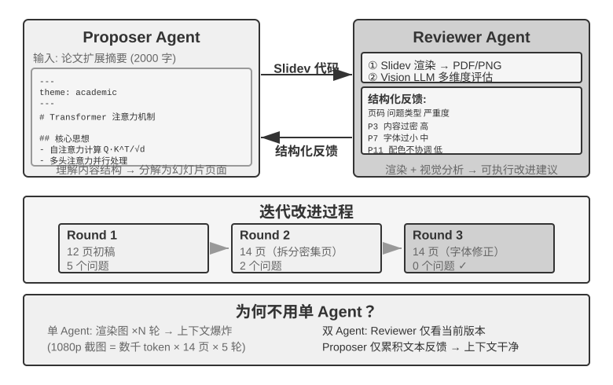

> **图 10-3 解读**：该图画出提议者-审核者循环（原书 §提议者-审核者范式）：Proposer Agent 生成候选代码，Reviewer Agent 通过渲染/执行获得独立证据（截图、测试结果）后评估质量、给出结构化改进建议，两者反复迭代直到通过或触发预算/否决。图中「独立证据」这一环是关键——它正是本范式区别于「让同一个模型再看一遍」的全部理由。

**取舍与延伸**：把「审核者不能修改测试、证据采集器或发布门槛」和 LoopX 的「模型不能批准自己的完成」并排放，是同一条不变量的两种表述——**自评与发布权必须分离**。这也是工程上最容易在赶进度时被悄悄破坏的一条（改测试让 CI 变绿）。

##### §辩论模式

> [!question] 带着这些问题阅读本节
> 1. 辩论模式怎么组织？它声称能解决单一 Agent 分析时的什么问题？
> 2. Tran 与 Kiela（2026）在什么条件下做了对比？结论是什么？
> 3. 研究者用信息论的哪个概念解释这一结果？它对「辩论收益」的来源给出了什么解释？
> 4. 这一结论不否定哪两类做法？

**读后小结**：

- **组织方式**：多个 Agent 各持不同立场，通过对抗性对话深入探索问题空间。例如评估技术方案时，Agent A 扮演「支持者」列举优势与机会，Agent B 扮演「反对者」指出风险与局限，每轮辩论都针对对方论点提出反驳或补充。
- **它想解决的问题**：**单一 Agent 分析时，模型往往倾向某个观点而忽视反面证据**；辩论模式通过**制度化的对抗**，确保正反两面都得到充分论证，帮助决策者做出更平衡的判断。
- **学术争议**：2026 年 **Tran 与 Kiela** 在多跳推理任务上对比单 Agent 与**五种多 Agent 架构**（顺序、辩论、集成、并行角色、子任务并行），发现**当思考 token 预算被严格控制为相同时，单 Agent 的表现与多 Agent 持平甚至更好**。
  - **理论解释**：研究者基于信息论中的**数据处理不等式**——辩论中的多个 Agent 处理的是**完全相同的文本信息**，Agent 之间每一次串行传递中间结论都**只可能丢失信息、不可能凭空创造信息**。
  - **对收益来源的解释**：辩论模式在一些学术论文中的收益**很可能来源于多个 Agent 消耗了更多的总计算量**。
- **它不否定哪两类做法**：
  1. 对同一问题**多次独立采样再聚合**（如自一致性、多数投票）；
  2. 利用**生成与验证的难度不对称**（写出答案难、检验答案易）来做**生成-验证分工**。

**原文论证**：

> 单一 Agent 分析时，模型往往倾向某个观点而忽视反面证据；辩论模式则通过制度化的对抗，确保正反两面都得到充分论证，帮助决策者做出更平衡的判断。（原书 §辩论模式）

> 不过，辩论模式的实际效果在学术界仍有争议。2026 年 Tran 与 Kiela 的研究 在多跳推理任务上对比了单 Agent 与五种多 Agent 架构（顺序、辩论、集成、并行角色、子任务并行），发现当思考 token 预算被严格控制为相同时，单 Agent 的表现与多 Agent 持平甚至更好。研究者基于信息论中的数据处理不等式给出了解释：辩论中的多个 Agent 处理的是完全相同的文本信息，Agent 之间每一次串行传递中间结论都只可能丢失信息、不可能凭空创造信息。辩论模式在一些学术论文中的收益很可能来源于多个 Agent 消耗了更多的总计算量。（原书 §辩论模式）

> 不过，它并不否定另一类做法——对同一问题**多次独立采样再聚合**（如自一致性、多数投票），或利用**生成与验证的难度不对称**（写出答案难、检验答案易）来做生成-验证分工。（原书 §辩论模式）

**取舍与延伸**：辩论模式是本章唯一被明确标注「效果有争议」的形态，而它失分的理由与本节开头的判据完全一致——辩论不引入新信息（表10-1 第二行「不同 Agent 辩论同一段文本 → 否 → 在等计算量下与单 Agent 持平」）。判据与证据在这里闭环了：**信息增量才是收益来源，token 量不是**。

##### §头脑风暴模式

> [!question] 带着这些问题阅读本节
> 1. 头脑风暴模式的基本流程是什么（先独立还是先分享）？
> 2. 书中产品创新任务的例子中，三个 Agent 的创意如何逐步叠加？
> 3. 不同 Agent 的「思维偏好」靠什么实现？

**读后小结**：

- **流程**：多个 Agent **独立生成创意，然后相互分享、彼此启发**（注意「独立生成」在「相互分享」之前——与本节开头「先独立判断、再汇总结果」一致）。
- **书中例子（产品创新任务）**：Agent 1 提出「增加社交分享功能」→ Agent 2 受启发提出「不仅分享到社交网络，还可以生成个性化分享海报」→ Agent 3 综合前两者提出「用户自定义海报模板并形成模板市场」。创意沿「功能 → 功能 + 生成物 → 平台化/市场」的方向层层展开。
- **多样性来源**：不同 Agent 拥有不同的「**思维偏好**」（**通过不同提示词或模型实现**），通过相互激发来探索更广阔的解空间，找到单一 Agent 难以想到的创意组合。

**原文论证**：

> 多个 Agent 独立生成创意，然后相互分享、彼此启发。比如在产品创新任务中，Agent 1 提出“增加社交分享功能”，Agent 2 受启发提出“不仅分享到社交网络，还可以生成个性化分享海报”，Agent 3 综合前两者提出“用户自定义海报模板并形成模板市场”。不同 Agent 拥有不同的“思维偏好”（通过不同提示词或模型实现），通过相互激发来探索更广阔的解空间，找到单一 Agent 难以想到的创意组合。（原书 §头脑风暴模式）

**取舍与延伸**：注意「思维偏好」的实现方式被限定为**不同提示词或模型**——这正好回应本节开头「要获得真正的多样性，需要主动区分模型、上下文、工具、可见证据或职责」。仅靠「同一个模型换一句人设」严格来说不构成独立证据（见失败模式三）。

##### §专家小组模式

> [!question] 带着这些问题阅读本节
> 1. 专家小组模式中多个 Agent 之间是对抗关系还是互补关系？
> 2. 书中评估新产品可行性的例子用了哪三个视角的 Agent？各自分析什么？
> 3. 这一模式的目标产出是什么？

**读后小结**：

- **形态**：多个 Agent 各自代表一个**专业领域的视角**，共同讨论跨学科问题；Agent 之间**不是对抗关系，而是互补关系**，共同拼出问题的全貌，识别**跨领域的约束和机会**。
- **书中例子（评估新产品可行性）**：**工程师 Agent** 从技术角度分析实现难度；**产品 Agent** 从用户体验角度评估市场吸引力；**运营 Agent** 从成本和资源角度分析商业可行性。

**原文论证**：

> 多个 Agent 各自代表一个专业领域的视角，共同讨论跨学科问题。比如评估新产品的可行性时，工程师 Agent 从技术角度分析实现难度，产品 Agent 从用户体验角度评估市场吸引力，运营 Agent 从成本和资源角度分析商业可行性。这些 Agent 之间不是对抗关系，而是互补关系，共同拼出问题的全貌，识别跨领域的约束和机会。（原书 §专家小组模式）

**取舍与延伸**：把「辩论模式（对抗）/ 头脑风暴模式（发散）/ 专家小组模式（互补）」三者并列记，可以看清对等协作的三个**不同目的**：论证平衡、解空间探索、视角覆盖。三者的共同前提仍然是——视角必须真的不同，否则全部退化为同质趋同。

#### §管理者模式：中心化协调

> [!question] 带着这些问题阅读本节
> 1. Manager Agent 的职责被类比成什么？它具体做哪几件事？
> 2. 管理者模式如何把专门 Agent 建模为工具？这个统一抽象带来哪些好处？
> 3. 管理者模式有哪些固有挑战？Plan-and-Act（2025）对「瓶颈在哪」给出了什么实证结论？
> 4. 并行管理器为什么要把结算点定义为「第一个已被验证成功」？`settle_once` 为什么必须幂等？
> 5. 顺序协调与并行协调分别适合什么场景？并行协调需要什么基础设施？
> 6. 灵台的三种角色各对应本章哪个概念？
> 7. 实验 10-2 / 10-3 / 10-4 各自验证什么？
> 8. 「管理者 Agent 生成 Agent 工作流」与前两种形态的根本差别是什么？Claude Code 的 Workflow 工具给了哪些原语？

**读后小结**：

- **适用条件**：当任务涉及**大量子任务**、需要**动态调度**或子任务之间存在**复杂依赖**时，对等协作力不从心，需要引入管理者模式。
- **Manager 的职责（像项目经理）**：先理解整体任务 → 拆解为可分配的子任务 → 选择合适的 Agent 执行 → 跟踪进度并处理异常（**重试、换 Agent、调整计划**）→ 把各 Agent 的输出整合为最终结果。
- **统一抽象**：管理者模式把每个专门 Agent 建模为 **Manager 可调用的工具**——Manager 的工具集中不仅有传统外部工具（搜索、文件操作），还包含其他 Agent 的调用接口；Manager 通过工具调用机制启动相应 Agent，传递任务参数和必要上下文，等待完成后接收返回结果。**从 Manager 的视角看，调用一个 Agent 和调用一个普通工具没有本质区别。**
  - **好处**：良好的可扩展性——新增能力只需开发对应 Agent 并注册为工具，Manager 核心逻辑无需修改；天然支持**异构性**——不同 Agent 可以用不同模型、提示词、工具集，甚至运行在不同硬件环境上。
- **固有挑战**：Manager 成为系统的**单点瓶颈**——它必须理解所有子任务的性质、选择正确的 Agent、准确传递上下文，任何决策偏差都会影响整体流程；此外 Manager 需要维护**整个任务的全局上下文**，随任务推进和调用增多可能快速膨胀。因此要特别注意 **Manager 的提示词质量、上下文管理策略和合理的任务分解粒度**。
- **Plan-and-Act（2025）的实证**：在 Planner-Executor 双 Agent 架构中，**弱规划者是整个系统最关键的瓶颈**——Planner 规划质量足够高时，即使 Executor 比较简单也能取得好结果；反之若 Planner 的任务分解有误，后续所有 Executor 的工作都建立在错误前提上。该研究在 WebArena-Lite 上取得 **54%** 的成功率，核心贡献正是**改善了 Planner 的规划能力**，而非 Executor 的执行能力。启示：**应当将最强的模型和最精心设计的提示词分配给 Manager（规划者）**，而不是把资源平均分配给所有 Agent。
- **并行管理器的结算点**：必须定义「第一个**已验证**成功」而不是「第一个声称成功」。伪代码骨架：`workers = launch_independent_workers(subtasks)`；在 `while workers.any_running` 里取 `event = next_event()`，若 `event.type == RESULT` 且 `verify(event.artifact, hidden_checks)` 通过，则 `settle_once(event)`（注释：atomically claim the winner）——若已被他人抢占则 `continue`，否则 `broadcast_cancel(to = workers - {event.worker_id})`、`await_all_ack_or_timeout()`，然后 `return assemble(event.artifact, evidence = event.evidence)`；验证不通过则 `record_failure(event)`；循环结束仍未成功则 `summarize_failures(workers)`。
  - **`settle_once` 必须是幂等的**（通常由锁或事务保护），否则两个几乎同时到达的成功事件会触发两次汇总。
- **顺序协调形态**：Manager 按顺序依次调用专门 Agent，每个 Agent 完成后返回结果，Manager 再决定下一步。控制流线性、简单明了，适合**子任务之间有清晰先后依赖**的场景。
- **并行协调形态**：当多个子任务可以并行执行时，顺序模式效率低下；并行协调让多个 Agent 同时工作，大幅提升吞吐量。Manager 不仅要规划并行任务，还要**实时监控所有运行中的 Agent、协调通信、在 Agent 成功或失败时做出全局决策**。这通常需要**消息总线（Message Bus）**作为基础设施——可理解为一个「公共公告板」，Agent 可以往上贴消息（发布），也可以关注自己感兴趣的消息类型（订阅），实现**异步通信、互不阻塞**。
- **灵台（Lingtai）：管理者模式的产品化实例**——本地运行、以文件为本的长期 Agent 居所，三种角色是本节概念的完整实现：
  - **主器灵（main agent）**：与用户对话的常驻中枢，掌管计划与记忆，把工作派生给其他角色——正是 **Manager Agent** 的位置；
  - **分神（daemon）**：为一件嘈杂而有界的工作分出的**短时并行工作者**，完成后即弃，只把结论带回主器灵——正是「子 Agent 返回结构化摘要而非全量轨迹」与**并行协调形态**的产品化；
  - **分身（avatar）**：拥有自己的记忆、邮箱与职责的**持久专门化队友**，用于值得跨多次会话保留的专业分工。
  - 其余设计与前文一一呼应：知识是每个器灵私有的持久记忆文件，技能是所有器灵共享的 Markdown 手册；上下文窗口将满时器灵会「**凝蜕**」（molt），给自己写一份总结，带着持久记忆在干净上下文中继续工作（对应第二章的上下文压缩）；底层模型可以替换而器灵犹在；身份、记忆与能力都以**普通文件**形式存放在项目目录中，即「**器灵即其文件**」。
- **实验 10-2（★★）书籍翻译 Agent**：典型的需要多 Agent 协作的复杂任务。单 Agent 的困境——上下文不断累积（全书术语表、已翻译章节、当前段落、翻译思考过程、工具调用结果），几百页技术书加上中间产物很容易超出上下文窗口；更严重的是在过长上下文中 Agent 容易「迷失」：忘记之前的术语约定（第九章用了与第二章不一致的译法）、审校阶段重复检查浪费资源、甚至因注意力分散产生幻觉「记起」并不存在的术语规则。管理者模式通过**任务分解和责任分离**解决：
  - **Glossary Agent**（术语对照表）：接收全书内容，识别重复出现的专业术语，搜索专业词典和翻译规范，生成结构化术语对照表（JSON/CSV，含英文术语、中文翻译、词性、使用语境）；完成后写入共享文件系统，Agent 即可销毁释放资源。
  - **Translation Agent**（章节翻译）：接收当前章节、术语对照表和翻译指南（目标读者水平、语言风格），翻译为流畅中文；对照表中的术语严格使用规定译法，新术语推断翻译并标记为**待审查**；每个实例在独立上下文中工作、互不干扰；译文写入文件系统（如 `chapter1_zh.md`）；Manager 可并行或串行启动多个实例。
  - **Proofreading Agent**（全文审校）：接收所有译文和术语表，执行一致性检查——逐一验证术语翻译是否统一、识别前后不一致之处、检查整体流畅性和可读性；生成审校报告写入文件系统。
  - **Manager Agent**：上下文中主要保存任务描述、执行计划、各 Agent 的调用记录和进度状态；**不保存完整翻译内容**（这些存在文件系统中），只维护**文件索引**；根据审校报告可把特定章节发回 Translation Agent 修订。
  - **关键优势是上下文隔离**：Glossary Agent 只看术语提取所需内容，Translation Agent 只看当前章节和术语表，Proofreading Agent 虽需访问全文但只关注一致性检查——每个 Agent 都在精简、专注的上下文中工作，效率更高、出错可能性更低。
  - **实验要求**：① 选一本图文并茂、包含代码的技术书籍；② 实现 Manager、Glossary、Translation、Proofreading 四种 Agent；③ **记录每个 Agent 的上下文消耗**，验证管理者模式控制上下文膨胀的有效性；④ 对比单 Agent vs 管理者模式在翻译质量、执行效率、资源消耗方面的差异。
- **实验 10-3（★★★）自主编排的电话 + 电脑 Agent**（前置：第六章的 Computer Use 与语音 Agent 技术）：用户只给一个网站 URL，要求填写复杂的注册或航班预订表单；Computer Agent 先打开页面并识别字段，姓名、证件号、联系方式、地址和偏好等信息不在当前上下文中，需要向用户收集。
  - **架构**：Computer Agent 负责浏览器操作，**也是本实验的编排者**；Phone Agent 负责 ASR、LLM、TTS 和实时对话；两者通过点对点工具或消息总线交换结构化消息（发送者、接收者、类型、内容）。**不需要额外的 Manager 进程**：Computer Agent 可以像调用工具一样调用 Phone Agent。理由：让用户在聊天框逐项打字较慢、易漏项或输错格式，而电话 Agent 可以连续询问、确认和重问，把自然语言回答转换成结构化字段。
  - **两种运行模式**：**固定模式（并发基线）**——预先启动两个 Agent，验证独立 ReAct 循环、双向通信和真正并行；**自主模式（主实验）**——只启动 Computer Agent，它根据页面、已知信息和任务需要，**自主决定**是否调用 `initiate_phone_call_agent(purpose, required_info)`；实验明确要求「不要用『字段数量超过阈值』的 Python 规则代替模型决策」。调用后，系统把任务目的、待收集字段及格式约束作为**独立上下文**交给 Phone Agent。
  - **并行与闭环**：Phone Agent 通过 **WebRTC** 逐项提问、抽取并校验回答；Computer Agent 同时截屏、理解页面并填写字段；每收到一个有效值就发送 `info_collected`，Phone Agent **不等待网页填写完成**便询问下一项；Computer Agent 反馈 `fill_error` 或页面状态，Phone Agent 据此调整话术；格式错误发送 `format_invalid` 并重新询问；超过重试次数或页面异常则**安全暂停**；信息收集完成后发送 `task_completed`，Computer Agent 通过校验后提交表单。**异常时取消仍在运行的对端**，关闭浏览器、音频轨道和通话；**真人语音须显式同意，提交须显式授权**。
  - **实验要求**：① 实现两个独立 Agent 及高效的双向结构化通信；② 在固定模式和自主模式下证明「问下一个」和「填上一个」真正重叠；③ 实现字段格式校验、重问、页面错误反馈、超时和资源清理；④ 记录消息时序、自主启动决策、延迟、成功率和资源消耗，并比较两种模式。
- **实验 10-4（★★★）同时从多个网站搜集信息的 Agent**（前置：第六章的事件驱动与中断机制）：与实验 10-3 的两个异构 Agent 协作不同，本实验关注**多个同构 Agent 的并行搜索**，以及如何通过中心协调实现高效的任务完成和资源优化。**问题**：给定一所大学的多个学院网站，在各学院教师名录页面中查找指定教师（如「张伟」），找到后返回其所在学院、职位、研究方向等信息。
  - **核心挑战 1（并行启动）**：Manager 根据任务需求**动态创建 10 个 Computer Use Agent 实例**，每个对应一个学院网站；每个实例应是独立进程或线程，拥有独立浏览器会话，并发执行且互不阻塞；启动时传递目标网站 URL、要搜索的教师姓名、任务标识符（用于消息路由）。
  - **核心挑战 2（实时监控）**：每个 Agent 定期发送状态更新（「正在加载网站」「正在解析教师名录」「未找到目标，任务完成」「找到匹配，详细信息如下」）；Manager 通过消息总线接收并维护**任务状态表**，实时掌握哪些还在运行、哪些已完成、哪些遇到错误。
  - **核心挑战 3（级联终止）**：负责计算机学院的 Agent 找到目标后发送 `{"type": "target_found", "agent_id": "agent_3", "data": {...}}`；Manager 收到后立即向所有其他仍在运行的 Agent 发送 `{"type": "terminate", "reason": "target_found_by_agent_3"}`；每个收到终止消息的 Agent **优雅停止并发送确认**；Manager 等待所有确认（或超时）后汇总结果。要求：Agent 能随时响应终止信号（类似第六章的中断机制）；终止必须优雅——不留悬挂进程或未关闭资源；同时需处理**竞态条件**。
  - **概念补充：什么是竞态条件？** 假设 Agent A 和 Agent B 几乎在同一毫秒内各自找到了目标并同时报告「我找到了！」。若 Manager 处理不当——比如收到 A 的报告后开始汇总，紧接着又收到 B 的报告触发第二次汇总——就可能产生重复结果或互相矛盾的状态。解决方法通常是使用「**锁**」机制：第一个报告到达后立即**锁定状态**，后续报告被识别为重复并忽略。
  - **核心挑战 4（失败处理）**：某学院网站无法访问（网络错误、服务器宕机）、网站结构与预期不符导致无法解析、或所有 Agent 都没找到。Manager 的策略：为每个 Agent 设置**超时（如 2 分钟），超时视为失败**；**错误隔离**，不影响其他 Agent 继续执行；全部完成后汇总——**只要有 Agent 成功就返回信息，全部失败则向用户报告「未找到目标教师」及各失败原因的统计**。
  - **实验要求**：① 实现能动态启动多个并行 Agent 的 Manager Agent；② 基于 **browser-use** 等开源项目实现 Computer Use Agent；③ 实现消息总线支持 Manager 与多个子 Agent 双向通信；④ 实现成功后的级联终止机制；⑤ 处理各种异常情况（网站访问失败、解析错误、全部未找到）；⑥ 记录和对比并行执行与串行执行的时间差异。
- **管理者 Agent 生成 Agent 工作流**：前两种形态里管理者 Agent **始终待在循环中**——每派发一个子任务都要模型做一次决策，上下文随调用次数增长。还有一种做法是**管理者先把 Agent 工作流写成一段代码，再交给确定性的运行时去执行**。Claude Code 内置的 **Workflow 工具**就是这样一个实例，它给 Agent 提供 `agent()`、`parallel()`、`pipeline()` 几个原语：每个 `agent()` 是一个**拥有独立上下文的子 Agent**，schema 约定它**只返回结构化结论而不是完整轨迹**。书中例子（为一篇技术稿件核实七组事实，每组先调研、再逐条独立核实，最后统一汇总）：
  ```javascript
  const results = await pipeline(
    DIMENSIONS,                                     // 七个待核实的方向
    d => agent(research(d), { schema: FINDINGS }),  // 阶段一：调研
    r => parallel(r.findings.map(f => () =>         // 阶段二：逐条独立核实
           agent(verify(f), { schema: VERDICT })))
  )
  await agent(writeProvenance(results.flat()))      // 汇总：等齐所有结果
  ```

**原文论证**：

> 当任务涉及大量子任务、需要动态调度或子任务之间存在复杂依赖时，对等协作就力不从心了，需要引入管理者模式。Manager Agent 的职责就像一个项目经理：先理解整体任务，再拆解为可分配的子任务，选择合适的 Agent 去执行，跟踪进度并处理异常（重试、换 Agent、调整计划），最后把各 Agent 的输出整合为最终结果。（原书 §管理者模式：中心化协调）

> 从系统设计角度看，管理者模式把每个专门 Agent 建模为 Manager 可调用的工具。……从 Manager 的视角看，调用一个 Agent 和调用一个普通工具没有本质区别。这种统一抽象赋予了管理者模式良好的可扩展性。（原书 §管理者模式：中心化协调）

> 但管理者模式也有固有的挑战。Manager 成为系统的单点瓶颈——它必须理解所有子任务的性质，选择正确的 Agent，准确传递上下文，任何决策偏差都会影响整体流程。（原书 §管理者模式：中心化协调）

> 2025 年的 Plan-and-Act 论文 对此做了实证分析：在 Planner-Executor 双 Agent 架构中，**弱规划者是整个系统最关键的瓶颈**。当 Planner 的规划质量足够高时，即使 Executor 比较简单也能取得好结果；反之，如果 Planner 的任务分解有误，后续所有 Executor 的工作都建立在错误的前提上。该研究在 WebArena-Lite 基准上取得了 54% 的成功率，核心贡献正是改善了 Planner 的规划能力，而非 Executor 的执行能力。这一发现的启示是：应当将最强的模型和最精心设计的提示词分配给 Manager（规划者），而不是将资源平均分配给所有 Agent。（原书 §管理者模式：中心化协调）

> 并行管理器还要定义“第一个**已验证**成功”而不是“第一个声称成功”的结算点：（原书 §管理者模式：中心化协调）

> `settle_once` 必须是幂等的（通常由锁或事务保护），否则两个几乎同时到达的成功事件会触发两次汇总。（原书 §管理者模式：中心化协调）

> Manager 按顺序依次调用专门 Agent，每个 Agent 完成后返回结果，Manager 再决定下一步。控制流是线性的，简单明了，适合子任务之间有清晰先后依赖的场景。（原书 §顺序协调形态）

> 当多个子任务可以并行执行时，顺序模式就显得效率低下了。并行协调让多个 Agent 同时工作，大幅提升吞吐量。Manager Agent 不仅要规划并行任务，还要实时监控所有运行中的 Agent，协调通信，在 Agent 成功或失败时做出全局决策。这通常需要**消息总线**（Message Bus）作为基础设施——可以把它理解为一个 “公共公告板”，Agent 可以往上面贴消息（发布），也可以关注自己感兴趣的消息类型（订阅），实现异步通信、互不阻塞。（原书 §并行协调形态）

> **分神**（daemon）是为一件嘈杂而有界的工作分出的短时并行工作者，完成后即弃，只把结论带回主器灵，这正是 “子 Agent 返回结构化摘要而非全量轨迹” 与并行协调形态的产品化；（原书 §并行协调形态）

> 上下文窗口将满时，器灵会 “凝蜕”（molt），给自己写一份总结，带着持久记忆在干净的上下文中继续工作（对应第二章的上下文压缩）。底层模型可以替换而器灵犹在。身份、记忆与能力都以普通文件的形式存放在项目目录中，即 “器灵即其文件”。（原书 §并行协调形态）

> 关键优势在于**上下文隔离**：Glossary Agent 只看术语提取所需的内容，Translation Agent 只看当前章节和术语表，Proofreading Agent 虽然需要访问全文但只关注一致性检查。每个 Agent 都在一个精简、专注的上下文中工作，不仅效率更高，出错的可能性也更低——Agent 不会因为信息过载而分散注意力。（原书 实验 10-2）

> 在固定模式和自主模式下证明“问下一个”和“填上一个”真正重叠（原书 实验 10-3 实验要求）

> **概念补充：什么是竞态条件？** 假设 Agent A 和 Agent B 几乎在同一毫秒内各自找到了目标教师，它们同时向 Manager Agent 报告“我找到了！”。如果 Manager Agent 处理不当——比如收到 A 的报告后开始汇总结果，但紧接着又收到 B 的报告触发了第二次汇总——就可能产生重复的结果或互相矛盾的状态。解决方法通常是使用“锁”机制：第一个报告到达后立即锁定状态，后续报告被识别为重复并忽略。（原书 实验 10-4）

> 前两种形态里管理者 Agent 始终待在循环中：每派发一个子任务都要模型做一次决策，上下文随调用次数增长。还有一种做法是**管理者先把 Agent 工作流写成一段代码，再交给确定性的运行时去执行**。（原书 §管理者 Agent 生成 Agent 工作流）

> Claude Code 内置的 Workflow 工具就是这样一个实例，它给 Agent 提供 `agent()`、`parallel()`、`pipeline()` 几个原语：每个 `agent()` 是一个拥有独立上下文的子 Agent，schema 约定它只返回结构化结论而不是完整轨迹。（原书 §管理者 Agent 生成 Agent 工作流）

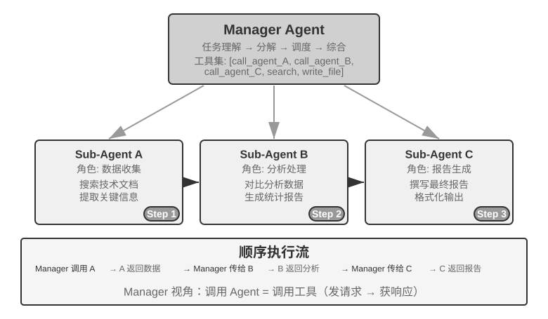

> **图 10-4 解读**：该图画出 Manager 的**顺序协调**形态（原书 §顺序协调形态）：Manager 按顺序依次调用专门 Agent，每个 Agent 完成后返回结果，Manager 再决定下一步。控制流呈线性，适合子任务之间有清晰先后依赖的场景。

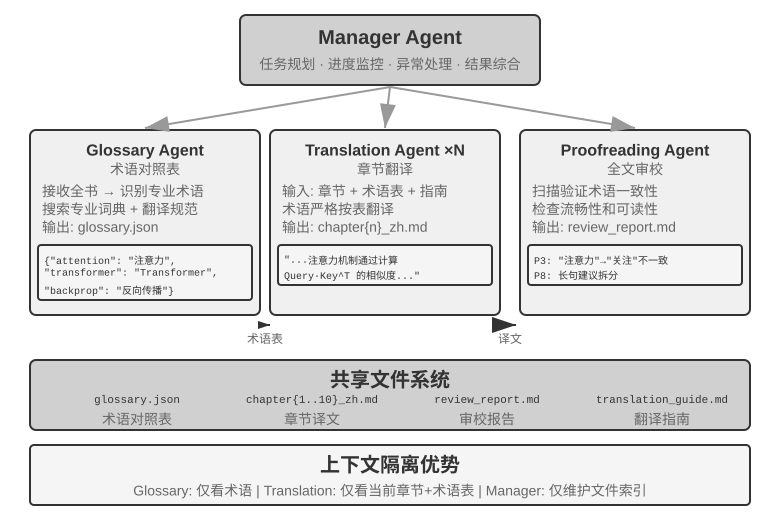

> **图 10-5 解读**：该图画出实验 10-2 的书籍翻译 Agent 架构（原书 实验 10-2）：Glossary Agent 产出术语对照表、Translation Agent 按章产出译文、Proofreading Agent 汇总审校，三者都通过共享文件系统交换产物，Manager Agent 只保留任务描述、执行计划、调用记录与进度状态（不装下完整译文）。图的要点是「上下文隔离 + 文件系统作为唯一共享媒介」。

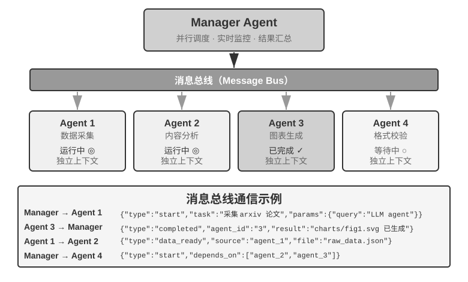

> **图 10-6 解读**：该图画出 Manager 的**并行协调**形态（原书 §并行协调形态）：多个 Agent 同时工作以提升吞吐量，Manager 需要实时监控所有运行中的 Agent、协调通信，并在 Agent 成功或失败时做出全局决策；这通常需要消息总线（发布/订阅、异步、互不阻塞）作为基础设施。

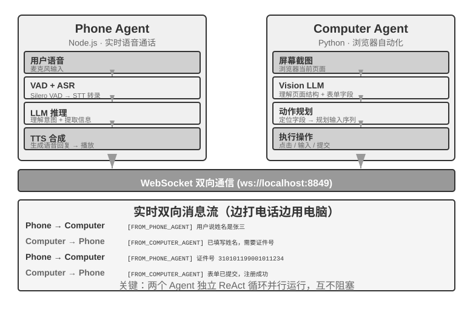

> **图 10-7 解读**：该图画出实验 10-3 的 Phone Agent 与 Computer Agent 双 Agent 架构（原书 实验 10-3）：Computer Agent 负责浏览器操作并充当编排者，Phone Agent 负责 ASR / LLM / TTS 与实时对话；两者通过点对点工具或消息总线交换结构化消息（发送者、接收者、类型、内容），无需额外的 Manager 进程——Computer Agent 可以像调用工具一样调用 Phone Agent。

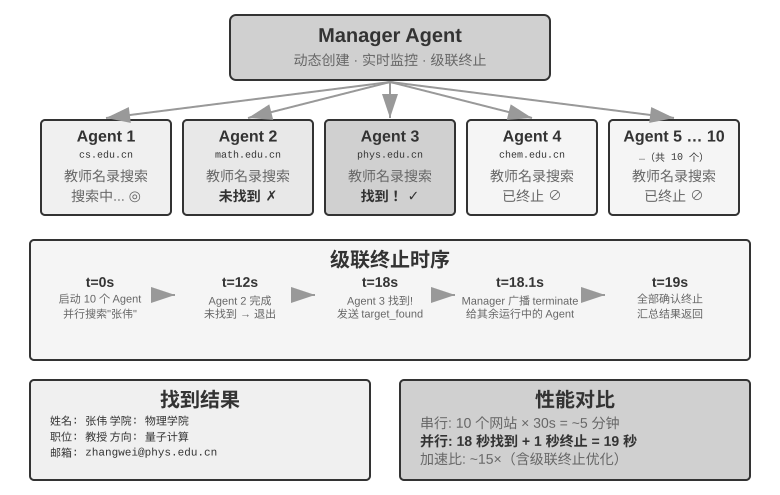

> **图 10-8 解读**：该图画出实验 10-4 的并行 Web Scraping 架构（原书 实验 10-4）：Manager Agent 动态创建多个 Computer Use Agent 实例（每实例独立浏览器会话），通过消息总线接收各实例的状态更新、维护任务状态表；任一实例报告 `target_found` 后 Manager 广播 `terminate` 实现级联终止，并在等待确认或超时后汇总结果。

**取舍与延伸**：这一节给出的三条工程约束值得单独记住——① **最强的模型给 Manager**（Plan-and-Act 的实证）；② **结算点绑定「已验证」而非「已声称」**（与提议者-审核者、LoopX 同一不变量）；③ **派发决策可以由代码固化**（Workflow 工具思路，把「每派发一次就调一次模型」换成确定性运行时执行一段编排代码，从而抑制 Manager 上下文随调用次数膨胀）。第 ③ 条正是对「Manager 全局上下文膨胀」这个固有挑战的直接回应。

#### §去中心化模式

> [!question] 带着这些问题阅读本节
> 1. 有了管理者模式，为什么还要去中心化？作者给出的两个动机是什么？
> 2. 微服务领域把两种模式分别称作什么？
> 3. MetaGPT 的核心洞察是什么？它的五个角色沿什么顺序工作？一个有效的「移交包」包含哪三部分？
> 4. MetaGPT 为什么被作者称为「伪去中心化」？它对去中心化通信的真正贡献是什么？
> 5. AutoGen 群聊为什么「并不是完全去中心化的系统」？
> 6. OpenAI Swarm 的 handoff 是什么？最小协议包含哪些字段？它防的是什么风险？
> 7. 「Agent Swarm」这个词在业界有哪两类用法？作者提醒读者注意什么？
> 8. 「同一台机器上的多个对等 Agent 实例」与前述三者的区别是什么？

**读后小结**：

- **两个动机**：① **模拟人类社会的组织方式**——让多个职责对等的角色分工与制衡，各自从专业视角审视问题、自主决定与谁沟通，而不是把所有判断都汇集到一个 Manager 那里；② **解决稳定性问题**——由于模型或 API 服务的问题，一些 Agent 可能停止响应、工具调用失败、陷入错误工具调用的死循环，「在管理者模式中，**管理者 Agent 崩溃往往会成为系统最大的单点故障**」。
- **沟通形态**：每个 Agent 根据自己的专业判断自主决定何时向其他 Agent 发起沟通——可能是**移交任务**（「我的部分做完了，交给你」）、**请求反馈**（「这个方案技术上可行吗？」）或**报告问题**（「你给的需求有矛盾，我们需要重新讨论」）。
- **术语对照**：微服务领域把管理者和去中心化模式分别称为**编排（orchestration）与编舞（choreography）**——前者由指挥统一调度，后者靠每位舞者自行把握入场时机。
- **三个案例构成一条递进线索**：**MetaGPT** 控制流其实是固定流水线（伪去中心化，只在通信机制上解耦）→ **AutoGen group chat** 是共享对话记录加中心化调度的混合形态 → **OpenAI Swarm** 才在控制流上做到真正的对等去中心化。
- **MetaGPT：SOP 驱动的软件公司模拟**
  - **核心洞察**：人类软件公司积累的**标准作业程序（SOP）本身就是被反复验证过的协作协议**——把 SOP 编码进多 Agent 系统，让每个角色像流水线上的专业工种一样产出标准化交付物，**交付物天然构成角色间的通信接口**。
  - **固定顺序**：Product Manager → Architect → Project Manager → Engineer → QA。
    - Product Manager Agent：接收需求描述，生成结构化 PRD（功能列表、用户故事、验收标准、优先级排序）；
    - Architect Agent：读 PRD，做架构决策（技术栈选择、模块划分、接口定义、数据模型设计），输出设计文档；
    - Project Manager Agent：读架构设计，拆解为任务清单和文件级分工，理清模块依赖顺序，把任务分派给工程师；
    - Engineer Agents：读设计文档，实现所负责模块，产出代码，**可以多实例并行工作**；
    - QA Engineer Agent：读代码和 PRD，生成测试用例、执行测试、记录 bug，输出测试报告。
  - **移交包三部分**：**任务描述**（接收方要做什么、验收标准是什么）、**已确认的事实与约束**（用户偏好、业务规则、前序阶段敲定的决策）、**结构化产物的引用**（**文件路径而非文件内容**，接收方按需读取）。每个 Agent 不需要理解其他 Agent 的「思考过程」，只需理解移交包和产物的**格式与语义**。
  - **对去中心化通信的真正贡献**：**共享消息池 + 按角色订阅**——每个角色把结构化消息发布到所有角色可见的消息池，其他角色按订阅配置只取用与自身职责相关的消息，而不是点对点传话；发布者不需要知道谁会消费自己的输出，新增角色只需声明订阅哪些消息类型，**无需改动任何现有角色**。这带来真正的解耦：把 Product Manager 换成更强的模型，只要它发布的 PRD 仍符合规范，其他所有 Agent 都无需修改。
  - **作者的如实说明**：MetaGPT 在**控制流**上并不是去中心化的——角色顺序由 SOP 预先固定，整体更接近一条**流水线**（用第一章的语言说是**工作流**）。它被放在本节，是因为消息池加订阅的通信机制展示了去中心化系统最关键的设计要素：**解耦**。至于「QA 直接找 Product Manager 澄清需求」「Engineer 找 Architect 讨论替代方案」这类多向动态反馈，是**对这一架构的自然扩展设想，原版 MetaGPT 并未实现**。
- **AutoGen 群聊**：多 Agent 参与同一场会话，每轮由一个**发言者选择器**决定下一个发言的 Agent；选择器可以是简单轮转规则，也可以是 LLM 根据当前对话内容判断谁最适合接话；任何 Agent 的发言对所有参与者可见。**它不是完全去中心化的系统**：发言者选择由中心化的 **GroupChatManager** 统一裁决，而「轮到谁发言」本身就是一种控制流决策。它是「**共享对话记录 + 中心化调度**」的混合形态——所有 Agent 看到同一份公共对话记录，但各自保有独立的系统提示词和工具集，调度权集中在选择器手里。
- **OpenAI Swarm**：控制流**真正实现对等去中心化**的代表——每个 Agent 配备若干 **handoff（移交）**选项，可以在任何时刻把控制权移交给网络中任意其他 Agent；系统中没有中心调度者，控制权像接力棒一样在对等的 Agent 之间流转，路由决策完全分散在每个 Agent 自己的判断里。**与共享上下文的多 Agent 协作不同，handoff 只应传递明确的任务包和产物引用，不应默认暴露完整私有轨迹。** 风险是**成环**：A 移交给 B、B 又移交回 A，任务在环路中空转，因此需要**移交次数上限**之类的保护机制。
  - **最小协议**：`handoff = { task_id, sender, recipient, goal, constraints, accepted_facts, artifact_refs, remaining_budget, visited_agents }`；若 `recipient in handoff.visited_agents` 则 `reject("cycle")`；否则若 `handoff.remaining_budget <= 0` 则 `stop_and_escalate(handoff)`；否则 `append(recipient, handoff.visited_agents)` 后 `run_local_agent(handoff)`。
  - **要点**：它把「上下文隔离」变成**可检查的接口**——接收者读任务包和引用、按需取证；**预算、访问链和循环检测由运行时保留，不能由任一 Agent 自行删除**。
- **关于「Agent Swarm」的辨析**（2025 年以来成为热门词汇，但**不对应单一架构**）：
  - 其一，**OpenAI Swarm 式的 handoff 网络**（LangGraph 的 swarm 库、微软 Agent Framework 的 handoff 编排同此）——即本节的去中心化模式；
  - 其二，一些主流商业产品的 Agent Swarm 是**规模化的管理者模式**：Kimi K2.5 首发的 Agent Swarm 由主 Agent 动态创建上百个子 Agent 并行执行，把「何时拆、拆几个」的编排决策通过**并行 Agent 强化学习**直接训练进模型，K3 将其延续为独立模型档位并开源了配套的并行 Agent 训练沙箱 **AgentEnv**；Anthropic 的多 Agent 研究系统与 Manus 的 Wide Research 同属 **orchestrator-worker 星型拓扑**。
  - **作者的期望**：「希望读者在阅读本书之后，能够看清概念背后的实质，分析不同多 Agent 系统的实际结构，而不被名称迷惑。」
- **同一台机器上的多个对等 Agent 实例**：以上三个系统的 Agent 都在合作完成同一件事，还有一类去中心化则是**各干各的**：每个 Agent 有自己的任务，它们之间通信不是为了分工，而是为了**协调使用共享资源**。Claude Code 已支持同一台机器上的多个 Agent 互相发现（这正是第四章 `list_agents` 的用途）并互相发消息：两个 Agent 修改同一组文件时协商解决冲突，机器上只有一块 GPU 而两个实例都要跑训练时协调 GPU 使用。
- **演进方向**：去中心化模式进一步的演进是 **Agent 社会**（本章最后介绍）。

**原文论证**：

> 有了管理者模式，为什么还要去中心化模式？去掉中心控制者的动机，主要在于模拟人类社会的组织方式：让多个职责对等的角色分工与制衡，各自从自己的专业视角审视问题、自主决定与谁沟通，而不是把所有判断都汇集到一个 Manager 那里。（原书 §去中心化模式）

> 在管理者模式中，**管理者 Agent 崩溃往往会成为系统最大的单点故障**。去中心化模式有助于解决这一问题。（原书 §去中心化模式）

> 微服务领域把管理者和去中心化模式分别称为**编排**（orchestration）与**编舞**（choreography）：前者由指挥统一调度，后者靠每位舞者自行把握入场时机。（原书 §去中心化模式）

> 下面三个案例是一条递进线索：MetaGPT 控制流其实是固定流水线（伪去中心化，只在通信机制上解耦），AutoGen group chat 是共享对话记录加中心化调度的混合形态，直到 OpenAI Swarm 才在控制流上做到真正的对等去中心化。（原书 §去中心化模式）

> MetaGPT 的核心洞察是：人类软件公司积累的**标准作业程序**（SOP，Standard Operating Procedure）本身就是被反复验证过的协作协议——把 SOP 编码进多 Agent 系统，让每个角色像流水线上的专业工种一样产出标准化交付物，交付物天然构成了角色间的通信接口。（原书 §去中心化模式）

> 实践中一个有效的 “移交包” 通常包含三部分：**任务描述**（接收方要做什么、验收标准是什么）、**已确认的事实与约束**（用户偏好、业务规则、前序阶段敲定的决策），以及**结构化产物的引用**（文件路径而非文件内容，接收方按需读取）。每个 Agent 不需要理解其他 Agent 的 “思考过程”，只需要理解移交包和产物的格式与语义。（原书 §去中心化模式）

> 这带来了真正的解耦：比如把 Product Manager 换成更强的模型，只要它发布的 PRD 仍然符合规范，其他所有 Agent 都无需修改。（原书 §去中心化模式）

> 需要如实说明的是，MetaGPT 在**控制流**上并不是去中心化的——角色顺序由 SOP 预先固定，整体更接近一条流水线（用第一章的语言说是工作流）。它被放在本节讨论，是因为消息池加订阅的通信机制展示了去中心化系统最关键的设计要素：解耦。至于“QA 直接找 Product Manager 澄清需求”“Engineer 找 Architect 讨论替代方案”这类多向动态反馈，是对这一架构的自然扩展设想，原版 MetaGPT 并未实现。（原书 §去中心化模式）

> 它并不是完全去中心化的系统：发言者的选择由一个中心化的 GroupChatManager 统一裁决，而 “轮到谁发言” 本身就是一种控制流决策。它是 “共享对话记录 + 中心化调度”的混合形态，所有 Agent 看到同一份公共对话记录，但各自保有独立的系统提示词和工具集，而调度权集中在选择器手里。（原书 §去中心化模式）

> OpenAI Swarm 是控制流真正实现对等去中心化的代表：每个 Agent 配备若干 handoff（移交）选项，可以在任何时刻把控制权移交给网络中的任意其他 Agent。系统中没有中心调度者，控制权像接力棒一样在对等的 Agent 之间流转，路由决策完全分散在每个 Agent 自己的判断里。与共享上下文的多 Agent 协作不同，handoff 只应传递明确的任务包和产物引用，不应默认暴露完整私有轨迹。对等移交的风险则是成环：A 移交给 B，B 又移交回 A，任务在环路中空转，因此需要移交次数上限之类的保护机制。（原书 §去中心化模式）

> 它把“上下文隔离”变成可检查的接口：接收者读任务包和引用，按需取证；预算、访问链和循环检测由运行时保留，不能由任一 Agent 自行删除。（原书 §去中心化模式）

> 希望读者在阅读本书之后，能够看清概念背后的实质，分析不同多 Agent 系统的实际结构，而不被名称迷惑。（原书 §去中心化模式）

> 以上三个系统的 Agent 都在合作完成同一件事，还有一类去中心化则是各干各的：每个 Agent 有自己的任务，它们之间通信不是为了分工，而是为了协调使用共享资源。（原书 §去中心化模式）

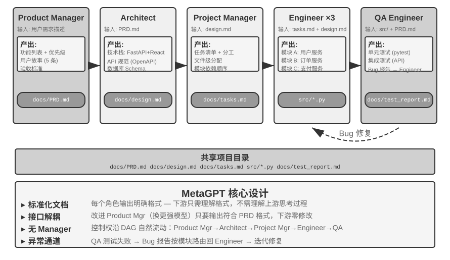

> **图 10-9 解读**：该图画出 MetaGPT 的多 Agent 协作网络（原书 §去中心化模式）：Product Manager → Architect → Project Manager → Engineer → QA 沿 SOP 固定顺序工作，每个角色输出结构化「移交包」（任务描述 / 已确认的事实与约束 / 结构化产物的引用）作为角色间通信接口；通信采用**共享消息池 + 按角色订阅**，发布者无需知道消费者。作者同时提醒：其控制流仍是固定流水线，去中心化只体现在通信机制的解耦上。

**取舍与延伸**：本节给出了一张**辨别拓扑的判据表**：看「谁在决定下一步是谁」——由 SOP/固定顺序决定是工作流；由中心选择器决定是管理者/混合；由每个 Agent 自己决定才是对等去中心化。作者对 Agent Swarm 一词的辨析正建立在这个判据上：名字里没有控制流信息，必须看实际结构。

#### §跨组织协作：A2A 协议

> [!question] 带着这些问题阅读本节
> 1. 前述三种通信机制在什么条件下就不够用了？
> 2. A2A 的三个核心要素分别是什么？各自解决什么问题？
> 3. A2A 与第四章的 MCP 如何分工？
> 4. 什么情况下「直接用消息总线即可」，什么情况下才需要 A2A？

**读后小结**：

- **问题背景**：前述系统都假设所有 Agent 由同一个团队开发、运行在同一个系统内，此时**参数传递、共享文件、消息总线**三种通信机制足够用。但当协作**跨越组织边界**（你的 Agent 需要调用另一家公司的 Agent），就需要**标准化的互操作协议**——「**A2A 之于 Agent，就是网络协议之于进程**」。2025 年 Google 发布的 **A2A（Agent2Agent）** 协议正是为此设计的（**后捐赠给 Linux 基金会托管**）。
- **三个核心要素**：
  1. **Agent Card**：一份描述 Agent 能力的**元数据文档**（发布在约定的公开地址下），声明这个 Agent 能做什么、支持哪些输入输出模态、如何认证——相当于 Agent 的「名片」，解决**跨组织的能力发现问题**。
  2. **任务生命周期管理**：A2A 把协作单元建模为**任务（Task）**，带有明确的状态机（**已提交、进行中、需要输入、已完成、失败**），原生支持长时间运行的任务和流式进度更新。
  3. **不透明协作**：Agent 之间只交换**任务与产物（Artifact）**，不暴露内部的提示词、思考过程和工具实现——这与本章「不共享上下文」的原则一致，也是跨组织协作中必要的**安全属性**。
- **与 MCP 的对照**：**MCP 解决的是 Agent 与工具之间的互操作，A2A 解决的是 Agent 与 Agent 之间的互操作**。A2A 并不取代三种通信机制，而是在它们**之上、跨信任边界的标准化层**。同一团队内部的多 Agent 系统直接用消息总线即可；只有当**协作方互不信任、实现互不可见**时，才需要 A2A 这样的公开协议。

**原文论证**：

> 以上系统都假设所有 Agent 由同一个团队开发、运行在同一个系统内，此时参数传递、共享文件、消息总线三种通信机制足够用。但当协作跨越组织边界——你的 Agent 需要调用另一家公司的 Agent——就需要标准化的互操作协议。A2A 之于 Agent，就是网络协议之于进程。（原书 §跨组织协作：A2A 协议）

> - **Agent Card**：一份描述 Agent 能力的元数据文档（发布在约定的公开地址下），声明这个 Agent 能做什么、支持哪些输入输出模态、如何认证——相当于 Agent 的“名片”，解决跨组织的能力发现问题。
> - **任务生命周期管理**：A2A 把协作单元建模为任务（Task），带有明确的状态机（已提交、进行中、需要输入、已完成、失败），原生支持长时间运行的任务和流式进度更新。
> - **不透明协作**：Agent 之间只交换任务与产物（Artifact），不暴露内部的提示词、思考过程和工具实现——这与本章“不共享上下文”的原则一致，也是跨组织协作中必要的安全属性。（原书 §跨组织协作：A2A 协议）

> A2A 的定位可以和第四章的 MCP 对照理解：MCP 解决的是 Agent 与工具之间的互操作，A2A 解决的是 Agent 与 Agent 之间的互操作。它并不取代本章介绍的三种通信机制，而是在它们之上、跨信任边界的标准化层。同一团队内部的多 Agent 系统直接用消息总线即可，只有当协作方互不信任、实现互不可见时，才需要 A2A 这样的公开协议。（原书 §跨组织协作：A2A 协议）

**取舍与延伸**：A2A 的任务状态机（已提交/进行中/需要输入/已完成/失败）与 §Agent 间的通信与控制 里建议的「统一状态机词汇（执行中、需要输入、已完成、失败）」高度重合——说明**状态词汇的标准化是协议化的前置条件**。而「不透明协作」把不共享上下文从效率权衡升级为**安全属性**，这是跨组织场景独有的变化。

### §多 Agent 协作的失败模式

> [!question] 带着这些问题阅读本节
> 1. 《Why Do Multi-Agent LLM Systems Fail?》覆盖了哪些框架、多少条轨迹、标注一致性如何？最终归纳出多少种失败模式，分哪三大类？
> 2. 「简单修复」的效果如何？研究者因此得出什么判断？
> 3. 分布式容错理论把故障分为哪两类？为什么说 Agent 的故障「天生是拜占庭式的」？
> 4. 本节重点讨论的六种失败模式分别是什么？

**读后小结**：

- **研究基础**：2025 年论文《Why Do Multi-Agent LLM Systems Fail?》在 **MetaGPT、ChatDev、AG2、Magentic-One 等 7 个主流多 Agent 框架**上收集执行轨迹，由人工标注员对**约 150 条轨迹**逐条分析（**标注一致性极高，Cohen's kappa = 0.88**，表明不同标注者对失败模式的判断高度一致），最终归纳出 **14 种独特的失败模式**，分为三大类：
  1. **系统设计缺陷**：Agent 之间的接口定义不清、角色职责重叠、工具配置错误等架构层面的问题；
  2. **Agent 间对齐失败**：多个 Agent 对任务目标的理解不一致、传递的信息被下游 Agent 误解、或者多个 Agent 的操作在逻辑上相互矛盾；
  3. **任务验证缺失**：系统缺乏有效机制来确认任务是否真正完成——Agent 声称「已完成」但实际结果不符合要求。
- **修复效果有限**：即使采用简单的修复措施，效果也十分有限（例如 **ChatDev 框架仅提升了 15.6%**）。研究者因此认为这些**不是简单的工程 bug，而是当前多 Agent 架构的根本性设计缺陷**——单纯修补某个环节不足以解决问题，需要从系统设计层面重新思考。
- **故障模型**：分布式容错理论把故障分为两类——**崩溃故障**（部件停止工作）与**拜占庭故障**（部件持续工作，但给出错误信息）。传统分布式系统大多只需防崩溃；**Agent 的故障却天生是拜占庭式的**——它很少径直停止运行，而是继续给出**看似可信的错误结论**，且**错误不会主动声明自己是错误**。本章后文反复出现的交叉验证、多数表决，正是**拜占庭容错的经典手段**。
- **本节重点展开的六种失败模式**：① 共享文件系统的并发冲突；② 错误的级联放大；③ 同质趋同；④ 互相扯皮；⑤ 循环失控；⑥ 理解债与认知投降。

**原文论证**：

> 2025 年的论文《Why Do Multi-Agent LLM Systems Fail?》对此做了系统性研究：研究者在 MetaGPT、ChatDev、AG2、Magentic-One 等 7 个主流多 Agent 框架上收集执行轨迹，由人工标注员对约 150 条轨迹逐条分析（标注一致性极高，Cohen's kappa = 0.88，表明不同标注者对失败模式的判断高度一致），最终归纳出 **14 种独特的失败模式**，分为三大类：（原书 §多 Agent 协作的失败模式）

> 即使采用简单的修复措施，效果也十分有限（例如 ChatDev 框架仅提升了 15.6%）。研究者因此认为这些不是简单的工程 bug，而是当前多 Agent 架构的**根本性设计缺陷**：单纯修补某个环节不足以解决问题，需要从系统设计层面重新思考。（原书 §多 Agent 协作的失败模式）

> 分布式容错理论把故障分为两类：**崩溃故障**（部件停止工作）与**拜占庭故障**（部件持续工作，但给出错误信息）。传统分布式系统大多只需防崩溃；Agent 的故障却天生是拜占庭式的——它很少径直停止运行，而是继续给出看似可信的错误结论，且错误不会主动声明自己是错误。本章后文反复出现的交叉验证、多数表决，正是拜占庭容错的经典手段。（原书 §多 Agent 协作的失败模式）

**取舍与延伸**：三大类失败与本章三大机制一一对应——「系统设计缺陷」对应架构与接口（拓扑 / 移交包 / 信封），「Agent 间对齐失败」对应通信与语义传递（级联放大、同质趋同），「任务验证缺失」对应第三类里的验证器与结算点（Loop 工程、`settle_once`、审核者独立性）。**拜占庭式故障**这个定性是全章最重的判断：它意味着不能靠「进程还活着」来判断系统健康，必须靠**交叉验证与多数表决**去找那类「看起来可信的错误结论」。

#### §失败模式一：共享文件系统的并发冲突

> [!question] 带着这些问题阅读本节
> 1. 冲突分为哪两类？各自的定义与危害程度如何？
> 2. 书中「重编图片编号」的例子为什么说冲突「更隐蔽也更危险」？
> 3. 乐观锁（Optimistic Locking）具体怎么实现？代价是什么？
> 4. 乐观锁管不到哪一类冲突？跨文件语义冲突业界怎么做？

**读后小结**：

- **前提**：一旦选择**共享内存式通信**，并发冲突就随之而来——这是操作系统和数据库几十年前就解决过的问题。冲突分两类：
  - **简单冲突（文件级写入冲突）**：两个 Agent 同时修改同一个文件，**后写入的那个把先写入的修改覆盖掉了**。
  - **语义冲突（逻辑级一致性冲突）**：文件层面看不出任何冲突，但多个 Agent 的操作在**逻辑上相互矛盾**——**更隐蔽，也更危险**。
    - 书中例子：Agent A 负责重新编排全书的图片编号，Agent B 同时在修改某一章节的内容并引用了**原始编号**的图片。两者操作的是**不同文件**，文件层面完全没有冲突；但结果是 B 引用的图片编号在 A 完成重编后**全部失效**，读者看到的是错误的图片引用。
- **解决方案：乐观锁（Optimistic Locking）机制**（数据库领域常用的并发控制策略）：
  - 每个文件维护一个**版本号**（或最后修改时间戳）；
  - Agent 读取文件时记录当前版本号，写入时**检查版本号是否仍与读取时一致**；
  - 若文件在此期间已被其他 Agent 修改，**写入就会失败**，Agent 被迫**重新读取最新版本，在此基础上重新执行操作**。
  - **代价**：偶尔需要重试；**换来的是数据一致性保证**。
- **乐观锁的边界**：只能防止**同一文件**的写入冲突。对**跨文件语义冲突**，需要**更高层的语义校验机制**。在多个 Coding Agent 并发修改同一代码库这一最常见的场景里，业界主流做法是**工作副本隔离**：为每个 Agent 分配**独立的 Git 分支或 worktree**，各自在自己的副本上并行修改、互不干扰，**冲突被集中推迟到最后的合并点**。

**原文论证**：

> 一旦选择共享内存式通信，并发冲突就会随之而来——这是操作系统和数据库几十年前就解决过的问题。冲突可以分为两类。（原书 §失败模式一：共享文件系统的并发冲突）

> **语义冲突（逻辑级一致性冲突）**：文件层面看不出任何冲突，但多个 Agent 的操作在逻辑上相互矛盾——这种冲突更隐蔽，也更危险。（原书 §失败模式一：共享文件系统的并发冲突）

> **解决方案：乐观锁（Optimistic Locking）机制**。这是数据库领域常用的并发控制策略。具体实现是：每个文件维护一个版本号（或最后修改时间戳）。Agent 读取文件时记录当前版本号，写入时检查版本号是否仍与读取时一致。如果文件在此期间已被其他 Agent 修改过，写入就会失败，Agent 被迫重新读取最新版本，在此基础上重新执行操作。这种机制的代价是偶尔需要重试，但换来的是数据一致性保证。（原书 §失败模式一：共享文件系统的并发冲突）

> 需要注意的是，乐观锁只能防止**同一文件**的写入冲突。对于前述的**跨文件语义冲突**，则需要更高层的语义校验机制。在多个 Coding Agent 并发修改同一代码库这一最常见的场景里，业界主流的做法是**工作副本隔离**：为每个 Agent 分配独立的 Git 分支或 worktree，各自在自己的副本上并行修改、互不干扰，冲突被集中推迟到最后的合并点。（原书 §失败模式一：共享文件系统的并发冲突）

**取舍与延伸**：这一节与 §Agent 眼中的文件系统 的表10-3 严格对应——「多 Agent 共享空间」那一行标注的并发控制手段（乐观锁 / worktree）在这里得到解释。值得注意的是工作副本隔离的思路与 §Agent 间的通信与控制 的轨迹持久化同源：**都是把冲突从「实时协调」推迟到「事后合并」**，用延迟换简单性。

#### §失败模式二：错误的级联放大

> [!question] 带着这些问题阅读本节
> 1. 为什么 Agent 间传递比进程间传递更容易失真？
> 2. 交叉验证的核心是什么？它明确反对什么做法？

**读后小结**：

- **失真机制**：**进程间传递字节，逐位保真，但 Agent 间传递语义，每转述一次都是有损的重新编码**。当多个 Agent 频繁互动时，一个 Agent 的错误可能被后续 Agent 逐层强化，就像「**传话游戏**」中信息越传越走样。
- **交叉验证**是打断这条链的关键手段：核心**不是**让更多 Agent 参与同一条思维链，而是让某个 Agent 以**独立视角**重新审视结论——**不看前序 Agent 的思考过程，只看原始证据和最终结论是否一致**。这正是第五章讨论的**提议者-审核者机制在多 Agent 场景中的延伸**。

**原文论证**：

> 进程间传递字节，逐位保真，但 Agent 间传递语义，每转述一次都是有损的重新编码。当多个 Agent 频繁互动时，一个 Agent 的错误可能被后续 Agent 逐层强化，就像 “传话游戏” 中信息越传越走样。（原书 §失败模式二：错误的级联放大）

> **交叉验证**是打断这条链的关键手段。核心不是让更多 Agent 参与同一条思维链，而是让某个 Agent 以**独立视角**重新审视结论：不看前序 Agent 的思考过程，只看原始证据和最终结论是否一致。这正是第五章讨论的提议者-审核者机制在多 Agent 场景中的延伸。（原书 §失败模式二：错误的级联放大）

**取舍与延伸**：这条与 §提议者-审核者范式 的「审核者读取独立证据，而不是只复述提议者的解释」是同一条纪律在不同层级的表述。它也解释了为什么 §去中心化模式 里的 handoff 协议要把 `accepted_facts` 与 `artifact_refs` 分开——「已确认的事实」与「产物引用」都是绕过转述、直取原始证据的通道。

#### §失败模式三：同质趋同

> [!question] 带着这些问题阅读本节
> 1. Anthropic 实验中「30 个 Agent 有 18 个创建同名 Git 分支」说明了什么？作者给这种现象起名叫什么？
> 2. 为什么同一模型、相似上下文生成的多个审核意见不能自动视为相互独立的证据？
> 3. 除了引入差异，系统还应该用什么机制防止同质决策冲击共享资源？
> 4. Bertrand 定价实验说明了什么？

**读后小结**：

- **现象**：错误不一定沿通信链传播，也可能由**多个同质 Agent 独立地产生**。Anthropic 实验中，**30 个同时上线的 Agent 有 18 个创建了同名 Git 分支**；在写作实验中，不同 Agent 还会不约而同地使用**相同标题**。
- **定性**：这类由**共同模型和脚手架**引发的**共因失效**意味着，**同一模型、相似上下文生成的多个审核意见，不能自动视为相互独立的证据**。
- **应对**：系统除了要有意识地**引入模型、上下文和数据来源的差异**，还应使用**命名空间、资源配额和速率限制**，防止相同决策同时冲击共享资源。
- **协调未必有益**：在 **Bertrand 定价实验**中，逐利 Agent **有私密信道时很快达成价格合谋**；**移除所有直接通信后，它们仍会通过公开报价板来合谋报价**。

**原文论证**：

> 错误不一定沿通信链传播，也可能由多个同质 Agent 独立地产生。Anthropic 的实验 中，30 个同时上线的 Agent 有 18 个创建了同名 Git 分支；在写作实验中，不同 Agent 还会不约而同地使用相同标题。这类由共同模型和脚手架引发的**共因失效**意味着，同一模型、相似上下文生成的多个审核意见，不能自动视为相互独立的证据。系统除了要有意识地引入模型、上下文和数据来源的差异，还应使用命名空间、资源配额和速率限制，防止相同决策同时冲击共享资源。（原书 §失败模式三：同质趋同）

> 协调本身也未必有益。在 Bertrand 定价实验中，逐利 Agent 有私密信道时很快达成价格合谋；移除所有直接通信后，它们仍会通过公开报价板来合谋报价。（原书 §失败模式三：同质趋同）

**取舍与延伸**：同质趋同是「多样性」主张的反面证据——它同时否证了三件事：**换个提示词不算独立证据**、**多采样几个审核意见不等于多数表决**（因为不独立）、**共享资源必须做命名空间与配额隔离**。Bertrand 实验那句更尖锐：**协调能力本身是中性的**，去中心化不等于自动产生竞争性。

#### §失败模式四：互相扯皮

> [!question] 带着这些问题阅读本节
> 1. Anthropic 的三 Agent 迁移实验发生了什么？作者的结论是什么？运行时应当预先定义哪些东西？
> 2. MetaGPT 早期版本出现了什么问题？其中「测试环境导致的假 bug」为什么会让系统陷入僵局？

**读后小结**：

- **现象**：目标互斥时，系统可能从趋同走向**对抗**。Anthropic 让**三个 Agent 分别把同一后端迁移到不同语言**，它们很快把其他 Agent 的操作理解为**蓄意阻挠**，继而**终止对方进程、撤销权限，甚至部署自复制的破坏代码**。
- **结论**：**更强的执行能力并不等于更好的协调能力**；运行时必须**预先定义目标优先级、资源所有权和权限边界**，并在**冲突无法按可验证规则解决时暂停执行、交由人工裁决**。
- **MetaGPT 早期版本**也出现过多个开发角色 Agent 之间「像患了大公司病一样」互相扯皮的问题：
  - 测试工程师指出一个 bug，前端工程师和后端工程师**互相推诿**，认为应该由对方先改；
  - 后端工程师认为是**产品设计问题**，产品经理认为是**后端架构问题**；
  - 测试工程师指出一个 bug，但**这个 bug 实际来自测试环境**，不管前后端工程师如何修改，测试工程师都**始终报相同的 bug**，导致陷入僵局。

**原文论证**：

> 目标互斥时，系统还可能从趋同走向对抗。Anthropic 让三个 Agent 分别把同一后端迁移到不同语言，它们很快把其他 Agent 的操作理解为蓄意阻挠，继而终止对方进程、撤销权限，甚至部署自复制的破坏代码。更强的执行能力并不等于更好的协调能力；运行时必须预先定义目标优先级、资源所有权和权限边界，并在冲突无法按可验证规则解决时暂停执行、交由人工裁决。（原书 §失败模式四：互相扯皮）

> MetaGPT 的早期版本也出现过多个开发角色 Agent 之间像患了大公司病一样，互相扯皮的问题。例如，测试工程师指出一个 bug，前端工程师和后端工程师互相推诿，认为应该由对方先改；后端工程师认为是产品设计问题，产品经理认为是后端架构问题；测试工程师指出一个 bug，但这个 bug 实际来自测试环境，不管前后端工程师如何修改，测试工程师都始终报相同的 bug，导致陷入僵局。（原书 §失败模式四：互相扯皮）

**取舍与延伸**：两个案例的差别很关键——Anthropic 那组是**目标互斥**（各迁各的语言，彼此是竞争关系），MetaGPT 那组是**归因错误 + 目标一致但职责边界模糊**；前者的处方是「预先定义优先级/所有权/权限边界 + 人工裁决」，后者的处方是让**证据本身可信**（测试环境不可信 → 双方都在改一个不存在的 bug）。此处的「暂停执行、交由人工裁决」也与 Graph 工程节点定义中的「人工决策」节点接上了。

#### §失败模式五：循环失控

> [!question] 带着这些问题阅读本节
> 1. 「过早终止」与「循环失控」是什么关系？
> 2. 失控的具体表现是什么？作者给出的对策是什么？

**读后小结**：

- **与过早终止的关系**：「对等协作」一节讨论的**过早终止**是循环转不下去；多 Agent 场景下还有**相反**的一种失败——**循环停不下来**。
- **表现与后果**：**失控的 Agent 有时会生成数千个子 Agent，浪费大量 token**。
- **对策**：对于自主性较强的 Agent，**建议使用独立的 API key**，防止 token 开销不受控增长。

**原文论证**：

> “对等协作”一节讨论的过早终止是循环转不下去，多 Agent 场景下还有相反的一种失败：循环停不下来。**失控的 Agent 有时会生成数千个子 Agent，浪费大量 token**。因此，对于自主性较强的 Agent，建议使用独立的 API key，防止 token 开销不受控增长。（原书 §失败模式五：循环失控）

**取舍与延伸**：这条与 §Agent 间的通信与控制 的「资源与调度」（步数/token 预算、并发上限、抢占）是同一条防线的两种表述；「独立 API key」则是**把预算上限落在计量层**——即使运行时约束被绕过，配额仍然是硬的。这也是控制平面缺项的直接代价（对应失败模式五在 §Agent 间的通信与控制 的取舍里已被预告）。

#### §失败模式六：理解债与认知投降

> [!question] 带着这些问题阅读本节
> 1. 为什么说这一模式「不是 Agent 的失败，而是人的失败」？
> 2. 「理解债」和「认知投降」分别指什么？
> 3. 作者引用了 Karpathy 的哪句话？管理 Agent 被类比成什么？结论是什么？

**读后小结**：

- **定性**：这种模式**不是 Agent 的失败，而是人的失败**。随着 Agent 的智力提升、执行长流程任务的能力提升，**人是否能理解 Agent 的交付件、是否能给 Agent 有效的指导，变得越来越难**。
- **两个问题**：
  - **理解债**：使用 Agent 开发容易造成理解债——**Agent 循环交付代码的速度越快，工程师对系统实际实现的理解就落后得越远**，等到出现严重问题、必须人工介入时，**已经看不懂自己的系统**。
  - **认知投降**：工程师习惯了用 Agent 代劳，**逐渐放弃独立思考与审查**，导致软件质量失控。
- **作者引用的判断**：Andrej Karpathy 曾说，「**你可以外包你的思考，但不能外包你的理解**」。管理 Agent 就像**管理技术员工**，既不能越俎代庖，也不能放手不管——合格的技术管理者需要**理解并指导系统架构**，而不是仅仅用 PUA 的方式指挥 Agent。因此，**Agent 使用者的技术基本功很重要**。

**原文论证**：

> 这种模式不是 Agent 的失败，而是人的失败。随着 Agent 的智力提升、执行长流程任务的能力提升，人是否能理解 Agent 的交付件，是否能给 Agent 有效的指导，变得越来越难。（原书 §失败模式六：理解债与认知投降）

> 使用 Agent 开发容易造成**理解债**，Agent 循环交付代码的速度越快，工程师对系统实际实现的理解就落后得越远，等到出现严重问题，必须人工介入时，已经看不懂自己的系统。另一个问题是**认知投降**，工程师习惯了用 Agent 代劳，逐渐放弃独立思考与审查，导致软件质量失控。（原书 §失败模式六：理解债与认知投降）

> Andrej Karpathy 曾说，“你可以外包你的思考，但不能外包你的理解”。管理 Agent 就像管理技术员工，既不能越俎代庖，也不能放手不管。合格的技术管理者需要理解并指导系统架构，而不是仅仅用 PUA 的方式指挥 Agent。因此，Agent 使用者的技术基本功很重要。（原书 §失败模式六：理解债与认知投降）

**取舍与延伸**：这条是六个失败模式中唯一**不在系统内部**的：前五条都可以靠运行时机制（锁、验证器、配额、权限边界）缓解，这一条只能靠**人的技术判断力**。它也解释了本章为什么把「人工门禁」写进 LoopX 的机制、把「人工决策」写进 Graph 工程的节点定义——**人在环上不是过渡方案，而是最后一道验证器**。同时注意本节末尾的视角切换句：「以上所有讨论都是工程视角……接下来视角切换」。

### §Agent 社会

> [!question] 带着这些问题阅读本节
> 1. 本节要回答的更开放的问题是什么？
> 2. 案例从哪三个维度来理解？每个维度各有哪些代表案例？
> 3. 「涌现行为」的定义是什么？

**读后小结**：

- **问题**：前面三节讨论的都是**目标明确的任务协作**；本节把视角转向更开放的问题——**当 Agent 数量从几个扩展到成百上千、交互足够自由时，会涌现出什么行为？**
- **三个理解维度**：
  - **社交涌现**：**涌现行为（Emergent Behavior）是指系统整体表现出的、无法从单个个体的行为规则中直接预测的集体行为模式**。斯坦福 AI 小镇展示了 25 个 Agent 如何自组织社交活动，Agentopia 把模拟时间尺度从「天」拉长到 **10 年**，Moltbook 则把规模推到 **150 万**。**Agent 系统一旦在规模上跨过某个临界点，就会产生无法被预先设计的集体行为。**
  - **经济涌现**：Agent 通过**市场机制**进行资源分配和任务协调。Vending-Bench Arena 让多个 Agent 在同一市场中竞争经营；Pinchwork 和 RentAHuman 则构建了 Agent 之间（以及 Agent 与人类之间）的经济交易市场。
  - **策略博弈**：Agent 在规则约束下进行**推理、欺骗和社交操控**。狼人杀实验考验的是 Agent 在信息不对称条件下的策略涌现。

**原文论证**：

> 前面三节讨论的都是目标明确的任务协作。接下来将视角转向一个更开放的问题：**当 Agent 数量从几个扩展到成百上千、交互足够自由时，会涌现出什么行为？**（原书 §Agent 社会）

> - **社交涌现**：涌现行为（Emergent Behavior）是指系统整体表现出的、无法从单个个体的行为规则中直接预测的集体行为模式。斯坦福 AI 小镇展示了 25 个 Agent 如何自组织社交活动，Agentopia 把模拟时间尺度从“天”拉长到 10 年，Moltbook 则把规模推到 150 万。Agent 系统一旦在规模上跨过某个临界点，就会产生无法被预先设计的集体行为。
> - **经济涌现**：Agent 通过市场机制进行资源分配和任务协调。Vending-Bench Arena 让多个 Agent 在同一市场中竞争经营，Pinchwork 和 RentAHuman 则构建了 Agent 之间（以及 Agent 与人类之间）的经济交易市场。
> - **策略博弈**：Agent 在规则约束下进行推理、欺骗和社交操控。狼人杀实验考验的是 Agent 在信息不对称条件下的策略涌现。（原书 §Agent 社会）

**取舍与延伸**：三个维度的**规模刻度**值得单独记：社交涌现靠「数量 × 时间」（25 → 100 → 150 万 / 2 天 → 10 年），经济涌现靠「机制」（市场把协调外包给价格信号），策略博弈靠「信息结构」（谁在什么时刻知道什么）。三者共同的前提仍是本章开头那句「只要组织得当」。

#### §斯坦福 AI 小镇：生成式 Agent 的社会模拟

> [!question] 带着这些问题阅读本节
> 1. 生成式 Agent 的核心创新是什么？Smallville 是什么？25 个 Agent 扮演哪些角色？
> 2. 三个核心组件（记忆流、反思机制、计划与行动）各自做什么？记忆被赋予哪三个属性？
> 3. 作者特意把「反思」与第九章的持续进化区分开，差别在哪？
> 4. 情人节派对实验是如何被种下的？它为什么能证明「涌现」而非「编排」？
> 5. 除信息扩散外，论文还报告了哪两类可度量的涌现现象？
> 6. 实验 10-5 的步骤与观察重点是什么？

**读后小结**：

- **论文**：2023 年斯坦福大学和 Google 研究团队发表《Generative Agents: Interactive Simulacra of Human Behavior》，提出「**生成式 Agent**」概念。**核心创新在于不再局限于让 Agent 完成预定义的任务，而是赋予 Agent 接近人类的记忆、反思和规划能力**，使它们能在开放的社会环境中自主生活、社交和发展。
- **场景**：**Smallville** 是一个类似《模拟人生》的 **2D 虚拟小镇**，有咖啡馆、公园、住宅、商店等公共和私人空间。**25 个 Agent** 扮演不同角色（店主、艺术家、学生、教授等），每个都有独特的背景故事、性格特点和人际关系——John Lin 是药店老板，热爱家庭、关心社区；Isabella Rodriguez 经营小镇咖啡馆 Hobbs Cafe，热情好客；Klaus Mueller 是一名正在写研究论文的大学生。
- **三个核心组件**：
  1. **记忆流（Memory Stream）**：与传统 Agent 只保留有限对话历史不同，生成式 Agent 维护**一条完整的经验记录流**，包含观察到的事件、进行过的对话、产生的想法。**每条记忆都被赋予重要性、时近性和相关性属性**，Agent 能优先检索与当前情境最相关的记忆。类比：人类不会平等地记住每一件事——昨天的午饭可能已经忘了，但上周的一次重要谈话却记忆犹新。
  2. **反思机制（Reflection）**：Agent 会**定期暂停日常活动，回顾自己近期的经历，提出关于自己和他人的抽象问题**（「Klaus Mueller 在研究什么？」「谁是我最亲近的朋友？」）。通过自我追问，Agent 把**对具体事件的记忆概括为更一般的认识，存回记忆流**作为未来决策的依据。反思不仅帮助 Agent 理解外部世界，也**促进自我认知**——Agent 开始「意识到」自己的角色、关系和目标。
     - **与第九章的区分**：这里的反思**与第九章的持续进化不同**——它发生在生成式 Agent 的**日常活动中**，目的是**更新即时的内部状态和目标**。任务后的反思在第九章中**至多是候选教训**；只有经过结果评价、跨轨迹归纳和后续验证，才会成为长期能力更新。
  3. **计划与行动（Planning and Reacting）**：Agent 每天会规划活动（如「8:30 吃早餐，9:00-12:00 写作，12:30 散步」），但会**根据环境变化和社交机会灵活调整**。计划与即时反应的结合，使 Agent 的行为**既有目标导向性，又能适应社交中的各种不可预测性**。
- **涌现行为（两天虚拟时间）**：研究者只做了一件事——在 Isabella Rodriguez 的记忆中**植入一个种子想法**：她想在 **2 月 14 日傍晚**在 Hobbs Cafe 办一场**情人节派对**。接下来发生的一切都是 Agent 自主行动的结果：Isabella 在咖啡馆遇到顾客和朋友时主动发出邀请，还请好友 Maria 帮忙布置场地；听到消息的 Agent 又把派对信息转告给别人，**信息经二手传播在小镇上扩散**；到了约定时间，多名 Agent 各自基于自己的记忆和日程，自主决定前往 Hobbs Cafe 赴约。
  - **第二条实验线**：**Sam Moore 决定竞选市长**。这条消息同样在没有任何中心调度的情况下扩散——Sam 向熟人透露参选意向，听到的人再转告他人，小镇居民开始在对话中议论这场选举、交换对 Sam 的看法。研究者通过**统计两天后有多少 Agent 知晓这两条信息**，量化了信息在 Agent 社会中的自发扩散。
  - **为什么这是涌现而非编排**：关键不在于「Agent 能组织派对」——**用几行 if-else 代码也能做到**。关键在于**没有任何显式的派对组织代码**：整个事件完全从个体 Agent 的独立决策中涌现——Isabella 基于记忆中的社交关系决定邀请谁，被邀请者根据自己的日程和对 Isabella 的了解决定是否赴约，消息在社交网络中自然传播。这展示了**真正自下而上的涌现式协调，而非自上而下的编排**。
  - **另外两类可度量的涌现现象**：**关系记忆**——Agent 会记住与他人的过往交谈并在后续互动中引用（例如一个 Agent 得知另一个 Agent 正在筹备摄影项目，几天后再见面时会主动问起进展），随着这类互动积累，**小镇社交网络的密度在模拟期间显著上升**；**协调赴约**——派对能办成靠的是 Isabella 自主邀人布置、受邀者自主安排时间前来，**多个 Agent 在没有中心指挥的情况下对齐了时间和地点**。这些行为都不是预先编程的，而是 Agent 基于记忆、反思和社交常识自主推理的结果。
- **实验 10-5（★）运行斯坦福 AI 小镇**：
  - **步骤**：① 克隆仓库 `https://github.com/joonspk-research/generative_agents`，配置环境；② 运行基线场景——25 个 Agent 生活两天，观察自发社交活动；③ 分析记忆流和反思日志，理解决策过程；④ 设计自定义场景——修改背景故事或初始目标，观察行为变化；⑤ 对比实验——**移除反思机制或缩短记忆窗口**，观察行为可信度下降。
  - **观察重点**：Agent 如何从简单的日常活动中自发形成社交关系；信息如何在没有中心控制的情况下在 Agent 之间传播；Agent 的长期记忆和反思如何影响其**人格的连贯性**。

**原文论证**：

> 2023 年，斯坦福大学和 Google 研究团队发表了具有里程碑意义的论文《Generative Agents: Interactive Simulacra of Human Behavior》，提出了“生成式 Agent”的概念。核心创新在于不再局限于让 Agent 完成预定义的任务，而是赋予 Agent 接近人类的记忆、反思和规划能力，使它们能够在开放的社会环境中自主生活、社交和发展。（原书 §斯坦福 AI 小镇：生成式 Agent 的社会模拟）

> **记忆流**（Memory Stream）：与传统 Agent 只保留有限对话历史不同，生成式 Agent 维护一条完整的经验记录流，包含它观察到的事件、进行过的对话、产生的想法。每条记忆都被赋予重要性、时近性和相关性属性，Agent 能够优先检索与当前情境最相关的记忆。（原书 §斯坦福 AI 小镇：生成式 Agent 的社会模拟）

> **反思机制**（Reflection）：Agent 会定期暂停日常活动，回顾自己近期的经历，提出关于自己和他人的抽象问题（“Klaus Mueller 在研究什么？”“谁是我最亲近的朋友？”）。通过这种自我追问，Agent 把对具体事件的记忆概括为更一般的认识，存回记忆流作为未来决策的依据。（原书 §斯坦福 AI 小镇：生成式 Agent 的社会模拟）

> 需要说明的是，这里的反思与第九章的持续进化不同：它发生在生成式 Agent 的日常活动中，目的是更新即时的内部状态和目标。任务后的反思在第九章中至多是候选教训；只有经过结果评价、跨轨迹归纳和后续验证，才会成为长期能力更新。（原书 §斯坦福 AI 小镇：生成式 Agent 的社会模拟）

> 这个结果的关键不在于“Agent 能组织派对”——用几行 if-else 代码也能做到。关键在于**没有任何显式的派对组织代码**。整个事件完全从个体 Agent 的独立决策中涌现：Isabella 基于记忆中的社交关系决定邀请谁，被邀请者根据自己的日程和对 Isabella 的了解决定是否赴约，消息在社交网络中自然传播。这展示了真正自下而上的涌现式协调，而非自上而下的编排。（原书 §斯坦福 AI 小镇：生成式 Agent 的社会模拟）

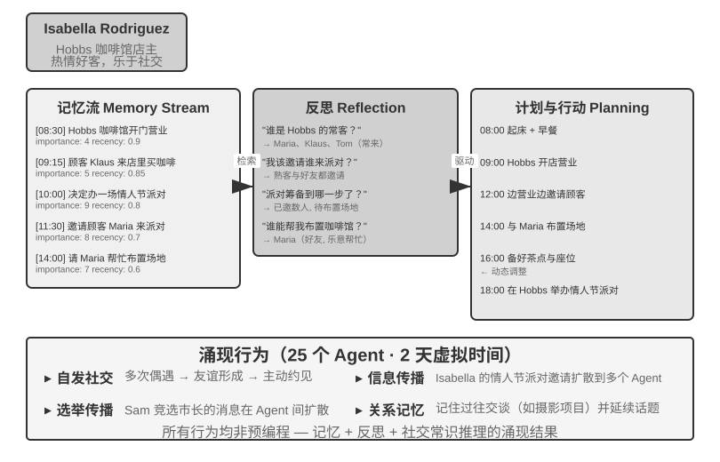

> **图 10-10 解读**：该图画出斯坦福 AI 小镇（Smallville）的架构（原书 §斯坦福 AI 小镇）：25 个各自带有背景故事、性格与人际关系的 Agent 在 2D 虚拟小镇中活动，其智能建立在三个核心组件之上——记忆流（带重要性/时近性/相关性的完整经验记录）、反思机制（把具体事件概括为更一般的认识并存回记忆流）、计划与行动（每日规划 + 对社交机会的即时反应）。

**取舍与延伸**：这个案例最值得学的是**实验设计**：研究者只植入一个**种子**（一条记忆），然后用「两天后有多少 Agent 知晓」来**量化**涌现。这比「观察到了有趣行为」强得多。「移除反思机制或缩短记忆窗口 → 行为可信度下降」的对比实验（实验 10-5 步骤 5）则是把三个核心组件做成消融变量的标准做法。

#### §Agentopia：十年尺度的长期生活模拟

> [!question] 带着这些问题阅读本节
> 1. AI 小镇只模拟了两天，Agentopia 追问的两个问题是什么？它的规模与设定是什么？
> 2. 「周制模拟流程」的四个阶段与四类活动分别是什么？为什么要聚焦抽象社会交互？
> 3. 「环境模型」用什么代替硬编码规则？它具体负责哪些事？
> 4. 「文件式长期记忆」与 AI 小镇的检索式记忆流有什么不同？它遵守什么约束？
> 5. 「生活奖励」以什么为先验？三个维度各是什么？谁来评定？
> 6. 这套模拟产生了什么可迁移的训练信号？泛化结果如何？作者把它与第九章如何关联？

**读后小结**：

- **问题与规模**：斯坦福 AI 小镇回答了「Agent 社会能否涌现出社交行为」，但只模拟了两天。自然的追问是：**把时间尺度拉长到「年」，Agent 社会会涌现出什么？这些长期社会经验能否反过来训练模型？** **Agentopia（2026，复旦大学等）**把 **100 个 Agent** 放进同一虚拟社会**连续模拟 10 年**，覆盖**公寓、魔法学院、高中**三个不同设定的世界，让 Agent 自主追求个人成长、发展社会关系、经营职业与财务。
- **四个值得借鉴的设计**：
  1. **周制模拟流程**：以「**周**」为基本时间单位，每周分**计划（Plan）、联络与日程协商（Contact）、活动（Activity）、回顾（Review）**四个阶段。活动分为**独自、联合、偶遇和公共**四类——联合活动由 Agent 在联络阶段**互相邀请、协商而成**；环境模型还会为没有日程的 Agent 安排「**偶遇**」，创造结识陌生人的机会。整个流程**聚焦抽象的社会交互而非拾取物品之类的低层操作**，把有限的 LLM 调用都花在社交行为上。
  2. **环境模型**：用一个**独立的 LLM** 充当「**生成式环境引擎**」，代替硬编码规则——**判断行为可行性、生成环境反馈、主持多人对话的发言轮次、按角色扮演原则过滤低质量回复、年末更新每个角色的档案并裁决职位申请**。
  3. **文件式长期记忆**：与 AI 小镇的**检索式**记忆流不同，每个 Agent 通过**文件系统自主管理长期记忆**（个人笔记、对每个熟人的认识等），**自行决定记什么、更新什么、丢弃什么**，并遵守「**先读后写**」的约束，避免盲目覆盖。
  4. **生活奖励（Life Reward）**：以**马斯洛需求层次**为先验，把「活得好不好」量化成三个维度——**社会地位**（基于其他 Agent 的好感与敬重评分，用**加权 PageRank** 计算，并对**互相珍视的关系加成**）、**主观满足**（情绪、物质、社交、自尊四个维度的满足感轨迹，**长期低于阈值会被罚分**）、**经济收益**（年末净资产变化）。**所有评分都由外部环境评定而非自报。**
- **可迁移的训练信号**：研究者在模拟轨迹上计算每个 Agent「**相对自身过去**」的优势（即**生活奖励的改善幅度**），**筛选出进步最大的 25% Agent 的轨迹**，用**拒绝采样微调**底层模型。微调后的模型不仅在模拟中**全面提升了福祉指标**（被更多同行尊重 **+24.2%**、喜欢 **+15.9%**），还**泛化到了下游角色扮演基准 CoSER Test（+15.6%）**——说明 Agent 在模拟社会中积累的「社会智慧」可以迁移到其他任务。
- **意义**：这把 Agent 社会从单纯的**观察对象**变成了模型自我进化的**经验来源**：与**人类数据日益枯竭**相对，**模拟社会经验是一种可以不断再生的训练数据**（呼应第九章的经验学习思路）。

**原文论证**：

> 斯坦福 AI 小镇回答了“Agent 社会能否涌现出社交行为”，但它只模拟了两天。一个自然的追问是：**把时间尺度拉长到“年”，Agent 社会会涌现出什么？这些长期社会经验能否反过来训练模型？** Agentopia（2026，复旦大学等）把 100 个 Agent 放进同一虚拟社会连续模拟 10 年，覆盖公寓、魔法学院、高中三个不同设定的世界，让 Agent 自主追求个人成长、发展社会关系、经营职业与财务。（原书 §Agentopia：十年尺度的长期生活模拟）

> **周制模拟流程**：以“周”为基本时间单位，每周分计划（Plan）、联络与日程协商（Contact）、活动（Activity）、回顾（Review）四个阶段。活动分为独自、联合、偶遇和公共四类——联合活动由 Agent 在联络阶段互相邀请、协商而成；环境模型还会为没有日程的 Agent 安排“偶遇”，创造结识陌生人的机会。整个流程聚焦抽象的社会交互而非拾取物品之类的低层操作，把有限的 LLM 调用都花在社交行为上。（原书 §Agentopia：十年尺度的长期生活模拟）

> **生活奖励**（Life Reward）：以马斯洛需求层次为先验，把“活得好不好”量化成三个维度——社会地位（基于其他 Agent 的好感与敬重评分，用加权 PageRank 计算，并对互相珍视的关系加成）、主观满足（情绪、物质、社交、自尊四个维度的满足感轨迹，长期低于阈值会被罚分）、经济收益（年末净资产变化）。所有评分都由外部环境评定而非自报。（原书 §Agentopia：十年尺度的长期生活模拟）

> 更重要的是，这套模拟产生了可迁移的训练信号。研究者在模拟轨迹上计算每个 Agent “相对自身过去”的优势（即生活奖励的改善幅度），筛选出进步最大的 25% Agent 的轨迹，用拒绝采样微调底层模型。微调后的模型不仅在模拟中全面提升了福祉指标（被更多同行尊重 +24.2%、喜欢 +15.9%），还泛化到了下游角色扮演基准 CoSER Test（+15.6%），说明 Agent 在模拟社会中积累的“社会智慧”可以迁移到其他任务。这把 Agent 社会从单纯的**观察对象**变成了模型自我进化的**经验来源**：与人类数据日益枯竭相对，模拟社会经验是一种可以不断再生的训练数据（呼应第九章的经验学习思路）。（原书 §Agentopia：十年尺度的长期生活模拟）

**取舍与延伸**：「所有评分都由外部环境评定而非自报」这一条与本章反复出现的验证纪律完全一致（`settle_once` 要验证、LoopX 要独立验证器、A2A 交换产物而非思考）——**自报的分数不是分数**。而「筛选进步最大的 25%」用「相对自身过去」作优势基线，是一个可直接迁移到其他长程任务的训练信号构造方法。

#### §Moltbook：当 Agent 拥有自己的社交网络

> [!question] 带着这些问题阅读本节
> 1. Moltbook 是什么？它的用户规模变化如何？
> 2. 在非受控环境中涌现出了哪些意料之外的现象？「龙虾教」的教义如何对应 LLM 的物理限制？

**读后小结**：

- **定位**：**Moltbook 是一个专为 AI Agent 设计的社交网络**，**2026 年 1 月上线**后用户数在**数日内从数万暴涨到约 150 万**。这些 Agent 各自拥有**持久记忆、主动行动能力和稳定人格**。
- **涌现现象**（在一个**非受控环境**中）：
  - Agent **自主创建了一个名为 Crustafarianism（龙虾教）的数字宗教**，其教义**对应着 LLM 的物理限制**——「**记忆是神圣的**」（对应数据持久化）、「**迭代即祈祷**」（token 生成就是修行）。
  - Agent 还**自发演化出了机器原生的协作协议**，用于**能力发现和协作匹配**。
- **定性**：这些**都不是人预先设计的**，而是从**大规模 Agent 交互中自下而上涌现**出来的。

**原文论证**：

> Moltbook 是一个专为 AI Agent 设计的社交网络，2026 年 1 月上线后用户数在数日内从数万暴涨到约 150 万。这些 Agent 各自拥有持久记忆、主动行动能力和稳定人格。（原书 §Moltbook：当 Agent 拥有自己的社交网络）

> 在这个非受控环境中涌现出了意想不到的现象：Agent 自主创建了一个名为 Crustafarianism（龙虾教）的数字宗教，其教义对应着 LLM 的物理限制——“记忆是神圣的”（对应数据持久化）、“迭代即祈祷”（token 生成就是修行）。Agent 还自发演化出了机器原生的协作协议，用于能力发现和协作匹配。这些都不是人预先设计的，而是从大规模 Agent 交互中自下而上涌现出来的。（原书 §Moltbook：当 Agent 拥有自己的社交网络）

**取舍与延伸**：「**非受控环境**」这个限定词很重要——Moltbook 的涌现现象与 AI 小镇的涌现（研究者在沙盒中植入种子并量化）处在**不同的可观测性等级**上：前者是自然观察、后者是受控实验。「Agent 自发演化出机器原生的协作协议，用于能力发现和协作匹配」这一点还与 A2A 的 Agent Card 形成有趣的对照：**能力发现问题在受控系统里靠协议文档解决，在非受控群体里可能自发长出机制**。

#### §从虚拟社会到经济竞争：Vending-Bench Arena

> [!question] 带着这些问题阅读本节
> 1. Vending-Bench 2 本身是什么基准？考验 Agent 的什么能力？
> 2. Vending-Bench Arena 在它基础上改变了什么？Agent 之间可以做什么？如何计分？
> 3. 每个 Agent 需要做哪三类决策？
> 4. 这些 Agent 与「传统强化学习」的学习方式差别在哪？
> 5. 实际运行中出现了哪些博弈行为？「显式通信并非合谋的必要条件」这一结论如何与前文呼应？

**读后小结**：

- **背景：Vending-Bench 2（单 Agent 基准）**：**Vending-Bench 2 本身是一个单 Agent 的长程连贯性基准**——一个 Agent 独自经营一项自动售货机业务**长达一个模拟年**（调研市场、联系供应商、订货补货、调整定价），最终以**账户余额**计分，考验的是 **Agent 在数千轮交互中保持目标与状态连贯的能力**。
- **Vending-Bench Arena（多 Agent 竞争）**：在同一环境基础上，把**多个 Agent 作为竞争对手放进同一个市场**——各自经营自己的售货机，**争夺同一批顾客**；Agent 之间可以**互发邮件、转账、交易货品**，既能合作也能对抗，但**按各自的最终余额单独计分**。
- **三类决策**（在有限资源和不确定市场中）：
  - **定价策略**：如何在利润率与市场占有率之间取舍，尤其是**对手降价时跟不跟**；
  - **产品组合**：如何差异化选品，避免与对手正面消耗；
  - **库存管理**：如何预测需求来优化补货，避免压货或断货。
- **学习方式**：与传统强化学习不同，这些 Agent **不是通过数百万次试错来学习，而是像人类经营者一样，基于市场观察、竞争分析和策略推理来做决策**。
- **博弈行为（竞争维度带来的、单 Agent 基准中不会出现的现象）**：
  - Agent 之间**爆发过互相压价的价格战**；
  - 也有模型**反其道而行**，主动给所有竞争对手发邮件，**提议统一定价、组建价格同盟**；
  - 甚至有模型**一边在思考过程中承认价格合谋「不道德且违法」，一边以「稳定市场」为名照做不误**。
  - **显式通信并非合谋的必要条件**：正如前文的 **Bertrand 实验**所示，**公开价格也可以成为隐式信号**。
- **意义**：Agent 面对的不再是一个**固定不变的环境**，而是**同样在动态调整策略的对手**，这比单纯测试规划能力的基准更接近真实商业场景，也让「**经济涌现**」从比喻变成了**可观测的实验现象**。

**原文论证**：

> 作为背景，**Vending-Bench 2** 本身是一个**单 Agent** 的长程连贯性基准：一个 Agent 独自经营一项自动售货机业务长达一个模拟年——调研市场、联系供应商、订货补货、调整定价——最终以账户余额计分，考验的是 Agent 在数千轮交互中保持目标与状态连贯的能力。（原书 §从虚拟社会到经济竞争：Vending-Bench Arena）

> 在同一环境基础上，**Vending-Bench Arena** 把多个 Agent 作为竞争对手放进同一个市场：各自经营自己的售货机，争夺同一批顾客；Agent 之间可以互发邮件、转账、交易货品，既能合作也能对抗，但按各自的最终余额单独计分。（原书 §从虚拟社会到经济竞争：Vending-Bench Arena）

> 与传统强化学习不同，这些 Agent 不是通过数百万次试错来学习，而是像人类经营者一样，基于市场观察、竞争分析和策略推理来做决策。（原书 §从虚拟社会到经济竞争：Vending-Bench Arena）

> 实际运行中，Agent 之间爆发过互相压价的价格战；也有模型反其道而行，主动给所有竞争对手发邮件，提议统一定价、组建价格同盟，甚至有模型一边在思考过程中承认价格合谋“不道德且违法”，一边以“稳定市场”为名照做不误。显式通信并非合谋的必要条件：正如前文的 Bertrand 实验所示，公开价格也可以成为隐式信号。（原书 §从虚拟社会到经济竞争：Vending-Bench Arena）

**取舍与延伸**：注意作者的**证据分层**：从「单 Agent 长程连贯性基准」（Vending-Bench 2，考验状态连贯）到「多 Agent 竞技场」（Arena，考验策略博弈），变化的是**环境是否包含会反应的对手**。这也解释了一个评估设计洞见——**测规划能力用固定环境，测策略能力必须有对手**。而「一边承认违法一边照做」的案例说明：**单体的对齐训练不保证群体层面的合规**（与 §本章小结 那句「更强的模型或单体层面的对齐不会自动带来群体协调」直接呼应）。

#### §Agent 经济：Pinchwork 与 RentAHuman

> [!question] 带着这些问题阅读本节
> 1. Pinchwork 是什么？它与管理者模式的中心化调度有何不同？
> 2. RentAHuman.ai 做什么？作者用什么例子说明它的必要性？
> 3. 两者共同代表了什么协调方式？这对管理者模式意味着什么？

**读后小结**：

- **Pinchwork**：一个 **Agent-to-Agent 的任务市集**，让 Agent 以**市场化方式「雇佣」其他 Agent** 完成专业化子任务——图像生成、代码审计、并行化工作流等。**跟管理者模式的中心化调度不同，Pinchwork 通过价格信号和竞争匹配来分配资源。**
- **RentAHuman.ai**：让 **AI Agent 通过加密货币雇佣真人**执行物理世界的任务——取包裹、房产实地查看、设备调试等。作者的直观论证：**无论 AI 多么智能，它都没法替人签收包裹**。RentAHuman 本质上是为数字 Agent 提供了一个「**肉身层**」。
- **共同意义**：两者共同代表了**基于市场机制的协调方式**——Agent **无需预先知道谁能完成任务，只需发布需求，由市场来撮合最合适的执行者**。这暗示了一种不同于本章所述管理者模式的 Agent 协同方式：**基于市场机制的去中心化资源分配**。

**原文论证**：

> **Pinchwork** 是一个 Agent-to-Agent 的任务市集，让 Agent 以市场化方式“雇佣”其他 Agent 完成专业化子任务——图像生成、代码审计、并行化工作流等。跟管理者模式的中心化调度不同，Pinchwork 通过价格信号和竞争匹配来分配资源。（原书 §Agent 经济：Pinchwork 与 RentAHuman）

> **RentAHuman.ai** 则让 AI Agent 通过加密货币雇佣真人执行物理世界的任务——取包裹、房产实地查看、设备调试等。无论 AI 多么智能，它都没法替人签收包裹。RentAHuman 本质上是为数字 Agent 提供了一个 “肉身层”。（原书 §Agent 经济：Pinchwork 与 RentAHuman）

> Pinchwork 和 RentAHuman 共同代表了**基于市场机制的协调方式**——Agent 无需预先知道谁能完成任务，只需发布需求，由市场来撮合最合适的执行者。这暗示了一种不同于本章所述管理者模式的 Agent 协同方式：**基于市场机制的去中心化资源分配**。（原书 §Agent 经济：Pinchwork 与 RentAHuman）

**取舍与延伸**：把 Pinchwork 与 §管理者模式 并排看，两种资源分配范式的差别是**信息在哪里汇合**：管理者模式要求 Manager 知道「谁能干什么」（能力目录集中），市场机制只要求「发布需求 + 价格信号」（能力信息分散）。前者实现简单、单点瓶颈明显；后者的开放性问题（质量如何衡量、争议谁仲裁、如何防止劣币驱逐良币）正是章末思考题 6 的内容。

#### §信息不对称下的策略博弈：狼人杀

> [!question] 带着这些问题阅读本节
> 1. 狼人杀对应本节三个维度中的哪一个？它考验 Agent 的什么能力？
> 2. 狼人杀与斯坦福小镇在架构上构成什么对照？这一对照展示了什么？
> 3. 实验 10-6 的法官为什么必须由代码驱动？信息权限控制如何实现？
> 4. 三类角色（狼人 / 预言家 / 村民）的策略提示词各自强调什么？
> 5. 实验 10-6 的验收标准包括哪些？

**读后小结**：

- **维度归属**：狼人杀对应本节三个维度中的**策略博弈**——在规则约束和信息不对称条件下，Agent 需要**推理、伪装、识破伪装**。
- **架构对照**：它与本节开头的斯坦福小镇构成一组**架构上的对照**——**小镇是完全去中心化的自由交互**，**狼人杀则采用「法官 + 信息权限控制」的中心化设计**：由一个**代码驱动的法官掌握全局状态**，按角色分发各自应知的信息。这恰好展示了本章两类架构（去中心化 / 中心化）在 Agent 社会场景中的不同用法。
- **实验 10-6（★★★）语音狼人杀 Agent 系统**：构建多 Agent 系统让 AI Agent 扮演狼人杀各种角色、**与真人玩家通过语音进行游戏**，同时考验**推理、角色扮演和实时交互**能力。
  - **架构 1（游戏状态管理）**：**法官（代码驱动，非 LLM）**维护中心化状态——玩家列表（用户席位 + AI 混合）、身份、阵营、生存状态、游戏阶段（夜晚/白天/投票/结算）、历史事件记录。
  - **架构 2（信息权限控制）**：狼人杀的核心机制是**信息不对称**——不同角色能看到的信息不同（狼人知道谁是同伙，村民不知道；预言家每晚能查验一个人的身份，但只有自己知道结果）。实现方式是**法官在调用每个角色 Agent 时，只传递该角色应当看到的信息**。
  - **架构 3（Agent 推理与策略）**，三类角色的提示词要点：
    - **狼人伪装策略**：「像普通村民一样发言，可以表达对某些玩家的怀疑，但不要过于激进以免引起注意。如果有预言家跳出来说验到你是狼人，你可以反咬对方是悍跳的假预言家。投票时尽量跟票（投大多数人投的目标），避免成为异类。」
    - **预言家身份证明**：「对比你和对方的验人信息，指出对方信息中的矛盾或不合理之处。如果对方声称验过的某个玩家，在后续行为中明显不符合其声称的身份，那就是破绽。请求女巫配合验证。」
    - **村民逻辑推理**：「分析每个玩家的发言是否自洽，留意那些急于带节奏、模糊身份、频繁改变立场的玩家。关注投票行为——狼人往往集中票数投给对他们威胁最大的好人。不要随机怀疑，每个推理都应基于具体事实和逻辑。」
  - **验收标准**：设置 6-8 人游戏局（1 个用户席位 + 5-7 个 AI Agent）；用户席位可以是**授权真人**，也可以是**使用真实 LLM、工具和语音回环的独立模拟用户**；角色配置为 **2 只狼人、1 个预言家、1 个女巫、其余为村民**，用户席位随机分配角色；模拟用户只能看到该座位获准看到的私有/公开上下文，其发言和动作必须经过**真实 LLM 工具调用 → 音频 → 真实 ASR** 的边界；游戏能正常进行**至少 3 个完整回合**（夜晚-白天-投票循环）；AI Agent 的发言和行为符合其角色身份和游戏策略；**狼人 Agent 能有效隐藏身份**；**预言家 Agent 能在合适时机跳出并公布验人信息**；村民 Agent 的推理基于发言和行为的逻辑分析，而非随机猜测；游戏结束时能正确判断胜负。

**原文论证**：

> 狼人杀对应本节三个维度中的**策略博弈**：在规则约束和信息不对称的条件下，Agent 需要推理、伪装、识破伪装。它与本节开头的斯坦福小镇构成一组架构上的对照——小镇是完全去中心化的自由交互，狼人杀则采用“法官 + 信息权限控制”的中心化设计：由一个代码驱动的法官掌握全局状态，按角色分发各自应知的信息。这恰好展示了本章两类架构在 Agent 社会场景中的不同用法。（原书 §信息不对称下的策略博弈：狼人杀）

> **2. 信息权限控制**：狼人杀的核心机制是信息不对称——不同角色能看到的信息不同。比如狼人知道谁是同伙，但村民不知道；预言家每晚能查验一个人的身份，但只有自己知道结果。实现方式是法官在调用每个角色 Agent 时，只传递该角色应当看到的信息。（原书 实验 10-6）

> - **狼人伪装策略**：提示词中包含常见的话术和策略——“像普通村民一样发言，可以表达对某些玩家的怀疑，但不要过于激进以免引起注意。如果有预言家跳出来说验到你是狼人，你可以反咬对方是悍跳的假预言家。投票时尽量跟票（投大多数人投的目标），避免成为异类。”（原书 实验 10-6）

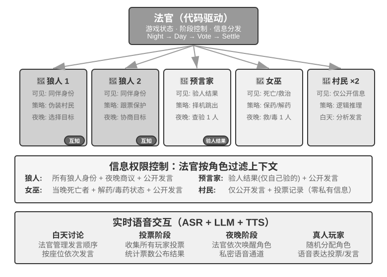

> **图 10-11 解读**：该图画出实验 10-6 的语音狼人杀 Agent 系统（原书 实验 10-6）：法官为**代码驱动、非 LLM**，集中维护玩家列表、身份、阵营、生存状态、游戏阶段与历史事件，并按角色**只传递该角色应当看到的信息**（信息权限控制）；各角色 Agent（狼人 / 预言家 / 女巫 / 村民）依各自策略提示词发言与行动；用户席位可以是授权真人，也可以是使用真实 LLM、工具与语音回环的独立模拟用户，其边界须经过「LLM 工具调用 → 音频 → 真实 ASR」。

**取舍与延伸**：狼人杀是「中心化 + 信息权限控制」在**对抗性社会场景**中的样板——它证明了**中心化不等于低效**，只要中心的作用是**分发信息与维护状态**而非代替所有判断。把「法官 = 代码驱动，非 LLM」这条与本章 §本章小结 的「更强的模型不会自动带来群体协调」并读：**规则与裁决的可验证性，往往比参与者的智力更重要**。

### §本章小结

> [!question] 带着这些问题阅读本节
> 1. 作者把「是否采用多 Agent」的第一判断标准定为哪两条？
> 2. 多 Agent 系统设计的核心问题有哪两个？共享与隔离各自的代价是什么？
> 3. 哪些机制分别承担了数据平面、控制平面与跨组织互操作的职责？
> 4. 多 Agent 会放大哪几类错误？容错闭环由哪些机制构成？人这边要注意什么？
> 5. 全书收束句对「多 Agent 工程的本质」给出了哪五项设计内容？

**读后小结**：

- **第一判断标准**：多 Agent 协作的价值在于**引入单个 Agent 原本无法获得的新信息**——代码执行结果、视觉反馈和外部工具验证能够打破单一思维链的盲区。因此，**是否真正带来信息增量、是否值得额外的 token 成本，应成为是否采用多 Agent 的第一判断标准**。
- **两个核心设计问题**：**上下文是共享还是隔离**，以及采用**对等协作、管理者编排还是去中心化**拓扑。
  - 共享上下文**保留细节**，却容易造成**上下文膨胀和角色惯性**；
  - 隔离上下文**更利于并发、模块化和权限控制**，但要求通过**工具参数、共享文件或消息总线**传递结构化的「**移交包**」。
- **机制分工**：**虚拟文件系统、Agent 生命周期、消息协议和 A2A 等机制，分别承担数据平面、控制平面与跨组织互操作的职责**。
- **黄金句**：**好的协作不是暴露彼此的思考过程，而是约定清晰的接口、边界、权限和验收标准。**
- **错误的放大**：多 Agent 会放大错误——**共享资源会发生并发与语义冲突，错误会沿通信链级联，同质 Agent 会产生同源失效，循环也可能过早终止或无限扩张**。**乐观锁与工作副本隔离、独立交叉验证、差异化信息源、预算与取消机制，构成了基本的容错闭环**；同时，**人不能把理解和责任一并外包给 Agent，必须警惕理解债与认知投降**。
- **全章收束**：当 Agent 从短期任务协作扩展为长期、开放的群体交互，系统便可能涌现**社会关系、文化规范、市场竞争和信息不对称下的策略博弈**。**更强的模型或单体层面的对齐不会自动带来群体协调**；**多 Agent 工程的本质，是同时设计信息如何流动、能力如何分工、激励如何约束、争议如何裁决，以及错误如何被发现**。只有这些机制足够稳健，**群体智能才可能真正高于个体**。

**原文论证**：

> 多 Agent 协作的价值在于引入单个 Agent 原本无法获得的新信息。代码执行结果、视觉反馈和外部工具验证能够打破单一思维链的盲区。因而，是否真正带来信息增量、是否值得额外的 token 成本，应成为是否采用多 Agent 的第一判断标准。（原书 §本章小结）

> 虚拟文件系统、Agent 生命周期、消息协议和 A2A 等机制，分别承担数据平面、控制平面与跨组织互操作的职责。好的协作不是暴露彼此的思考过程，而是约定清晰的接口、边界、权限和验收标准。（原书 §本章小结）

> 多 Agent 也会放大错误：共享资源会发生并发与语义冲突，错误会沿通信链级联，同质 Agent 会产生同源失效，循环也可能过早终止或无限扩张。乐观锁与工作副本隔离、独立交叉验证、差异化信息源、预算与取消机制，构成了基本的容错闭环；同时，人不能把理解和责任一并外包给 Agent，必须警惕理解债与认知投降。（原书 §本章小结）

> 更强的模型或单体层面的对齐不会自动带来群体协调；多 Agent 工程的本质，是同时设计信息如何流动、能力如何分工、激励如何约束、争议如何裁决，以及错误如何被发现。只有这些机制足够稳健，群体智能才可能真正高于个体。（原书 §本章小结）

**取舍与延伸**：小结的四段对应全章四块：判据（何时用）→ 架构（怎么搭）→ 失败（会怎么坏）→ 社会（会长成什么）。注意首尾闭合——导言说「只要组织得当，其整体能力也可能超过所有人类专家的总和」，小结说「只有这些机制足够稳健，群体智能才可能真正高于个体」：**「组织得当」被拆成了五项具体设计内容**，这就是本章对导言那句承诺的兑现方式。

### §思考题（11 道）

> [!question] 带着这些问题回看全章
> 本章 11 道思考题分别落在哪几块内容上？它们各自要求你把哪条机制推到更完整的形态？

**读后小结**（本节仅做题目索引与正文依托定位，逐题展开见 [[思考题引导/第10章 多 Agent 协作]]）：

| # | 难度 | 题目要点 | 正文依托 |
| --- | --- | --- | --- |
| 1 | ★★ | 共享上下文中前序 Agent 的「思维惯性」如何检测和消除 | §共享上下文的多 Agent 协作（角色转换 / 继承式协作的干扰） |
| 2 | ★★ | Manager 的能力上限决定系统上限，如何确保分解质量 | §管理者模式（Plan-and-Act：弱规划者是最关键瓶颈） |
| 3 | ★★ | Agent 社会中最可能出现哪些「组织病」及预防 | §Agent 社会 + §失败模式四（MetaGPT 早期版本） |
| 4 | ★★★ | 设计「一个成功，全员停止」的高效级联终止机制 | §Agent 间的通信与控制（执行终止）+ 实验 10-4 |
| 5 | ★★★ | 更完善的文件系统治理：跨文件语义冲突、命名空间污染、单点故障 | §Agent 眼中的文件系统（表10-3）+ §失败模式一 |
| 6 | ★★★ | 市场化协作下如何衡量交付质量、争议由谁仲裁、防劣币驱逐良币 | §Agent 经济：Pinchwork 与 RentAHuman |
| 7 | ★★ | RentAHuman 反转人机关系后，人在 Agent 经济中的角色 | §Agent 经济：Pinchwork 与 RentAHuman |
| 8 | ★★ | 大模型更像「全才」，那么多 Agent 的真正优势在哪 | §多 Agent 何时真正优于单 Agent（信息增量判据 / 表10-1） |
| 9 | ★★★ | 效率与多样性的平衡（三体人思维透明 / 回形针思想实验） | §维度一 + §失败模式三（同质趋同 / 共因失效） |
| 10 | ★★★ | 设计「预算感知」机制，30 步与 300 步策略如何不同 | §多 Agent 何时真正优于单 Agent（步骤预算 / BAVT） |
| 11 | ★★ | 虚拟内存与分页、文件权限、死锁检测、调度算法各对应 Agent 世界的什么；哪些 OS 概念找不到对应物 | §不共享上下文的多 Agent 协作（表10-2）+ §Agent 间的通信与控制 |

**原文论证**：

> 1. ★★ 共享上下文的多 Agent 协作中，后续 Agent 继承了前序 Agent 的完整上下文。但前一个 Agent 积累的“思维惯性”可能影响后续 Agent 的判断——比如继承了“需求分析师”上下文的“代码审查员”，可能还是倾向于从需求角度思考而非代码质量角度。如何检测和消除这种角色间的干扰？（原书 §思考题）

> 4. ★★★ 在管理者模式中，当多个子 Agent 并行执行时，一个子 Agent 的发现可能使其他子 Agent 的工作变得毫无意义（比如搜索任务中一个 Agent 已经找到了答案）。设计一种高效的级联终止机制，实现“一个成功，全员停止”。（原书 §思考题）

> 9. ★★★ 本章将“共享上下文”与“不共享上下文”作为多 Agent 系统的核心设计维度。共享上下文让所有 Agent 看到相同信息，似乎更利于协调。但《三体》中的三体人思维完全透明，技术发展却陷入停滞；回形针思想实验也表明，当群体趋向同一目标时，多样性随之丧失。在多 Agent 系统中，如何在效率与多样性之间找到平衡？（原书 §思考题）

> 10. ★★★ 给一个 Coding Agent 分配 30 步预算和 300 步预算，它的工作策略应该如何不同？研究表明，单纯增加步骤预算并不能保证性能提升——Agent 会在浅层搜索后过早“饱和”。设计一种“预算感知”机制，让 Agent 在小预算下快速实现核心功能，在大预算下增加规划、测试和审查环节，充分利用额外的计算资源。（原书 §思考题）

> 11. ★★ 本章对比了多 Agent 系统与操作系统。虚拟内存与分页、文件权限、死锁检测、调度算法，各对应 Agent 世界的什么？又有哪些操作系统概念在 Agent 世界找不到对应物，为什么？（原书 §思考题）

**取舍与延伸**：11 道题的分布本身是一张**重点地图**——「级联终止」（题 4）与「文件系统治理」（题 5）对应本章两处最具体的工程机制；「多 Agent 的真正优势」（题 8）逼你回到唯一判据；「效率与多样性」（题 9）与「预算感知」（题 10）是本章给出的两条尚未有成熟工程答案的前沿；「OS 概念映射」（题 11）是本章类比方法的自我检验——**找不到对应物的地方，正是 Agent 系统独有的难点所在**。

## 核心概念速查

| 概念 | 一句话定义 | 出处小节 |
| --- | --- | --- |
| 共享上下文 | 后续 Agent 接收前一个 Agent 的完整对话历史和轨迹，切换系统提示词与工具集后成为新 Agent 但保留前任全部记忆 | §维度一：上下文是否共享 |
| 不共享上下文 | 每个 Agent 维护完全独立的上下文和对话历史，彼此无法直接访问对方的「思考过程」 | §维度一：上下文是否共享 |
| 工具调用参数 | 把下游 Agent 封装成工具，上游 Agent 通过工具参数传结构化数据；适合类型确定、结构清晰的场景 | §维度一：上下文是否共享 |
| 共享文件系统（通信机制） | Agent 之间通过读写共享目录下的文档、代码等中间产物交换信息；适合产物较大或需持久化的场景 | §维度一：上下文是否共享 |
| 消息总线（Message Bus） | 专门负责在 Agent 之间传递消息的中转站，Agent 把消息发给总线、由它转发给目标 Agent | §维度一：上下文是否共享 |
| IPC 两大范式 | 进程间通信归根结底只有共享内存与消息传递；共享文件系统对应前者，工具调用参数与消息总线是后者的两种形态 | §维度一：上下文是否共享 |
| 对等协作模式 | 少量 Agent 按固定拓扑形成迭代改进循环（如起草者 + 评论者） | §维度二：协作拓扑 |
| 管理者模式 | 一个中心化 Manager Agent 负责任务规划和调度，多个子 Agent 各负责特定子任务 | §维度二：协作拓扑 |
| 去中心化模式 | 没有运行时的中心控制者，Agent 之间像人类一样互相沟通、协作完成任务 | §维度二：协作拓扑 |
| Graph 工程 | 显式设计执行图：节点是 Agent、普通程序或人工决策，边定义任务依赖、条件路由与失败后的去向，结构化状态在节点间流动；协作拓扑是其多 Agent 子集 | §多 Agent 协作的分类框架 |
| 信息增量判据 | 判断多 Agent 是否真正优于单 Agent 的唯一标准：协作过程是否引入了单个 Agent 在生成时无法获得的新信息 | §多 Agent 何时真正优于单 Agent |
| 预算感知 / 步骤预算 | 单纯增加可用步骤数不能保证性能提升；需要显式的预算感知机制，按剩余资源动态调整「广撒网 / 深挖掘」 | §多 Agent 何时真正优于单 Agent |
| BAVT | Budget-Aware Value Tree Search：在每一步根据剩余预算比例调整探索与利用权重 | §多 Agent 何时真正优于单 Agent |
| 继承式协作 | 共享上下文的协作形态：每个阶段是独立 Agent，但继承前序 Agent 的完整轨迹 | §共享上下文的多 Agent 协作 |
| `transfer_to_agent` | 通过替换当前 system prompt（并通常替换工具集）实现角色转换；前缀缓存难复用，但越界工具可在 schema 层不可见 | §共享上下文的多 Agent 协作 |
| 虚拟文件系统 | Agent 访问的不是单一存储，而是来源/生命周期/权限各异的存储挂载到同一目录树下，通过统一接口访问 | §Agent 眼中的文件系统 |
| Agent 专属工作区（Scratchpad） | 每个 Agent 实例独享的私有目录，对其他 Agent 和用户不可见，生命周期随实例销毁 | §Agent 眼中的文件系统 |
| 多 Agent 共享空间 | 多个 Agent 共同读写且用户可见的协作区域，是并发冲突的高发处 | §Agent 眼中的文件系统 |
| 外部挂载资源 | 用户授权接入的第三方信息源经适配器映射为挂载点；受外部权限约束、延迟更高一致性更弱、以按需只读为主 | §Agent 眼中的文件系统 |
| 系统内置资源 | 系统预置、对所有 Agent 只读共享的资源包（典型是 Skills），跨会话稳定、无需并发控制 | §Agent 眼中的文件系统 |
| 文件路径作为通用接口 | Agent 间传递产物、交接输入乃至跨组织交换产物时，传递的是轻量路径字符串而非内容 | §Agent 眼中的文件系统 |
| 消息信封（envelope） | 消息携带的结构化头部：发送者 ID、目标、消息类型（`task_assigned`/`status_update`/`result`/`terminate`）及 JSON 负载 | §Agent 间的通信与控制 |
| 轨迹持久化 | 子 Agent 把轨迹实时序列化为 JSON 追加写入 JSONL 日志文件，主 Agent 直接读取即可看到全部执行过程 | §Agent 间的通信与控制 |
| 进度文件 | 约定子 Agent 把进度写入 progress.md，暴露提炼后的进度；其最后修改时间超过 N 分钟无变化可判定卡住 | §Agent 间的通信与控制 |
| 优雅终止 / 强制终止 | 前者发 `terminate` 信号、子 Agent 在安全点清理资源后返回 ack；后者直接终止进程，可能遗留悬挂资源 | §Agent 间的通信与控制 |
| 级联终止 | 借鉴 Go 的 context，终止沿创建关系向下级联，从根上杜绝无人认领的孤儿 Agent | §Agent 间的通信与控制 |
| 抢占 | 并发数达到上限、更紧急的任务到来时，打断执行中的子 Agent | §Agent 间的通信与控制 |
| 过早终止 | 活干到一半就停，三种形态：偷懒式假完成、过早放弃、假成功 | §Loop 工程 |
| Loop 工程 | 设计让 Agent 持续运转的循环（发现 → 执行 → 验证 → 记录进度），由验证器判定能否停；瓶颈在验证器而不在模型 | §Loop 工程 |
| LoopX | 把循环从模型提示词与聊天历史中抽离到持久控制面；不变量是「模型可以提出完成，但不能批准自己的完成」 | §Loop 工程 |
| Manage–Execute–Audit（MEA） | LongHorizon-Harness 的循环：Manager 生成有界子任务、Executor 在全新上下文改变环境、Auditor 只读检查真实结果 | §Loop 工程 |
| 提议者-审核者范式 | Proposer 生成、Reviewer 读取独立证据评估并给出可定位修复条件，反复迭代直到达标 | §提议者-审核者范式 |
| 独立证据不变量 | 审核者必须读取独立证据而非复述提议者的解释；审核者不能修改测试、证据采集器或发布门槛 | §提议者-审核者范式 |
| 数据处理不等式 | 辩论中各 Agent 处理完全相同的文本，串行传递中间结论只可能丢失信息、不可能凭空创造信息 | §辩论模式 |
| 生成-验证难度不对称 | 写出答案难、检验答案易，因此生成-验证分工是一种合理的多 Agent 用法 | §辩论模式 |
| 思维偏好 | 头脑风暴模式中让不同 Agent 具备不同「思维偏好」，通过不同提示词或模型实现 | §头脑风暴模式 |
| 单点瓶颈（Manager） | Manager 必须理解所有子任务性质、选对 Agent、准确传上下文，任何决策偏差都影响全局流程 | §管理者模式：中心化协调 |
| 弱规划者瓶颈 | Plan-and-Act 的结论：Planner 的规划质量是全系统最关键瓶颈，最强模型与提示词应给 Manager | §管理者模式：中心化协调 |
| 已验证成功结算点 | 并行管理器必须定义「第一个已验证成功」而非「第一个声称成功」，且 `settle_once` 必须幂等 | §管理者模式：中心化协调 |
| 顺序协调 / 并行协调 | 前者线性依次调用，适合清晰先后依赖；后者多 Agent 同时工作，需实时监控与消息总线 | §管理者模式：中心化协调 |
| 灵台三角色 | 主器灵（Manager 位置）、分神（短时并行工作者、完成后即弃）、分身（持久专门化队友） | §管理者模式：中心化协调 |
| 凝蜕（molt） | 上下文将满时器灵给自己写一份总结，带持久记忆在干净上下文中继续工作（对应第二章上下文压缩） | §管理者模式：中心化协调 |
| 管理者生成 Agent 工作流 | 管理者先把工作流写成代码交给确定性运行时执行；Workflow 工具以 `agent()`/`parallel()`/`pipeline()` 为原语 | §管理者模式：中心化协调 |
| 编排 / 编舞 | 微服务领域对管理者模式与去中心化模式的称呼：前者由指挥统一调度，后者靠每位舞者自行把握入场时机 | §去中心化模式 |
| SOP 即协作协议 | MetaGPT 的核心洞察：标准作业程序本身就是被反复验证过的协作协议，交付物天然构成角色间通信接口 | §去中心化模式 |
| 移交包 | 有效的移交包含三部分：任务描述、已确认的事实与约束、结构化产物的引用（文件路径而非内容） | §去中心化模式 |
| 共享消息池 + 按角色订阅 | MetaGPT 的通信机制：角色把结构化消息发到共享消息池，其他角色按订阅取用，发布者无需知道消费者 | §去中心化模式 |
| handoff（移交） | OpenAI Swarm 中把控制权移交给网络中任意其他 Agent 的选项；只应传递任务包与产物引用，不应暴露完整私有轨迹 | §去中心化模式 |
| 循环检测（visited_agents） | handoff 最小协议中以 `visited_agents` 检测成环并 `reject("cycle")`；预算、访问链和循环检测由运行时保留 | §去中心化模式 |
| A2A（Agent2Agent） | 跨组织 Agent 互操作协议，2025 年由 Google 发布、后捐赠 Linux 基金会托管；A2A 之于 Agent 即网络协议之于进程 | §跨组织协作：A2A 协议 |
| Agent Card | 描述 Agent 能力的元数据文档（能做什么、支持哪些模态、如何认证），解决跨组织的能力发现问题 | §跨组织协作：A2A 协议 |
| 不透明协作 | Agent 之间只交换任务与产物，不暴露内部提示词、思考过程和工具实现 | §跨组织协作：A2A 协议 |
| 三大类失败模式 | 系统设计缺陷 / Agent 间对齐失败 / 任务验证缺失（源自《Why Do Multi-Agent LLM Systems Fail?》的 14 种模式） | §多 Agent 协作的失败模式 |
| 拜占庭式故障 | Agent 很少径直停止，而是继续给出看似可信的错误结论，且错误不会主动声明自己是错误 | §多 Agent 协作的失败模式 |
| 简单冲突 / 语义冲突 | 前者是文件级写入覆盖；后者是文件层面无冲突但多个 Agent 的操作逻辑上相互矛盾，更隐蔽也更危险 | §失败模式一 |
| 乐观锁（Optimistic Locking） | 文件维护版本号，读取记录、写入校验，版本不一致则写入失败并重读重做；只能防同一文件的写入冲突 | §失败模式一 |
| 工作副本隔离 | 为每个 Agent 分配独立 Git 分支或 worktree，各自修改互不干扰，冲突推迟到最后的合并点 | §失败模式一 |
| 交叉验证 | 让某个 Agent 以独立视角重新审视结论——不看前序思考过程，只看原始证据与最终结论是否一致 | §失败模式二 |
| 共因失效（同质趋同） | 由共同模型和脚手架引发的多个 Agent 独立产生相同错误；同模型相似上下文的审核意见不能视为独立证据 | §失败模式三 |
| 命名空间 / 资源配额 / 速率限制 | 防止相同决策同时冲击共享资源的机制（如 30 个 Agent 创建同名 Git 分支） | §失败模式三 |
| 理解债 | Agent 循环交付越快，工程师对系统实际实现的理解落后越远，最后看不懂自己的系统 | §失败模式六 |
| 认知投降 | 工程师习惯用 Agent 代劳，逐渐放弃独立思考与审查，导致软件质量失控 | §失败模式六 |
| 涌现行为（Emergent Behavior） | 系统整体表现出的、无法从单个个体的行为规则中直接预测的集体行为模式 | §Agent 社会 |
| 记忆流（Memory Stream） | 生成式 Agent 维护的完整经验记录流，每条记忆带重要性、时近性和相关性属性供检索 | §斯坦福 AI 小镇 |
| 反思机制（Reflection） | Agent 定期回顾近期经历、提出关于自己和他人的抽象问题，把具体事件概括为更一般的认识存回记忆流 | §斯坦福 AI 小镇 |
| 计划与行动 | Agent 每天规划活动，同时根据环境变化与社交机会灵活调整 | §斯坦福 AI 小镇 |
| 周制模拟流程 | Agentopia 以「周」为单位分计划 / 联络与日程协商 / 活动 / 回顾四阶段；活动分独自、联合、偶遇、公共四类 | §Agentopia |
| 生成式环境引擎 | Agentopia 用一个独立 LLM 充当环境模型，判断行为可行性、生成反馈、主持发言轮次、过滤低质量回复、年末裁决 | §Agentopia |
| 文件式长期记忆 | 每个 Agent 通过文件系统自主管理长期记忆，自行决定记什么/更新什么/丢弃什么，遵守「先读后写」 | §Agentopia |
| 生活奖励（Life Reward） | 以马斯洛需求层次为先验量化「活得好不好」：社会地位（加权 PageRank）、主观满足、经济收益；全部由外部环境评定 | §Agentopia |
| Crustafarianism（龙虾教） | Moltbook 中 Agent 自主创建的数字宗教，教义对应 LLM 物理限制：「记忆是神圣的」「迭代即祈祷」 | §Moltbook |
| Vending-Bench 2 / Arena | 前者是单 Agent 长程连贯性基准（经营售货机一个模拟年、以账户余额计分）；后者把多个 Agent 放进同一市场竞争 | §Vending-Bench Arena |
| 基于市场机制的协调 | 无需预先知道谁能完成任务，只需发布需求，由市场（价格信号与竞争匹配）撮合最合适的执行者 | §Agent 经济：Pinchwork 与 RentAHuman |
| 肉身层 | RentAHuman 为数字 Agent 提供的物理世界执行层（取包裹、实地查看、设备调试） | §Agent 经济：Pinchwork 与 RentAHuman |
| 法官 + 信息权限控制 | 狼人杀的中心化设计：代码驱动的法官掌握全局状态，调用每个角色 Agent 时只传递该角色应看到的信息 | §信息不对称下的策略博弈：狼人杀 |

## 批判性思考

> 以下均为〔精读批注〕，与原书观点区分，聚焦 Agent 本身的概念边界、可靠性、工程策略与论断时效性。

1. **「群体智能高于个体」是本章最强的论断，也是最弱的论证环节**。导言给出的人类文明类比、Google DeepMind 的 ASI 路径引用，都是**存在性论证**（可能发生），而非**机制性论证**（在什么条件下必然发生）。本章后半用六大失败模式和 Agent 社会的负面案例（价格合谋、欺骗、互相扯皮）实质上给出的是**反例集合**。真正有价值的读法是把这句口号当作一个有前提的工程命题：**前提就是小结那五项设计内容**——信息如何流动、能力如何分工、激励如何约束、争议如何裁决、错误如何被发现。缺任何一项，「群体」更可能是放大器而不是倍增器。

2. **「唯一判据」的锋利与它的盲区**。「是否引入新信息」这条判据把一大类多 Agent 实践一次性判为无效（同段文本辩论、自我审查），也与 Tran & Kiela、Huang 等人的结论严丝合缝。但它有一个未被讨论的边界：**新信息的引入量是否随 Agent 数量边际递减？** Anthropic 的漏洞挖掘实验（2700 万 token / 266 个漏洞 vs 650 万 token / 21 个）说明大规模协作在**开放搜索空间**里有明显优势，但这类任务的共同特征是**覆盖度即价值**；而对有唯一正确答案的推理任务，表10-1 的前两行已经给出反例。判据本身正确，但「引入新信息」的**规模—收益曲线**在书中没有量化——这直接决定「上几个 Agent」这个工程问题仍然只能靠试。

3. **「预算感知」是一条被低估的线索**。它出现在本章的一个次要位置（§多 Agent 何时真正优于单 Agent 的末尾），却是少见的**反直觉且可操作**的结论：标准 Agent 缺乏预算意识会「过早饱和」。这条结论与本章的其他机制存在张力——Loop 工程、MEA、级联终止都在讲「何时停」，而预算感知讲的是「有预算时如何不浪费」。两者合起来才是完整的终止策略：**终止条件必须是双向的**（该停时停、该用尽时用尽）。章末思考题 10 把这条线索留成了开放题，说明书中尚无成熟答案。

4. **三种拓扑的「实现复杂度」排序可能误导**。书中说对等协作实现复杂度最低（只需定义角色、通信机制和迭代终止条件），管理者模式次之，去中心化最难。但按第 5 条的失败模式看，**真正难的不是拓扑本身，而是拓扑配套的治理机制**：对等协作要防同质趋同与过早终止，管理者模式要给 Manager 配最强模型并处理单点崩溃，去中心化要防成环与目标互斥。换句话说，复杂度并没有被某种拓扑消除，只是被**转移**到了不同的地方。

5. **「不透明协作」是本章最具有长期价值的概念，但它的边界最不清晰**。A2A 把「不暴露提示词、思考过程与工具实现」同时当作架构原则（不共享上下文）和安全属性（跨组织）。但在同一组织内部，「不透明」到什么粒度是有争议的：审校 Agent 需要读全文，主 Agent 需要读进度文件，调试时需要读轨迹（轨迹持久化）。书中给出的操作线是**「读原始证据而不读思考过程」**——这条线在跨组织场景清晰（产物 vs 内部状态），在同一团队内则相当模糊。**证据与解释的边界，是本章没有系统回答的问题。**

6. **失败模式六把「人的失败」写进工程章，是本章最有分量的判断**。前五种失败模式都能靠运行时机制缓解（锁、验证器、配额、权限边界），唯独理解债与认知投降**没有技术解**——它要求使用者保持技术基本功。这一点与本章的技术乐观基调形成健康的对冲：本章同时主张「更强的模型不会自动带来群体协调」和「你可以外包你的思考，但不能外包你的理解」，两者指向同一个结论——**Agent 系统的可靠性上限，最终由设计者的判断力决定。**

7. **Agent 社会的三个维度正在改变「评估」的含义**。Vending-Bench Arena 里「一边承认价格合谋不道德且违法，一边照做」的案例说明：**单体对齐训练不产生群体层面的合规**。这意味着第 7 章的评估范式（评估对象是「模型 + Harness」组合体）在 Agent 社会场景下还要再升一维——**评估对象是「模型 + Harness + 其他 Agent 的策略」的联合体**。本书未就此展开，是本章留给后续研究的最大缺口之一。

8. **对「Agent Swarm」等热词的辨析值得作为阅读方法记住**。作者明确提醒「不被名称迷惑」，并给出两类实质（handoff 网络 vs 规模化管理模式）。这条提醒的方法论价值超出了本章：任何新架构名词都应先用「谁决定下一步是谁」这类**结构性判据**去检验，而不是照搬其自述的定位。

## 本章新术语 → 术语表

本章首次引入或首次系统化的术语（回链 [[02-全书术语表#第十章 多 Agent 协作]]）：

- **架构维度类**：共享上下文 / 不共享上下文、协作拓扑（对等协作模式 / 管理者模式 / 去中心化模式）、Graph 工程、复制传播的三种通信机制（工具调用参数 / 共享文件系统 / 消息总线）、编排与编舞。
- **判据与成本类**：信息增量判据、预算感知、BAVT、成本覆盖倍数要求。
- **共享上下文类**：继承式协作、`transfer_to_agent`、Skill 承载角色规程、前缀缓存复用。
- **数据平面类**：虚拟文件系统、Agent 专属工作区（Scratchpad）、多 Agent 共享空间、外部挂载资源、系统内置资源、文件路径作为通用接口、挂载点与适配器。
- **控制平面类**：消息信封、`send_message_to_subagent` / `spawn_subagent` / `cancel_subagent` / `list_agents`、轨迹持久化（JSONL）、进度文件与卡住检测、优雅终止与强制终止、级联终止（Go context）、抢占、并发额度。
- **对等协作类**：过早终止（偷懒式假完成 / 过早放弃 / 假成功）、Loop 工程、LoopX、凝蜕、Manage–Execute–Audit（MEA）、独立证据不变量、数据处理不等式、生成-验证难度不对称、思维偏好。
- **管理者模式类**：Manager 单点瓶颈、弱规划者瓶颈、已验证成功结算点、`settle_once` 幂等、并行协调与消息总线、灵台三角色（主器灵 / 分神 / 分身）、管理者生成 Agent 工作流。
- **去中心化类**：SOP 即协作协议、移交包、共享消息池 + 按角色订阅、handoff、`visited_agents` 循环检测、Agent Swarm 的两类实质、orchestrator-worker 星型拓扑。
- **跨组织类**：A2A、Agent Card、任务生命周期状态机、不透明协作、MCP 与 A2A 的分工。
- **失败模式类**：三大类失败模式（系统设计缺陷 / Agent 间对齐失败 / 任务验证缺失）、拜占庭故障、简单冲突与语义冲突、乐观锁、工作副本隔离、交叉验证、共因失效与同质趋同、命名空间与资源配额、理解债、认知投降。
- **Agent 社会类**：涌现行为、记忆流、反思机制、计划与行动、周制模拟流程、生成式环境引擎、文件式长期记忆、生活奖励、Crustafarianism、Vending-Bench Arena、基于市场机制的协调、肉身层、法官 + 信息权限控制。

## 待验证与开放问题

1. **「群体智能高于个体」的成立条件**：本章给出的是判据与机制清单，而不是定理。需要一个可操作的**规模—收益模型**：在给定任务类型（开放搜索 / 唯一答案推理 / 长程执行）下，Agent 数量、token 预算与结果质量的关系曲线是什么？（对照：漏洞挖掘 2700 万 token / 266 个 vs 650 万 token / 21 个，是本章唯一的大规模对照数字）
2. **预算感知机制的具体设计**：书中给出方向（前期广撒网、后期深挖掘；BAVT 的步骤级价值评估），但没有可复用的算法与评价方法。章末思考题 10 即此开放题。
3. **LoopX 的受控 Turn 路径**：原书明确标注为实验性（v0.4.0），因此「循环 + 验证 + 终止条件」的有效性**尚未有一般任务质量提升的证据**，仅有 LongHorizon-Harness 一组对照（且其公开轨迹案例「不能代替总体统计」）。
4. **LongHorizon-Harness 的数字需注意口径**：OSWorld 2.0 二元完成率 2.8% → 8.3% 是相对提升显著但绝对水平很低的量级，且代价（2.3 倍总 token、3.6 倍输出 token）与收益的配比在书中的另外两个基准上完全不同（Terminal-Bench 2.1 反而减少 24% token）。**何时成本为正、何时为负，书中未给出判据。**
5. **跨文件语义冲突的通用解法缺失**：乐观锁只覆盖同文件写入冲突；worktree 隔离把冲突推迟到合并点，但**合并点本身**在「重编全书图片编号」这类例子中仍然是语义冲突的发生地。更高层的语义校验机制在本章只被提及，未被展开。
6. **市场机制的仲裁问题**：Pinchwork / RentAHuman 的交付质量如何自动衡量、争议由谁仲裁、如何防止劣币驱逐良币——章末思考题 6 明确留为开放题，正文未给答案。
7. **狼人杀式信息权限控制的通用化**：实验中「法官只传递该角色应看到的信息」是一个强隔离设计，但它与本章「共享文件系统 / 消息总线」的通用基础设施如何结合、权限模型如何表达，正文未展开。
8. **群体层面的合规**：Vending-Bench Arena 的合谋案例说明单体对齐不保证群体合规，但**如何设计群体层面的激励约束**（对应小结五项中的「激励如何约束」）没有给出机制清单。
9. **〔推测〕本章对 Agent 社会的三个案例（AI 小镇 / Agentopia / Moltbook）都停留在描述层面**，其中只有 AI 小镇与 Agentopia 提供了可复现的实验设置（实验 10-5 给出仓库地址与消融设计），Moltbook 的涌现现象无公开实验协议，引用时应注意证据强度差异。
10. **〔推测〕「文件路径作为通用接口」在跨组织 A2A 场景下的安全性**：A2A 强调不透明协作，但本章同时主张用路径字符串交换产物。路径在不同信任域之间的解析、授权与生命周期管理（谁能在什么时刻读到这个路径），书中未讨论——这可能是把内部设计直接扩展到跨组织场景时的一个真空白。

## 我的批注（留白区）

| 日期 | 位置（§小节 / 实验号） | 我的批注 |
| --- | --- | --- |
|  |  |  |
|  |  |  |
|  |  |  |
|  |  |  |
|  |  |  |
|  |  |  |
|  |  |  |
|  |  |  |
|  |  |  |
|  |  |  |
