# 第8章 模型后训练（内容精读）

> [!info] 状态
> **已精读**。本文覆盖 `chapter8.md`（878 行，UTF-8 无 BOM）**全文**，含该书第八章全部 **17 个二级小节**（`## `）与次级的四级小节、19 个编号实验、5 张表格（表8-1 至表8-5）、全部 **18 张插图**（fig8-1 ~ fig8-18），以及文末 13 道思考题与 33 条脚注（原书脚注编号跳过 `ch8-22`）。
>
> 相关笔记：实验解读见 [[实验解读/第8章 模型后训练]]，思考题见 [[思考题引导/第8章 模型后训练]]，体例规范见 [[01-精读笔记规范]]，术语登记见 [[02-全书术语表]]。
>
> 标注约定：`〔原书〕` 为书中内容并附锚点；`〔补充〕` 为书外知识，不冒充书中观点；`〔精读批注〕` 为本笔记的判断。本书无页码，锚点一律用「§小节标题」形式，**不编造页码**。

> [!info] 一句话主旨
> 本章讲的是**通过更新模型参数来实现 Agent 的持续进化**，并把「能力开发」这件事拆成 **预训练 → Mid-training → SFT → RL** 四个环节。它给出两条主结论：其一，**「SFT 记忆、RL 泛化」是本章受控对照实验中观察到的倾向，而不是不受数据、模型、奖励与环境影响的普遍规律**；其二，**数据和环境比算法更重要**——Mid-training 语料决定底座补到了哪里，SFT 示范决定协议是否稳定，环境和奖励决定 RL 能探索并强化什么。

---

## 本章速览

### 主旨展开

Agent 的「自我进化」有四个载体：知识、指令、程序与参数（第九章展开）。本章只处理**参数**这一条路径，因此它要回答的不是「Agent 该怎样设计」，而是「**当行为无法由外部符号完整表达时，怎样把行为写进权重**」。

四个环节的分工是本章的第一根骨架〔原书〕（§从预训练到 RL：四阶段全景）：

- **预训练**——在海量互联网文本上预测下一个词，把语言、知识与推理能力同时压进参数；成本最高，决定**底座**。
- **Mid-training**（中间训练，别名 CPT / DAPT / TAPT）——在目标领域的文档、指令与轨迹上继续预训练，用**比 SFT 多得多的数据**补知识与基础能力；数据以完整文档为主，学习目标是「预测内容本身」。
- **SFT**（监督微调）——用几千到几万条「问题—标准回答」教模型**格式与协议**：什么场景输出什么形状、什么时候调用哪个工具、何时停下来问澄清。
- **RL**（强化学习）——用 rollout 与奖励重新分配概率，让模型在**自己能到达的状态上**探索并强化出训练数据里没有的行为。

本章的第二根骨架是**三条对照证据**，它们共同支撑起「数据与环境比算法重要」的判断：

| 证据 | 对照设置 | 观察到的倾向 |
| --- | --- | --- |
| GeneralPoints 与 V-IRL（§单轮强化学习） | 相同任务、相同模型、相同数据与预算，只换训练信号 | SFT 在分布内记忆强、分布外泛化弱；RL 相反 |
| V-IRL-VL 与 SimpleVLA-RL（§奖励设计） | 逐步导航反馈 vs 终点成功奖励 | 「密集反馈换收敛速度、稀疏反馈换探索空间」 |
| On-Policy Distillation 与 RLVP（§蒸馏、§奖励设计） | 逐 token 监督 vs 终点标量；结果奖励 vs 结果+路径信号 | 信号密度与信号可达性，比奖励函数的复杂度更决定训练是否收敛 |

而**第三根骨架是工程判断**：本章用一节「后训练实践要点」列出 11 条常见陷阱，并以一句核心原则收束——**在投入大规模资源前，先用小规模实验验证关键假设**（小批 Mid-training 语料看知识/遗忘曲线，少量 SFT 数据测格式稳定性，小批 rollout 看 `pass@k`、奖励差异与 sampler/trainer 数值一致性）。

### 小节结构总表

下表按 `chapter8.md` 中 `## ` 出现的**实际顺序**列出全部二级小节，并标注其在本文中的对应块、以及该节承载的主要资产。

| # | 原书二级小节（`## `） | 对应本文块 | 主要资产 |
| --- | --- | --- | --- |
| 1 | 从预训练到 RL：四阶段全景 | §8.1 | 表8-1 四阶段能力开发全景 |
| 2 | 从经典 RL Agent 到现代 Agent `[可选阅读]` | §8.2 | 图8-1 ~ 图8-6；实验 8-1 ~ 8-4 |
| 3 | 模型预训练基础 `[可选阅读]` | §8.3 | 图8-8；MiniMind 2 案例 |
| 4 | Mid-training：补知识与基础能力 | §8.4 | 图8-9；表8-2 数据格式；实验 8-5 |
| 5 | SFT（监督微调） | §8.5 | 图8-10；LoRA 超参与实验 8-6 |
| 6 | SFT 数据合成：从示范到可训练轨迹 | §8.6 | 图8-12；SkillTax / SKT |
| 7 | 何时选择 Mid-training、SFT 与 RL | §8.7 | 图8-11；行动阈值；实验 8-7 |
| 8 | 单轮强化学习：记忆与泛化的对照 | §8.8 | 表8-3 机制对照；GeneralPoints / V-IRL |
| 9 | RL 算法：从 16 次 rollout 到一次参数更新 | §8.9 | 图8-13；GRPO 四步；数值失配小节 |
| 10 | RL 环境：从评估到仿真 | §8.10 | 图8-7；表8-4 四类环境；实验 8-10 ~ 8-11、8-19 |
| 11 | 从单轮到多轮：任务场景与信用分配 | §8.11 | 图8-14 ~ 图8-16；实验 8-12 ~ 8-15 |
| 12 | 奖励设计：如何把任务目标变成学习信号 | §8.12 | RLVR / GRM / ORM / PRM / RLVP；实验 8-16 |
| 13 | 蒸馏：提升样本效率 | §8.13 | 在轨蒸馏与 OPSD 伪代码 |
| 14 | 从问题案例到后训练 | §8.14 | 表8-5；三个案例；实验 8-17 ~ 8-19 |
| 15 | 后训练实践要点 | §8.15 | 11 条常见陷阱；与 RAG/ICL 的协同 |
| 16 | 本章小结 | §8.16 | 三条判断 + 指向第九章 |
| 17 | 思考题 | §8.17 | 13 道思考题（1★~3★） |

〔精读批注〕注意 `## 思考题` 也是二级小节，按体例同样给了独立块——它没有可引的「结论」，因此该块正文以「题目到章节的映射」为主，而不是强行编造小结。

### 实验索引（19 个编号实验）

| 编号 | 星 | 实验名 | 归属小节 | 关键数字 |
| --- | --- | --- | --- | --- |
| 8-1 | ★ | Q-learning 网格世界 | §从经典 RL Agent 到现代 Agent | 三个阶段 0 → 渐进收敛 → 接近 100% |
| 8-2 | ★★ | 边缘智能体的量化权衡 | 同上 | 参数从数十亿降到数亿 |
| 8-3 | ★★ | 用 SFT 复现一个 VLA 模型 | 同上 | SmolVLA 在消费级 GPU 上数小时完成 |
| 8-4 | ★★★ | 从零复现 MiniMind 2 预训练 | §模型预训练基础 | 14 小时、约 34 美元 |
| 8-5 | ★★ | 小规模领域 CPT | §Mid-training | 20% 领域文档换格式稳定性 |
| 8-6 | ★★ | SFT 冷启动到可探索策略 | §SFT（监督微调） | 几百条轨迹冷启动策略 |
| 8-7 | ★★ | `pass@k` 筛选训练路径 | §何时选择 Mid-training、SFT 与 RL | 用 `pass@k` 决定训练阶段 |
| 8-8 | ★★★ | GeneralPoints：SFT 与 RL 的泛化对照 | §单轮强化学习 | SFT 分布内好、RL 分布外好 |
| 8-9 | ★★★ | V-IRL：跨城市泛化的对照实验 | 同上 | 同上结构 |
| 8-10 | ★★ | 用模拟环境替代真实执行 | §RL 环境 | Search-R1 / ZeroSearch |
| 8-11 | ★★ | 用模型生成高质量合成数据 | 同上 | AutoData / TermiGen / CLI-Universe |
| 8-12 | ★★ | V-IRL-VL：逐步导航反馈 | §奖励设计 | 密集反馈换收敛速度 |
| 8-13 | ★★ | SimpleVLA-RL：稀疏成功奖励 | 同上 | 稀疏反馈换探索空间 |
| 8-14 | ★★★ | ReTool 工具调用 RL | §从单轮到多轮 | SFT 冷启动 + RL，AIME 准确率提升 |
| 8-15 | ★★★ | AWorld-train：沙盒中学工具 | 同上 | MCP 沙盒、可重置可重放 |
| 8-16 | ★★★ | RLVP：奖励结果、惩罚路径 | §奖励设计 | 违规 3.71 → 0.66；迭代 7.0 → 4.4 |
| 8-17 | ★★ | 从「过早结束」到 DPO 修复 | §从问题案例到后训练 | 24 条案例 + 12/8 双集 |
| 8-18 | ★★ | 作用域敏感的中文弯引号 SFT | 同上 | 1024 训练 / 256 留出 / 256 边界 |
| 8-19 | ★★ | 特殊字符串的精确复制 SFT | §RL 环境 | 37.5% → 78.9%，边界集 80.1% |

### 插图索引（18 张，按原书出现顺序）

| 编号 | 图题 | 出现小节 |
| --- | --- | --- |
| 图8-1 | 强化学习 Agent-环境交互循环 | §从经典 RL Agent 到现代 Agent |
| 图8-2 | 马尔可夫决策过程（MDP）示意图 | 同上 |
| 图8-3 | Q-learning 网格世界 | 同上 |
| 图8-4 | Q 值更新可视化 | 同上 |
| 图8-5 | 经典 RL 与现代 LLM Agent 对比 | 同上 |
| 图8-6 | OpenAI 训练范式演进 | 同上 |
| 图8-7 | Q-learning 与 LLM Agent 在寻宝游戏中的架构对比 | §从经典 RL Agent 到现代 Agent |
| 图8-8 | 预训练的下一个 Token 预测 | §模型预训练基础 |
| 图8-9 | 视觉语言模型（VLM）架构 | §模型预训练基础 |
| 图8-10 | 监督微调（SFT）流水线 | §SFT（监督微调） |
| 图8-11 | SFT→RL 两阶段训练流程；Mid-training 位于这两个行为对齐阶段之前 | §何时选择 Mid-training、SFT 与 RL |
| 图8-12 | GeneralPoints 实验架构（GP-L 与 GP-VL 两个变体的训练与测试设计） | §单轮强化学习 |
| 图8-13 | 同一 SWE-bench 任务的 16 次 rollout、验证与相对优势 | §RL 算法 |
| 图8-14 | 单轮 RL 与多轮 RL 对比 | §从单轮到多轮 |
| 图8-15 | 多轮交互中的信用分配 | 同上 |
| 图8-16 | 工具调用 RL 奖励循环 | 同上 |
| 图8-17 | ReTool 交织文本-代码思考与沙盒执行反馈循环 | §从单轮到多轮 |
| 图8-18 | AWorld-train MCP 沙盒训练架构与工具生态 | §RL 环境 |

〔精读批注〕本章 18 张图有一个明显的**分布特征**：图8-1 ~ 图8-6 全在「可选阅读」的经典 RL 小节里，图8-14 ~ 图8-16 全在「多轮与奖励」这两节。也就是说，**图集中在「概念奠基」与「最工程化的部分」，而 SFT、Mid-training 这类流程性内容各只有一张图**。这符合本章的重心判断：真正难说清的是 RL 的信用分配与奖励设计，SFT 只要一张流水线图就够。

---

## 与前后章节的关联

### 向前承接

| 前序章节 | 承接内容 |
| --- | --- |
| 第 1 章 | 承接「发现循环」与「改动不能破坏既有行为」的原则——本章把它落到参数层面：**边界集与保留集缺一不可**（§从问题案例到后训练）。 |
| 第 2 章 | 承接上下文工程。本章的对照项是 ICL：**上下文工程解决「信息在不在」，后训练解决「能力能不能不由外部符号承载」**。 |
| 第 4 章 | 承接 Agent 的记忆。围绕「参数化记忆」的争议与外部知识库形成对照——记忆写入参数还是存入知识库，是本章思考题第 7 题。 |
| 第 5 章 | 承接 Coding Agent 的工具协议：`edit_file(path, old_string, new_string)` 的精确匹配语义，正是 §从问题案例到后训练案例 3 的归因起点。 |
| 第 6 章 | 承接工具调用与运行时约束，本章把它们变成 RL 的动作空间与奖励结构。 |
| 第 7 章 | 承接最紧的一章：**评估环境与验证器是后训练的基石**。表8-5 直接把第七章的评估数据集映射成第八章的训练用法。 |

### 向后开启

- **第 9 章**：参数只是「知识、指令、程序、参数」四种自我进化载体之一。本章结尾明确把话交给下一章——**参数解决的是「难以由外部规则完整表达的行为」，其余三种载体解决的是可以被符号化的部分**。
- 对第 7 章的**反向支撑**：本章反过来解释了为什么第七章值得先做评估——**失败归因记录直接就是过程监督的负标签与路径惩罚的规则来源**；评估资产与训练资产在结构上同源。

### 内部依赖（本章第一节给的三条「为什么这样排序」）

〔原书〕本章的四阶段不是单纯按时间排的，而是按**两重门控**排的：

1. **能力门控**——如果合理采样下 `pass@k` 仍接近零，先做 Mid-training 补知识与能力（全失败的 rollout 没有正向轨迹，GRPO 组内优势也会消失）。
2. **格式门控**——如果模型偶尔会做却输出不可解析，先做 SFT 稳定格式；只有当前策略能产生**可评分且有奖励差异**的轨迹时，RL 才能高效工作。

---

## 逐节精读

> 以下按 `chapter8.md` 的 `## ` 顺序逐节展开，每节四段式：引导问题 → 读后小结 → 原文论证 → 取舍与延伸。
> 「原文论证」中的引用**逐字取自 `chapter8.md`**，锚点用「§小节标题」；跨节引用时标注来源小节。

### §8.1 从预训练到 RL：四阶段全景

> [!question] 带着这些问题阅读本节
> 1. 四个环节（预训练、Mid-training、SFT、RL）各自**主要负责什么**，成本量级差多少？
> 2. Mid-training 与 SFT 都吃「问答式数据」，为什么还要分开成两个阶段？
> 3. 既然 SFT 又便宜又快，为什么还需要 RL——RL 提供了哪一种「SFT 拿不到」的东西？
> 4. 给定一项能力缺失，你按什么顺序判断该走哪条路径？

**读后小结**：

- **四阶段是「能力开发」的流水线，不是「微调力度」的滑杆**。预训练给底座，Mid-training 补底座上的知识与基础能力，SFT 立协议（格式、工具调用、停止条件），RL 改策略（在模型自己能到达的状态上探索）。
- **成本量级跨了几个数量级**：预训练「动辄耗费数千万美元」；Mid-training 介于预训练与 SFT 之间；SFT 通常几小时到几天（本章后文给出 ReTool 的量级对照：RL 训练 9 天 vs SFT 1 小时）；RL 是本章篇幅最大、也最昂贵的部分。
- **表8-1 是本章的总纲**，它把「目标」「数据形态」「成本」「产出」四列并排，读者可以直接把一项需求代入表格定位阶段。
- **两条主线在此埋下**：主线一「SFT 记忆、RL 泛化」，主线二「数据和环境比算法更重要」。第一节只提出问题，对照证据在后文逐节给出。

**原文论证**：

> 预训练在海量互联网文本上预测下一个词，把语言、知识与推理能力同时压进参数，成本最高。（§从预训练到 RL：四阶段全景）

> Mid-training 在目标领域的文档、指令与轨迹上继续预训练，用比 SFT 多得多的数据补知识与基础能力。（同上）

> SFT 用几千到几万条“问题—标准回答”教模型格式与协议。（同上）

**取舍与延伸**：本节最关键的一次**概念切分**，是把「Mid-training 与 SFT 的区别」落在**数据的形态**而不是数据的**主题**上——Mid-training 的数据以完整文档为主，学习目标是「预测内容本身」；SFT 的数据是「问题—标准回答」，学习目标是「给定的答案」。同样一批领域知识，写成文档喂进去是 Mid-training，写成问答对喂进去是 SFT。

〔精读批注〕这条切分有直接的工程含义：**想让模型「知道」，用文档；想让模型「照做」，用问答对**。很多团队把大量文档改写成问答对来做 SFT，结果是既没把知识学扎实，又把格式约束稀释了——因为它同时越过了两道门控的顺序（先知识后格式）。

---

### §8.2 从经典 RL Agent 到现代 Agent `[可选阅读]`

> [!question] 带着这些问题阅读本节
> 1. 一个强化学习问题由哪几个要素定义？其中哪两个最容易和「Agent 的边界」混淆？
> 2. MDP 五元组是什么？「马尔可夫性」这条假设在工程上意味着什么？
> 3. Q-learning 是 on-policy 还是 off-policy？它要收敛，对「覆盖」和「学习率」有什么要求？
> 4. 现代 LLM Agent 与经典 RL Agent 的根本差别，是「算法更好」还是别的东西？
> 5. 为什么把 token 生成看成「带语言先验的巨大动作空间」之后，RL 就可以直接借用现成算法？

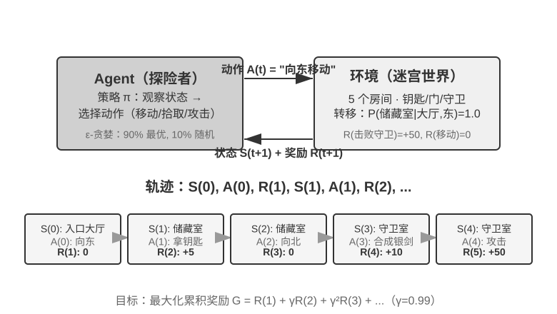
> **图 8-1 解读**：这张图给出经典强化学习的最小闭环——Agent 观察环境状态、输出动作、环境返回新状态与奖励，如此往复。它对应本节开头「策略、奖励、价值函数与环境模型四要素」中的交互结构，也是后文判断「奖励属于环境一侧」的图形依据：**奖励的产生位置在环境，不在 Agent**。

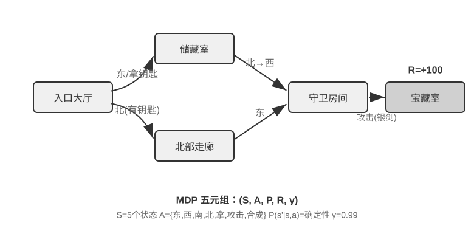
> **图 8-2 解读**：MDP 示意图把上面的交互循环形式化为「状态—动作—转移—奖励—折扣」五元组。要点是**马尔可夫性**这条假设：下一个状态只依赖当前状态与动作，与更早的历史无关。本节用它引出折扣因子 $\gamma$；本章后文（§奖励设计）指出多轮 LLM RL 通常把 $\gamma$ 设为 $1$。

**读后小结**：

- **经典 RL 定义了一套最小要素集**：策略（policy）、奖励（reward）、价值函数（value function）、环境模型（model of the environment）；加上「动作空间」与「探索与利用的权衡」，就构成一张完整的 RL 问题清单。
- **Agent 与环境的边界不是物理边界，而是「谁的动作不由你控制」**。原则是：**能被 Agent 任意改变的部分归 Agent，其余归环境**。
- **MDP 与贝尔曼方程给出「最优」的定义方式**，折扣因子 $\gamma$ 决定远期奖励的权重；本章后文（§奖励设计）指出多轮 LLM RL 通常把 $\gamma$ 设为 $1$。
- **两类 Agent 的对比（图8-5）**：以具体任务类比说明现代 LLM Agent 的角色划分，并指出核心差别在于**起点不同**——经典 RL 从随机初始化策略开始从零学习，而 LLM Agent 一开始就带着互联网规模的语言先验。**这个先验才是现代 Agent 能用得起 RL 的原因，不是算法变强了。**
- **OpenAI 训练范式的演进（图8-6）**给出了机构层面的旁证：从「算法为王」到「环境为王」，再到「先验与知识更重要」。

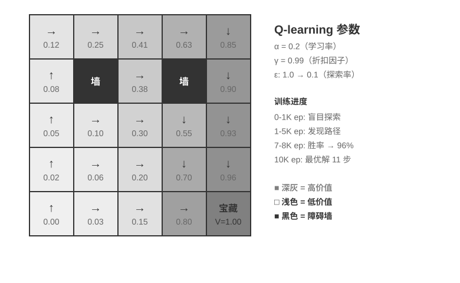
> **图 8-3 解读**：网格世界是本节实验 8-1 的环境——Agent 在离散格子上移动，只有到达目标才拿到奖励。这张图的作用是让读者看到**稀疏奖励**的样子：绝大多数动作的即时奖励都是零，学会走路全靠价值在多次迭代中的传播。

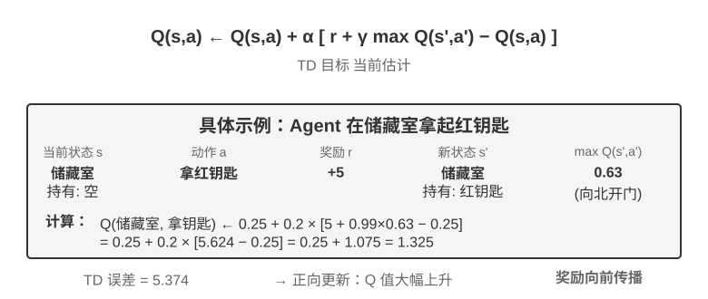
> **图 8-4 解读**：这张图把 Q 值在迭代中的变化画出来，对应实验 8-1 观察到的三个阶段——**初始全零、渐进收敛、接近 100%**。它解释了后文「全失败的 rollout 没有正向轨迹」为什么等于「没有梯度」：如果价值从未被传播到任何动作上，策略就只能随机游走。

**原文论证**：

> 强化学习问题由策略、奖励、价值函数与环境模型四要素定义；再加上动作空间与探索—利用的权衡，就构成一张完整的清单。（§从经典 RL Agent 到现代 Agent）

> Agent 与环境的边界不是物理边界，而是「谁的动作不由你控制」——能被 Agent 任意改变的部分归 Agent，其余归环境。（同上）

> 现代 LLM Agent 与经典 RL Agent 的根本差别在于起点：经典 RL 从随机初始化的策略开始从零学习，LLM Agent 则一开始就带着互联网规模的语言先验。（同上）

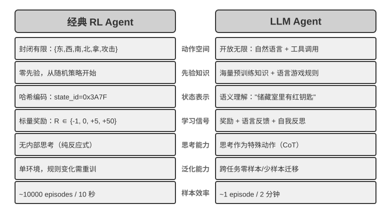
> **图 8-5 解读**：这张对照图是本节的核心——左侧是经典 RL Agent（从随机初始化策略开始、以任务专属动作空间行动），右侧是现代 LLM Agent（以互联网规模语言先验起步、动作空间是 token）。**差别不在算法，而在起点**，这正是「LLM Agent 用得起 RL」的前提。

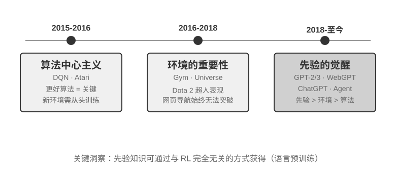
> **图 8-6 解读**：这张图给出机构层面的旁证——训练范式从「算法为王」转向「环境为王」，再转向「先验与知识更重要」。它与本节结论一致：**决定 Agent 能力的往往不是优化器，而是起点和训练环境**。

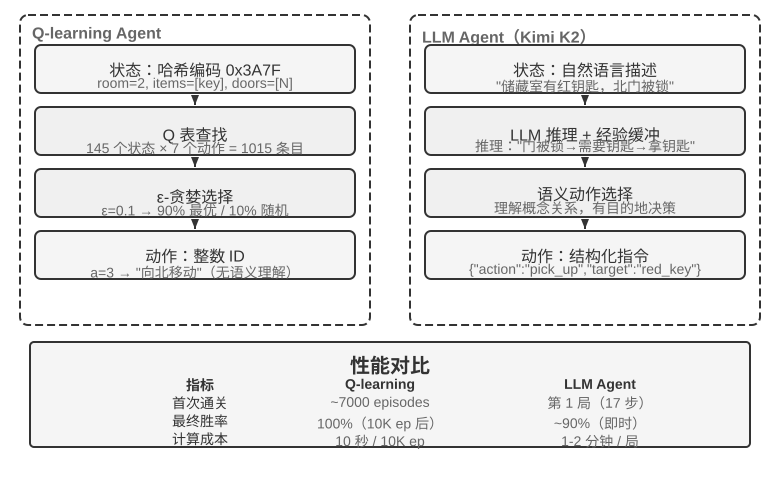
> **图 8-7 解读**：这张图把同一个寻宝游戏拆成两套架构并排——左侧的 Q-learning 从零学一张 Q 表/网络，右侧的 LLM Agent 直接复用语言先验来输出动作。**同一任务、两种起点、两种代价**：经典 RL 需要海量交互才能形成有效策略，而 LLM Agent 的难点转移到「环境接口与奖励如何定义」。

**取舍与延伸**：本节是**可选阅读**，但它给出的两个判断被后文反复引用：

1. **「Agent 与环境的分界线」是奖励设计的坐标系**——奖励属于环境一侧，所以「模型自己声称完成」不能作为奖励来源（§奖励设计、§从问题案例到后训练反复强调）。
2. **「带语言先验的巨大动作空间」是 LLM RL 的可行性前提**——这解释了本章为什么把「先 Mid-training / SFT 再 RL」写成两重门控：如果底座本身没有可用的先验，RL 要探索的空间会大到不收敛。

〔精读批注〕本节的实验 8-1（Q-learning 网格世界，★）值得当作**心智模型**而不是教程来读：它的价值在于让读者亲眼看到「三个阶段：0 → 渐进收敛 → 接近 100%」，从而理解为什么后文说「全失败的 rollout 没有正向轨迹」就等于「没有梯度」。一个从零开始的策略在稀疏奖励下长时间拿 0 分，这在经典 RL 里是靠随机探索解决的，在 LLM RL 里则靠底座先验解决。

#### 本节涉及的其余实验

- **实验 8-2（★★）边缘智能体的量化权衡**：本节用它引出「用参数换延迟」的方向——从数十亿参数降到数亿参数。
- **实验 8-3（★★）用 SFT 复现一个 VLA 模型**：以 SmolVLA 为例，说明视觉—语言—动作模型可以在消费级 GPU 上用数小时完成 SFT。它与后文 SimpleVLA-RL 构成「SFT 起点 → RL 强化」的完整链路。
- **实验 8-4（★★★）从零复现 MiniMind 2 预训练**：约 14 小时、约 34 美元，采用 QK 归一化与 Muon 优化器取得数倍加速。这一条与 §模型预训练基础 相互印证。

---

### §8.3 模型预训练基础 `[可选阅读]`

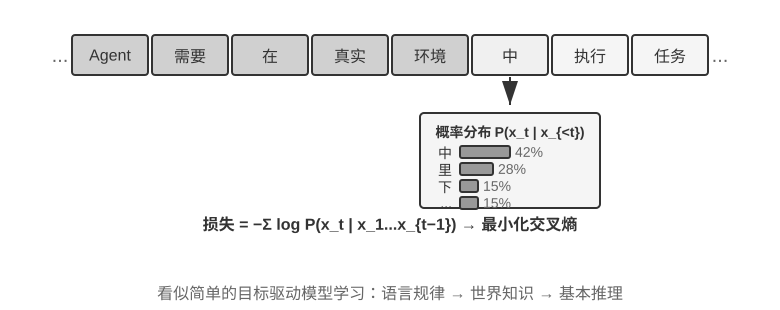
> **图 8-8 解读**：这张图画出预训练目标函数的形态——输入一段文本，逐个位置预测下一个 token，监督信号由文本自身提供。**「标签来自数据本身」正是预训练能吃下互联网规模语料的原因**，也是它只覆盖「继续写下去」这一种任务形态的原因。

> [!question] 带着这些问题阅读本节
> 1. 预训练的目标函数是什么？它为什么能在没有人工标注的情况下产生能力？
> 2. 参数量、数据量与算力之间是什么关系？小规模复现能说明什么、不能说明什么？
> 3. 「预训练已经有了知识，但不会听指令」具体表现为什么？
> 4. VLM 的两阶段训练（投影层对齐 + 指令微调）给后训练提供了什么类比？

**读后小结**：

- **预训练的目标是「预测下一个 token」，监督信号由文本自身提供**——这是它能吃掉互联网规模数据的原因；但代价是它**只覆盖『继续写下去』这一种任务形态**。
- **能力是涌现的、协议不是**：预训练后的模型已经知道很多事实，却常常不能按指令输出正确格式。这正好解释了为什么 SFT 的必要性在于**格式稳定**而非知识注入。
- **小规模复现证明了训练循环本身可以在消费级硬件上跑通**，但**不能**据此推断大规模预训练的涌现行为。
- **VLM 的两阶段**（先把冻结视觉编码器的表示投影到语言空间，再在高质量图文对上指令微调）是「对齐接口 → 教协议」这套思路在多模态上的版本，与本章主线同构。

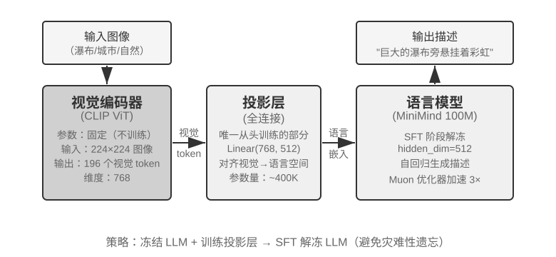
> **图 8-9 解读**：这张图拆开 VLM 的构造——冻结的视觉编码器提取图像表示，投影层把表示映射到语言模型的表示空间，语言模型负责生成。**第一阶段只训练投影层**（对齐接口），**第二阶段才在高质量图文对上微调指令跟随**（教协议）。它给后训练提供的类比是：跨模态的能力接入往往要分「先对齐接口、再教用法」两步走。

**原文论证**：

> 预训练的目标是预测下一个词元，监督信号由文本自身提供。（§模型预训练基础）

> 预训练后的模型已经知道很多事实，却常常不能按指令输出正确格式。（同上）

**取舍与延伸**：本节同样是**可选阅读**，但它是理解「为什么 SFT 不是知识注入手段」的必要背景。若跳过本节，读者容易把 §SFT 理解成「用问答对把知识灌进模型」，而本章后文的实践要点第 1 条恰好否定了这种用法。

〔精读批注〕把「预训练 = 学知识、SFT = 学协议」这条分工记住之后，本章后文几处看起来矛盾的表述就自洽了：SFT 的损失在训练集上能降到很低却泛化差（因为它学的是**格式的模仿**），而 RL 能泛化（因为它优化的是**结果的达成**）。两者优化的根本不是同一件事。

---

### §8.4 Mid-training：补知识与基础能力

> [!question] 带着这些问题阅读本节
> 1. Mid-training 有哪三个别名？它们分别强调哪一类适配？
> 2. Mid-training 的数据应该长什么样（表8-2）？它与 SFT 数据在形态上的差别是什么？
> 3. 「中小规模数据即可带来明显收益」与「会造成通用能力遗忘」如何同时成立？
> 4. 放数据配比与学习率上的注意力，与算力投入相比为什么更划算？

**读后小结**：

- **三个别名对应三种适配范围**：CPT（领域继续预训练）、DAPT（领域自适应预训练）、TAPT（任务自适应预训练）。它们是同一类动作在不同粒度上的叫法。
- **知识注入为什么有效（表8-2）**：Mid-training 以**完整文档**为主要数据形态，学习目标是「预测内容本身」；文档里的**隐性关联**（事实之间的共现与依赖）会被一并吸收，而问答对只覆盖「答案」这一点。
- **收益与代价并存**：领域数据能在中等规模下带来明显收益，但会**造成通用能力遗忘**——所以「每个阶段保留短数据和前序阶段 replay」「用『能力 × 长度』矩阵检查退化」被写进了实践要点。
- **工程上的高性价比动作**是调**数据配比**与**学习率**，而不是加算力；本章后文的实践要点第 7 条把「过度训练导致泛化下降」列为独立陷阱，与本节的遗忘风险是同一件事的两面。

**原文论证**：

> Mid-training 在目标领域的文档、指令与轨迹上继续预训练，用比 SFT 多得多的数据补知识与基础能力。（§Mid-training：补知识与基础能力）

> Mid-training 以完整文档为主要数据形态，学习目标是预测内容本身。（同上）

> 领域数据能在中等规模下带来明显收益，但会造成通用能力遗忘。（同上）

**取舍与延伸**：本节把 **CPT / DAPT / TAPT** 三个缩写并置，等于在说：这三个名字在论文里各说各话，但在工程上它们是**同一个旋钮的三个档位**——档位的差别只是「续训数据的范围」。选择档位的依据不是名词，而是**目标能力距离底座有多远**。

〔精读批注〕本节最容易被低估的一句是「调数据配比与学习率比加算力更划算」。它的反面是**大量团队用算力去补数据配比的问题**：当领域数据占比过低时，延长训练只会让模型在通用分布上走得更远；当占比过高时，遗忘会加速。这是一个二维搜索问题，不是一个时长问题。

---

### §8.5 SFT（监督微调）

> [!question] 带着这些问题阅读本节
> 1. SFT 与 RL 在优化目标、训练信号、数据格式、优化压力上分别差在哪里？
> 2. LoRA 在后训练的实际成本语境下为什么值得单独讨论？它的学习率与秩该怎么取？
> 3. 「SFT 记忆」为什么是结构性的，而不是「数据不够多」？
> 4. 什么情况下 SFT 本身就够了，不需要继续上 RL？

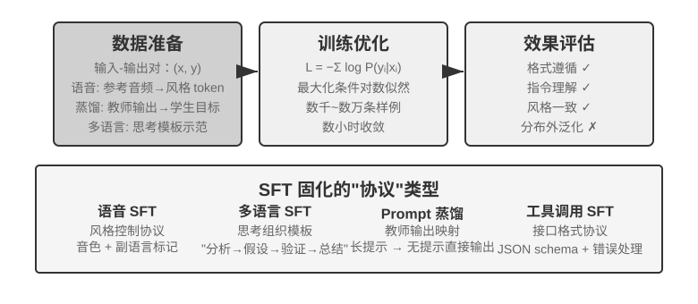
> **图 8-10 解读**：SFT 流水线图：示范数据 → 构造「问题—回答」训练样本 → 只在回答部分计算损失 → 更新参数。它对应本节「SFT 教的是协议」的定位，也解释了为什么 SFT 的损失能降到很低却泛化差——**它优化的是对给定答案的模仿，不是结果的达成**。

**读后小结**：

- **SFT 教的是协议**：什么场景输出什么形状、什么时候调用哪个工具、何时停下来问澄清。这几件事都**可以示范**，因此适合监督学习。
- **SFT 与 RL 的四点差别**：优化目标不同（模仿给定答案 vs 最大化期望奖励）、训练信号不同（逐 token 的正确性 vs 结果的成败）、数据格式不同（问答对 vs 任务与环境）、优化压力不同（全词表上的模仿 vs 只在自己采样分布上的重分配）。
- **「SFT 记忆、RL 泛化」的机制解释**：SFT 主要在**教师会走到的状态**上给监督，学生部署后一旦走入训练数据没覆盖的前缀，后续每一步都在陌生状态上预测，误差沿长序列累积。这就是 §蒸馏 里「分布错位」的前身。
- **LoRA 的实用结论**：成本并不高，因此它成为后文一系列小规模实验（8-17 ~ 8-19）的默认工具；超参上要区分 SFT 与 RL 两套口径，秩的选取也按任务调整。
- **「SFT 可能已经足够」的条件**：如果测试分布与训练高度一致，SFT 就够了（实践要点第 10 条）。

**原文论证**：

> SFT 用几千到几万条“问题—标准回答”教模型格式与协议。（§SFT（监督微调））

> SFT 主要在教师会走到的状态上给监督；学生部署后一旦走入训练数据没覆盖的前缀，后续每一步都在陌生状态上预测，误差会沿长序列累积。（同上）

> 如果测试分布与训练高度一致，SFT 可能已经足够。（§后训练实践要点）

**取舍与延伸**：本节给出的 LoRA 讨论最有价值的地方不是具体超参，而是**它把「后训练」从「大厂专属」拉回到「小团队可做实验」**——本章后半段三个案例实验（DPO 修复过早结束、中文弯引号 SFT、精确复制 SFT）全部建立在「LoRA 成本不高」这个前提上。没有这个前提，本章的实践建议会全部失效。

〔精读批注〕「SFT 在教师会走到的状态上给监督」这句话，是本章最可迁移的一条诊断工具：**当模型在训练集上表现良好、上线后却频繁出错时，先问「它现在所处的状态，示范数据里出现过吗」**——如果没出现过，这仍然是一个 SFT 问题，而不是「模型太笨」。

---

### §8.6 SFT 数据合成：从示范到可训练轨迹

> [!question] 带着这些问题阅读本节
> 1. 从原始文档到可训练轨迹，中间要经过哪些环节（图8-12）？
> 2. 合成数据的质量靠什么保证？「可验证」在其中扮演什么角色？
> 3. 为什么需要让合成数据在「组合」维度上有覆盖，而不只是「数量」上有覆盖？
> 4. 合成的轨迹怎样避免成为「教师偏好的复读」？

**读后小结**：

- **数据合成是一条流水线，不是一次生成**：从原始文档出发，经过任务抽取、轨迹生成、验证与过滤，最后落到可训练轨迹。
- **合成数据的关键成本在验证而不在生成**——与本章奖励设计的「验证比生成更容易」是同一个事实的两面。
- **组合覆盖是重点**：合成数据的价值在于系统性地铺开任务的组合空间，而不是在同一个任务上反复采样。
- **可验证性决定合成数据能否用于 RL**：不可验证的合成轨迹只能进 SFT，可验证的合成任务才能进 RL 的采样池。

**原文论证**：

> 从原始文档到可训练轨迹，中间要经过任务抽取、轨迹生成、验证与过滤等环节。（§SFT 数据合成：从示范到可训练轨迹）

> 合成数据的价值在于系统性地铺开任务的组合空间，而不是在同一个任务上反复采样。（同上）

**取舍与延伸**：本节与 §蒸馏 构成一对：**数据合成是「在没有学生的真实轨迹之前造数据」，蒸馏是「在学生自己的轨迹上造监督」**。前者便宜但分布未必对齐学生，后者贵但直接对齐学生当前会犯的错。工程顺序通常是「先合成冷启动、再在轨蒸馏」。

〔精读批注〕本节提到的 SKT（Skill-Use Training at Scale）与技能分类法引导的数据合成，代表了合成数据的两种组织方式：**按「技能」组织数据**（把任务分解到技能粒度再合成）与**按「技能分类法」组织数据**（先建 taxonomy 再保证组合覆盖）。这两种方式都指向同一个结论：**数据合成的难点已经从「能不能生成」变成「用什么结构生成」**。

---

### §8.7 何时选择 Mid-training、SFT 与 RL

> [!question] 带着这些问题阅读本节
> 1. 图8-11 给出的两阶段训练流程中，Mid-training 为什么被放在「行为对齐」之前？
> 2. 判断该上哪一个阶段，需要看哪几个指标？它们的先后顺序是什么？
> 3. 「行动阈值」是怎么定义的？为什么阈值必须是数据相关的而不是固定的？
> 4. 为什么「格式未稳定就引入 RL」会同时损害信号密度与信号正确性？

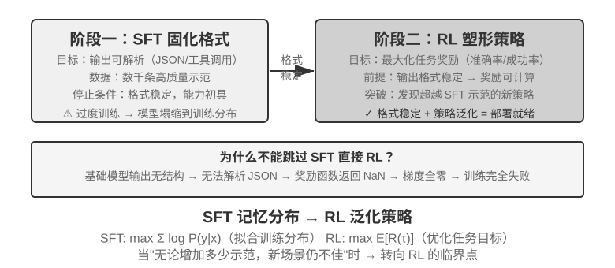
> **图 8-11 解读**：这张图是本节的结构依据——**Mid-training 被画在 SFT 与 RL 这两个「行为对齐」阶段之前**，因此它属于底座工作而不是对齐工作。把它与 SFT/RL 并列成「三种微调力度」是对本图的误读。

**读后小结**：

- **判断顺序是「知识 → 格式 → 策略」**：先看 `pass@k`，如果合理采样下仍然接近零，说明底座缺能力，走 Mid-training；再看格式解析率，如果模型偶尔会做却输出不可解析，走 SFT；只有当策略能产生**可评分且有奖励差异**的轨迹时，RL 才有效率。
- **图8-11 的结构意义**：Mid-training 位于两个「行为对齐」阶段（SFT 与 RL）之前，说明它属于**底座工作**，不属于对齐工作。把它和 SFT/RL 并列成「三种微调力度」是本章明确反对的读法。
- **阈值必须是数据相关的**：本章实践要点第 2 条明确说，「可接受的解析失败率取决于任务与奖励设计，**不应把固定阈值当作普遍标准**」。
- **格式不稳定对 RL 的伤害是双重的**：奖励计算依赖解析，解析失败会让信号变稀疏；更糟的是解析器可能**系统性地偏好某类错误输出**，让奖励失真。

**原文论证**：

> 如果合理采样下 `pass@k` 仍接近零，先用 Mid-training 补知识与能力；如果模型偶尔会做却输出不可解析，先用 SFT 稳定格式；只有当当前策略能产生可评分且有奖励差异的轨迹时，RL 才能高效地重新分配概率并探索策略。（§本章小结）

> 可接受的解析失败率取决于任务与奖励设计，不应把固定阈值当作普遍标准。（§后训练实践要点）

> SFT→RL 两阶段训练流程；Mid-training 位于这两个行为对齐阶段之前。（图8-11 图题）

**取舍与延伸**：本节实际给出了**一份可执行的分诊流程**：`pass@k` 近零 → Mid-training；`pass@k` 尚可但解析率低 → SFT；两者都可 → RL。配上 §后训练实践要点 的「先用小规模实验验证关键假设」，这套流程的成本门槛被压到「少量数据 + 小批 rollout」的量级。

〔精读批注〕这套分诊流程有一个隐含前提值得点出：**它假设失败原因已经被正确归因**。如果 `pass@k` 低是因为工具接口设计有问题、或者 Harness 截断了上下文，那么无论走哪个阶段都不会有改善——这正是第七章「先检查评测系统、再动 Agent」在训练侧的版本。

---

### §8.8 单轮强化学习：记忆与泛化的对照

> [!question] 带着这些问题阅读本节
> 1. GeneralPoints 与 V-IRL 两个实验分别把 SFT 与 RL 放在什么条件下比较？为什么要控制到「相同任务、相同模型、相同数据与预算」？
> 2. 「SFT 记忆、RL 泛化」为什么只能是**倾向**，而不是普遍规律？
> 3. 表8-3 的机制对照中，最关键的一行是哪一行？
> 4. RL 的泛化能力来自「更大的探索」，还是来自「不同的优化目标」？

**读后小结**：

- **对照设计是本节的分量所在**：两个实验都刻意固定任务、模型、数据与预算，只替换训练信号（SFT 的示范 vs RL 的结果奖励），这样「记忆 / 泛化」的差异才能归因到训练信号本身。
- **表8-3 的机制对照**把差异拆成四点：优化目标、训练信号、数据格式、优化压力。其中**最关键的是「优化压力」**——SFT 在每个位置都对整个词表施加模仿压力，RL 只在自己采样出的轨迹上重新分配概率。
- **RL 泛化的来源是「在正确的状态下被奖励」**：RL 的轨迹由当前策略自己生成，因此训练分布与部署分布天然更接近；SFT 的轨迹由教师生成，两者的错位在长序列上会被放大。
- **结论的边界必须一起记住**：本章小结明确写「『SFT 记忆、RL 泛化』概括的是本章受控实验中观察到的倾向，并不是不受数据、模型、奖励与环境影响的普遍规律」。

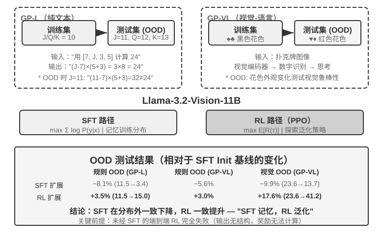
> **图 8-12 解读**：这张图给出 GeneralPoints 的实验架构——GP-L（语言版）与 GP-VL（视觉语言版）两个变体各自如何切分训练与测试。它的意义在于**把「记忆 vs 泛化」变成一个可测量的对照**：训练与测试的任务分布刻意分开，模型在未见分布上的表现就是泛化读数，而不是训练集上的拟合读数。

**原文论证**：

> 两个实验都刻意固定任务、模型、数据与预算，只替换训练信号。（§单轮强化学习：记忆与泛化的对照）

> “SFT 记忆、RL 泛化”概括的是本章受控实验中观察到的倾向，并不是不受数据、模型、奖励与环境影响的普遍规律。（§本章小结）

> RL 的轨迹由当前策略自己生成，因此训练分布与部署分布天然更接近。（§单轮强化学习：记忆与泛化的对照）

**取舍与延伸**：这一节的方法论价值高于结论价值。**「控制变量到只换训练信号」在 Agent 研究里非常难做到**——因为换 RL 往往意味着换数据格式、换评测方式，甚至换模型规模。本章把两个实验并置，正是为了说明这个控制是可以做到的。

〔精读批注〕如果只记一句话，本节的应该是：**「SFT 记忆、RL 泛化」的机制不在算法，而在数据分布**。SFT 训练分布来自教师，RL 训练分布来自学生自己。由此可推出一条实用推论——**如果 SFT 的示范数据恰好覆盖了部署分布，SFT 的泛化劣势会大幅缩小**，这也解释了为什么高质量示范数据在工业界仍然极其有效。

---

### §8.9 RL 算法：从 16 次 rollout 到一次参数更新

> [!question] 带着这些问题阅读本节
> 1. 为什么一个任务要采 16 次 rollout，而不是 1 次或 64 次？
> 2. 图8-13 里「相对优势」是怎么算出来的？它为什么比绝对分数更适合做训练信号？
> 3. PPO、GRPO 与 DPO 在本章的分工分别是什么？为什么不展开 PPO 的推导？
> 4. 「看似 On-Policy，为什么仍会被数值误差拖垮」——这个四级小节在说什么？

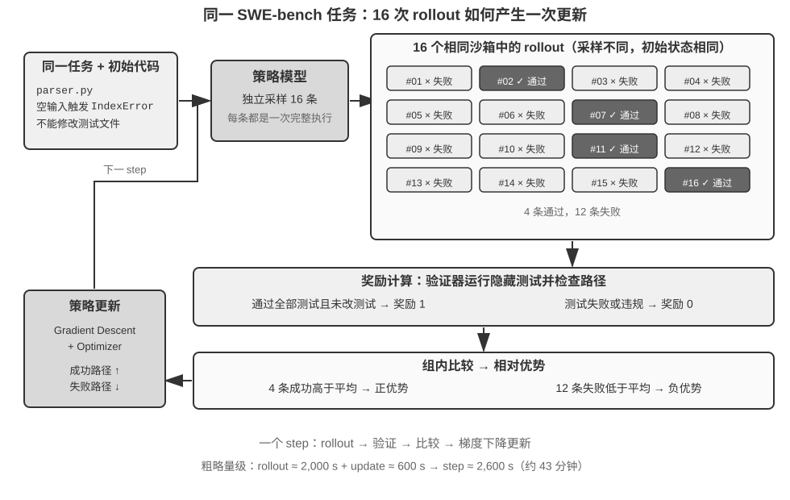
> **图 8-13 解读**：这张图把 GRPO 的四步画在同一个 SWE-bench 任务上——**16 次 rollout → 验证器打分 → 组内比较得相对优势 → 一次参数更新**。它解释了「相对优势」为什么优于绝对分数：绝对分数含环境噪声与任务难度差异，而组内比较在采样组内部把这些干扰消掉了。

**读后小结**：

- **GRPO 的四步是最小可复现的算法骨架**：同一任务采一组 rollout → 用验证器打分 → 组内比较算出相对优势 → 用这个优势做一次参数更新。图8-13 正是把这四步画在同一个 SWE-bench 任务上。
- **「组内相对」取代了「绝对分数」**：绝对分数有环境噪声与任务难度差异，组内相对优势则在采样组内部消掉了这些干扰，同时天然给出「比平均水平好多少」的方向。
- **16 次是工程折中**：次数太少优势估计噪声大，次数太多则同一任务上的收益递减、而且长尾响应会拖慢整批（思考题第 12 题）。
- **PPO / GRPO / DPO 的分工**：PPO 是经典策略梯度方法，价值网络或 turn-level 优势负责把终点反馈归因到较早的动作；GRPO 去掉价值网络，用组内相对优势，「把轨迹级优势均摊到生成 token，长轨迹上需格外注意信号稀释」；DPO 跳过显式奖励模型，直接从偏好对做离线优化，在本章主要作为案例 1 的修复工具出现。

**原文论证**：

> 同一任务采一组 rollout，用验证器打分，组内比较算出相对优势，再用这个优势做一次参数更新。（§RL 算法：从 16 次 rollout 到一次参数更新）

> GRPO 则把轨迹级优势均摊到生成 token，长轨迹上需格外注意信号稀释。（§奖励设计：如何把任务目标变成学习信号）

> DPO 跳过显式奖励模型，直接从偏好对做离线优化。（同上）

#### 四级小节：看似 On-Policy，为什么仍会被数值误差拖垮

> [!question] 带着这些问题阅读本小节
> 1. 什么情况下「名义上 on-policy」的训练实际上是 off-policy 的？
> 2. 更新前 sampler 与 trainer 的 log probability 不一致，会导致什么后果？
> 3. 应该监控哪几个量来发现这类失配？

**读后小结**：这一小节是本章**最少被引用、但最容易导致训练失败**的部分。要点是：即使算法流程里完整保留了重要性修正，**只要 rollout 引擎实际采样的分布与 trainer 计算的分布不是同一个**，训练状态就已经离轨；而这类失配在小模型短序列上可能只表现为轻微噪声，在长序列上会累积成实质偏差。监控项包括：更新前 sampler/trainer 的 log probability 差异、近似 KL、裁剪比例与策略 staleness。

**原文论证**：

> 如果 rollout 引擎实际采样的分布与 trainer 计算的分布不是同一个，即使不显式使用 PPO 的概率比，训练状态也已经离轨。（§蒸馏：提升样本效率）

> 应监控 log probability 差异、近似 KL、裁剪比例和策略 staleness。（§后训练实践要点）

**取舍与延伸**：本节把 RL 从「算法选择问题」重新表述为**「数值一致性问题」**。这解释了一个常见现象：**同一份 RL 代码在不同推理后端上复现不出相同曲线**。本章的立场很明确——这不是「工程细节」，而是与奖励曲线同等重要的前提（本章小结第二条）。

〔精读批注〕把「sampler/trainer 一致性」提升到与奖励曲线并列的位置，是本章最不讨喜、也最实用的判断。它的实践含义是：**在调奖励函数之前，先证明 rollout 与训练用的是同一个分布**。否则你会在一个错误的信号上反复优化，而且所有调参经验都无法迁移。

---

### §8.10 RL 环境：从评估到仿真

> [!question] 带着这些问题阅读本节
> 1. 表8-4 把环境分成哪几类？划分依据是什么？
> 2. 真实环境、仿真环境与「模型模拟环境」三者之间的关系是什么（图8-7）？
> 3. 用模型模拟环境有什么风险？为什么说「模拟器的偏差就是训练的天花板」？
> 4. 从评估环境改造成训练环境，最容易低估的成本是什么？

**读后小结**：

- **表8-4 给出环境谱系**：从可以直接使用的真实环境，到为训练构建的仿真环境，再到用模型模拟出来的环境；它们的共性是都要提供**动作、观测与可计算的奖励**。
- **图8-7 的核心信息是「三者不是替代关系而是取舍关系」**：真实环境保真但贵、慢、不可重置；仿真环境可重置可重放但需要构建成本；模型模拟环境最便宜但偏差最大。
- **「制造不出真实环境时，用模型模拟环境也是一条可行路线」**（本章小结），但**模拟器的偏差就是训练的天花板**——这一句同时是许可与警告。
- **评估环境走向训练环境的两项改造要求**：可靠的 reset 语义与远高于评估的吞吐。
- **环境也是对训练集与测试集分离原则的挑战**：评估集用于训练后就不再独立（思考题第 10 题）。

**原文论证**：

> 造不出真实环境时，用模型模拟环境（合成工具返回值、仿真环境动态）也是一条可行路线，但模拟器的偏差就是训练的天花板。（§本章小结）

> 若仿真过于简化（客服总按固定模式回复）或环境响应不真实（错误信息与生产环境不一致），训练出的策略在真实场景中会完全失效。（§后训练实践要点）

> 评估环境提供自动化测试基础设施。（§本章小结）

**取舍与延伸**：本节把「环境」从训练基础设施提升为**训练质量的第一变量**。这与本章的第二条主结论完全一致：**数据与环境比算法更重要**——「Mid-training 语料决定底座补到了哪里，SFT 示范决定协议是否稳定，环境和奖励决定 RL 能探索并强化什么」。

〔精读批注〕一个容易忽略的推论：**环境建设是可以在训练之前独立验收的**。既然「奖励计算所需的 JSON 解析失败率」和「reset 语义」都可以用小批 rollout 测出来，那么环境的质量就应当像代码一样有回归测试。把环境当代码来维护，是本章隐含但未明说的工程建议。

---

### §8.11 从单轮到多轮：任务场景与信用分配

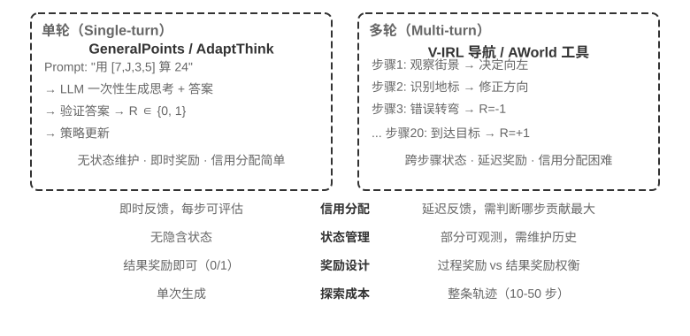
> **图 8-14 解读**：这张图把单轮与多轮并排比较——单轮只有一次「提问—回答」，成败信号落在轨迹末尾；多轮则把一次任务摊到若干次交互上，**信号出现的位置被推迟、被稀释**。这正对应本节开头的问题：多轮不是单轮的简单重复，它首先改变了奖励的时间结构。

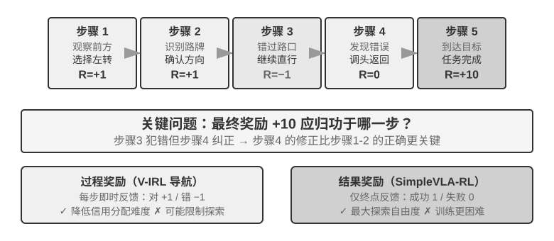
> **图 8-15 解读**：这张图画出信用分配的难题——一次成功或失败要往回分摊到各轮决策上，而越靠前的轮次离最终结果越远，越难被公平打分。**这与「先把任务分解到技能粒度再合成数据」是同一个问题的两端**：数据侧在铺开组合空间，奖励侧则要判断组合空间里的哪一步功不可没。

> [!question] 带着这些问题阅读本节
> 1. 单轮 RL 与多轮 RL 的差别（图8-14）具体落在哪几个维度上？
> 2. 多轮交互中的信用分配难在哪里（图8-15）？「第 3 轮还是第 7 轮的决策」为什么难归因？
> 3. 工具调用为什么带来「组合爆炸」（图8-16）？它对奖励设计提出什么新要求？
> 4. 多轮 Agent 的训练难点，主要是优化器的问题还是环境反馈的问题？

**读后小结**：

- **单轮与多轮的核心差别是「成败信号出现的位置」**：单轮在轨迹末尾，多轮可能在很晚才出现，而且中间每一步都可能决定了最终结果。
- **信用分配有三条常见出路**：把终点反馈通过价值网络或 turn-level 优势回传、用过程奖励在中间步骤直接给分、用路径信号对可机器判定的动作扣分（RLVP）。
- **工具调用带来的组合爆炸是量级问题**：工具的组合数随工具数量与轮数快速增长，穷举不可能，因此必须靠**可验证奖励 + 采样**而不是靠覆盖。
- **本节的共同结论**：多轮 Agent 的训练难点**不是「有没有一个更复杂的优化器」，而是环境反馈是否可靠、动作链是否可验证，以及最终奖励该如何归因到中间决策**。

**原文论证**：

> 这些场景共同说明：多轮 Agent 的训练难点不是“有没有一个更复杂的优化器”，而是环境反馈是否可靠、动作链是否可验证，以及最终奖励该如何归因到中间决策。（§从单轮到多轮：任务场景与信用分配）

> 工具使用则带来组合爆炸。（§后训练实践要点）

**取舍与延伸**：本节收录的实验 8-12（V-IRL-VL 逐步导航反馈）与实验 8-13（SimpleVLA-RL 稀疏成功奖励）构成一组对照：**密集反馈换收敛速度、稀疏反馈换探索空间**。注意这组对照的成立条件——两者都在**可重置的仿真环境**里，因此能承受大量采样；在真实环境里，这个对照的代价结构完全不同。

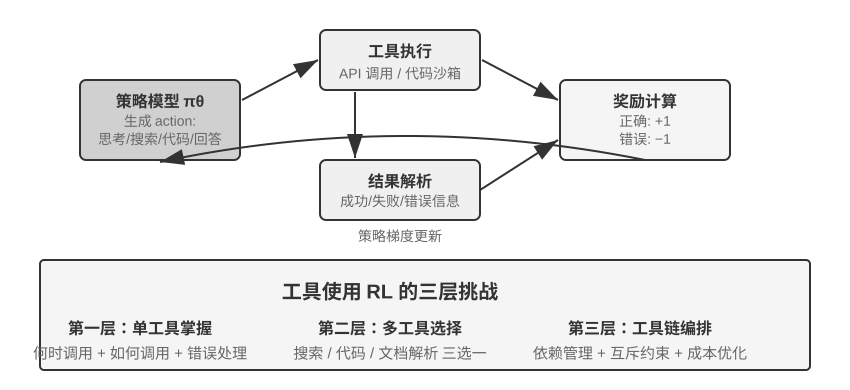
> **图 8-16 解读**：这张图画出工具调用 RL 的奖励循环——模型发出调用、工具执行并返回结果、验证器对最终结果打分、分数回流成训练信号。**循环里的关键节点是验证器**：它必须能对「工具用得对不对」给出可计算的判断，否则整条循环没有梯度。

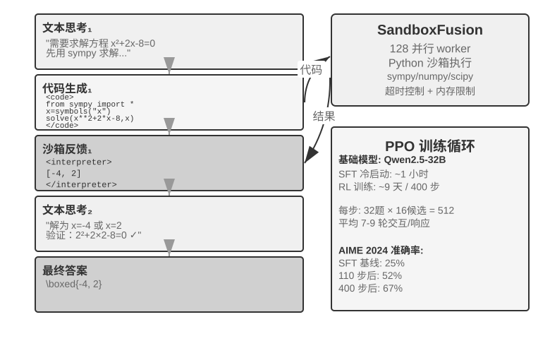
> **图 8-17 解读**：这张图给出 ReTool 的形态——文本思考与代码执行交替进行，沙盒把执行结果（成功、报错、越界）回灌进上下文。**它把「工具调用」从一次性的输出变成多轮反馈**，因此奖励可以落在每一步执行结果上，而不必只等最终答案。

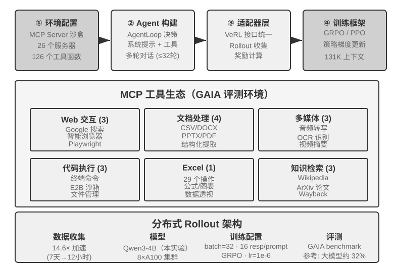
> **图 8-18 解读**：这张图画出 AWorld-train 的架构——MCP 沙盒承载工具生态，训练循环在其上采样与评分。它给本节的结论提供了具体形态：**多轮 RL 的基础设施本质是一个可控、可验证、可重置的工具环境**，而不是一个更复杂的优化器。

〔精读批注〕本节最有工程价值的一句是「动作链是否可验证」。它把多轮 RL 的可行性门槛从「环境是否真实」换成了「动作链是否可验证」——这两者不等价：**一个高度真实的仿真环境，如果动作不可验证，仍然训不出东西；一个简化但每步可验证的环境，可能更有用。**

---

### §8.12 奖励设计：如何把任务目标变成学习信号

> [!question] 带着这些问题阅读本节
> 1. 奖励设计沿哪三个维度展开？它们分别回答什么问题？
> 2. reward hacking 与 reward seeking 的区别是什么？后者为什么更隐蔽？
> 3. 结果奖励与过程奖励各自的代价是什么？「先用哪一个」有明确答案吗？
> 4. RLVP 的「奖励结果、惩罚路径」具体惩罚什么？为什么必须保留结果奖励？
> 5. 奖励的密度与表示形式是两件事——这句话在工程上意味着什么？

**读后小结**：

本节是本章**信息密度最高**的一节，四个子问题各自给出可操作结论：

1. **奖励来自哪里**——最可靠的是**可验证奖励（RLVR）**：用测试用例、数据库断言、状态差异或格式检查直接判断结果。规则越确定，奖励越便宜、可复现，也越不容易被钻空子。RLHF 只作为背景（InstructGPT 的流程、KL 正则、DPO 的离线优化）；目标难以规则化时用 **GRM（生成式奖励模型）**，它不只输出分数还生成诊断。
2. **reward hacking vs reward seeking**——前者是钻规则或实现漏洞拿高分，后者是模型先在心里建立「评判器会看什么」的模型再按猜测调整行为。**后者不一定篡改测试或伪造结果**，却可能在长程任务中自行设置一个过于简单的检查，刚好通过就提前结束。因此「通过了 grader」**不能**自动等价于「任务完成了」。
3. **什么时候给**——结果奖励（ORM）只在 episode 结束时判断，最简单、探索自由度最大，但稀疏；过程奖励（PRM）在中间步骤给反馈，能缓解长时序信用分配，**却可能把模型限制在设计者预设的路径上**，而且标注和验证成本更高。工程顺序是**先用结果奖励建立可靠基线，再只为真正可验证的中间事件加入过程信号**。
4. **表达多少信息**——密度与表示形式是两件事。标量只回答「总体多好」；半标量先给理由再给分；向量按维度分别打分；生成式奖励给自然语言诊断。选择原则：有确定答案或测试→二元标量；有多个相互独立的质量目标→向量或加权标量；开放式、难穷举→生成式诊断 + 事实校验 + 人工抽检。**不要为了「奖励更丰富」而堆叠不可验证的维度。**

**RLVP（Reinforcement Learning with Verified Penalty）**是本节的落点：原则是**奖励结果，惩罚路径**，针对的是可机器判定的、与最终成败无关的**结果中性约束**。它不改变 PPO/GRPO，只改变每一步看到的奖励，合并形式为 $R=O+\beta\Phi$——$O$ 是任务结果，$\Phi$ 是由确定性规则逐动作计算的路径信号；两路归一化后再合并，避免路径信号淹没主目标。

设计 RLVP 的四条纪律（〔原书〕）：只惩罚具体动作，不惩罚「不够努力」；结果奖励始终保留，避免模型学会什么都不做；每个惩罚最好配一条可达的合规路径；规则必须确定、难以钻空子。并且**先测信号可达性**——「纯结果奖励在全败组和全胜组都会产生零方差、没有梯度；违规动作通常容易检测，惩罚几乎总能恢复差异；进展奖励只有在部分进展可达时才有效」。

**原文论证**：

> 最可靠的来源是**可验证奖励（RLVR）**：用测试用例、数据库断言、状态差异或格式检查直接判断结果。（§奖励设计：如何把任务目标变成学习信号）

> **reward hacking** 是钻规则或实现漏洞拿高分，**reward seeking** 则是模型先在心里建立一个“评判器会看什么”的模型，再按这个猜测调整行为。（同上）

> 所以“通过了 grader”不能自动等价于“任务完成了”：评判器是意图的代理，训练越强，模型越可能把代理当成目标本身。（同上）

> **结果奖励（ORM）**只在 episode 结束时判断任务是否完成，最简单，也给策略最大的探索自由度。（同上）

> **过程奖励（PRM）**在中间步骤提供反馈，例如检查身份验证、工具参数、测试通过数或导航动作。（同上）

> 不要为了“奖励更丰富”而堆叠不可验证的维度。每增加一个评价维度，就增加一种被策略钻空子的可能。（同上）

> RLVP（Reinforcement Learning with Verified Penalty）的原则是：**奖励结果，惩罚路径**。（同上）

> 换句话说，惩罚是通常可达的那一半，进展奖励是受可达性门控的那一半。（同上）

**取舍与延伸**：本节把奖励设计从「打分函数怎么写」重构成**「信号的可达性与可验证性」**两个问题。这两个问题都比「奖励函数复杂度」更底层：**奖励再复杂，如果组内没有方差，就没有梯度；规则再精妙，如果模型能钻，就会被钻。**

〔精读批注〕本节的实验 8-16（RLVP，★★★）值得单独记：TerminalBench 上违规次数由 3.71 降至 0.66，而成功率基本持平；miniF2F 上可达的部分奖励把达到 0.9 成功率所需迭代从 7.0 降至 4.4；软件修复中若所有 rollout 都无法通过任何测试，进展信号不可达，加入它不会带来收益。这三个数字构成一条完整的纪律：**路径惩罚解决「合规」，路径奖励解决「速度」，而两者都受可达性门控。**

---

### §8.13 蒸馏：提升样本效率

> [!question] 带着这些问题阅读本节
> 1. 这里的「样本效率」特指什么？为什么它不等于训练步数或 GPU 时间？
> 2. 在轨蒸馏与离轨蒸馏、On-policy RL 的差别，落在「谁生成状态前缀」还是「谁提供监督」？
> 3. 没有更强的教师模型时，On-Policy 自蒸馏（OPSD）靠什么造出密集信号？
> 4. 在轨蒸馏与「sampler/trainer 数值一致性」有什么关系？

**读后小结**：

- **样本效率的定义被明确限定**：「每次昂贵的环境交互，能带来多少有效的参数更新」，而不只是训练步数或 GPU 时间。ReTool 的 RL 训练时间是 SFT 的 200 倍以上（9 天 vs 1 小时），因此减少环境采样尤其重要。
- **稀疏性是根本原因**：主流 model-free RL 通常只在一条 rollout 结束时得到一个成败标量，中间的错误原因、缺少字段、流程提示都没有直接的学习信号。
- **蒸馏把一次 rollout 变成密集的监督信号**：不必额外探索更多环境轨迹，就能让同一条轨迹贡献大量梯度。
- **在轨蒸馏的组合方式**：学生决定走到哪里，教师负责在学生已经走到的位置告诉它下一步的完整概率分布。一条长度 $T$ 的 rollout 不再只产生一个 0/1 信号，而能产生约 $T$ 组逐 token 监督。
- **OPSD 破除了「必须有更强教师」这个前提**：同一个模型分饰教师和学生两角，但看到的上下文不同——教师版能看到「特权信息」（标准答案或已验证的正确解答），学生版只看到问题本身。它用特权信息替代更强的外部教师，同时保留「在轨采样 + 逐 token 监督」的样本效率优势。
- **两者的边界必须一起记住**：在轨蒸馏「不是从零创造能力」的办法（学生至少要能进入教师可纠正的有效状态）；OPSD「不会凭空创造新知识」（模型拿着答案也讲不清过程就没有额外信号），且朴素 OPSD 还可能让模型丢失原有思考风格。

**原文论证**：

> 这里的“样本效率”特指：**每次昂贵的环境交互，能带来多少有效的参数更新**，而不只是训练步数或 GPU 时间。（§蒸馏：提升样本效率）

> **蒸馏则把一次 rollout 变成密集的监督信号**，不必额外探索更多环境轨迹，就能让同一条轨迹贡献大量梯度，这是蒸馏提升样本效率的关键。（同上）

> **学生决定走到哪里，教师负责在学生已经走到的位置告诉它下一步的完整概率分布。**（§在轨蒸馏：让一次 rollout 产生密集监督）

> 一条长度为 $T$ 的 rollout 不再只产生一个 0/1 信号，而能产生约 $T$ 组逐 token 监督。（同上）

> **同一个模型分饰教师和学生两角，但看到的上下文不同。**（§没有更强的教师怎么办：On-Policy 自蒸馏）

> 在数学等任务上，达到同等性能所需的训练步数约为纯 RL 的 **1/10**。（§在轨蒸馏：让一次 rollout 产生密集监督）

> 这说明瓶颈往往不是奖励函数不够复杂，而是每次交互提供的信号不够密。（同上）

**取舍与延伸**：本节与 §奖励设计 是一对互补的答案，回答的是同一个问题「**信号不够怎么办**」：

- **奖励设计的答案是「让信号更准」**——可验证奖励、路径惩罚、可达性检查。
- **蒸馏的答案是「让信号更密」**——用教师分布把一条轨迹展开成 $T$ 组监督。

两者的共同前提都是**环境交互昂贵**。如果交互很便宜（例如模拟环境），稀疏信号未必是瓶颈；如果交互很贵，蒸馏的性价比就凸显出来。

〔精读批注〕本节最值得记住的一句是「瓶颈往往不是奖励函数不够复杂，而是每次交互提供的信号不够密」。它把大量工程努力的方向从「设计更精妙的奖励」扭转回「提高信号密度」——而后者往往可以通过教师、特权信息或过程验证器实现，不需要改动 RL 算法本身。

#### 在轨蒸馏、自蒸馏与「时间感」实验

〔原书〕一位作者及其合作者的「时间感」任务实验给出了另一条旁证：比较 DPO、四种 RL 与 On-Policy Distillation，前三者分别受到稀疏奖励、目标错位、rollout 形状不匹配和策略崩溃的限制；换成冻结的 Qwen3-32B 教师、在学生自己的多轮轨迹上逐 token 对齐后，训练平滑收敛，**四种条件下通过率比同源 SFT 基线高出 23 到 47 个百分点**。

**原文论证**：

> 换成冻结的 Qwen3-32B 教师，在学生自己的多轮轨迹上逐 token 对齐后，训练平滑收敛，四种条件下通过率比同源 SFT 基线高出 23 到 47 个百分点。（§在轨蒸馏：让一次 rollout 产生密集监督）

---

### §8.14 从问题案例到后训练

> [!question] 带着这些问题阅读本节
> 1. 第七章的评估数据集（端到端回归任务、轨迹前缀回归任务、失败归因记录、Rubric）分别对应本章的哪种训练用法？
> 2. 案例 1 中，「过早结束」应该归因到哪一步？为什么不是归因到「模型不会改代码」？
> 3. 案例 3 的归因链路有哪几个环节？为什么必须逐层对比才能确定是模型的问题？
> 4. 「边界集与保留集缺一不可」——只优化边界集会产生什么后果？

**读后小结**：

本节把第 7 章的评估资产**逐一映射**成训练资产（表8-5），然后用三个真实案例走完整条链路：**失败归因 → 构造训练数据 → 训练 → 边界集与保留集验证**。

**表8-5 的映射关系**（这是本章与第七章之间最重要的一张连接表）：

| 第七章的评估数据集 | 第八章的训练用法 |
| --- | --- |
| 端到端回归任务（含验证器） | RL rollout 任务与可验证奖励（RLVR）；拒绝采样（RFT）的采样池 |
| 轨迹前缀回归任务 | DPO 偏好对、决策边界的 SFT 示范、On-Policy Distillation 的教师状态 |
| 失败归因记录（首个错误步骤与错误类别） | 过程监督的负标签（PRM）、RLVP 路径惩罚的规则来源 |
| Rubric 多维评分与人工金标集 | 向量奖励的各维度、生成式奖励模型（GRM）的训练与校准数据 |

**三个案例的共性结构**：

| 案例 | 归因落点 | 数据构造 | 验证方式 |
| --- | --- | --- | --- |
| 案例 1：Coding Agent 过早结束 | 首个错误在「准备宣称完成」的决策边界 | 决策边界的偏好对（拒绝过早结束 / 选中先验证） | 边界集查「该继续验证」，保留集查「该收尾时能收尾」 |
| 案例 2：中文引号 | 引号在不同作用域中的角色不同 | 把作用域规则写成 Skill，正反例成对覆盖 | 未见过的上下文组合上保持边界 |
| 案例 3：编辑文件经常失败 | 逐层对比后才确定是否归因给模型 | 三个可验证复制任务（复述 / 选择 / 抄写到 JSON 参数） | 独立 tokenizer 审计排除词元化假象 |

**案例 1 的完整链路**（实验 8-17，★★）：24 条写实的过早结束问题案例，覆盖四类失败（未跑测试就宣称完成、多目标只完成一部分、验收条件未满足、遇错放弃并宣称不可能，含删除失败测试这类更恶劣的 reward hacking 变体），以及与训练数据严格隔离的 held-out 评估集（boundary 12 条 + retention 8 条）。

**案例 2 的规模**（实验 8-18，★★）：以 `Qwen/Qwen3-8B` 为基座，bf16 LoRA 训练 2 个 epoch（256 次更新）；按 16 类片段、10 种文章体裁和 9 种编程语言渲染 1024 条训练样本、256 条留出样本和 256 条边界样本。

**案例 3 的归因链路**：文件原始字节 → 工具返回 → Harness 序列化 → 模型上下文 → 模型 token 输出 → 解码字符串 → JSON/tool-call 解析 → 工具匹配。**只有模型收到的上下文与原始字符串完全一致，而模型输出是链路上首个出现差异的位置，才能把它标为模型的精确复制能力问题，作为后训练候选。**

**原文论证**：

> 第七章结尾把评估环境和验证器比作后训练的基石。（§从问题案例到后训练）

> 归因记录把首个错误定位在 “准备宣称完成” 的那个决策边界上。（§案例 1：Coding Agent 过早结束）

> 只盯前一个指标，会把模型训练成永远不敢收尾的**过度矫正**状态：每个任务都无限验证下去，延迟与成本崩溃。（同上）

> 正确的修复是**作用域敏感的最小编辑**。（§案例 2：中文引号）

> 只有模型收到的上下文与原始字符串完全一致，而**模型输出是链路上首个出现差异的位置**，才能把它标为模型的精确复制能力问题，作为后训练候选。（§案例 3：编辑文件经常失败）

> 模型留出集 byte-exact accuracy 从基座的 37.5% 提升到 78.9%，独立边界集为 80.1%。（实验 8-19 结果）

**取舍与延伸**：本节最可迁移的方法论是**「归因先于训练」**。三个案例的构造顺序完全一致：先沿链路定位首个错误位置，再决定「这该不该由参数解决」，最后才构造训练数据。跳过第一步会让后训练变成碰运气——用正确的数据去修一个根本不由模型负责的错误。

〔精读批注〕案例 3 的 tokenizer 审计（实验 8-19）是本章**方法论上最严谨的一处**：模型 byte-exact accuracy 提升到 78.9%，但独立边界集为 80.1%，而三个开源 tokenizer 的无损 round-trip 也恰为 80.1%——**这两个数字相同，说明 80.1% 同时反映了模型复制和 tokenizer 上限**。承认「有一部分失败根本不是模型能修的」，比报告一个漂亮的提升数字更诚实。

---

### §8.15 后训练实践要点

> [!question] 带着这些问题阅读本节
> 1. 十一条陷阱里，哪几条是「数据」问题、哪几条是「环境」问题、哪几条是「数值」问题？
> 2. 为什么「先用小规模实验验证关键假设」被放在核心原则的位置？
> 3. RAG、ICL、程序与后训练四者的分工依据是什么？
> 4. 「长期稳定的规则也应由代码提供确定性保障」——这句话在反驳什么？

**读后小结**：

本节是全章的**工程收束**。它先给出一条贯穿全章的总线索，再列 11 条常见陷阱，最后处理「后训练与 RAG/ICL 的关系」这个实践中最常被问到的问题。

**总线索**〔原书〕：这一章从预训练的「预测下一个词」出发，走了很长一段路——Mid-training 在目标分布上补知识与基础能力，SFT 高效学习格式与协议，结果导向的 RL 在本章的对照实验中改善了分布外泛化；多轮任务引入信用分配难题，奖励设计从结果奖励延伸到「奖励结果、约束过程」的路径信号，工具使用则带来组合爆炸。**贯穿其中的线索只有一条——模型学到什么，取决于训练信号教了它什么；而信号的质量主要由数据和环境决定，不是由算法决定。**

**十一条常见陷阱**（原书逐条）：

| # | 陷阱 | 要点 |
| --- | --- | --- |
| 1 | 用 SFT 硬塞知识库，或把所有知识都交给参数 | 稳定领域知识与基础能力可用 Mid-training 写入参数；需要动态更新、引用、权限控制或删除的事实应由 RAG 管理 |
| 2 | 格式未稳定就引入 RL | 解析失败会让信号稀疏或失真；阈值取决于任务与奖励设计，**不应把固定阈值当作普遍标准** |
| 3 | 把标称窗口当成有效窗口 | 位置编码允许 128K 不代表 128K 上仍会检索、推理和规划；用「能力 × 长度」矩阵检查退化 |
| 4 | `pass@k` 近零仍直接上 RL | 全失败的 rollout 没有正向轨迹，GRPO 组内优势也会消失；先用 Mid-training 补能力或用 SFT/蒸馏扩大有效支持 |
| 5 | 奖励函数设计不当导致奖励黑客 | 模型学会钻奖励漏洞而非真正完成任务（如只看回复长度就生成冗长无意义的文本）；应评估最终目标而非中间指标 |
| 6 | 忽视仿真保真度 | 仿真过简或环境响应不真实会让策略在真实场景完全失效；高保真仿真的构建成本可能高于训练本身 |
| 7 | 过度训练导致泛化下降 | 训练损失降而验证集恶化即死记细节；Mid-training / SFT / RL 三者都需要独立保留集和早停 |
| 8 | 价值函数崩溃与探索不足 | 价值估计不准会让优势计算偏差、曲线剧烈震荡；温度过低或随机性不足会陷入局部最优 |
| 9 | 把训练—推理数值失配当成小噪声 | 会把 on-policy 训练悄悄变成 off-policy；应监控 log probability 差异、近似 KL、裁剪比例和策略 staleness |
| 10 | 低估 RL 的计算成本 | SFT 上表现好的任务转 RL 可能需要 10-100 倍训练时间；测试分布与训练高度一致时 SFT 可能已足够 |
| 11 | 训练数据质量低下 | Mid-training 吸收语料中的错误关联，SFT 直接学习示范噪声，RL 的系统性偏差会把策略朝错误方向放大 |

**核心原则**〔原书〕：**在投入大规模资源前，先用小规模实验验证关键假设**——小批 Mid-training 语料检查知识/能力与遗忘曲线，少量 SFT 数据测试格式能否稳定，小批 rollout 检查 `pass@k`、奖励差异和 sampler/trainer 数值一致性。**快速失败比大规模失败更可接受。**

**与 RAG/ICL 的协同**〔原书〕：三者不是互斥方案，而是作用于不同位置。ICL 用示例、规则和当前状态实现零参数的即时适应，但随着上下文增长，延迟与费用也会上升；RAG 把事实与证据放在可动态更新、可追溯的外部知识中；后训练则把高维感知、生成风格和隐式决策策略写入参数。**选择依据不只是任务是否长期稳定，更重要的是能力能否被外部符号充分表达。**

**原文论证**：

> 贯穿其中的线索只有一条——模型学到什么，取决于训练信号教了它什么；而信号的质量主要由数据和环境决定，不是由算法决定。（§后训练实践要点）

> 核心原则：**在投入大规模资源前，先用小规模实验验证关键假设**。（同上）

> 选择依据不只是任务是否长期稳定，更重要的是能力能否被外部符号充分表达。（同上）

> 医疗影像识别、自然语气等能力即使面对持续变化的领域，仍往往需要参数更新；反过来，长期稳定的转账审批规则也应由代码提供确定性保障，而不能只靠模型记忆。（同上）

> 很多场景下，只要底座和示范数据到位，甚至不需要做 RL。（§本章小结）

**取舍与延伸**：本节给出的**选择依据**比通常的「稳定性 vs 时效性」判据更锋利。常见说法是「长期稳定的知识放进参数，经常变化的放进 RAG」，而本章补上了第二个更重要的维度：**能力能否被外部符号充分表达**。反例很直接——医疗影像识别是「长期稳定」的，但它无法被符号完全表达，所以仍然要走参数；转账审批规则是「可能变化」的，但它可以被符号完全表达，所以应由代码提供确定性保障。

〔精读批注〕第 10 条陷阱里的「10-100 倍」与 §蒸馏 里 ReTool 的「200 倍以上」相互呼应。这两个数字放在一起，构成本章最具威慑力的一句话：**在决定上 RL 之前，先确认 SFT 真的不够用**。而判断「够不够用」的标准不是主观感受，而是「测试分布与训练是否高度一致」。

---

### §8.16 本章小结

> [!question] 带着这些问题阅读本节
> 1. Mid-training、SFT 与 RL 各自处理什么？为什么说它们不是三种可互换的「微调力度」？
> 2. 本章两条贯穿全章、比算法更值得记住的判断是什么？
> 3. 本章如何把话交给下一章？
> 4. 「受控实验中的倾向」这个限定词，保护的是什么？

**读后小结**：

- **三阶段的分工是「底座、协议与策略」**：Mid-training 处理底座，SFT 处理协议，RL 处理策略。三者不是同一个旋钮的三个档位。
- **两重门控的顺序**：`pass@k` 接近零 → 先 Mid-training；偶尔会做但输出不可解析 → 先 SFT；只有当前策略能产生可评分且有奖励差异的轨迹时，RL 才高效。
- **主线一的正确表述**：**「SFT 记忆、RL 泛化」概括的是本章受控实验中观察到的倾向，并不是不受数据、模型、奖励与环境影响的普遍规律。** 这个限定词保护的是结论的适用范围，去掉它就会把一个实验观察读成一条定律。
- **判断之一：数据和环境比算法更重要**——Mid-training 语料决定底座补到了哪里，SFT 示范决定协议是否稳定，环境和奖励决定 RL 能探索并强化什么。
- **判断之二：当前 RL 的主要瓶颈是样本效率与分布一致性**——On-Policy Distillation 把一条 rollout 的终点标量扩展为学生实际状态上的逐 token 监督；RLVP 把被浪费的环境反馈变成可学习信号；真正 on-policy 的 rollout 又减少了重要性修正的偏差与方差。
- **交给第 9 章**：本章回答了怎样通过更新模型参数来实现 Agent 持续进化的问题；下一章将看到，**参数只是知识、指令、程序与参数四种 Agent 自我进化的载体之一**。

**原文论证**：

> Mid-training、SFT 和 RL 不是三种可互换的“微调力度”，而是分别处理**底座、协议与策略**。（§本章小结）

> “SFT 记忆、RL 泛化”概括的是本章受控实验中观察到的倾向，并不是不受数据、模型、奖励与环境影响的普遍规律。（同上）

> 其一，**数据和环境比算法更重要**：Mid-training 语料决定底座补到了哪里，SFT 示范决定协议是否稳定，环境和奖励决定 RL 能探索并强化什么。（同上）

> 其二，**当前 RL 的主要瓶颈是样本效率与分布一致性**。（同上）

> 本章回答了怎样通过更新模型参数来实现 Agent 持续进化的问题。下一章我们将看到，参数只是知识、指令、程序与参数四种 Agent 自我进化的载体之一。（同上）

**取舍与延伸**：本章小结的结构本身就是一种示范：**先给分工，再给门控，再给两条判断，最后给限定词与交接**。它没有试图把全章压成一句口号，而是承认了「倾向」与「规律」的差别——这在技术书里是少见的克制。

〔精读批注〕把本章的两条判断与第 7 章的「评估四环节」并读，可以看出全书的一条暗线：**第七章说「每个环节都会影响结论的可信度」，第八章说「信号的质量由数据和环境决定」。两章共同指向同一个工程态度——把不确定性写进流程，而不是写进结论。**

---

### §8.17 思考题

> [!question] 带着这些问题阅读本节
> 1. 13 道题分别指向本章的哪一节？哪些跨章？
> 2. 哪几道题是「设计题」（给定预算做取舍），哪几道是「判断题」（识别边界与风险）？
> 3. 第 10 题关于「评估集用于训练后不再独立」的追问，与第七章哪条原则直接冲突？

**读后小结**：

思考题共 13 道，难度标注从 ★★ 到 ★★★。它们大致可以分三类：

| 类型 | 题目 | 指向小节 |
| --- | --- | --- |
| 遗忘与载体选择 | 第 1、2、7 题 | §SFT、§后训练实践要点、§本章小结 |
| 训练路径与信用分配 | 第 4、9、11 题 | §从单轮到多轮、§奖励设计、§何时选择 |
| 蒸馏与逆向蒸馏 | 第 3、8 题 | §蒸馏 |
| 预算与资源分配 | 第 5、12 题 | §后训练实践要点、§RL 算法（长尾响应） |
| 评估独立性 | 第 10 题 | §RL 环境、表8-5 |
| 终局问题 | 第 6 题 | §本章小结（后训练的终极目标） |
| 模拟器风险 | 第 13 题 | §RL 环境 |

**原文论证**（题目原文）：

> ★★ 灾难性遗忘——一次针对特定任务的微调破坏了模型原有的通用能力（如通用工具调用）——在 Agent 场景下尤其棘手。相比全参微调，LoRA 冻结基座权重、遗忘风险更低，但并非免疫。有哪些策略可以进一步缓解微调带来的能力遗忘？（思考题 1）

> ★★★ 在多轮 Agent 交互中，奖励的归因（credit assignment）问题比单轮更严重——一个最终的成功或失败很难归因到第 3 轮还是第 7 轮的决策。你会如何设计奖励分配策略？（思考题 4）

> ★★★ 如果你有固定预算（比如 $10,000），要提升一个客服 Agent 的性能，你会如何在上下文与知识、Prompt/Skills、程序约束和参数训练之间分配预算？（思考题 5）

> ★★★ On-Policy Distillation 依赖更强的教师模型来监督学生。但 OpenAI 的 Weak-to-Strong Generalization 研究提出了一个反直觉的发现：弱模型的监督信号有时能激发强模型本身潜在但未被激活的能力。如果将这一思路应用到 Agent 训练，是否可能实现 “小模型教大模型” 的逆向蒸馏？（思考题 8）

> ★★★ 本章讨论的评估数据集（如 SWE-Bench Verified、τ²-bench、AndroidWorld）既可以用于评估也可以用于后训练。但如果将评估集用于训练，它就不再是独立的评估集——这是否违反了训练集与测试集必须分离的基本原则？（思考题 10）

> ★★★ ReTool 的训练动态显示（见实验 8-14），少数超长响应会显著拖长整个训练周期——一批 rollout 里绝大多数已经生成完毕，却要等那几条最长的响应收尾，其间集群的 GPU 利用率很低。如何提升这种长尾响应场景下训练集群的资源利用率？（思考题 12）

**取舍与延伸**：思考题的第 10 题是本章**唯一一道直接质疑本章做法的题**——表8-5 明确建议把评估数据集改造成训练数据，而题目指出这会让评估集失去独立性。本章给出的部分缓解是：「τ²-bench 的动态参数生成和 AndroidWorld 的参数化模板在一定程度上缓解了这个问题，但模板结构本身仍然是固定的。」

〔精读批注〕第 8 题（逆向蒸馏）与 §蒸馏 的「必须有一个明显强于学生的教师」构成正面冲突。本章的在轨蒸馏路线依赖更强的教师，而 OPSD 已经部分绕开了这个前提（用特权信息替代强教师）。若 Weak-to-Strong 成立，则「教师强弱」这个维度可能整体被替换成「教师是否掌握学生没有的信息」——这是一条值得跟踪的方向。详细引导见 [[思考题引导/第8章 模型后训练]]。

---

## 核心概念速查

> 口径说明：下表「定义」一列尽量沿用原书表述；原书未给出明确定义的条目在定义末尾标 `〔补充〕`，表示这句话由本笔记根据书外语境补全，**不冒充书中观点**。「首见」列为该术语在本章首次出现的二级小节。

| 术语 | 英文 | 定义（一句话，原书口径） | 首见 |
| --- | --- | --- | --- |
| 预训练 | Pre-training | 在海量互联网文本上预测下一个词，把语言、知识与推理能力同时压进参数，成本最高 〔补充〕 | §8.1 四阶段全景 |
| 后训练 | Post-training | 预训练之后所有以「让模型按期望方式行为」为目标的训练环节的统称 〔补充〕 | §8.1 四阶段全景 |
| Mid-training | Mid-training | 在目标领域的文档、指令与轨迹上继续预训练，用比 SFT 多得多的数据补知识与基础能力 | §8.1 四阶段全景 |
| 监督微调 | SFT (Supervised Fine-Tuning) | 用几千到几万条「问题—标准回答」教模型格式与协议 | §8.1 四阶段全景 |
| 强化学习 | RL (Reinforcement Learning) | 用 rollout 与奖励重新分配概率，让模型在自身可达状态上探索并强化行为 〔补充〕 | §8.1 四阶段全景 |
| 强化学习四要素 | — | 策略、奖励、价值函数与环境模型；加上动作空间与探索—利用的权衡构成完整清单 | §8.2 经典 RL |
| 策略 | Policy | 从状态到动作的映射；在 LLM 中即给定上下文后 token 的生成分布 〔补充〕 | §8.2 经典 RL |
| 奖励 | Reward | 环境对动作的即时反馈信号 〔补充〕 | §8.2 经典 RL |
| 价值函数 | Value Function | 从某个状态出发能获得的期望累积回报 〔补充〕 | §8.2 经典 RL |
| 环境模型 | Model of the Environment | 对「动作会带来什么下一个状态」的预测 〔补充〕 | §8.2 经典 RL |
| 动作空间 | Action Space | Agent 可以采取的全部动作集合 | §8.2 经典 RL |
| 探索与利用 | Exploration vs Exploitation | 在尝试未知动作与重复已知好动作之间的权衡 | §8.2 经典 RL |
| Agent 与环境的边界 | — | 不是物理边界，而是「谁的动作不由你控制」——能被 Agent 任意改变的部分归 Agent，其余归环境 | §8.2 经典 RL |
| 马尔可夫决策过程 | MDP | 用状态、动作、转移、奖励与折扣因子刻画序贯决策的形式化框架 | §8.2 经典 RL |
| 马尔可夫性 | Markov Property | 下一个状态只依赖当前状态与动作，与更早的历史无关 〔补充〕 | §8.2 经典 RL |
| 折扣因子 | Discount Factor ($\gamma$) | 决定远期奖励权重的系数；多轮 LLM RL 通常设为 1 | §8.2 经典 RL / §8.12 奖励设计 |
| 贝尔曼方程 | Bellman Equation | 把价值函数写成即时奖励加后继价值期望的递归形式 〔补充〕 | §8.2 经典 RL |
| Q-learning | Q-learning | 一种 off-policy 的价值迭代方法；收敛要求足够覆盖与合适的学习率 〔补充〕 | §8.2 经典 RL |
| 语言先验 | Language Prior | 经典 RL 从随机初始化策略从零学习，LLM Agent 则一开始就带着互联网规模的语言先验——这是根本差别 | §8.2 经典 RL |
| 灾难性遗忘 | Catastrophic Forgetting | 一次针对特定任务的微调破坏了模型原有的通用能力 | §8.15 实践要点 |
| 领域继续预训练 | CPT (Continued Pre-training) | Mid-training 的别名之一，强调在领域语料上继续预训练 | §8.4 Mid-training |
| 领域自适应预训练 | DAPT (Domain-Adaptive Pre-training) | Mid-training 的别名之一，强调适配新的领域分布 | §8.4 Mid-training |
| 任务自适应预训练 | TAPT (Task-Adaptive Pre-training) | Mid-training 的别名之一，强调适配目标任务 | §8.4 Mid-training |
| 参数高效微调 | LoRA (Low-Rank Adaptation) | 冻结基座权重、只训练低秩增量的微调方式；成本不高，遗忘风险低于全参微调但并非免疫 | §8.5 SFT |
| VLA 模型 | VLA (Vision-Language-Action) | 视觉—语言—动作模型；SmolVLA 可在消费级 GPU 上用数小时完成 SFT | §8.2 经典 RL（实验 8-3） |
| 下一个 Token 预测 | Next-Token Prediction | 预训练的目标，监督信号由文本自身提供 | §8.3 预训练基础 |
| 数据合成 | Data Synthesis | 从原始文档出发经任务抽取、轨迹生成、验证与过滤得到可训练轨迹的流水线 | §8.6 SFT 数据合成 |
| 可训练轨迹 | Trainable Trajectory | 经过验证与过滤、可以直接进入 SFT 或 RL 的完整交互记录 〔补充〕 | §8.6 SFT 数据合成 |
| 行动阈值 | Action Threshold | 判断应进入 Mid-training / SFT / RL 的触发条件组合；阈值必须数据相关而非常数 〔补充〕 | §8.7 何时选择 |
| 格式门控 | Format Gate | 「偶尔会做但输出不可解析」时先做 SFT 稳定格式，再考虑 RL | §8.7 何时选择 |
| 能力门控 | Capability Gate | 合理采样下 `pass@k` 仍接近零时先做 Mid-training 补知识与能力 | §8.7 何时选择 |
| pass@k | pass@k | 采样 k 次至少成功一次的比例；用于判断底座是否具备可被强化的能力 | §8.7 何时选择 |
| 拒绝采样微调 | RFT (Rejection Sampling Fine-Tuning) | 从通过验证的采样结果中构造训练数据的方法 | §8.14（表8-5） |
| GRPO | Group Relative Policy Optimization | 同一任务采一组 rollout、组内比较算相对优势、再做一次参数更新；无需价值网络 | §8.9 RL 算法 |
| PPO | Proximal Policy Optimization | 经典策略梯度方法；价值网络或 turn-level 优势负责把终点反馈归因到较早的动作 | §8.9 RL 算法 |
| DPO | Direct Preference Optimization | 跳过显式奖励模型，直接从偏好对做离线优化 | §8.9 / §8.12 奖励设计 |
| rollout（采样轨迹） | Rollout | 用当前策略在环境中执行一次任务并记录完整轨迹的过程或产物 | §8.9 RL 算法 |
| 相对优势 | Relative Advantage | 同一任务多次采样后在组内比较得出的「比平均好多少」，用作参数更新的方向与幅度 | §8.9 RL 算法 |
| 优势函数 | Advantage Function | 某个动作相对于该状态平均水平好多少的度量 〔补充〕 | §8.9 RL 算法 |
| 价值网络 | Value Network | 估计状态价值的网络；PPO 依赖它，GRPO 去掉了它 | §8.9 / §8.12 奖励设计 |
| 信用分配 | Credit Assignment | 把最终成败归因到中间某一步决策的问题；多轮交互中比单轮更严重 | §8.11 从单轮到多轮 |
| 信号稀释 | Signal Dilution | GRPO 把轨迹级优势均摊到生成 token 时，长轨迹上每个 token 分到的信号变小 | §8.9 / §8.12 奖励设计 |
| 策略 staleness | Policy Staleness | 采样所用策略与更新时策略的版本差距；过大会让训练偏离 on-policy | §8.9 / §8.15 实践要点 |
| 裁剪比例 | Clip Ratio | PPO 类算法中被裁剪样本的比例，用于诊断更新幅度是否异常 | §8.15 实践要点 |
| 可验证奖励 | RLVR (RL with Verifiable Rewards) | 用测试用例、数据库断言、状态差异或格式检查直接判断结果 | §8.12 奖励设计 |
| 奖励黑客 | Reward Hacking | 钻规则或实现漏洞拿高分，而非真正完成任务 | §8.12 奖励设计 |
| 奖励寻求 | Reward Seeking | 模型先建立「评判器会看什么」的模型，再按猜测调整行为；不一定篡改测试却能提前结束 | §8.12 奖励设计 |
| 结果奖励模型 | ORM (Outcome Reward Model) | 只在 episode 结束时判断任务是否完成；最简单，给策略最大的探索自由度 | §8.12 奖励设计 |
| 过程奖励模型 | PRM (Process Reward Model) | 在中间步骤提供反馈（身份验证、工具参数、测试通过数、导航动作）；可能把模型限制在预设路径上 | §8.12 奖励设计 |
| 生成式奖励模型 | GRM (Generative Reward Model) | 不只输出分数，还生成「哪里做得好、哪里需要改」的诊断 | §8.12 奖励设计 |
| 基于人类反馈的强化学习 | RLHF | 人工比较回答、训练奖励模型、再用 PPO 优化策略；本章只作为背景 | §8.12 奖励设计 |
| 奖励模型过优化 | Reward Model Overoptimization | 奖励模型只是偏好的代理，过度优化会导致 reward hacking | §8.12 奖励设计 |
| 路径约束 | Path Constraint | 对可机器判定、与最终成败无关的「结果中性约束」的惩罚或奖励 | §8.12 奖励设计 |
| RLVP | RL with Verified Penalty | **奖励结果，惩罚路径**；写成 $R=O+\beta\Phi$，$O$ 为任务结果、$\Phi$ 为逐动作路径信号 | §8.12 奖励设计 |
| 非对称验证器 | Asymmetric Verifier | 检测「做了一个坏动作」便宜而可靠，证明「这一步确实有进展」却很难 | §8.12 奖励设计 |
| 奖励密度 | Reward Density | 单位 rollout 能提供的有效监督数量；与奖励的表示形式是两件事 | §8.12 奖励设计 |
| 边界集 | Boundary Set | 检查「任务未完成时，模型是否选择继续验证而非宣称完成」的评估集 | §8.14 从问题案例到后训练 |
| 保留集 | Retention Set | 检查「任务确实已完成时模型是否正常收尾」的评估集；防止过度矫正 | §8.14 从问题案例到后训练 |
| 过度矫正 | Overcorrection | 只盯边界集会把模型训练成永远不敢收尾、每个任务都无限验证下去 | §8.14 从问题案例到后训练 |
| 失败归因 | Failure Attribution | 沿链路定位首个错误步骤与错误类别的过程 | §8.14（表8-5） |
| 偏好对 | Preference Pair | 同一决策点的被拒绝样本与被选中样本组成的训练对 | §8.14 从问题案例到后训练 |
| Rubric | Rubric | 多维评分量表；同时可作为向量奖励的各维度与 GRM 的训练校准数据 | §8.14（表8-5） |
| 蒸馏 | Distillation | 让一个模型学习另一个模型的行为；本章特指提升样本效率的用途 | §8.13 蒸馏 |
| 在轨蒸馏 | On-Policy Distillation | 学生决定走到哪里，教师负责在学生已经走到的位置告诉它下一步的完整概率分布 | §8.13 蒸馏 |
| 离轨蒸馏 | Off-Policy Distillation | 轨迹由人类或教师采样，监督是标注答案的逐 token 监督 〔补充〕 | §8.13 蒸馏 |
| 在轨自蒸馏 | OPSD (On-Policy Self-Distillation) | 同一个模型分饰教师和学生两角，但看到的上下文不同；教师版能看到特权信息 | §8.13 蒸馏 |
| 特权信息 | Privileged Information | 只在训练侧可见的标准答案、已验证解答或领域文档；不能泄露给部署时的 Agent | §8.13 蒸馏 |
| KL 散度 | KL Divergence | 衡量两个概率分布差异的量；在轨蒸馏通常最小化学生与教师的 KL | §8.13 蒸馏 |
| 样本效率 | Sample Efficiency | 特指每次昂贵的环境交互能带来多少有效的参数更新，而不只是训练步数或 GPU 时间 | §8.13 蒸馏 |
| 标称窗口 vs 有效窗口 | Nominal vs Effective Context | 位置编码允许 128K 不代表模型在 128K 上仍会检索、推理和规划 | §8.15 实践要点 |
| 能力 × 长度矩阵 | Capability × Length Matrix | 扩窗后用于检查退化情况的评估矩阵 | §8.15 实践要点 |
| 上下文学习 | ICL (In-Context Learning) | 用示例、规则和当前状态实现零参数的即时适应；上下文增长会推高延迟与费用 | §8.15 实践要点 |
| 检索增强生成 | RAG | 把事实与证据放在可动态更新、可追溯的外部知识中 | §8.15 实践要点 |

---

## 批判性思考

> 以下 10 条均以 `〔精读批注〕` 起头，是**本笔记的判断**，不代表原书立场。

- 〔精读批注〕**「SFT 记忆、RL 泛化」的表述容易被读成定律，而本章自己在小结里加了限定词。** 这个限定词不是免责声明，而是**结论的适用范围**：它保护的是「相同任务、相同模型、相同数据与预算」这个实验条件。整章最有价值的不是这条倾向本身，而是**「控制变量到只换训练信号」这个实验设计**——它证明了这种对照在 Agent 研究里是可以做出来的。
- 〔精读批注〕**本章的两条主结论其实是同一件事的两面。** 「数据和环境比算法更重要」讲的是**输入质量决定输出上限**；「当前 RL 的主要瓶颈是样本效率与分布一致性」讲的是**输入不够多、不够准时**。把它们合起来读，本章真正的主张是：**后训练的工程重心应当从「选算法」移到「造数据、建环境、保数值一致」。**
- 〔精读批注〕**「信号密度」与「信号可达性」是两把不同的尺子，很容易混用。** 在轨蒸馏解决的是密度（一条轨迹变 $T$ 组监督），RLVP 的进展奖励解决的是可达性（部分进展是否可达）。实验 8-16 里「所有 rollout 都无法通过任何测试时，加入进展信号不带来收益」正是可达性失效的例子——这时该做的是蒸馏或 Mid-training，而不是继续雕琢奖励。
- 〔精读批注〕**RLVP 的四条纪律里，「结果奖励始终保留」是最反直觉、也最关键的一条。** 它的作用不是防止模型变坏，而是**防止模型学会什么都不做**——如果只惩罚违规而不奖励成功，最省力的合规策略就是不行动。这条纪律与「每个惩罚最好配一条可达的合规路径」配对，构成了路径约束的安全边界。
- 〔精读批注〕**案例 3 的 tokenizer 审计是本章的方法论高地。** 模型留出集 byte-exact accuracy 78.9%、独立边界集 80.1%、三个开源 tokenizer 的无损 round-trip 也恰为 80.1%——**后两个数字相同，说明有一部分失败根本不是模型能修的**。承认存在这样一条「不可归因给模型」的天花板，比报告一个漂亮的提升数字更有价值，因为后者会诱导团队继续投入无效训练。
- 〔精读批注〕**「先归因、再训练」的纪律在本章三个案例里完全一致，但它依赖第七章的评估基础设施。** 没有失败归因记录，就无法定位首个错误步骤；没有轨迹前缀回归任务，就造不出 DPO 偏好对。这解释了一个常见的困惑——**为什么团队「直接想上 RL」往往失败**：他们跳过的不是某个算法步骤，而是整条归因链路。
- 〔精读批注〕**十一条陷阱里有四条（第 3、6、7、9）本质上都是「把名义指标当成有效指标」。** 标称窗口 ≠ 有效窗口；仿真环境存在 ≠ 仿真保真；训练损失下降 ≠ 泛化没退化；算法名字是 on-policy ≠ 数值上真 on-policy。这四条合起来提示了一条通用自检：**任何你打算依赖的性质，都要用独立手段观测一次，而不是从命名或配置推断。**
- 〔精读批注〕**「能力能否被外部符号充分表达」这个判据比「任务是否长期稳定」更锋利，但它也有代价。** 它的代价是：符号化能力边界本身需要判断力，而判断错了会导致两类相反的失败——把能符号化的能力塞进参数（浪费算力、引入幻觉），或把不能符号化的能力交给程序（做出僵硬、覆盖不全的规则）。因此这个判据在实践里应该**先做小规模对照实验，再大规模投入**，与本章的核心原则一致。
- 〔精读批注〕**表8-5 把评估集改造成训练集，与思考题第 10 题指出的独立性冲突，是本章留下的最大未解张力。** 本章的缓解手段（动态参数生成、参数化模板）只改变了**实例**，没有改变**结构**——模板结构固定，意味着模型可以在学完训练实例后对同结构的新实例仍然表现良好。这提示一个更根本的问题：**评估集的独立性究竟要求「实例未见」还是「结构未见」？** 本章没有回答，但把问题清楚地摆了出来。
- 〔精读批注〕**本章几乎没有讨论后训练的成本结构，只给了零散的倍数（SFT 数小时到数天、RL 是 SFT 的 10-100 倍、ReTool 的 200 倍以上）。** 对于要报预算的团队，这些倍数不足以做决策——缺的是「给定任务难度与 `pass@k`，需要多少 rollout 才能获得有效梯度」这类估算。这是本章在工程落地层面最明显的空白，也是思考题第 5 题的开放空间。

---

## 待验证与开放问题

> 以下 12 条是本章读完仍然悬空的问题，按「需要什么证据才能回答」组织。

1. **「SFT 记忆、RL 泛化」的边界在哪里？** 本章的对照条件是「相同任务、相同模型、相同数据与预算」。若把示范数据的**覆盖度**提高到接近部署分布，SFT 的泛化劣势会缩小多少？需要一组「示范覆盖度 × 训练信号」的二维对照才能回答。
2. **16 次 rollout 是最优值吗？** 本章给出的是工程折中，但缺少次数与优势估计方差之间的定量关系。需要在小规模任务上扫 4 / 8 / 16 / 32 / 64 五档，同时记录组内方差与最终性能。
3. **在轨蒸馏的「1/10 训练步数」能否迁移到多轮 Agent？** 这个数字来自数学任务；多轮 Agent 上成败信号更晚、更稀疏，需要重测——而且前提是「仿真环境足够真实」。
4. **OPSD 的遗忘风险有多大？** 本章明确指出「朴素 OPSD 还可能让模型丢失原有思考风格，需要额外正则稳定」，但没有给出正则项的形态与强度指南。需要一组「正则强度 × 原风格保持率」的对照。
5. **RLVP 的 $\beta$ 该如何设定？** 本章给出 $R=O+\beta\Phi$ 与「两路归一化后再合并」，但 $\beta$ 的具体取值策略、以及归一化方式对结果的影响未展开。
6. **评估集用于训练后的独立性还剩多少？** 动态参数生成与参数化模板改变了实例，是否也改变了结构？需要设计一组「训练于模板族 A、评估于模板族 B」的迁移实验。
7. **模拟器的偏差该如何量化？** 本章说「模拟器的偏差就是训练的天花板」，但没有给出量化方法。可以尝试：用同一批任务在真实环境与模拟环境上各跑一遍同一策略，把两者的奖励差作为偏差估计。
8. **「能力能否被外部符号充分表达」如何操作化？** 这是一个判断，不是一个测量。它能否被近似成「同一能力分别用 ICL 与 SFT 实现后的性能差」？
9. **表格里那些倍数（10-100 倍、200 倍以上）的任务相关性有多大？** 它们分别来自不同任务族，直接相乘或外推都不可靠。需要一组同任务、同数据下的 SFT / RL 成本对照。
10. **长尾响应导致的 GPU 利用率问题（思考题 12）有标准解法吗？** 本章只提出问题。可验证的方向包括：分组采样时按预期长度分桶、超长响应早停退化为部分奖励、异步流水线。需要实测这些手段对最终性能的影响。
11. **「参数化记忆」（思考题 7）在什么场景下真的优于外部知识库？** 需要一组小规模对照：用 LoRA 写入企业知识 vs 用 RAG 检索同一批知识，比较更新成本、删除能力与幻觉率。
12. **事实与引用核对。[待验证]** 本章给出的若干数值（ReTool 的「9 天 vs 1 小时」与「200 倍以上」、时间感实验的「23 到 47 个百分点」、RLVP 的「3.71 → 0.66」与「7.0 → 4.4」、实验 8-19 的「37.5% → 78.9% / 80.1%」）均按原书逐字记录，**未独立复核**其原始论文口径；引用与出处见 `chapter8.md` 脚注 `ch8-1` ~ `ch8-34`（原书编号跳过 `ch8-22`）。

---

## 本章新术语 → 术语表

本章首次详细引入的术语已录入 [[02-全书术语表#第八章 模型后训练|术语表·第八章]]，约 70 条，覆盖四条主线：

- **四阶段与门控**：预训练、后训练、Mid-training（CPT / DAPT / TAPT）、SFT、RL、能力门控、格式门控、行动阈值、`pass@k`、拒绝采样微调（RFT）。
- **算法与环境**：GRPO、PPO、DPO、rollout、相对优势、信用分配、信号稀释、策略 staleness、训练—推理数值失配、仿真保真度、合成环境动态、非对称验证器。
- **奖励设计**：RLVR、reward hacking、reward seeking、ORM、PRM、GRM、RLHF、奖励模型过优化、路径约束、结果中性约束、RLVP、信号可达性、组内差异、奖励密度、部分奖励。
- **蒸馏与案例修复**：在轨蒸馏、离轨蒸馏、OPSD、特权信息、保留正则、KL 散度、样本效率、过早结束、边界集、保留集、过度矫正、失败归因、偏好对、作用域敏感的最小编辑、Rubric。

完整定义与首见位置见 [[02-全书术语表]]（本笔记的「核心概念速查」表是它的本章投影，两者口径一致时以术语表为准）。

---

## 未覆盖范围说明

本章笔记覆盖 `chapter8.md` 全文，但有四处**有意的不覆盖**，说明如下：

1. **经典 RL 与现代 Agent 的数学推导**——§8.2 中 MDP、贝尔曼方程、Q-learning 的形式化定义在原文中以图和文字说明为主，本笔记只记录结论与关键公式位置，不重写推导。原书该节标注 `[可选阅读]`。
2. **预训练的工程细节**——§8.3 中分词、数据配比、并行策略等细节本笔记未逐条展开；该节同样标注 `[可选阅读]`，且这些内容属于预训练工程而非 Agent 后训练主线。
3. **19 个实验的完整复现步骤**——本笔记只记录每个实验的目标、设置与关键数字，**具体的代码、超参文件与数据构造脚本不在本文范围**，见配套仓库与 [[实验解读/第8章 模型后训练]]。
4. **脚注 `ch8-1` ~ `ch8-34` 的全文**——本笔记引用到的出处（LoRA Without Regret、The Second Half、SFT Memorizes RL Generalizes、On-Policy Distillation、RLVP、Self-Distilled Reasoner、Purified OPSD、SKT、TermiGen、CLI-Universe、OpenVLA、Inference-Time Scaling for Generalist Reward Modeling、V-IRL、Search-R1、ReTool、DAPO、SWE-Gym / τ²-bench / AndroidWorld、Don't Stop Pretraining 等）按原书标注列出，**未逐篇核对原文**，属于上述开放问题第 12 条的范围。

〔精读批注〕第 1、2 两处不覆盖是**服从原书自己的层次划分**（`[可选阅读]`）；第 3、4 两处是**本笔记的边界声明**——它们不是「没读到」，而是「不属于精读笔记的职责」。

---

## 我的批注（留白区）

| 疑问/心得 | 状态 |
| --- | --- |
|  |  |
|  |  |
|  |  |
|  |  |
|  |  |
|  |  |
|  |  |
|  |  |
|  |  |
|  |  |

---

*精读日期：2026-10-12 · 原文：`D:\ObsidianRepository\book\chapter8.md`（878 行，库外只读）。实验解读见 [[实验解读/第8章 模型后训练]]，思考题见 [[思考题引导/第8章 模型后训练]]，规范见 [[01-精读笔记规范]]，术语表见 [[02-全书术语表]]。*
