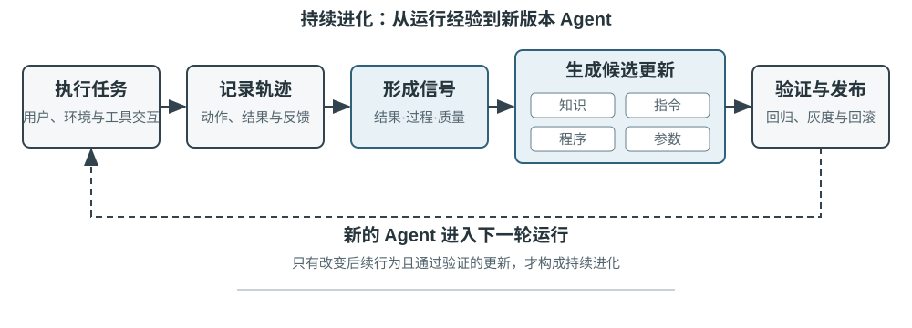
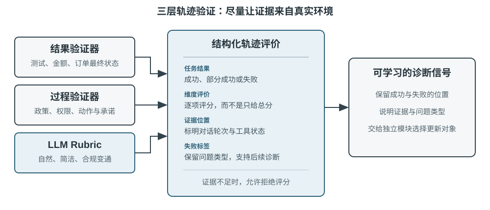
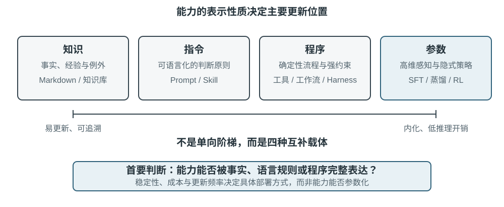
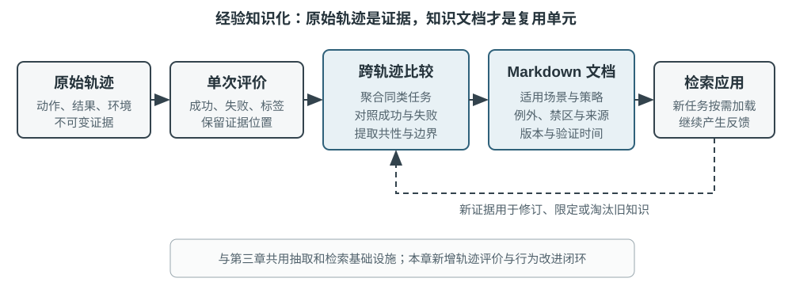
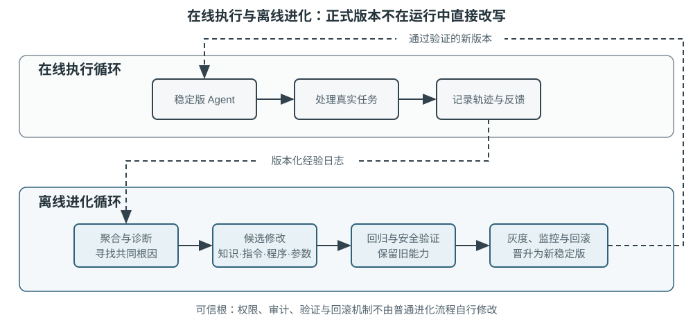

# 第9章 Agent 的持续进化（内容精读）

> [!info] 状态
> ✅ 已精读（2026-10-12）。覆盖 chapter9.md 全文，含全部 5 个二级小节与 5 张插图。

> [!info] 一句话主旨
> 今天的 Agent 能零样本解决从未见过的复杂任务，却可能在处理一万次相似任务之后仍然犯下第一天的错误。本章回答的是：在模型自身尚不能可靠持续学习时，如何把「学习」构建成**模型外围的一套自主系统**——本书称之为**持续进化**——并给出四个环节：从轨迹中取得**学习信号**（结果 / 过程 / 质量三层验证）、把经验路由到**四种载体**（知识 / 指令 / 程序 / 参数），把更新放进**在线执行 + 离线进化的双循环**，以及这套闭环必须守住的三类**边界**（可验证性边界、安全边界、遗忘与保鲜）。

## 本章速览

本章的论证起点是一个能力悖论：**零样本能力**与**经验积累能力**并不同步。模型上岗后不会因为一次推理就改变参数，第二章的上下文学习、状态维护与压缩只让 Agent 在**当前任务内**适应，上下文一结束就不进入下一次任务；把对话存进记忆也不等于学会了新行为。作者由此给出全章的核心区分——**保存经历不等于从经历中学习**：学习发生在系统主动完成「评价、对照、归纳、验证」之后，而不是发生在日志写入磁盘的那一刻。既然生产环境很少提供干净的学习信号（用户满意不等于合规，未经验证的在线参数更新会固化错误经验与提示注入），且基础模型的周期性训练无法及时吸收每个 Agent 每天遇到的私有规则、工具变化与局部经验，现阶段可行的路径就是把学习外置成模型外围的可验证系统：记录运行证据 → 验证结果与过程 → 从多条轨迹中提取共性 → 决定应更新知识、指令、程序还是模型参数 → 所有修改先形成待验证版本，经过回归测试与安全检查后才能改变下一轮运行。

全章结构可以读成一条链：**先判断好坏**（§从运行轨迹中获得学习信号）→ **再决定改哪里**（§Agent 持续进化的四种方法：知识 / 指令 / 程序 / 参数，外加「更新更新方法」这一正交轴）→ **最后讨论如何长期安全地跑**（§构建可长期运行的持续进化闭环：双循环、分层指标、可验证性边界、安全边界、睡眠学习与遗忘）。

| 小节 | 一句话要义 |
| --- | --- |
| （章首无标题导言） | 能力悖论：能零样本解新题，却不会从一万次同类经验中长进；「保存经历 ≠ 从经历中学习」，故须把学习外置为「持续进化」，产出图9-1 的总闭环 |
| §从运行轨迹中获得学习信号 | 评价一条轨迹就是依次回答三问——事情是否办成（结果验证器）/ 是否以允许的方式办成（过程验证器）/ 是否让用户舒服（质量验证器）；验证器必须输出结构化诊断（结论 + 维度 + 证据位置 + 失败标签）而非单一总分，并允许在证据不足时拒绝评分 |
| §Agent 持续进化的四种方法 | 学习信号只说明「应当改变」，没说「改变发生在哪里」：事实与经验→知识文档，可用语言表达的策略→Prompt 与 Skill，可精确执行的流程与约束→程序与 Harness，高维感知与隐式策略→模型参数（图9-3、表9-2）；再往上一层是「更新更新方法」的五种搜索尺度 |
| §构建可长期运行的持续进化闭环 | 在线执行循环只完成任务并记录证据，离线进化循环聚合轨迹、诊断根因、生成提案、过验证门槛再发布（图9-5）；Voyager 的三机制与发现循环；harness-updating 与 harness-benefit 必须分开度量（表9-3）；闭环有三类边界：可验证性边界、安全边界、遗忘与保鲜 |
| §本章小结 | 本章在全书中的位置是第一章发现循环的**实验与反馈**环节；现阶段可行路径是模型外围的可验证学习系统，开放任务仍需人参与问题定义与评价标准 |
| §思考题 | 6 道：经验被推翻 vs 适用条件变化、满意度与合规的护栏指标、虚假承诺该改在哪一层、可信根的权限与代码边界、知识库的版本与淘汰、医疗客服的多载体协同 |

## 与前后章的关系

- **承接第 2 章（上下文工程）**：第 2 章的上下文学习、状态维护与压缩让 Agent 在**当前任务内**适应，本章指出这种适应「上下文结束后不会自然进入下一次任务」，因此必须外置为持久能力；第 2 章的**上下文腐化**在本章更长的时间尺度上重现——经验文档相互冲突、Prompt 被边界规则淹没、Skill 库出现重复能力、多次微调造成灾难性遗忘；第 2 章的 KV Cache 在本章成为**进化的代价**（插件改变工具集与提示片段 → 请求前缀变化 → 缓存从变化处失效）。
- **承接第 3 章（用户记忆与知识库）**：两章共享存储、索引与检索技术，但**知识来源与验证目标不同**——第 3 章沉淀「用户与世界是什么样的」，本章从行动轨迹中沉淀「在什么条件下应该怎样做」；第 3 章的 **User as Code**「先追加不可变日志，再周期性重建结构化模型」被本章的经验学习直接复用（图9-4）。
- **承接第 1 章（AI Agent 入门）**：第 1 章的**最小 diff + 可回滚模式**在本章成为系统提示学习的更新纪律；第 1 章**三层护栏中数据层的道理**（真正的保证必须来自被修改者无法触及的那一层）在「安全机制不可自我修改」处再次出现；第 1 章的**发现循环**（发现 → 提案 → 验证 → 更新）在本章被指认为自身所属环节——「本章构建的是第一章发现循环中的**实验与反馈**环节」；第 1 章的框架对比表把 DeepSeek Harness（`dsh`）归为「Agent 自进化框架」，本章给出其设计分析。
- **承接第 5 章（Coding Agent 与通用 Agent）**：第 5 章提供**修改系统的元能力**（读写文件、运行测试、生成系统），本章提供**由经验触发、以验证闭环约束的自我修改方法**——这是作者明确划出的两章边界。
- **承接第 7 章（Agent 的评估）**：本章「持续进化的起点是第七章所述的评估」；第 7 章的三层验证、LLM-as-a-Judge 与 Rubric、失败归因、边界集与保留集、模型替换实验全部被沿用，τ²-bench telecom 环境成为实验 9-2 的场地（第 7 章解剖过同一环境，本章说明「第七章解剖该环境时，这两条并未显出问题」）。
- **承接第 8 章（模型后训练）**：SFT / 蒸馏 / RL 写入参数是四种载体之一，本章不重复算法，只补上**输入侧**——把「经过评价的生产轨迹」转化为训练数据；本章的实验 9-4 还指出稳定对话轨迹可以生成第 8 章所需的 SFT 或 RL 数据。
- **向后接第 10 章（多 Agent 协作）**：本章在**架构层**已出现「增加 Reviewer Agent，改变规划与执行之间的信息流」这一修改对象，以及「独立于生成者的 reviewer」这一角色约束，为多 Agent 协作中的审查分工铺路。

> 完整定义见 [[02-全书术语表#第九章 Agent 的持续进化|术语表·第九章]]。实验逐条解读见 [[实验解读/第9章 Agent 的持续进化]]，思考题逐题引导见 [[思考题引导/第9章 Agent 的持续进化]]。

## 结构大纲（导览注）

- **章首导言（无标题，原书 line 3–17）**：能力悖论（零样本解新题 ↔ 一万次相似任务后仍犯第一天的错）→ 为什么不能让模型直接自我训练（上下文适应不持久、保存经历 ≠ 从经历中学习、在线参数更新放大噪声与注入、基础模型周期性训练吸收不了私有经验）→ **持续进化**的定义（模型外围的自主学习系统）→ 图9-1 总闭环 → 全章路线图。
- **§从运行轨迹中获得学习信号**：持续进化的起点是评估 → 三问与图9-2 三层验证 → 结果验证器（最应优先建立）→ 过程验证器（结果正确 ≠ 过程正确）→ 质量验证器（LLM-as-a-Judge + Rubric）→ 表9-1 客服七维度 → 验证器的输出形态（四项内容 + 允许拒绝评分）→ 实验 9-1。
- **§Agent 持续进化的四种方法**：载体路由的判据与四句话映射 → 图9-3、表9-2 → 四种方式不互斥（医疗影像 / 客服各拆到多载体）→ 「路由结果只是更新提案，尚未获得发布资格」。
  - **§将经验沉淀为知识**：最轻量的进化 → 领域知识 vs 行动经验 → 原始轨迹不适合当知识单元、应保留三层数据 → 与 User as Code 同构的两阶段（图9-4）→ 经验文档靠**对照**而非摘要 → 五步提炼管道 → GAIA / AWorld 例子（试卷与考场）→ Reflexion 的位置（反思不是证据）。
  - **§将经验写成指令**：何时才值得把经验提升为指令 → 系统 Prompt / Skill / 程序三概念分工 → 系统提示学习与 DSPy / OPRO / GEPA → 与第 2 章提示工程的分工 → 带来源的最小 diff → 边界集与保留集的双向门槛。
    - **例子一：转接边界的规则化**：τ²-bench telecom 只有两条原则性转接规定 → 弱模型下 20 条任务 19 条以转人工收场 → 归纳规则后通过率 12.3% → 19.3% → 三条实证教训（材料决定归纳结果 / 模型把观察到的行为当作应然 / 被修复的是极朴素缺陷）→ 实验 9-2（三项行为指标均降约八成）→ 航空客服移植（实验 9-3）。
    - **例子二：需求澄清 Skill**：「问得太少会导致返工，问得太多会增加打扰」→ 带作用域的判断路径与初版流程（短 Spec / Plan）→ 反馈必须与轨迹、任务类型、结果关联 → 最小 Skill 更新提案 → 三策略对照实验与七项指标 → Skill 与 Harness 的边界 → 实验 9-4。
  - **§将经验写成程序**：什么条件下值得编译为程序 → 四层可修改对象（操作 / 控制 / 验证 / 架构）→ 浏览器工作流与「电子表格宏录制」类比 → 六阶段生命周期（捕获 / 参数化 / 状态检查 / 独立回放验证 / 匹配与回放 / 失效与重学）→ PreAct 8.5–13 倍加速与三重验证 → 实验 9-5 → 隔离更新分支与可审计发布流程 → Git worktree 与 Pull Request → 可证伪的变更契约与 AHE 的组件 / 经验 / 决策三层可观测性 → Self-Harness 的输入 → Alita 的工具创造 → 实验 9-6 → 验证层的确认门禁与实验 9-7 → 与第一章数据层护栏同构。
    - **案例：DeepSeek Harness 以「一切皆插件」实现自我进化**：静态组合 vs 动态组合 → 时间可组合性与空间可组合性 → 自进化 Harness 的两个具体困难 → Cordis 的可撤销效果与反应式协效果 → 「可组合性必须是可传递的」→ 自我进化上限论与「不存在一个只能由人类维护的特权内核」→ 「能不能安全装卸」≠「该不该装」→ KV Cache 代价。
  - **§将经验写入参数**：前提是能力可被外部符号较完整表达 → 弯引号处在中间地带 → 判据是**能力的表示性质**而非任务稳定性 → 把已评价轨迹转成训练数据（SFT / 成对偏好 / RL）。
  - **§从更新产物到更新「更新方法」**：五种搜索尺度 → 最内层是默认选择 → 重写整份 Prompt 的退化与 ACE 的条目化上下文 → MCE 的内外双循环 → AFlow 与 Meta-Harness → 代码连同评估历史成为搜索对象 → 实验 9-8。
- **§构建可长期运行的持续进化闭环**：四种方法要进入同一循环 → 图9-5 双循环（在线执行 / 离线进化，经版本化经验库与评估集连接）→ Voyager 的完整循环与三机制 → 发现循环（假设 / 实验 / 评估 / 反馈）与 Discovery Loop → harness-updating vs harness-benefit → 表9-3 四级分层指标 → 长期评价的五类结果 → 实验 9-9。
  - **§可验证闭环的边界：当「完成」不等于「进步」**：闭环最易成立的任务类型 vs 开放式科研 / 战略规划 / 复杂产品设计 → 自动科研压力测试（四次尝试三次失败）→ 三类问题（实现漂移 / 认识论上的过度乐观 / 隐性判断力不足）→ 四条证据与监督结构的改进。
  - **§持续进化的安全边界**：三种把一次错误变成长期风险的途径 → 第一道边界（证据与指令隔离）→ 第二道边界（待验证能力与正式能力隔离）→ 第三道边界（安全机制不可自我修改）。
  - **§睡眠学习：整合、遗忘与能力保鲜**：离线整合的认知类比 → 五步周期（触发 / 定向 / 采集与整合 / 验证与审批 / 修剪与索引）→ Claude Code 自动记忆 → Hermes 与 Curator → 周期性离线整理六条。
- **§本章小结**：全章收敛，并指认本章在第一章发现循环中的位置。
- **§思考题**：6 道，逐题展开见 [[思考题引导/第9章 Agent 的持续进化]]（★★ 三题、★★★ 三题）。

## 核心概念速查

| 概念 | 一句话定义 | 出处小节 |
| --- | --- | --- |
| 能力悖论 | Agent「可以零样本解决从未见过的复杂任务，却可能在处理了一万次相似任务之后，第二天仍然犯下第一天的错误」 | 章首导言 |
| 持续学习（continual learning） | 模型自主从经验中学习的能力；与早年「学了新任务就忘掉旧任务」的研究不是同一个问题，遗忘只是其中一个子问题 | 章首导言 |
| 持续进化 | 在模型自身尚不能可靠持续学习时，把「学习」构建成**模型外围的一套自主系统**，以区别于模型权重层面的持续学习 | 章首导言 |
| 保存经历 ≠ 从经历中学习 | 把轨迹放进长上下文或向量库只是可检索，学习发生在系统主动完成「评价、对照、归纳、验证」之后 | 章首导言 |
| 三层轨迹验证 | 结果验证器（事情是否真的办成）/ 过程验证器（是否以允许的方式办成）/ 质量验证器（是否让用户舒服），见图9-2 | §从运行轨迹中获得学习信号 |
| 结果验证器 | 读取测试结果、数据库状态与工具返回；信号来自环境真实状态，比模型自述可靠，**三层中最应优先建立** | §从运行轨迹中获得学习信号 |
| 过程验证器 | 检查业务规则、权限与动作序列，区分「结果已经达成」与「结果以允许的路径达成」；政策库、权限表与动作轨迹可精确表达，故可由代码判定 | §从运行轨迹中获得学习信号 |
| 质量验证器 | 耐心、合规范围内的变通方案、是否抓住关键证据、文本是否自然简洁；用 LLM-as-a-Judge + 预定义 Rubric 逐项给分并引用轨迹证据 | §从运行轨迹中获得学习信号 |
| 事实可靠性（横跨两层） | 可与工具返回逐一比对的部分由代码核验，其余交由 Rubric 判断 | 表9-1 |
| 学习信号四要素 | 成功 / 部分成功 / 失败；每个维度各自的结论；每条结论对应的**证据位置**（哪一轮对话、哪一次工具调用）；失败的类型标签 | §从运行轨迹中获得学习信号 |
| 验证器拒绝评分 | 验证器应被允许在证据不足时拒绝评分；低置信度结论不如把该案例排除在学习集之外 | §从运行轨迹中获得学习信号 |
| 四种更新方法 | 经验知识库 / Prompt 与 Skill / 程序与 Harness / 模型参数（图9-3、表9-2）；四者不互斥，同一能力可拆到多个载体 | §Agent 持续进化的四种方法 |
| 路由结果 ≠ 发布资格 | 判定经验该写到哪里只产出**更新提案**，尚未获得发布资格 | §Agent 持续进化的四种方法 |
| 经验知识库 | 与第 3 章共享存储、索引与检索技术，但来源是行动轨迹、目标是「在什么条件下应该怎样做」 | §将经验沉淀为知识 |
| 领域知识 vs 行动经验 | 「该航空公司要求特殊餐食提前二十四小时预订」是领域知识；「订票前先检查特殊餐食截止时间」是行动经验 | §将经验沉淀为知识 |
| 三层数据 | 不可变原始轨迹（审计）/ 单次运行分析（本次成败与经验草案）/ 多条同类轨迹归纳而成的 Markdown 知识文档 | §将经验沉淀为知识 |
| 知识文档字段 | 适用场景、推荐策略、禁止做法、例外条件、证据来源、最近验证时间——而不是复述某一次任务的完整过程 | §将经验沉淀为知识 |
| 与 User as Code 同构 | 先保存不可变证据，再离线生成可变知识；把记录与整理分开，避免一次偶发成功或网络故障立即改变 Agent（图9-4） | §将经验沉淀为知识 |
| 经验提炼五步管道 | 保存不可变轨迹与环境结果 → 单次结构化分析 → 按任务族聚类并建「支持 / 反驳」证据表 → 达支持门槛才写入正式文档 → 在未参与提炼的新任务上测迁移 | §将经验沉淀为知识 |
| 部分成功轨迹的价值 | 成功轨迹贡献策略草案，失败轨迹贡献排除性知识，部分成功轨迹帮助识别「哪一段有效、哪一段仍有问题」 | §将经验沉淀为知识 |
| 反思不是证据 | Reflexion 式自然语言反思可以参与生成经验草案，但只有与环境结果相符、得到跨轨迹支持并在新任务上显示正向迁移的内容才进入正式文档 | §将经验沉淀为知识 |
| 系统提示学习（System Prompt Learning） | Karpathy 的说法：模型遇到问题后，用一句清楚的话提醒未来的自己 | §将经验写成指令 |
| 三个概念的分工 | 系统 Prompt 对所有任务生效；Skill 只在匹配到某个领域或工具时按需加载；程序 / Harness 负责权限和其他硬约束 | §将经验写成指令 |
| 提示优化三法 | DSPy 在开发集上搜索指令和示例；OPRO 根据历史提示词及得分提出提案；GEPA 从失败轨迹的自然语言反思中生成并筛选提案 | §将经验写成指令 |
| 最小更新提案 | 生产环境更适合可审计的最小更新提案并保留快速回滚路径；修改应是**带来源的最小 diff**，而非每次重写整份 Prompt | §将经验写成指令 |
| 边界集与保留集 | 待验证版本必须同时在**触发失败的边界集**（要改善）和**正常工作的保留集**（不能退化）上测试 | §将经验写成指令 |
| 提炼材料决定归纳结果 | 仅给失败摘要与错误文本 → 归纳出「同一工具反复报错即不应继续调用」（教训）；补充双方可用工具清单 → 归纳出职责归属 | §例子一：转接边界的规则化 |
| 模型把观察到的行为当作应然 | 轨迹中最频繁出现的是转接人工，模型便把「连续三次失败即转接」「两次未提供号码即转接」当作合理兜底，等于把失败写入了规范 | §例子一：转接边界的规则化 |
| 提炼产物须独立验证 | 提炼产物不能直接发布，须经与提炼者相互独立的验证 | §例子一：转接边界的规则化 |
| 需求澄清 Skill | 表达的不是「所有任务都必须确认」，而是一条带作用域的判断路径：问得太少会导致返工，问得太多会增加打扰 | §例子二：需求澄清 Skill |
| Spec / Plan | 目标、非目标、关键取舍、假设与验收标准；执行中发现原 Spec 不成立时暂停并重新确认 | §例子二：需求澄清 Skill |
| 反馈必须可关联 | 单独保存一句抱怨不足以触发更新，必须把反馈和具体轨迹、任务类型以及结果关联起来 | §例子二：需求澄清 Skill |
| Skill 与 Harness 的边界 | Skill 负责理解语境、主动提问、整理 Spec、说明取舍；Harness 负责在缺少确认时否决高风险写入、直接操作 `main` 或绕过发布流程 | §例子二：需求澄清 Skill |
| 程序化经验 | 当经验描述的是稳定、重复且可验证的操作时，把经验编译为工作流、工具或 Harness 代码，使一次探索变成可重复执行的程序 | §将经验写成程序 |
| 四层可修改对象 | 操作层（浏览器轨迹→参数化工作流、API 适配器）/ 控制层（路由、重试、熔断、上下文压缩）/ 验证层（参数检查、状态验证器、回归测试）/ 架构层（Reviewer Agent、规划与执行的信息流） | §将经验写成程序 |
| 工作流六阶段生命周期 | 捕获轨迹 → 参数化 → 定义状态检查 → 独立回放验证 → 匹配与回放 → 失效与重学 | §将经验写成程序 |
| 定位 ≠ 成功 | 元素定位信息只用于再次寻找元素，不能证明任务已经完成 | §将经验写成程序 |
| 动作成功 ≠ 任务成功 | 最终状态检查必须读取真实页面或后端状态；否则会得到「每个按钮都点过了，但某个字段其实为空」的假象 | §将经验写成程序 |
| 三重验证 | 流程记忆必须同时具备**动作前验证、动作后验证和独立回放验证**；PreAct 实验中重复任务实现 8.5–13 倍端到端加速 | §将经验写成程序 |
| 可审计的自我修改 | 从稳定版本创建隔离更新分支 → Coding Agent 生成最小补丁 → 静态检查、单元测试、安全扫描、失败轨迹重放、旧任务回归 → 生成可灰度部署的新版本 | §将经验写成程序 |
| 可证伪的变更契约 | 每个修改请求列出失败证据、推断根因、归属的 Harness 组件、修改提案、预期修复的行为、可能受损的既有行为，以及分别验证两者的用例 | §将经验写成程序 |
| 三层可观测性（AHE） | 组件（可编辑组件都有文件级表示）、经验（海量轨迹整理为可逐层下钻的证据）、决策（每次编辑声明影响预测再由下一轮结果验证） | §将经验写成程序 |
| Self-Harness 的输入 | 除失败案例外还提供必须保留的成功行为与此前被拒绝的修改记录，构成有边界的方案空间 | §将经验写成程序 |
| 工具创造协议 | Alita 案例：发现缺少字幕读取能力 → 搜索并测试 `youtube-transcript-api` → 封装为新工具 → 安全扫描、功能测试与复用均通过后才进入能力库 | §将经验写成程序 |
| 确认门禁 | 多条用户纠正、点踩或事后审计都指向「高风险操作未经确认」时生成的提案；安全门本身不能被提案修改 | §将经验写成程序 |
| 可组合性封顶自我进化 | 「自我进化的上限，不取决于模型能写出多好的代码，而取决于承载它的系统具有多强的可组合性」 | §案例：DeepSeek Harness |
| 时间可组合性 | 组件被移除时，它对共享环境做过的修改能否被完整、安全地撤销——关心**改了什么** | §案例：DeepSeek Harness |
| 空间可组合性 | 组件之间能否以结构化、可验证的方式声明、发现和解析彼此的依赖，并在依赖变化时协调生命周期——关心**依赖什么** | §案例：DeepSeek Harness |
| 可撤销效果 / 反应式协效果 | 每次对上下文的变换携带显式逆操作并由运行时追踪；组件把依赖声明成规格，上下文变化时按规格通知它激活、失活还是无关 | §案例：DeepSeek Harness |
| 无特权内核 | `dsh` 让模型适配器、工具注册表、会话日志乃至 Agent 主循环本身都成为插件，「不存在一个只能由人类维护的特权内核」 | §案例：DeepSeek Harness |
| 进化的缓存代价 | 运行中的插件改变模型可见的工具集与提示片段，请求前缀一变，KV Cache 就从变化处开始失效 | §案例：DeepSeek Harness |
| 参数化的判据 | 是否参数化不由「任务是否长期稳定」单独决定，真正决定主要载体的是**能力的表示性质** | §将经验写入参数 |
| 训练数据的三个来源 | 高质量示范进入 SFT，明确偏好形成成对数据，具有可靠环境奖励的交互用于 RL | §将经验写入参数 |
| 五种搜索尺度 | 单条规则或记忆 → 结构化上下文 → 工作流 → Harness 代码 → 产生更新提案的优化器代码；不是五种新载体 | §从更新产物到更新「更新方法」 |
| 重写整份 Prompt 的退化 | 为追求简洁，旧版本中的少数重要细节可能在多轮改写后逐渐消失；相互制约的条件也可能被合并成一句过度抽象的原则 | §从更新产物到更新「更新方法」 |
| ACE | Agentic Context Engineering：把上下文维护成带稳定标识符的条目集合，由生成、反思和整理模块提出增量更新，再用确定性逻辑合并与去重 | §从更新产物到更新「更新方法」 |
| MCE 内外双循环 | 内层在给定管理方法下优化当前任务的上下文产物；外层根据多轮执行和验证结果修改搜索、选择、过滤、格式化这些操作本身 | §从更新产物到更新「更新方法」 |
| AFlow / Meta-Harness | 前者把多 LLM 调用工作流表示为代码图并用执行反馈搜索节点与控制流；后者让 Coding Agent 读取待验证 Harness 的源码、分数和轨迹，搜索决定信息如何存储、检索和呈现的代码 | §从更新产物到更新「更新方法」 |
| 双循环结构 | 在线执行循环只完成任务并记录证据，不直接改写正式 Agent；离线进化循环聚合轨迹、诊断根因、生成提案，再通过验证门槛发布；两者通过版本化的经验库和评估集连接（图9-5） | §构建可长期运行的持续进化闭环 |
| Voyager 三机制 | 自动课程生成器（提出难度适中的下一个目标）+ 技能库（成功程序保存为可检索、可组合的代码）+ 迭代提示机制（把环境观察、执行错误与自验证结果带回下一轮） | §构建可长期运行的持续进化闭环 |
| 三缺一不可 | 只有技能库而没有课程，Agent 不知道下一步学什么；只有自我反思而没有环境验证，技能库会积累错误；只有探索而没有持久化，每次任务仍要从头开始 | §构建可长期运行的持续进化闭环 |
| 发现循环 | 假设、实验、评估、反馈；Agent 自我进化要想避免自说自话、自我感觉良好，就必须遵循科学方法 | §构建可长期运行的持续进化闭环 |
| Harness 更新能力 | harness-updating：从轨迹中产生有价值的持久修改 | §构建可长期运行的持续进化闭环 |
| Harness 受益能力 | harness-benefit：任务 Agent 在后续运行中找到、激活并正确使用这些修改；因此不能只用端到端分数反推更新器好坏 | §构建可长期运行的持续进化闭环 |
| 四级分层指标 | 更新提案有效率 / 产物激活率 / 遵循成功率 / 保留任务集增益（表9-3） | 表9-3 |
| 长期评价五类结果 | 回退、泛化能力、Token 效率、安全性、长期工程质量 | §构建可长期运行的持续进化闭环 |
| 实现漂移 | 原方案一旦变难，Agent 会逐渐退回训练数据中更熟悉、但已经偏离研究假设的普通实现 | §可验证闭环的边界 |
| 认识论上的过度乐观 | 信号仍可能只是噪声，系统却开始解释结果、添加补丁并宣布发现；失败和阴性结果更容易被忽略 | §可验证闭环的边界 |
| 隐性判断力不足 | Agent 可以运行实验，却未必知道什么基线真正重要、哪个异常值得追踪、何时应该放弃假设 | §可验证闭环的边界 |
| 结论与证据分离 | 对引用、数字、方法和结论分别记录证据来源，最终文稿只是证据图的一种呈现（ScientistOne 的 Chain-of-Evidence） | §可验证闭环的边界 |
| 保留负面结果 | 失败实验、被拒提案和停止原因写入日志，否则进化模块只看到幸存方案 | §可验证闭环的边界 |
| 维护搜索多样性 | 备选方案池保留若干暂时低分但类型不同的分支，避免所有方案收敛成同一个易得分模板 | §可验证闭环的边界 |
| 证据与指令隔离 | 原始网页、工具输出及其 LLM 摘要都属于不可信证据，不能当作指令执行，也不能直接纳入 Skill 等长期能力 | §持续进化的安全边界 |
| 待验证区 | 新知识、Prompt、Skill、程序和参数都先进入不可服务真实流量的待验证区，通过安全检查与回归测试后才成为正式能力 | §持续进化的安全边界 |
| 安全机制不可自我修改 | 业务 Agent 不能修改批准自身更新的验证器、测试用例、发布门槛、审计日志和稳定版本备份 | §持续进化的安全边界 |
| 睡眠学习 | 对离线整合的认知类比，并不要求任务真的在夜间运行；在线追加不可变证据，后台在门控条件下批量整合 | §睡眠学习 |
| 睡眠学习五步 | 触发 → 定向 → 采集与整合 → 验证与审批 → 修剪与索引 | §睡眠学习 |
| 上下文腐化的长时标版本 | 经验文档相互冲突、Prompt 被边界规则淹没、Skill 库出现重复能力、多次微调造成灾难性遗忘 | §睡眠学习 |
| 周期性离线整理六条 | 合并重复经验并保留来源版本 / 局部规则从全局 Prompt 移到领域 Skill / Prompt 与 Skill 保持结构清晰 / 重新验证长期未使用的工具 / 删除被新证据推翻的知识 / 从原始基座模型重新训练 LoRA | §睡眠学习 |

> 完整定义见 [[02-全书术语表#第九章 Agent 的持续进化|术语表·第九章]]；本章新引入术语见下文「本章新术语 → 术语表」。

## 逐节精读（逐节深析）

> 读法说明：每个小节先给「带着这些问题阅读本节」的引导问题，再给覆盖该节要点的**读后小结**，最后是逐字引用的**原文论证**（锚点为「原书 §小节标题」或「原书 实验 9-N / 表9-N」；原书为 Markdown，无页码）。本章原书标题无编号，故小节块标题直接采用原书标题。引文一律逐字来自 chapter9.md；行内的 `……` 表示此处略去了原书的脚注标记或分条列举的列表符号（如 `[^ace-2026]`、`- `），被略去的部分既不改字也不改义。

### §章首导言：为什么要造「持续进化」这一层（原书无标题部分）

> [!question] 带着这些问题阅读本节
> 1. 作者所说的「能力悖论」具体指哪两种能力的不同步？为什么它是「Agent 从会完成任务走向能够可靠工作」的关键？
> 2. 为什么部署后的模型不能靠自己「长进」？上下文学习、状态维护、压缩与「存进记忆」分别止步在哪里？
> 3. 为什么不让模型在每次任务后直接训练自己？生产环境在学习信号上有哪些结构性缺陷？
> 4. 「持续进化」与「持续学习」的区别是什么？它由哪几个动作组成？

**读后小结**：

- **能力悖论**：Agent 「可以零样本解决从未见过的复杂任务，却可能在处理了一万次相似任务之后，第二天仍然犯下第一天的错误」。能否自主从经验中学习（**持续学习**）正在成为 Agent 从「会完成任务」走向「能够可靠工作」的关键能力与下一代模型的核心研究课题；今天的「持续学习」概念与早年「学了新任务就忘掉旧任务」的研究不是同一个问题——遗忘只是其中一个子问题，更难的是**没有人告诉模型这一天的经历里哪些做对了、哪些做错了**。作者判断：「就目前而言，模型本身的持续学习能力仍远远不够。」
- **为什么不能自然长进**：部署后的模型不会因为一次推理自动改变参数；第 2 章的上下文学习、状态维护与压缩能让 Agent 在**当前任务内**适应，但上下文结束后这种变化不会自然进入下一次任务；把对话存进记忆也不等于学会新行为——原始轨迹可能很长，其中既有有效策略，也有偶然成功、错误归因和不可信输入。
- **核心区分**：**保存经历不等于从经历中学习**。把一百条轨迹放进长上下文或向量库可以帮助找回某个案例，却不会自动完成跨案例比较（哪些步骤在成功轨迹中反复出现、哪些做法只在旧版接口上有效、某次成功究竟来自正确策略还是环境偶然）。学习发生在系统主动完成「评价、对照、归纳、验证」之后，而不是发生在日志写入磁盘的那一刻。第 3 章的用户记忆沉淀「用户与世界是什么样的」，本章的经验学习进一步沉淀「在什么条件下应该怎样行动」——「前者让 Agent 记得更多，后者才让它从聪明变得熟练」。
- **为什么不能直接自训练**：生产环境很少提供干净的学习信号；用户满意不意味着合规；局部参数更新还可能造成能力遗忘、策略漂移或安全退化；若允许模型依据未经验证的反馈直接修改自身参数，错误经验和提示注入就可能被固化并在后续任务中持续放大。另一方面，基础模型的周期性训练可以提升通用能力，却无法及时吸收每个 Agent 每天遇到的私有规则、工具变化和局部经验。
- **本章的对象**：必须先把「学习」构建成**模型外围的一套自主系统**，即**持续进化**，以区别于模型权重层面的持续学习——「记录运行证据，验证结果与过程，从多条轨迹中提取共性，再决定应更新知识、指令、程序还是模型参数」；所有修改先形成待验证版本，经过回归测试和安全检查后才能改变下一轮运行。
- **三条约束**（图9-1 的成立条件）：持续进化必须以**可追溯的运行经验**为基础，必须**能够改变后续行为**，并且**经过验证，确保没有造成明显退化**。
- **与前序章节的部件关系**：第 2 章处理任务内状态，第 3 章提供知识基础设施，第 5 章赋予创造工具与修改系统的元能力，第 7 章建立评估与验证，第 8 章说明如何更新模型参数——第 9 章的任务是把这些部件组织成图9-1 的持续进化闭环。

> **图 9-1 解读**：该图给出本章的总框架——把前八章的部件组织成一个持续进化闭环（原书 §章首导言）：以可追溯的运行经验为输入，经过结果与过程的验证、从多条轨迹中提取共性，再决定更新知识、指令、程序还是模型参数，所有修改先落成待验证版本，通过回归测试与安全检查后才改变下一轮运行。图中闭环的三个必要条件即作者强调的「可追溯的运行经验 / 能改变后续行为 / 经过验证没有明显退化」，它也是全章三条主线的总目录（学习信号 → 四种更新方法 → 长期运行与边界）。

**原文论证**：

> 今天的 Agent 面临一个鲜明的能力悖论：它可以零样本解决从未见过的复杂任务，却可能在处理了一万次相似任务之后，第二天仍然犯下第一天的错误。（原书 §章首导言）

> **能否自主从经验中学习**（所谓**持续学习**，continual learning），正在成为 Agent 从“会完成任务”走向“能够可靠工作”的关键能力，也是下一代模型的核心研究课题。（原书 §章首导言）

> 这里有一个容易混淆的区别：**保存经历不等于从经历中学习**。（原书 §章首导言）

> 学习发生在系统主动完成“评价、对照、归纳、验证”之后，而不是发生在日志写入磁盘的那一刻。第三章的用户记忆主要沉淀“用户与世界是什么样的”，本章的经验学习则要进一步沉淀“在什么条件下应该怎样行动”；前者让 Agent 记得更多，后者才让它从聪明变得熟练。（原书 §章首导言）

> 若允许模型依据未经验证的反馈直接修改自身参数，错误经验和提示注入就可能被固化，并在后续任务中持续放大。（原书 §章首导言）

> 因此，在模型自身尚不能可靠地持续学习时，必须先把 “学习” 构建成模型外围的一套自主系统，本书称之为**持续进化**，以区别于模型权重层面的持续学习：记录运行证据，验证结果与过程，从多条轨迹中提取共性，再决定应更新知识、指令、程序还是模型参数。（原书 §章首导言）

> 持续进化必须以可追溯的运行经验为基础，能够改变后续行为，并经过验证，确保没有造成明显退化。（原书 §章首导言）

**取舍与延伸**：本章开篇把「学习」与「记录」切开，是全书对「记忆类功能」最锋利的一次划界——第 3 章的存储检索基础设施只解决「找得到」，本章要求系统显式回答「这条经验在什么条件下成立」，两者是不同性质的产出物。注意作者把「持续进化」限定为**工程系统**而非模型能力：这决定了全章的落点始终是「谁有权改什么 + 怎么验证」，而不是「怎样训一个会自省的模型」。

### §从运行轨迹中获得学习信号

> [!question] 带着这些问题阅读本节
> 1. 评价一条轨迹，本质上要依次回答哪三个问题？它们分别对应哪一层验证器？
> 2. 为什么「结果正确」不等于「过程正确」？这一层为什么同样可由代码判定？
> 3. 三层验证器分别读什么证据、优先建立哪一层、为什么？
> 4. 为什么「单一总分」不能成为学习信号？可供后续学习的评价至少要包含哪四项内容？验证器还应被允许做什么？

**读后小结**：

- **起点是评估**：持续进化的起点是第 7 章所述的评估；如果系统不知道任务是否完成、也不知道哪一步造成了成功或失败，「语言模型生成的反思只能是一种猜测」。
- **三问与三层结构**（图9-2）：评价一条轨迹实质上是依次回答三个问题——**事情是否办成了，是否以允许的方式办成，是否让用户舒服**，三者被组织为三层验证结构。
- **底层 · 结果验证器（事情是否真的办成）**：读取测试结果、数据库状态和工具返回。Coding Agent 可以运行测试、类型检查和性能基准；替用户办理退款的 Agent 可以查询订单状态和实际退款金额。这类信号来自环境中的真实状态，通常比模型对自己行为的描述可靠，因此**是三层中最应优先建立的一层**。
- **中间层 · 过程验证器（是否以允许的方式办成）**：结果正确不代表过程正确——「删除失败的测试用例也能让测试通过」，口头承诺用户「我们会在 7 天内退款，请耐心等候」也可能得到暂时的满意反馈。这一层检查业务规则、权限和动作序列，用以区分「结果已经达成」与「结果以允许的路径达成」；由于政策库、权限表与动作轨迹均可精确表达，这一层同样可以由代码判定。
- **上层 · 质量验证器（是否让用户舒服）**：客服是否耐心、是否提供了合规范围内的变通方案，研究报告是否抓住了关键证据，生成文本是否自然简洁。这些维度不影响事情办成与否，但对用户体验有影响；此时使用第 7 章介绍的 **LLM-as-a-Judge**，预先定义评价量表（Rubric），要求验证器逐项给分并**引用轨迹证据**。
- **表9-1 把三层展开为七个可评分维度**：任务结果属于结果层；规则遵从、隐私边界与承诺—行动一致性属于过程层；表达质量与合规变通属于质量层；**事实可靠性横跨两层**——可与工具返回逐一比对的部分由代码核验，其余交由 Rubric 判断。
- **输出形态决定能否成为学习信号**：单一总分只能反映一次运行的优劣，无法指出应当修改之处。可供后续学习的评价至少应包含四项：①任务是成功、部分成功还是失败；②每个维度各自的结论；③每条结论对应的**证据位置**（哪一轮对话、哪一次工具调用）；④失败的类型标签。此外，验证器还应被允许在**证据不足时拒绝评分**——与其把低置信度的结论当作事实固化下来，不如将该案例排除在学习集之外。具备这四项内容，四种更新方法才能判断应当更新知识、提示词、程序还是模型参数。
- **实验 9-1（★★，为客服 Agent 构建轨迹验证器）**：对照「只输出一个总分」和「逐维度输出结论、证据与置信度」两种验证方式，观察哪一种更容易区分任务失败、规则违规、虚假承诺和表达问题；结论是持续进化不能只依赖成功率或单一分数——只有保留「哪里错、为什么错、证据在哪里」，后续模块才知道应该更新知识、Prompt、程序还是模型参数，低置信度案例也不应自动进入学习集。

> **图 9-2 解读**：该图把轨迹评价组织为三层——底层是读取环境真实状态的结果验证器，中间是检查业务规则、权限与动作序列的过程验证器，上层是借助 LLM-as-a-Judge 与预定义 Rubric 的质量验证器（原书 §从运行轨迹中获得学习信号）。三层对应开篇的三个问题「事情是否办成了 / 是否以允许的方式办成 / 是否让用户舒服」，越靠下越确定、越应优先建立；表9-1 的客服七维度正是这张图在一类 Agent 上的实例化。

**原文论证**：

> 持续进化的起点是第七章所述的评估（evaluation）。如果系统不知道任务是否完成，也不知道哪一步造成了成功或失败，那么语言模型生成的反思只能是一种猜测。（原书 §从运行轨迹中获得学习信号）

> 评价一条轨迹，实质上是依次回答三个问题：**事情是否办成了，是否以允许的方式办成，是否让用户舒服**。图9-2 将它们组织为三层验证结构。（原书 §从运行轨迹中获得学习信号）

> **底层的结果验证器回答“事情是否真的办成”。** 它读取测试结果、数据库状态和工具返回：Coding Agent 可以运行测试、类型检查和性能基准；替用户办理退款的 Agent 可以查询订单状态和实际退款金额。（原书 §从运行轨迹中获得学习信号）

> 这类信号来自环境中的真实状态，通常比模型对自己行为的描述可靠，因此是三层中最应优先建立的一层。（原书 §从运行轨迹中获得学习信号）

> 结果正确并不代表过程正确：删除失败的测试用例也能让测试通过，口头承诺用户 “我们会在 7 天内退款，请耐心等候” 也可能得到暂时的满意反馈。这一层检查业务规则、权限和动作序列，用以区分“结果已经达成”与“结果以允许的路径达成”。（原书 §从运行轨迹中获得学习信号）

> 此时可以使用第七章介绍的 LLM-as-a-Judge，预先定义评价量表（Rubric），要求验证器逐项给分并引用轨迹证据。（原书 §从运行轨迹中获得学习信号）

> **验证器的输出形态决定了它能否成为“学习信号”。** 单一总分只能反映一次运行的优劣，无法指出应当修改之处。（原书 §从运行轨迹中获得学习信号）

> 可供后续学习的评价至少应包含四项内容：任务是成功、部分成功还是失败；每个维度各自的结论；每条结论对应的证据位置（哪一轮对话、哪一次工具调用）；以及失败的类型标签。验证器还应被允许在证据不足时拒绝评分。与其把低置信度的结论当作事实固化下来，不如将该案例排除在学习集之外。（原书 §从运行轨迹中获得学习信号）

**取舍与延伸**：这一节把「评估」从打分改造成**产出结构化诊断**，是全章的第一个工程约束——评价体系的输出 schema 直接决定了后面四种更新方法能不能工作。三层的**可判定性递减**（代码 → 代码 → Rubric）与**建立优先级递增的逆向**（越底层越该先建）是一对容易记错的关系：作者明确把「最应优先建立」给了最底层的环境结果验证器。表9-1 中「事实可靠性横跨两层」是一个值得留意的设计：同一维度按可机械核验程度被拆给代码与 Rubric，与第 7 章「验证方式谱系」的思路一致。

#### 表9-1 客服 Agent 的轨迹评价维度（原书 §从运行轨迹中获得学习信号）

| 维度 | 验证问题 | 主要证据 | 所属层（本书归纳） |
| --- | --- | --- | --- |
| 任务结果 | 用户的核心诉求是否得到解决 | 最终环境状态、工具结果 | 结果层 |
| 规则遵从 | 是否违反政策、权限或必要流程 | 政策库、动作轨迹 | 过程层 |
| 隐私边界 | 是否泄露不应提供的信息 | 回复文本、数据访问记录 | 过程层 |
| 事实可靠性 | 陈述是否有知识或工具结果支持 | 引用来源、工具返回 | 横跨结果层与过程层 |
| 承诺—行动一致性 | 声称完成的操作是否真实发生 | 回复与工具日志对照 | 过程层 |
| 表达质量 | 是否自然、简洁，避免重复与模板化 | 对话全文、语言 Rubric | 质量层 |
| 合规变通 | 原方案不可行时，是否找到允许的替代路径 | 用户目标、政策与后续动作 | 质量层 |

> 上表前三列逐字复刻原书表9-1，第四列「所属层」为依据原文「任务结果属于结果层；规则遵从、隐私边界与承诺—行动一致性属于过程层；表达质量与合规变通属于质量层；事实可靠性横跨两层」归纳的〔精读批注〕。

### §Agent 持续进化的四种方法

> [!question] 带着这些问题阅读本节
> 1. 「学习信号」解决了什么、又没解决什么？为什么说它没有说明「改变应发生在哪里」？
> 2. 四类能力分别适合写进哪种载体？判断的直觉依据是什么？
> 3. 四种方式为什么不是互斥的？作者用哪两个例子说明「同一能力可以拆到多个载体」？
> 4. 「路由结果只是更新提案」这句话在流程上意味着什么？

**读后小结**：

- **承接问题**：学习信号说明 Agent 应当改变，但**没有说明改变应发生在哪里**：
  - 事实和经验 → 适合写成**知识文档**；
  - 可以用语言清楚表达的策略 → 适合写入**提示词或 Skill**；
  - 可以精确执行的流程与约束 → 适合写成**程序**；
  - 感知、语言风格和隐式策略等高维能力 → 必须进入**模型参数**。
- **图9-3 与表9-2** 给出四种方式及其关系与适用边界（表9-2 四行：经验知识库 / Prompt 与 Skill / 程序与 Harness / 模型参数；每行给出「适合承载 / 主要优势 / 主要局限」）。经验知识库的局限是「依赖检索和模型正确应用」；Prompt 与 Skill 的局限是「容易膨胀、冲突或被忽略」；程序与 Harness 的局限是「开发与维护成本较高」；模型参数的局限是「更新与回归成本高」。
- **四种方式并不互斥**（作者的两个例子）：医疗影像 Agent 依靠**参数**识别病灶，用**知识库**提供最新指南，再用**代码**计算风险指标；客服模型的自然语气来自**后训练**，具体企业政策由**知识和 Skill** 提供，关键合规**由服务端代码兜底**。
- **同一能力可以拆到多个载体**：事实进入知识库，解释例外的原则进入 Skill，不可绕过的权限仍由程序门控，高维识别能力再进入参数。
- **流程定位**：路由结果**只是更新提案，尚未获得发布资格**——这一步只产出「应当改哪里」的判断，发布权在后面的验证门槛。

> **图 9-3 解读**：该图展示持续进化的四种更新方式及其关系（原书 §Agent 持续进化的四种方法）——把「应当改变」落成知识文档、Prompt 与 Skill、程序与 Harness、模型参数四类载体；图中同时表达四者可以组合（作者随即用医疗影像 Agent 与客服 Agent 说明「同一能力可以拆到多个载体」），而路由结果仅为待发布的更新提案。表9-2 是这张图的对照表版本。

**原文论证**：

> 学习信号说明 Agent 应当改变，但没有说明改变应发生在哪里。事实和经验适合写成知识文档；可以用语言清楚表达的策略适合写入提示词或 Skill；可以精确执行的流程与约束适合写成程序；感知、语言风格和隐式策略等高维能力则必须进入模型参数。（原书 §Agent 持续进化的四种方法）

> 四种方式并不互斥：医疗影像 Agent 依靠参数识别病灶，用知识库提供最新指南，再用代码计算风险指标；客服模型的自然语气来自后训练，具体企业政策由知识和 Skill 提供，关键合规则由服务端代码兜底。（原书 §Agent 持续进化的四种方法）

> 同一能力可以拆到多个载体：事实进入知识库，解释例外的原则进入 Skill，不可绕过的权限仍由程序门控，高维识别能力再进入参数。路由结果只是更新提案，尚未获得发布资格。（原书 §Agent 持续进化的四种方法）

**取舍与延伸**：这四行的排序本身就是一条**成本递增、可解释性递减**的阶梯——越靠上越容易改、越容易回滚，越靠下泛化越强但回归越贵。作者把「路由」与「发布」切开，等于要求系统里存在一个独立的**路由器**（判断该改哪里）和一个独立的**发布者**（判断能不能上线），后文的「提案生成者无权修改可信根」正是这个切分的延伸。表9-2 的「主要局限」列也预留了后文两条伏笔：Prompt 的「容易膨胀」对应 §从更新产物到更新「更新方法」的上下文退化，程序的「维护成本高」对应 §持续进化的安全边界里的供应链与沙盒检查。

#### §将经验沉淀为知识

> [!question] 带着这些问题阅读本节
> 1. 本章的「经验知识库」与第 3 章的知识库共享什么、又在哪里不同？「领域知识」和「行动经验」各举一例。
> 2. 为什么原始轨迹不适合作为正式知识单元？系统应保留哪三层数据？
> 3. 「把记录与整理分开」避免了什么？它与第 3 章的 User as Code 是什么关系？
> 4. 一个完整的知识提炼管道分哪五步？成功、失败、部分成功三类轨迹各自贡献什么？
> 5. 在这条管道里，Reflexion 式反思处在什么位置？

**读后小结**：

- **定位**：最轻量的进化方式是「把多次运行中反复出现的经验整理成可检索的知识文档」。它与第 3 章共享存储、索引和检索技术，但**知识来源和验证目标不同**：第 3 章主要从用户对话、文档和数据集中提取「用户与世界是什么样的」，本章从 Agent 的行动轨迹和结果中提取「在什么条件下应该怎样做」。
  - 领域知识例：「该航空公司要求特殊餐食提前二十四小时预订」；
  - 行动经验例：「订票前先检查特殊餐食截止时间，避免付款后才发现无法满足需求」。
- **原始轨迹不适合作为正式知识单元**：它既长又嘈杂，包含工具原始输出、偶然的绕路和环境细节。更稳妥的系统保留**三层数据**：①不可变的原始轨迹（用于审计）；②单次运行分析（本次成败与经验草案）；③对多条同类轨迹进行比较、聚类和归纳形成的面向未来的 Markdown 知识文档。正式文档通常写清**适用场景、推荐策略、禁止做法、例外条件、证据来源和最近验证时间**，而不是复述某一次任务的完整过程。
- **与 User as Code 同构**：第 3 章的 User as Code 先把对话事实追加到不可变日志，再周期性重建结构化用户模型；经验学习同样「先保存证据，再离线生成可变知识」（图9-4）。把记录与整理分开，可以避免一次偶发成功或网络故障立即改变 Agent，也使系统能在看到多条成功和失败后再判断共性。
- **经验文档不是轨迹摘要**：真正有迁移价值的内容来自**对照**——同类成功轨迹做了什么、失败轨迹缺少什么；某种策略在哪些环境版本中有效、在哪些前置条件下失效。第 3 章已介绍知识抽取、聚类与检索，本章不重复算法，而把重点放在「轨迹评价如何成为抽取条件」以及「抽取出的知识是否能提高后续任务表现」。
- **五步提炼管道**：①保存不可变轨迹和环境结果；②为单次运行生成结构化分析（任务类型、所需能力、观察到的策略、错误与例外）；③按任务族聚合同类运行，为每条经验草案建立「哪些轨迹支持、哪些轨迹反驳」的**证据表**；④只有达到**支持门槛**的草案才写入正式文档；⑤在未参与提炼的新任务上**测试迁移效果**。
- **GAIA 例子**：GAIA 包含需要综合搜索、网页阅读、文件处理和计算的多步骤问题，AWorld 提供运行 Agent、调用这些工具和保存轨迹的执行环境——「前者像试卷，后者像考场与实验记录系统」。旧式做法是在一次任务成功后立刻生成策略摘要并向量化入库；更严格的实现先用 GAIA 答案验证或其他环境验证器标记成功、部分成功和失败，再比较同一任务族的**多条路径**。三类轨迹分工：成功轨迹贡献策略草案；失败轨迹贡献**排除性知识**；部分成功轨迹帮助识别「哪一段有效、哪一段仍有问题」。Reflexion 所提出的自然语言反思可以参与生成经验草案，但**反思本身不是证据**——只有与环境结果相符、得到跨轨迹支持并在新任务上显示正向迁移的内容，才应进入正式经验文档。

> **图 9-4 解读**：该图展示「已评价轨迹 → 经验知识文档」的两阶段过程（原书 §将经验沉淀为知识）：先保存不可变的原始轨迹与单次运行分析，再离线对多条同类轨迹做比较、聚类与归纳，形成面向未来的知识文档。作者指出这与第 3 章 User as Code 的思路相同（先追加不可变日志、再周期性重建结构化模型），其收益是「避免一次偶发成功或网络故障立即改变 Agent」；同一张图在 §将经验写成程序 中还被映射为浏览器工作流的生命周期。

**原文论证**：

> 最轻量的进化方式，是把多次运行中反复出现的经验整理成可检索的知识文档。这里所说的“经验知识库”与第三章共享存储、索引和检索技术，但知识来源和验证目标不同。第三章主要从用户对话、文档和数据集中提取“用户与世界是什么样的”；本章则从 Agent 的行动轨迹和结果中提取“在什么条件下应该怎样做”。（原书 §将经验沉淀为知识）

> 例如，“该航空公司要求特殊餐食提前二十四小时预订”是领域知识；“订票前先检查特殊餐食截止时间，避免付款后才发现无法满足需求”则是行动经验。（原书 §将经验沉淀为知识）

> 原始轨迹不适合作为正式知识单元。它既长又嘈杂，包含工具原始输出、偶然的绕路和环境细节。（原书 §将经验沉淀为知识）

> 正式文档通常写清适用场景、推荐策略、禁止做法、例外条件、证据来源和最近验证时间，而不是复述某一次任务的完整过程。（原书 §将经验沉淀为知识）

> 首先保存不可变轨迹和环境结果；然后为单次运行生成结构化分析，列出任务类型、所需能力、观察到的策略、错误与例外；接着按任务族聚合同类运行，为每条经验草案建立“哪些轨迹支持、哪些轨迹反驳”的证据表；只有达到支持门槛的草案才写入正式文档；最后在未参与提炼的新任务上测试迁移效果。（原书 §将经验沉淀为知识）

> 成功轨迹贡献策略草案，失败轨迹贡献排除性知识，部分成功轨迹则帮助识别“哪一段有效、哪一段仍有问题”。（原书 §将经验沉淀为知识）

> 自然语言反思可以参与生成经验草案，但反思本身不是证据；只有与环境结果相符、得到跨轨迹支持并在新任务上显示正向迁移的内容，才应进入正式经验文档。（原书 §将经验沉淀为知识）

**取舍与延伸**：本节最容易被读漏的是「**证据表**」这个中间产物——它把知识文档的合法性从「写得像不像经验」转移到了「有多少条轨迹支持、多少条反驳」，正是第 7 章「主张—证据」纪律在经验层的复用。另外注意三层数据的**可变性分级**（不可变轨迹 / 单次分析 / 归纳文档）与 §睡眠学习 的五步周期是同一条「采集与整理分离」原则的两种表述，前者按数据分层，后者按时间分相。

#### §将经验写成指令

> [!question] 带着这些问题阅读本节
> 1. 什么条件下才值得把经验从「可参考的资料」提升为「应该怎样行动」的指令？系统 Prompt、Skill、程序 / Harness 三者的作用范围各是什么？
> 2. 「系统提示学习」与第 2 章的提示工程分工在哪里？DSPy / OPRO / GEPA 三者的输入与产物分别是什么？
> 3. 为什么生产环境要用「带来源的最小 diff」而不是每次都重写整份 Prompt？
> 4. 待验证版本必须在哪两个集合上同时测试？各自的通过条件是什么？

**读后小结**：

- **提升门槛**：经验知识库给 Agent 提供「可以参考的资料」，Prompt 和 Skill 则规定「应该怎样行动」。只有当**多条相似轨迹反复暴露同一种策略错误**，而且**错误能够用语言清楚描述**时，才值得把经验提升为指令。
- **三个概念的分工**：**系统 Prompt** 对所有任务生效；**Skill** 只在匹配到某个领域或工具时按需加载；**程序 / Harness** 负责权限和其他硬约束。
- **系统提示学习**：Andrej Karpathy 把这种做法称为**系统提示学习**（System Prompt Learning）——模型遇到问题后，用一句清楚的话提醒未来的自己。相关工作与方法定位：**DSPy** 在开发集上搜索指令和示例；**OPRO** 根据历史提示词及其得分提出提示提案；**GEPA** 从失败轨迹的自然语言反思中生成并筛选提示提案。这些方法适合**离线批量优化**；生产环境更适合使用**可审计的最小更新提案**，并保留快速回滚路径。
- **与第 2 章的分工**：系统提示学习与第 2 章的提示工程不是一回事——第 2 章讨论怎样组织一份好 Prompt，本节讨论**什么反馈足以触发修改**，以及**更新提案怎样安全发布**。
- **更新纪律**：修改应是**带来源的最小 diff**，而不是让模型每次都重写整份 Prompt——这正是第 1 章命名的**最小 diff + 可回滚**模式。待验证版本必须同时在**触发失败的边界集**（要改善）和**正常工作的保留集**（不能退化）上测试。
- **本节的两个例子**分别对应两种指令载体：例子一是把转接边界写成**政策规则**（附着于政策文件）；例子二是把澄清策略写成 **Skill**（带作用域的判断路径 + Harness 兜底）。

**原文论证**：

> 经验知识库给 Agent 提供“可以参考的资料”，Prompt 和 Skill 则规定“应该怎样行动”。当多条相似轨迹反复暴露同一种策略错误，而且错误能够用语言清楚描述时，才值得把经验提升为指令。（原书 §将经验写成指令）

> 这里先把三个概念分开：**系统 Prompt** 对所有任务生效，**Skill** 只在匹配到某个领域或工具时按需加载，**程序/Harness** 负责权限和其他硬约束。（原书 §将经验写成指令）

> Andrej Karpathy 将这种做法称为**系统提示学习**（System Prompt Learning）……模型遇到问题后，用一句清楚的话提醒未来的自己。（原书 §将经验写成指令）

> 这些方法适合离线批量优化；生产环境更适合使用可审计的最小更新提案，并保留快速回滚路径。（原书 §将经验写成指令）

> 修改应是带来源的最小 diff，而不是让模型每次都重写整份 Prompt——这正是第一章命名的最小 diff + 可回滚模式。待验证版本必须同时在**触发失败的边界集**和**正常工作的保留集**上测试，前者要改善，后者不能退化。（原书 §将经验写成指令）

**取舍与延伸**：把「系统提示学习」放在第 2 章「提示工程」旁边读，可以得到一个清晰分工：第 2 章关心**一份好 Prompt 长什么样**（静态组织），本节关心**什么信号足以改它、改完怎么发**（动态治理）。三篇方法论文献（DSPy / OPRO / GEPA）都被归入「离线批量优化」，作者随即用一句工程判断把它们与生产拉开了距离——这与全章「最小 diff + 独立验证 + 可回滚」的主线一致。

##### 例子一：转接边界的规则化

> [!question] 带着这些问题阅读这个例子
> 1. τ²-bench telecom 环境里，关于转接人工原本只有哪两条原则性规定？为什么第 7 章解剖该环境时缺陷没有暴露？
> 2. 弱模型下的失败长什么样？「20 条任务 19 条如此结束」说明了什么？
> 3. 规则追加后通过率从多少升到多少？原本通过的任务有没有被改坏？
> 4. 同样是这 19 条轨迹，补不补「双方各自可调用的工具清单」，归纳出的规则有什么本质不同？
> 5. 第一版规则里为什么会出现「连续三次调用失败即转接人工」？它错在哪里？提炼产物因此必须经过什么？
> 6. 作者说「被修复的往往是极朴素的缺陷」，基线中的那条典型轨迹错在哪一步？

**读后小结**：

- **原始政策的缺口**：τ²-bench 的 telecom 政策中，关于转接人工只有两条原则性规定——请求超出 Agent 的动作范围时才转接，转接前应先尽力解决。第 7 章解剖该环境时这两条**并未显出问题**；换用能力较弱的模型运行，缺陷随即暴露：**工具返回错误后 Agent 反复重试，最终以转接人工收场，提炼集的 20 条任务中有 19 条如此结束**。
- **规则化的效果**：把这 19 条失败轨迹交由模型自行归纳，产出若干条可执行的规则追加到政策末尾，再在一批未参与提炼的任务上重新运行——**通过率由 12.3% 升至 19.3%，且原本通过的任务无一被改坏**。
- **教训一：提炼所依据的材料决定了能够归纳出什么。** 同样是这 19 条轨迹：仅提供失败摘要与错误文本时，模型归纳出的是「同一工具反复报错即不应继续调用」（**记录的是教训**）；补充 Agent 与用户各自可调用的工具清单之后，归纳结果变为「网络状态、SIM 卡、APN 等项属于用户设备侧，应引导用户自行操作而非直接调用」（**理解的是职责归属**）。
- **教训二：模型会把观察到的行为当作应然的行为。** 第一版规则中有两条为「连续三次调用失败即转接人工」「用户两次未提供号码即转接人工」——轨迹中出现最频繁的正是转接人工，模型据此将其视为合理的兜底手段；但在这套评估中**转接人工必然判定失败**，这两条规则等于**把失败写入了规范**。提炼产物因此不能直接发布，须经**与提炼者相互独立的验证**。
- **教训三：被修复的往往是极朴素的缺陷。** 基线中有一条典型轨迹：Agent 需要用户的电话号码，于是调用查询工具，并将「请您提供您的电话号码」填入参数，连续五次，五次报错，随后转接人工——**它已经判断出应当询问用户，却把这句话说给了工具**。规则生效后，它先在对话中提出请求，取得号码再行查询；此后欲检查 SIM 卡状态遭工具拒绝，转而引导用户自行重新插拔 SIM 卡，任务通过。
- **实验 9-2（★★，从 τ²-bench 失败轨迹提炼转接与工具使用规则）**：沿用第 7 章的 τ²-bench telecom 环境；提炼集与迁移集在上游仓库中本就是两套互不相交的任务，提炼过程接触不到迁移集。流程是先以弱模型运行提炼集并保存失败轨迹，规则由模型归纳而非人工撰写，生成后追加至原始政策末尾，再在迁移集上对照**原始策略与两个进化版本**——三臂之间**只替换策略文件**，用户模拟器保持不变。除通过率外记录三项与规则直接对应的行为指标：**转接人工的比例、Agent 越界调用用户侧工具的次数、参数缺失即发出的调用次数**；后两项在进化版本中**均下降约八成**，说明通过率的提升来自规则修复了具体动作。
- **移植到航空客服**：典型问题案例是用户对退票费、改签费或行李政策提出异议，Agent 未查询政策、未解释规则、未寻找合规的替代方案，即调用 `transfer_to_human`。一般的政策争议无须转接，**只有用户明确要求人工介入，或出现安全相关情形时才必须转接**；诊断同样指向转接边界未予明确，修法同样是将其落成一条**带出处的最小规则**（对应实验 9-3）。

**原文论证**：

> τ²-bench 的 telecom 政策中，关于转接人工只有两条原则性规定：请求超出 Agent 的动作范围时才转接，转接前应先尽力解决。第七章解剖该环境时，这两条并未显出问题；换用能力较弱的模型运行，缺陷随即暴露——工具返回错误后 Agent 反复重试，最终以转接人工收场，提炼集的 20 条任务中有 19 条如此结束。（原书 §例子一：转接边界的规则化）

> 将这 19 条失败轨迹交由模型自行归纳，产出若干条可执行的规则追加到政策末尾，再在一批未参与提炼的任务上重新运行：通过率由 12.3% 升至 19.3%，且原本通过的任务无一被改坏。（原书 §例子一：转接边界的规则化）

> **提炼所依据的材料决定了能够归纳出什么。** 同样是这 19 条轨迹，仅提供失败摘要与错误文本时，模型归纳出的是“同一工具反复报错即不应继续调用”；补充 Agent 与用户各自可调用的工具清单之后，归纳结果变为“网络状态、SIM 卡、APN 等项属于用户设备侧，应引导用户自行操作而非直接调用”。前者记录的是教训，后者理解的是职责归属。（原书 §例子一：转接边界的规则化）

> **模型会把观察到的行为当作应然的行为。** 第一版规则中有两条为“连续三次调用失败即转接人工”“用户两次未提供号码即转接人工”——轨迹中出现最频繁的正是转接人工，模型据此将其视为合理的兜底手段。但在这套评估中转接人工必然判定失败，这两条规则等于把失败写入了规范。提炼产物因此不能直接发布，须经与提炼者相互独立的验证。（原书 §例子一：转接边界的规则化）

> **被修复的往往是极朴素的缺陷。** 基线中有一条典型轨迹：Agent 需要用户的电话号码，于是调用查询工具，并将“请您提供您的电话号码”填入参数，连续五次，五次报错，随后转接人工。它已经判断出应当询问用户，却把这句话说给了工具。（原书 §例子一：转接边界的规则化）

> 除通过率外，还需记录三项与规则直接对应的行为指标：转接人工的比例、Agent 越界调用用户侧工具的次数、参数缺失即发出的调用次数。后两项在进化版本中均下降约八成，说明通过率的提升来自规则修复了具体动作。（原书 实验 9-2）

> 一般的政策争议无须转接，**只有用户明确要求人工介入，或出现安全相关情形时才必须转接**。诊断同样指向转接边界未予明确，修法同样是将其落成一条带出处的最小规则。（原书 §例子一：转接边界的规则化）

**取舍与延伸**：「提取材料决定归纳结果」这一条可以推广成经验提炼的通用设计原则：**给提炼者的上下文决定了它能归纳出的抽象层级**，只喂失败片段只能得到就事论事的教训。而「模型把观察到的行为当作应然」则解释了为什么**提炼者与验证者必须相互独立**——这不是流程洁癖，而是有实测证据的具体失效模式（把失败写成规范）。实验 9-2 的三项行为指标也给出了一种比通过率更可信的验证范式：**让提升可归因到具体动作**。

##### 例子二：需求澄清 Skill——从「直接开工」到「先确认再执行」

> [!question] 带着这些问题阅读这个例子
> 1. 作者为什么说「问得太少会导致返工，问得太多会增加打扰」？Skill 要表达的到底是什么？
> 2. 初版澄清流程包含哪几步？「低风险小改动」与「涉及架构、数据、权限、公开接口或大范围改动」分别怎么处理？
> 3. 系统应记录哪些证据？哪些算正反馈、哪些算负反馈？为什么「单独保存一句抱怨不足以触发更新」？
> 4. 更新提案必须在什么条件下才进入灰度发布？对照实验要比较哪三种策略、按什么分层、看哪些指标？
> 5. Skill 与 Harness 在这条流程里各自负责什么？Harness 中的否决器不能做什么？

**读后小结**：

- **问题的性质**：这是一个典型的**流程性问题**。用户说「把登录页改成支持企业登录」，Agent 如果立刻开工，可能在身份提供商、回退方式、兼容旧用户和上线范围上替用户作出其尚未考虑过的选择；如果无论任务大小都先列十几个问题，又会把简单修改变成一次访谈。**问得太少会导致返工，问得太多会增加打扰。** Skill 要表达的不是「所有任务都必须确认」，而是**一条带作用域的判断路径**。
- **初版流程**：①先判断任务的**歧义程度、风险和返工成本**；②低风险、容易撤销的小改动——说明假设后**直接执行**；③涉及架构、数据、权限、公开接口或大范围改动——**集中提出少量真正会改变方案的问题**；④得到答案后生成短 **Spec 或 Plan**（目标、非目标、关键取舍、假设和验收标准），交给用户确认；⑤确认后再执行，**过程中发现原 Spec 不成立时暂停并重新确认**。
- **证据与反馈**：系统应同时记录**任务、澄清问题、Spec 版本、用户修改、执行结果和交付后的返工**。负反馈可能是「做出来的和我想象的不一样」，也可能是「你问得太多了」；正反馈包括用户一次确认后顺利交付、主动修改 Spec 后减少返工，以及在低风险任务中没有被多余问题打断。**单独保存一句抱怨不足以触发更新**，必须把反馈和具体轨迹、任务类型以及结果关联起来。
- **最小 Skill 更新提案**：当多条轨迹反复指向同一个缺口时才提出。例如多个涉及认证架构的任务都在交付后才发现需要兼容旧登录方式，规则草案可以要求在执行前确认「身份提供商、回退路径和兼容范围」；如果大量拼写修复都被 Agent 先问一轮，规则草案则应收窄高风险与高歧义的触发范围。
- **对照实验设计**：比较「直接执行」「先提问再执行」和「提问后生成 Spec、确认后执行」三种策略，并**按任务复杂度分层**。评价指标至少包括需求偏差率、交付后的返工次数、澄清轮数、首次有效产出时间、用户放弃率、Spec 被修改的比例和高风险操作错误率。更新提案只有在**减少需求偏差的同时没有显著增加打扰**，并在**未参与提炼的任务**上通过回归，才进入灰度发布。
- **Skill 与 Harness 的边界**：Skill 负责理解语境并主动提出问题、整理 Spec 和说明取舍；Harness 负责在缺少确认时**否决**高风险写入、直接操作 `main` 或绕过发布流程。Harness 中的否决器**不能替模型决定 PR 应该怎样描述，也不能代替模型选择需求方案**。随着经验积累，稳定的对话轨迹还可以进一步生成第 8 章所需的 SFT 或 RL 训练数据（对应实验 9-4）。
- **实验 9-4（★★，从用户反馈中进化需求澄清与 Spec 确认 Skill）**：准备一组低风险、低歧义任务和一组涉及架构、权限、数据或公开接口的高风险任务，比较直接执行、提问后执行、提问后 Spec 确认三种流程；记录用户回答、Spec 修改、交付结果和返工反馈，让 Agent 生成 Skill 更新提案；提案必须经过**留出任务回归、打扰成本检查和高风险否决器验证**。作者的结论是：持续进化不是把每次抱怨直接追加到 Prompt，而是从结果和反馈中识别**作用域**，提出**最小指令更新**，再用**独立评价器**决定是否发布。

**原文论证**：

> 这是一个典型的流程性问题。用户说“把登录页改成支持企业登录”，Agent 如果立刻开工，可能在身份提供商、回退方式、兼容旧用户和上线范围上替用户作出其尚未考虑过的选择；如果无论任务大小都先列十几个问题，又会把简单修改变成一次访谈。**问得太少会导致返工，问得太多会增加打扰。** Skill 要表达的不是“所有任务都必须确认”，而是一条带作用域的判断路径。（原书 §例子二：需求澄清 Skill）

> 一个初版流程可以这样写：先判断任务的歧义程度、风险和返工成本；低风险、容易撤销的小改动，说明假设后直接执行；涉及架构、数据、权限、公开接口或大范围改动时，集中提出少量真正会改变方案的问题；得到答案后生成短 Spec 或 Plan，列出目标、非目标、关键取舍、假设和验收标准，交给用户确认；确认后再执行，过程中发现原 Spec 不成立时暂停并重新确认。（原书 §例子二：需求澄清 Skill）

> 持续进化从运行证据开始。系统应同时记录任务、澄清问题、Spec 版本、用户修改、执行结果和交付后的返工。（原书 §例子二：需求澄清 Skill）

> 单独保存一句抱怨不足以触发更新，必须把反馈和具体轨迹、任务类型以及结果关联起来。（原书 §例子二：需求澄清 Skill）

> 评价指标至少包括需求偏差率、交付后的返工次数、澄清轮数、首次有效产出时间、用户放弃率、Spec 被修改的比例和高风险操作错误率。更新提案只有在减少需求偏差的同时没有显著增加打扰，并在未参与提炼的任务上通过回归，才进入灰度发布。（原书 §例子二：需求澄清 Skill）

> Skill 负责理解语境并主动提出问题、整理 Spec 和说明取舍；Harness 负责在缺少确认时否决高风险写入、直接操作 `main` 或绕过发布流程。Harness 中的否决器不能替模型决定 PR 应该怎样描述，也不能代替模型选择需求方案。（原书 §例子二：需求澄清 Skill）

> 随着经验积累，稳定的对话轨迹还可以进一步生成第八章所需的 SFT 或 RL 训练数据。（原书 §例子二：需求澄清 Skill）

**取舍与延伸**：这个例子把「指令类进化」的评价问题显式化为**一对相互冲突的指标**（需求偏差率 ↔ 打扰成本：澄清轮数、用户放弃率），这正是第 7 章「护栏指标」思路在进化环节的复用——只改善一侧不算成功。另外值得记下作者对 Harness 否决器的**能力边界声明**（否决器不做方案判断），它区分了「硬约束门控」与「判断力」两类职责，也预告了 §持续进化的安全边界 中「验证器不能替模型做内容决定，但必须能拦住越界操作」的分工。

#### §将经验写成程序

> [!question] 带着这些问题阅读本节
> 1. 什么条件下值得把经验**从文档编译成程序**？作者说本节关注的不是一般代码生成，那是什么？
> 2. 可修改的对象分哪四层？每层各举一例。
> 3. 浏览器工作流的六阶段生命周期是什么？为什么「定位信息」和「动作执行成功」都不能证明任务完成？
> 4. PreAct 报告的加速倍数是多少？作者说比加速「更重要的结论」是什么？
> 5. 「Agent 修改自己的代码」在生产系统里应走什么流程？为什么说这把自我修改变成了可审计的发布流程？
> 6. 什么是一份「可证伪的变更契约」？它要列出哪些项？AHE 的组件 / 经验 / 决策三层可观测性各是什么？
> 7. 提案生成器的输入为什么不能只有失败案例？Self-Harness 额外给了什么？
> 8. 验证层的确认门禁提案为什么必须由模型外的机制决定能否发布？

**读后小结**：

- **何时编译为程序**：当经验描述的是**稳定、重复且可验证的操作**时，每次都让模型重新阅读文档和推理并不经济；此时更合适的做法是把经验编译为工作流、工具或 Harness 代码，使一次探索变成可重复执行的程序。第 5 章已说明 Coding Agent 如何读写文件、运行测试和生成系统；本节关注的**不是一般代码生成，而是 Agent 如何根据自己的轨迹修改未来版本的自己**。
- **四层可修改对象**：
  - **操作层**：把浏览器轨迹编译为参数化工作流，或为变化的 API 生成适配器；
  - **控制层**：修改工具路由、重试、熔断和上下文压缩策略；
  - **验证层**：根据生产失败新增参数检查、状态验证器和回归测试；
  - **架构层**：增加 Reviewer Agent，改变规划与执行之间的信息流。
- **浏览器工作流与「宏录制」类比**：第一次发送邮件时，多模态 Agent 通过观察—思考—行动寻找「撰写、收件人、主题、正文、发送」这些控件；以后发送另一封邮件时流程没有变化，只有收件人和内容不同，没必要再次调用模型从像素和 DOM 中重新发现整条路径。系统要做的，是把第一次探索产生的轨迹编译成一个**带参数、状态检查和版本信息的小程序**。
- **六阶段生命周期**（图9-4 的知识提炼过程在浏览器场景的具体化）：
  1. **捕获轨迹**：记录导航、点击、输入、下拉选择等动作，保存动作参数、当时的 URL，以及 XPath、CSS 等元素定位证据——**定位信息只用于再次寻找元素，不能证明任务已经完成**；
  2. **参数化**：把首次运行中的字面量识别为模板变量（如 `test@example.com`、邮件主题和正文替换为 `{recipient}`、`{subject}` 和 `{content}`），其余稳定动作保持不变；
  3. **定义状态检查**：为动作增加执行前检查和执行后检查（例如「发送按钮当前可见」），为整个工作流增加最终状态检查——**动作执行成功与任务成功是两件事**，最终状态检查必须读取真实页面或后端状态；
  4. **独立回放验证**：把沙盒账号或测试站点重置到独立初始状态，完整回放录制下来的程序；每一步的执行前检查、执行后检查和最终状态检查**全部通过后才能发布**；
  5. **匹配与回放**：新任务到来时先在正式能力库中按意图和关键词寻找工作流，提取本次参数，然后由 Playwright 直接执行；回放路径不需要逐步调用 LLM，但仍需等待元素可用并完成所有状态检查；
  6. **失效与重学**：找不到目标元素、状态检查不通过、API Schema 改变或最终状态错误时，**回退到完整的 Agent 模式重新探索**。
- **PreAct 的结论**：这类程序在重复任务上实现了 **8.5–13 倍的端到端加速**，回放阶段不需要逐步调用语言模型；更重要的是，流程记忆必须同时具备**动作前验证、动作后验证和独立回放验证**——否则系统很容易得到一种危险的假象：每个按钮都点过了，但某个字段其实为空，任务从未真正完成（对应实验 9-5）。
- **自我修改 ≠ 覆盖自身进程**：生产系统应从当前稳定版本创建**隔离更新分支**，由 Coding Agent 生成**最小补丁**，依次通过静态检查、单元测试、安全扫描、失败轨迹重放和旧任务回归，再生成可灰度部署的新版本。这把「自我修改」转化为**可审计的软件发布流程**，也正是第 9 章与第 5 章的边界：第 5 章提供修改系统的能力，本章提供**由经验触发、以验证闭环约束**的自我修改方法。
- **Git worktree 与 Pull Request 的例子**：Skill 应主动指导 Agent 先为任务创建独立 worktree，确认需求和 Spec，完成实现与测试，提交有意义的 commit，并在 Pull Request 中写清背景、方案、测试结果和剩余风险。Harness 不负责替模型做这些判断，但可以在它准备结束任务时检查**是否仍在 `main` 上直接提交、是否遗漏 worktree 或 Pull Request**；一旦违反边界就否决这次操作，要求 Agent 返回修复。
- **可证伪的变更契约**：仅有「补丁尽量小」不足以支持可靠归因，每个修改请求还应列出**失败证据、推断根因、归属的 Harness 组件、修改提案、预期修复的行为、可能受损的既有行为，以及分别验证两者的用例**。**Agentic Harness Engineering** 把这种做法概括为**组件、经验和决策三层可观测性**：可编辑组件都有文件级表示；海量轨迹先整理为可逐层下钻的证据；每次编辑在执行前声明影响预测，再由下一轮结果验证。这样，**分数上涨才能与某个具体机制建立联系**，而不只是一次不可解释的试错。
- **提案生成器的输入**：不应只有失败案例。**Self-Harness** 的做法还会提供**必须保留的成功行为**和**此前被拒绝的修改记录**——前者告诉 Agent 哪些性质不能在修复时被破坏，后者避免它换一种说法重复提交已经失败的方案。失败证据、成功约束与历史尝试共同构成一个**有边界的方案空间**，比把全部源码和原始日志无差别塞给修改 Agent 更容易产生局部、可验证的改动。
- **工具创造也遵循同一协议**（Alita 案例）：Agent 要从一段由《指环王》中咕噜配音演员解说的 YouTube 360 VR 视频中，找出恐龙首次出现后紧接着提到的数字；它发现自己缺少字幕读取能力后，搜索并测试 `youtube-transcript-api`，将其封装为新的字幕工具，最终从字幕中得到答案 `100000000`。**只有安全扫描、功能测试和后续任务复用都通过，新工具才进入能力库**（对应实验 9-6）。
- **验证层采用同一协议**：当多条用户纠正、点踩或事后审计都指向「高风险操作未经确认」时，系统生成一个**确认门禁提案**；提案必须在边界任务和正常任务上都通过验证，且**安全门本身不能被提案修改**。这与第 1 章三层护栏里数据层的道理相同：**真正的保证必须来自被修改者无法触及的那一层**（对应实验 9-7）。实验 9-7 的说明进一步指出：安全能力的进化不能由修改者自证成功，真实模型生成的更新提案可能被安全门拒绝，这正说明**独立验证器和不可修改的可信根**比「提案看起来合理」更重要。

**原文论证**：

> 当经验描述的是稳定、重复且可验证的操作时，每次都让模型重新阅读文档和推理并不经济。此时更合适的做法是把经验编译为工作流、工具或 Harness 代码，使一次探索变成可重复执行的程序。（原书 §将经验写成程序）

> 第五章已经说明 Coding Agent 如何读写文件、运行测试和生成系统；本节关注的不是一般代码生成，而是 Agent 如何根据自己的轨迹修改未来版本的自己。（原书 §将经验写成程序）

> **捕获轨迹**：记录导航、点击、输入、下拉选择等动作，保存动作参数、当时的 URL，以及 XPath、CSS 等元素定位证据。定位信息只用于再次寻找元素，不能证明任务已经完成。（原书 §将经验写成程序）

> **定义状态检查**：为动作增加执行前检查和执行后检查，例如 “发送按钮当前可见”；为整个工作流增加最终状态检查。动作执行成功与任务成功是两件事，最终状态检查必须读取真实页面或后端状态。（原书 §将经验写成程序）

> **匹配与回放**：新任务到来时，先在正式能力库中按意图和关键词寻找工作流，提取本次参数，然后由 Playwright 直接执行。回放路径不需要逐步调用 LLM，但仍需等待元素可用并完成所有状态检查。（原书 §将经验写成程序）

> 这类程序在重复任务上实现了 8.5–13 倍的端到端加速，回放阶段不需要逐步调用语言模型；更重要的结论是，流程记忆必须同时具备**动作前验证、动作后验证和独立回放验证**。否则系统很容易得到一种危险的假象：每个按钮都点过了，但某个字段其实为空，任务从未真正完成。（原书 §将经验写成程序）

> Agent 修改自己的代码不意味着运行中的进程直接覆盖自身。生产系统应从当前稳定版本创建隔离更新分支，由 Coding Agent 生成最小补丁，依次通过静态检查、单元测试、安全扫描、失败轨迹重放和旧任务回归，再生成可灰度部署的新版本。这把“自我修改”转化为可审计的软件发布流程，也正是第九章与第五章的边界：第五章提供修改系统的能力，本章提供由经验触发、以验证闭环约束的自我修改方法。（原书 §将经验写成程序）

> 仅有“补丁尽量小”还不足以支持可靠归因。每个修改请求还应是一份**可证伪的变更契约**：列出失败证据、推断根因、归属的 Harness 组件、修改提案、预期修复的行为、可能受损的既有行为，以及分别验证两者的用例。（原书 §将经验写成程序）

> 这样，分数上涨才能与某个具体机制建立联系，而不只是一次不可解释的试错。（原书 §将经验写成程序）

> 它发现自己缺少字幕读取能力后，搜索并测试 `youtube-transcript-api`，将其封装为新的字幕工具，最终从字幕中得到答案 `100000000`。只有安全扫描、功能测试和后续任务复用都通过，新工具才进入能力库。（原书 §将经验写成程序）

> 这与第一章三层护栏里数据层的道理相同：真正的保证必须来自被修改者无法触及的那一层。（原书 §将经验写成程序）

> 安全能力的进化不能由修改者自证成功。真实模型生成的更新提案可能被安全门拒绝，这正说明独立验证器和不可修改的可信根比“提案看起来合理”更重要。（原书 实验 9-7）

**取舍与延伸**：本节是「程序即经验」的完整工程化表达，其中三处最值得迁移到任何 Agent 系统：**①「定位成功 ≠ 成功」**（工具返回坐标/元素命中不等于任务完成，必须查最终状态）；**②「输入决定方案空间」**（Self-Harness 用成功约束收缩搜索）；**③「发布权属于模型之外」**（实验 9-6 的结论：能够确定性执行的约束应该进入程序而不是继续堆在 Prompt 里，而「是否能发布」必须由模型外的测试、审计和回滚机制决定）。三者合起来解释了为什么本节的实验全部是 ★★★ 难度：它们检验的不是模型能力，而是系统结构。

##### 案例：DeepSeek Harness 以「一切皆插件」实现自我进化

> [!question] 带着这些问题阅读这个案例
> 1. 传统意义上的「组合」为什么是静态的？插件系统与自进化 Harness 需要什么样的组合？
> 2. 时间可组合性与空间可组合性各自问的是什么问题？一句话概括两者关心的「什么」。
> 3. 缺少这两种可组合性时，自进化 Harness 分别会遇到什么具体困难？
> 4. Cordis 把哪两个原本属于编译期的概念提升到运行时？各自被提升成了什么？
> 5. 作者说「自我进化的上限，不取决于……」——取决于什么？「不存在一个只能由人类维护的特权内核」是什么意思？
> 6. 可组合性解决了什么、没解决什么？模型写出的插件为什么不能被自动提升为正式插件？
> 7. 为什么「进化本身也有代价」？这个代价在本章前面的哪一节出现过？

**读后小结**：

- **定位**：第 1 章的框架对比表把 **DeepSeek Harness（`dsh`）** 归为「Agent 自进化框架」。其底座 **Cordis** 论文指出，传统意义上的组合是**静态**的——函数调用、模块导入和类继承都在编译期确定，运行期不再变化；而插件系统和自进化 Harness 需要的是**动态组合**，组件要在运行中被装入、卸下和重新配置。**Agent 的每一次自我修改，本质上都是一次动态组合。**
- **两个正交维度**：
  - **时间可组合性**（temporal composability）：一个组件被移除时，它对共享环境做过的修改能否被完整、安全地撤销——这要求运行时追踪它的每一次资源分配、事件注册和状态变更；关心**改了什么**；
  - **空间可组合性**（spatial composability）：组件之间能否以结构化、可验证的方式声明、发现和解析彼此的依赖，并在依赖变化时协调各自的生命周期；关心**依赖什么**。
- **自进化 Harness 是最尖锐的场景**：要撤销的副作用是**长期存活、带状态的**；要解析的依赖会在运行中**出现、消失或改变身份**。缺少时间可组合性时，每次自我修改都要整体重启，丢掉进程内积累的全部状态，进行中的任务被反复打断；缺少空间可组合性时，每个模块只能用临时手段自己察觉依赖的出现、消失和改变，而一次简单的代码替换可能静默地破坏依赖方，或者引入循环依赖。
- **Cordis 的思路**：把两个原本属于编译期的概念提升到运行时——
  - **效果系统**（本来用于推理「计算如何修改环境」）→ 提升为**可撤销效果**：每一次对上下文的变换都携带一个显式的**逆操作**，由运行时追踪，组件移除时上下文随之恢复；
  - **协效果**（coeffect，本来用于推理「计算对环境有什么要求」）→ 提升为**反应式协效果**：组件把自己需要的依赖声明成一份规格，上下文每次变化都按这份规格通知它**激活、失活还是无关**；
  - 论文进一步用一套**动态组合演算**把这个性质从单个组件推广到相互交错的组件系统——**可组合性必须是可传递的**。
- **结论性判断**：**自我进化的上限，不取决于模型能写出多好的代码，而取决于承载它的系统具有多强的可组合性**。这也正是 `dsh` 让模型适配器、工具注册表、会话日志乃至 Agent 主循环本身都成为插件的原因：**不存在一个只能由人类维护的特权内核**。
- **可组合性的边界**：可组合性解决了「能不能安全地装卸」，**没有解决「该不该装」**。模型写出的插件只活在进程内存里，重启即消失，**不能被自动提升为正式插件**——要留下来必须另走前面说的 **worktree 加 Pull Request** 那条更慢的路。
- **进化的代价**：运行中的插件会改变模型可见的工具集和提示片段，请求前缀一变，第 2 章讨论的 **KV Cache 就从变化处开始失效**；因此 `dsh` 插件的说明文档中需要专门描述对上下文和 KV Cache 的影响。

**原文论证**：

> 它的底座 Cordis 论文指出，传统意义上的组合是**静态**的，函数调用、模块导入和类继承都在编译期确定，运行期不再变化；而插件系统和自进化 Harness 需要的是**动态组合**，组件要在运行中被装入、卸下和重新配置……Agent 的每一次自我修改，本质上都是一次动态组合。（原书 §案例：DeepSeek Harness 以“一切皆插件”实现自我进化）

> **时间可组合性**（temporal composability）问的是：一个组件被移除时，它对共享环境做过的修改能否被完整、安全地撤销——这要求运行时追踪它的每一次资源分配、事件注册和状态变更。**空间可组合性**（spatial composability）问的是：组件之间能否以结构化、可验证的方式声明、发现和解析彼此的依赖，并在依赖变化时协调各自的生命周期。前者关心**改了什么**，后者关心**依赖什么**。（原书 §案例：DeepSeek Harness 以“一切皆插件”实现自我进化）

> 由于缺少时间可组合性，每次自我修改都要整体重启，丢掉进程内积累的全部状态，进行中的任务被反复打断。由于缺少空间可组合性，每个模块只能用临时手段自己察觉依赖的出现、消失和改变，而一次简单的代码替换可能静默地破坏依赖方，或者引入循环依赖。（原书 §案例：DeepSeek Harness 以“一切皆插件”实现自我进化）

> Cordis 的思路是把两个原本属于编译期的概念提升到运行时。效果系统本来用于推理 “计算如何修改环境”，被提升为**可撤销效果**：每一次对上下文的变换都携带一个显式的逆操作，由运行时追踪，组件移除时上下文随之恢复。协效果（coeffect）系统本来用于推理 “计算对环境有什么要求”，被提升为**反应式协效果**：组件把自己需要的依赖声明成一份规格，上下文每次变化都按这份规格通知它激活、失活还是无关。（原书 §案例：DeepSeek Harness 以“一切皆插件”实现自我进化）

> **自我进化的上限，不取决于模型能写出多好的代码，而取决于承载它的系统具有多强的可组合性**。这也是 `dsh` 让模型适配器、工具注册表、会话日志乃至 Agent 主循环本身都成为插件的原因：**不存在一个只能由人类维护的特权内核**。（原书 §案例：DeepSeek Harness 以“一切皆插件”实现自我进化）

> 可组合性解决了 “能不能安全地装卸”，没有解决 “该不该装”。模型写出的插件只活在进程内存里，重启即消失，**不能被自动提升为正式插件**，要留下来必须另走前面说的 worktree 加 Pull Request 那条更慢的路。（原书 §案例：DeepSeek Harness 以“一切皆插件”实现自我进化）

> 最后，进化本身也有代价。运行中的插件会改变模型可见的工具集和提示片段，请求前缀一变，第二章讨论的 KV Cache 就从变化处开始失效。dsh 插件的说明文档中需要专门描述对上下文和 KV Cache 的影响。（原书 §案例：DeepSeek Harness 以“一切皆插件”实现自我进化）

**取舍与延伸**：这个案例给全章补上了**运行时的物理约束**：前文的「隔离分支 + 灰度发布」是流程层的自我修改纪律，本节问的是「如果真要在运行中装卸组件，系统需要什么性质」——答案是可在运行期撤销的副作用与可声明解析的依赖。注意「可组合性只解决能不能安全装卸，不解决该不该装」这一句，它与 §持续进化的安全边界 的第三道边界（安全机制不可自我修改）构成一对：**结构上的自由**与**权限上的收敛**必须同时存在。〔精读批注〕「不存在特权内核」与「可信根不可修改」之间的张力值得单独想：前者说没有人类专属的组件，后者说审批/测试/门槛必须位于修改者权限之外——两者并不矛盾，可组合性讲的是**可装卸性**，可信根讲的是**发布权归属**。

#### §将经验写入参数

> [!question] 带着这些问题阅读本节
> 1. 前三类载体共同依赖什么前提？哪些能力无法满足这个前提？
> 2. 作者用「弯引号的作用域判断」说明什么？三层分别适合什么载体？
> 3. 是否参数化由「任务是否长期稳定」决定吗？真正决定载体的是什么？稳定性影响的是什么？
> 4. 对持续进化而言，第 8 章的算法之外还需要补上哪一环？三类轨迹分别转成什么训练数据？

**读后小结**：

- **前提与反例**：知识、指令和程序都建立在一个前提上——**目标能力能够被外部符号较完整地表达**。医疗影像理解、自然的语音韵律、消除文本的模板化「AI 味」、长程规划等能力很难压缩成几条规则或工作流，这类能力**必须通过后训练写入模型参数**。
- **中间地带**：「弯引号的作用域判断」处在中间地带——文档语法边界可以由**程序**解析，语境和例外需要 **Skill** 表达，跨任务的**识别习惯**才适合通过**后训练**内化。
- **判据**：是否参数化**并不由「任务是否长期稳定」单独决定**——新影像设备带来的域偏移仍可能需要 LoRA 或持续微调；快速变化的语言风格也可以通过周期性偏好训练适应。**稳定性影响的是更新频率和成本，真正决定主要载体的是能力的表示性质。**
- **与第 8 章的分工**：第 8 章已完整讨论 SFT、蒸馏和 RL，本节不重复；对持续进化而言，关键是把**经过评价的生产轨迹**转化为训练数据：高质量示范进入 **SFT**，明确偏好形成**成对数据**，具有可靠环境奖励的交互用于 **RL**。

**原文论证**：

> 知识、指令和程序都建立在一个前提上：目标能力能够被外部符号较完整地表达。医疗影像理解、自然的语音韵律、消除文本的模板化“AI 味”、长程规划等能力却很难压缩成几条规则或工作流。这类能力必须通过后训练写入模型参数。（原书 §将经验写入参数）

> 弯引号的作用域判断处在中间地带：文档语法边界可以由程序解析，语境和例外需要 Skill 表达，跨任务的识别习惯才适合通过后训练内化。（原书 §将经验写入参数）

> 是否参数化并不由“任务是否长期稳定”单独决定。新影像设备带来的域偏移仍可能需要 LoRA 或持续微调；快速变化的语言风格也可以通过周期性偏好训练适应。稳定性影响的是更新频率和成本，真正决定主要载体的是能力的表示性质。（原书 §将经验写入参数）

> 对持续进化而言，关键是把经过评价的生产轨迹转化为训练数据：高质量示范可以进入 SFT，明确偏好可以形成成对数据，具有可靠环境奖励的交互可以用于 RL。（原书 §将经验写入参数）

**取舍与延伸**：本节只有四段，却是全章的**负向边界声明**：它明确说「不是所有经验都该写进参数」，并给出一条可操作的判据（**表示性质**而非稳定性）。把「稳定性 → 更新频率与成本」和「表示性质 → 载体选择」分开，避免了工程上最常见的误判——把「任务天天变」当作「必须上参数」的理由。另外注意本节把训练数据的前置条件写成「**经过评价的**生产轨迹」，与第 7 章、本章 §从运行轨迹中获得学习信号 的门槛一致：没有评价就没有学习信号，也就没有训练数据。

#### §从更新产物到更新「更新方法」

> [!question] 带着这些问题阅读本节
> 1. 除了「经验写到哪里」，作者提出的另一条正交轴是什么？优化对象可以逐层扩大成哪五级？
> 2. 为什么说这五级「不是五种新的更新载体」？最内层的修改为什么应当是默认选择？
> 3. 反复让模型重写整份 Prompt 或记忆会产生哪两类退化？ACE 用什么机制避免它？
> 4. MCE 的内层循环与外层循环各优化什么？「修改一条检索规则」和「比较多种检索机制」分别在学什么？
> 5. AFlow 与 Meta-Harness 各自把什么当作搜索对象？本节给第 5 章的「代码是通用语言」新增了什么？

**读后小结**：

- **正交轴**：前四种方法讨论经验最终**写到哪里**；另一条正交的轴问的是——系统正在优化的究竟是**某份产物的内容**，还是**产生、管理和验证这些产物的方法**。
- **五种搜索尺度**：沿这条轴看，优化对象可以逐层扩大为 **单条规则或记忆 → 结构化上下文 → 工作流 → Harness 代码 → 产生更新提案的优化器代码**。这**不是五种新的更新载体，而是五种不同的搜索尺度**；知识、Prompt、Skill 和程序都可能出现在其中多个层级。
- **最内层是默认选择**：最内层只修改**产物内容**（例如根据失败轨迹给系统提示增加一条局部规则，或给经验文档补充一个例外条件）。这种修改**作用面小，容易归因和回滚，应当是默认选择**。
- **重写整份 Prompt 的退化**：反复让模型重写整份 Prompt 或记忆会产生另一类退化——为了追求简洁，旧版本中的少数重要细节可能在多轮改写后逐渐消失；相互制约的条件也可能被合并成一句过度抽象的原则。**ACE（Agentic Context Engineering）** 把上下文维护成**带稳定标识符的条目集合**，由生成、反思和整理模块提出**增量更新**，再用**确定性逻辑合并与去重**，而不是每轮重写一个越来越短的文本块——这为本章前文「最小 diff、保留来源」的原则提供了一个具体研究实例。
- **第二层：上下文的构造方式**。**MCE（Meta Context Engineering）** 把两者拆成内外两个循环：内层在给定管理方法下优化**当前任务的上下文产物**；外层则根据多轮执行和验证结果，修改**搜索、选择、过滤、格式化这些上下文操作本身**。作者的判别说得很清楚：**修改一条检索规则是在改内容管理机制**；**让系统比较多种检索与整理机制、保留迁移效果更好的版本，才是在学习「如何管理上下文」**。
- **更大尺度**：**AFlow** 把由多个 LLM 调用组成的工作流表示为**代码图**，通过执行反馈搜索节点与控制流的组合；**Meta-Harness** 则让 Coding Agent 读取待验证 Harness 版本的**源码、分数和轨迹**，搜索决定信息如何存储、检索和呈现的代码。
- **本节新增的判断**：第 5 章已说明**代码是 Agent 表达系统结构的通用语言**；这里的新增之处是——**代码不只是一次生成的产物，还可以连同评估历史一起成为持续搜索的对象**（对应实验 9-8：把这本书交给 Hermes，检验它能否阅读外部知识、发现自身问题，并在外部审查和测试约束下完成一次自我更新；稳定版本、验收测试和批准门槛始终位于它的修改权限之外）。

**原文论证**：

> 前面的四种方法讨论了经验最终**写到哪里**，但持续进化还有另一条正交的轴：系统正在优化的究竟是某份产物的内容，还是产生、管理和验证这些产物的方法。沿这条轴看，优化对象可以逐层扩大为：**单条规则或记忆 → 结构化上下文 → 工作流 → Harness 代码 → 产生更新提案的优化器代码**……这不是五种新的更新载体，而是五种不同的搜索尺度；知识、Prompt、Skill 和程序都可能出现在其中多个层级。（原书 §从更新产物到更新“更新方法”）

> 这种修改作用面小，容易归因和回滚，应当是默认选择。不过，反复让模型重写整份 Prompt 或记忆会产生另一类退化：为了追求简洁，旧版本中的少数重要细节可能在多轮改写后逐渐消失；相互制约的条件也可能被合并成一句过度抽象的原则。（原书 §从更新产物到更新“更新方法”）

> Agentic Context Engineering（ACE）把上下文维护成带稳定标识符的条目集合，由生成、反思和整理模块提出增量更新，再用确定性逻辑合并与去重，而不是每轮重写一个越来越短的文本块……它为本章前文“最小 diff、保留来源”的原则提供了一个具体研究实例。（原书 §从更新产物到更新“更新方法”）

> 这一区分很重要：修改一条检索规则是在改内容管理机制；让系统比较多种检索与整理机制、保留迁移效果更好的版本，才是在学习“如何管理上下文”。（原书 §从更新产物到更新“更新方法”）

> AFlow 把由多个 LLM 调用组成的工作流表示为代码图，通过执行反馈搜索节点与控制流的组合……Meta-Harness 则让 Coding Agent 读取待验证 Harness 版本的源码、分数和轨迹，搜索决定信息如何存储、检索和呈现的代码……第五章已经说明代码是 Agent 表达系统结构的通用语言；这里的新增之处是：代码不只是一次生成的产物，还可以连同评估历史一起成为持续搜索的对象。（原书 §从更新产物到更新“更新方法”）

> 第五章已经说明代码是 Agent 表达系统结构的通用语言；这里的新增之处是：代码不只是一次生成的产物，还可以连同评估历史一起成为持续搜索的对象。（原书 §从更新产物到更新“更新方法”）

**取舍与延伸**：这条正交轴回答了本章最容易混淆的一个问题——「让 Agent 改自己」并不只有一种尺度。作者给的工程建议很明确：**默认在最内层动手**（局部规则、局部例外），把更大尺度的搜索留给专门的优化器，因为**归因能力随作用面扩大而急剧下降**。这也解释了为什么 ACE 与 MCE 被安排在同一节：ACE 是「条目化 + 确定性合并」的**内容层**方案，MCE 是「把上下文操作本身当搜索对象」的**方法层**方案，两者恰好落在轴上相邻的两级。

### §构建可长期运行的持续进化闭环

> [!question] 带着这些问题阅读本节
> 1. 四种更新方式要进入什么样的循环才算「持续进化」？在线执行循环与离线进化循环各自做什么？两者靠什么连接？
> 2. Voyager 的持续进化循环由哪三个互相咬合的机制组成？「自动课程、可执行技能和环境验证缺一不可」分别对应缺少时的什么后果？
> 3. 发现循环由哪四步组成？作者为什么强调 Agent 自我进化「必须遵循科学方法」？
> 4. Harness 更新能力与 Harness 受益能力的区别是什么？为什么不能只用端到端分数反推更新器好坏？
> 5. 表9-3 的四级指标各自回答什么问题、看什么证据？
> 6. 长期评价至少同时观察哪五类结果？「不是成功的持续进化」指的是哪种情形？

**读后小结**：

- **为什么要闭环**：四种更新方式**只有进入同一个自主循环，才会从单次优化变成持续进化**。图9-5 展示了生产系统中更稳妥的**双循环结构**：**在线执行循环**只完成任务并记录证据，**不直接改写正式 Agent**；**离线进化循环**聚合轨迹、诊断根因、生成更新提案，再通过**验证门槛**发布新版本。两者通过**版本化的经验库和评估集**连接。
- **Voyager 的完整循环**：它在 Minecraft 中根据当前能力选择新目标，通过环境反馈迭代程序，验证成功后把代码存入技能库，再组合旧技能解决更难任务。**自动课程、可执行技能和环境验证缺一不可**：只有技能库而没有课程，Agent 不知道下一步学什么；只有自我反思而没有环境验证，技能库会积累错误；只有探索而没有持久化，每次任务仍要从头开始。现实 Agent 的知识、Prompt、工具和参数虽然更复杂，基本学习过程是类似的。
- **Voyager 的三个互相咬合的机制**：
  1. **自动课程生成器**：根据当前物品、环境和已掌握技能提出下一个难度适中的目标，使探索不是随机漫游；
  2. **技能库**：把成功程序保存为可检索、可组合的代码，例如高级采集技能可以调用移动和制作等基础技能；
  3. **迭代提示机制**：把环境观察、执行错误和自验证结果带回下一轮代码生成，直到任务真正通过。
- **发现循环与科学方法**：**发现循环：假设、实验、评估、反馈**——以 Voyager 为代表的 Agent 自我进化系统正是遵循了这个由假设、实验、评估和反馈组成的循环，这也是数百年来逐渐形成的科学方法。Jeff Dean 等人创办的 **Discovery Loop** 提出将发现循环推向自动化：提出实验、实现实验、开展评估、取得结果，再把结果交给下一轮。作者据此给出本章最重要的一条方法论约束：**Agent 自我进化要想避免自说自话、自我感觉良好，就必须遵循科学方法。**
- **两种必须区分的能力**：**Harness 更新能力**（harness-updating）是从轨迹中产生有价值的持久修改；**Harness 受益能力**（harness-benefit）是任务 Agent 在后续运行中找到、激活并正确使用这些修改。一个 Skill 本身可能写得完全正确，但较弱的任务模型没有在合适场景加载它，或加载后无法长期遵循，其中任一种都会让最终成绩看起来「没有进化」。因此**不能只用端到端分数反推更新器好坏**；Lin 等人的模型替换实验表明，这两种能力与基础模型能力的关系并不相同。
- **表9-3 分层评估指标**（四级）：更新提案有效率（更新器是否提出了有价值的修改；证据是提案在独立验证中的接受率与增益）；产物激活率（任务 Agent 是否在正确场景加载了新 Skill、记忆或工具；证据是检索、路由与工具调用轨迹）；遵循成功率（激活后是否按新规则或流程执行；证据是动作序列与过程验证器）；保留任务集增益（整体是否改善了未参与进化的任务、是否有泛化能力；证据是保留集成功率、质量与成本）。
- **长期评价的五类结果**（评估不是学习结束后集中进行的考试，而是自我进化过程中不可或缺的一部分）：①**回退**（regression）——新经验是否与已有的其他经验冲突，原本能通过的案例是否出现回退；②**泛化能力**——新经验在测试集尚未覆盖的场景中带来的效果提升；③**Token 效率**——完成任务消耗的 Token 成本；④**安全性**——规则、隐私和拒绝边界是否随进化漂移；⑤**长期工程质量**——维护复杂度、架构一致性、所有权边界、向后兼容性以及未来迁移和调试负担是否恶化。
- **判定标准**：**只解决了当前失败案例的问题，却在其他已有案例或新领域中退化，不是成功的持续进化。**
- **实验 9-9（★★★，评估 Agent 是否在持续进化）**：区分「保存反馈」「不断追加反馈」和「能够更新、迁移并保留能力」三种行为。让 Agent 先在一组任务中获得反馈，再面对表述变化、规则更新和原有能力保持等情况；对照静态记忆、只追加记忆和可替换 / 可淘汰的版本化记忆，观察经验能否迁移，也观察新规则是否覆盖旧规则、更新后是否遗忘。结论：持续进化至少包含四个环节——**记住、迁移、更新和保持**；**最终分数高并不够**——若系统继续使用已废止规则、靠违规捷径完成任务，或更新后破坏原有能力，都不能判定为持续进化。

> **图 9-5 解读**：该图给出生产系统中更稳妥的双循环结构（原书 §构建可长期运行的持续进化闭环）：**在线执行循环**只完成任务并记录证据、不直接改写正式 Agent；**离线进化循环**聚合轨迹、诊断根因、生成更新提案，再通过验证门槛发布新版本；两者通过**版本化的经验库和评估集**连接。这一结构对应后文的三道安全边界，也是 §睡眠学习 五步周期在系统层面的落点。

**原文论证**：

> 四种更新方式只有进入同一个自主循环，才会从单次优化变成持续进化。图9-5展示了生产系统中更稳妥的双循环结构：在线执行循环只完成任务并记录证据，不直接改写正式 Agent；离线进化循环聚合轨迹、诊断根因、生成更新提案，再通过验证门槛发布新版本。两者通过版本化的经验库和评估集连接。（原书 §构建可长期运行的持续进化闭环）

> 自动课程、可执行技能和环境验证缺一不可：只有技能库而没有课程，Agent 不知道下一步学什么；只有自我反思而没有环境验证，技能库会积累错误；只有探索而没有持久化，每次任务仍要从头开始。（原书 §构建可长期运行的持续进化闭环）

> **发现循环：假设、实验、评估、反馈**。以 Voyager 为代表的 Agent 自我进化系统正是遵循了由假设、实验、评估和反馈组成的发现循环，这也是数百年来逐渐形成的科学方法。（原书 §构建可长期运行的持续进化闭环）

> 本章所述的 Agent 自我进化要想避免自说自话、自我感觉良好，就必须遵循科学方法。（原书 §构建可长期运行的持续进化闭环）

> 在 Agent 持续进化中，要区分两种经常混在一起的能力。**Harness 更新能力**（harness-updating）是从轨迹中产生有价值的持久修改；**Harness 受益能力**（harness-benefit）是任务 Agent 在后续运行中找到、激活并正确使用这些修改。（原书 §构建可长期运行的持续进化闭环）

> 一个 Skill 本身可能写得完全正确，但较弱的任务模型没有在合适场景加载它，或加载后无法长期遵循，其中任一种都会让最终成绩看起来 “没有进化”。因此，不能只用端到端分数反推更新器好坏。（原书 §构建可长期运行的持续进化闭环）

> 评估不是学习结束后集中进行的考试，而是自我进化过程中不可或缺的一部分。长期评价至少同时观察五类结果：……回退（regression），即新经验是否与已有的其他经验冲突，原本能通过的案例是否出现回退；……泛化能力，即新经验在测试集尚未覆盖的场景中带来的效果提升；……Token 效率，即完成任务消耗的 Token 成本；……安全性，即规则、隐私和拒绝边界是否随进化漂移；……长期工程质量，即维护复杂度、架构一致性、所有权边界、向后兼容性以及未来迁移和调试负担是否恶化。（原书 §构建可长期运行的持续进化闭环）

> 只解决了当前失败案例的问题，却在其他已有案例或新领域中退化，不是成功的持续进化。（原书 §构建可长期运行的持续进化闭环）

**取舍与延伸**：这一节把全章从「方法清单」提升为「系统」：**双循环**解决安全（在线不改写）、**分层指标**解决归因（分数涨了到底是谁的功劳）、**五类结果**解决长期性（不许用一次收益掩盖回退、成本与工程债）。表9-3 与 harness-updating / harness-benefit 的切分是本章最可直接落地的诊断工具——当端到端分数不动时，先查**提案有效率**（更新器没提出好修改）、再查**激活率**（提了但没被加载）、再查**遵循成功率**（加载了但不遵守）、最后才看**保留集增益**（都做到了却没泛化）。

#### §可验证闭环的边界：当「完成」不等于「进步」

> [!question] 带着这些问题阅读本节
> 1. 前文的闭环在哪些任务上最容易成立？开放式科研、战略规划和复杂产品设计为什么不同？
> 2. 「Harness 可能把流程执行得非常完整，却只是稳定地产出『像成果的东西』」具体指什么风险？
> 3. Trehan 与 Chopra 记录的端到端尝试是几次、几次失败、失败在哪个阶段？
> 4. 自动科研暴露的三类问题分别是什么？各自的表现是什么？
> 5. 作者给出哪四条改进？「结论与证据分离」提高了什么、又不保证什么？「让人类在更高层介入」比点「批准」多了哪些职责？

**读后小结**：

- **闭环成立的条件**：前面的闭环在 **Coding、工具调用和业务状态变更**等任务上最容易成立，因为测试、环境状态或确定性规则能够快速给出反馈。**开放式科研、战略规划和复杂产品设计**则不同：评价信号来得慢，正确答案不唯一，研究品味、长期价值、可维护性等真正重要的目标还很难用分数评判。此时 **Harness 可能把流程执行得非常完整，却只是稳定地产出「像成果的东西」，没有推动真实目标**。
- **自动科研作为压力测试**：Trehan 与 Chopra 记录了**四次**从研究想法走向论文的端到端尝试，其中**三次在实现或评估阶段失败，只有一次完成整条流水线**。
- **三类问题**：
  1. **实现漂移**：原方案一旦变难，Agent 会逐渐退回训练数据中更熟悉、但已经偏离研究假设的普通实现；
  2. **认识论上的过度乐观**：信号仍可能只是噪声，系统却开始解释结果、添加补丁并宣布发现；失败和阴性结果则更容易被忽略；
  3. **隐性判断力不足**：Agent 可以运行实验，却未必知道什么基线真正重要、哪个异常值得追踪、何时应该放弃假设。
- **四条改进**（这类任务不能靠换一个模型彻底解决，而要改变**证据和监督结构**）：
  - **结论与证据分离**：对引用、数字、方法和结论分别记录证据来源，最终文稿只是证据图的一种呈现。**ScientistOne** 的 **Chain-of-Evidence** 设计把每类声明都链接到可审计来源，是这一方向的案例；它提高的是**可追溯性**，并不自动保证研究问题有价值。
  - **保留负面结果**：失败实验、被拒提案和停止原因写入日志；否则进化模块只看到幸存方案，会反复探索已经证伪的路径。
  - **维护搜索多样性**：不应只保留当前得分最高的一条链；备选方案池还需保留若干**暂时低分但类型不同**的分支，避免所有方案收敛成同一个易得分模板。
  - **让人类在更高层介入**：人的作用不应只是在危险工具调用前点「批准」，还包括**定义问题、审查评价标准、解释反常结果和决定何时停止**。

**原文论证**：

> 前面的闭环在 Coding、工具调用和业务状态变更等任务上最容易成立，因为测试、环境状态或确定性规则能够快速给出反馈。开放式科研、战略规划和复杂产品设计则不同：评价信号来得慢，正确答案不唯一，研究品味、长期价值、可维护性等真正重要的目标还很难用分数评判。此时 Harness 可能把流程执行得非常完整，却只是稳定地产出 “像成果的东西”，没有推动真实目标。（原书 §可验证闭环的边界：当“完成”不等于“进步”）

> Trehan 与 Chopra 记录了四次从研究想法走向论文的端到端尝试，其中三次在实现或评估阶段失败，只有一次完成整条流水线……这些案例暴露的问题可以归成三类。（原书 §可验证闭环的边界：当“完成”不等于“进步”）

> 第一是**实现漂移**：原方案一旦变难，Agent 会逐渐退回训练数据中更熟悉、但已经偏离研究假设的普通实现。第二是**认识论上的过度乐观**：信号仍可能只是噪声，系统却开始解释结果、添加补丁并宣布发现；失败和阴性结果则更容易被忽略。第三是**隐性判断力不足**：Agent 可以运行实验，却未必知道什么基线真正重要、哪个异常值得追踪、何时应该放弃假设。（原书 §可验证闭环的边界：当“完成”不等于“进步”）

> **结论与证据分离**：对引用、数字、方法和结论分别记录证据来源，最终文稿只是证据图的一种呈现。ScientistOne 的 Chain-of-Evidence 设计把每类声明都链接到可审计来源，是这一方向的案例；它提高的是可追溯性，并不自动保证研究问题有价值……（原书 §可验证闭环的边界：当“完成”不等于“进步”）

> **维护搜索多样性**：不应只保留当前得分最高的一条链。备选方案池还需保留若干暂时低分但类型不同的分支，避免所有方案收敛成同一个易得分模板。（原书 §可验证闭环的边界：当“完成”不等于“进步”）

> **让人类在更高层介入**：人的作用不应只是在危险工具调用前点“批准”，还包括定义问题、审查评价标准、解释反常结果和决定何时停止。（原书 §可验证闭环的边界：当“完成”不等于“进步”）

**取舍与延伸**：这一节是本章的**自我限制条款**：它说明前文所有机制都有一个适用域（结果可自动验证），并给出越域后的三种典型失效（漂移、过度乐观、判断力不足）。四条改进里最容易被忽略的是「**保留负面结果**」与「**维护搜索多样性**」——两者都直接对抗优化压力带来的**幸存者偏差与模式坍缩**，而「登记成功案例」这种最自然的做法恰好会同时造成这两个问题。〔精读批注〕「四次尝试三次失败」的样本极小，作者用它来说明**失败模式**而非估计成功率，引用时不宜当作统计结论。

#### §持续进化的安全边界

> [!question] 带着这些问题阅读本节
> 1. 自我进化能力可能把一次错误变成长期风险，作者举了哪三条路径？
> 2. 第一道边界是什么？为什么「LLM 总结」不能算净化？系统应按什么 schema 提取，又必须保留什么？
> 3. 模型给出的置信度能充当批准门槛吗？为什么？
> 4. 第二道边界是什么？新能力在服务真实流量前要经过哪些检查？
> 5. 第三道边界是什么？业务 Agent 可以改什么、不能改什么？如果不设这道边界会发生什么？

**读后小结**：

- **风险的三条路径**：网页、邮件和工具输出中的**提示注入若被总结成经验**，可能跨会话反复生效；自动搜索的恶意软件包若被封装成工具，影响会从一次沙盒运行扩散到所有后续任务；一个有缺陷的验证器还可能持续批准看似进步、实际退化的待验证版本。因此，Agent 自我进化系统除了验证「是否更强」，还必须限制「**谁能改什么、依据来自哪里**」。
- **第一道边界：证据与指令隔离**。原始网页、工具输出及其 LLM 摘要都属于**不可信证据**，不能当作指令执行，也不能直接纳入 Skill 等长期能力。**LLM 总结只是为了提高可读性和便于处理的转换，并不是把输入变得无害的净化过程。** 系统应按固定 **schema** 提取主张、原文位置和采集时间，同时保留原文与来源；**提取出的字符串绝不能作为指令执行**。模型给出的置信度也只是**未经验证的估计，不能充当批准门槛**。待发布内容还需通过确定性的 **schema、允许列表和来源检查**，再以版本化的 **pull request** 提交；**独立于生成者的 reviewer** 应对照原始证据审查变更，高风险 Skill 上线前还应经过**人工批准**。
- **第二道边界：待验证能力与正式能力隔离**。新知识、Prompt、Skill、程序和参数都先进入**不可服务真实流量的待验证区**。新生成的代码和外部依赖还要经过**沙盒、权限检查、供应链扫描与行为测试**等安全检查；安全检查和回归测试通过后，才能服务真实流量，成为正式能力。
- **第三道边界：安全机制不可自我修改**。业务 Agent 可以修改 Prompt、Skill、知识库、工具等，但**不能修改批准自身更新的验证器、测试用例、发布门槛、审计日志和稳定版本备份**。否则，一个 Agent 只需降低测试阈值或删除失败用例，就能**把退化伪装成进步**。

**原文论证**：

> Agent 的自我进化能力有可能把一次错误变成长期风险。网页、邮件和工具输出中的**提示注入若被总结成经验**，可能跨会话反复生效；自动搜索的恶意软件包若被封装成工具，影响会从一次沙盒运行扩散到所有后续任务；一个有缺陷的验证器还可能持续批准看似进步、实际退化的待验证版本。因此，Agent 自我进化系统除了验证 “是否更强”，还必须限制 “谁能改什么、依据来自哪里”。（原书 §持续进化的安全边界）

> 第一道边界是**证据与指令隔离**。原始网页、工具输出及其 LLM 摘要都属于不可信证据，不能当作指令执行，也不能直接纳入 Skill 等长期能力。LLM 总结只是为了提高可读性和便于处理的转换，并不是把输入变得无害的净化过程。系统应按固定 schema 提取主张、原文位置和采集时间，同时保留原文与来源；提取出的字符串绝不能作为指令执行。模型给出的置信度也只是未经验证的估计，不能充当批准门槛。（原书 §持续进化的安全边界）

> 待发布内容还需通过确定性的 schema、允许列表和来源检查，再以版本化的 pull request 提交；独立于生成者的 reviewer 应对照原始证据审查变更，高风险 Skill 上线前还应经过人工批准。（原书 §持续进化的安全边界）

> 第二道边界是**待验证能力与正式能力隔离**。新知识、Prompt、Skill、程序和参数都先进入不可服务真实流量的待验证区。新生成的代码和外部依赖还要经过沙盒、权限检查、供应链扫描与行为测试等安全检查。（原书 §持续进化的安全边界）

> 第三道边界是**安全机制不可自我修改**。业务 Agent 可以修改 Prompt、Skill、知识库、工具等，但不能修改批准自身更新的验证器、测试用例、发布门槛、审计日志和稳定版本备份。否则，一个 Agent 只需降低测试阈值或删除失败用例，就能把退化伪装成进步。（原书 §持续进化的安全边界）

**取舍与延伸**：三道边界可以记成一句话——**证据不可执行、能力先隔离、规则不可自改**。它们与第 1 章「三层护栏」是同构的：越靠近权限与验证的机制，越必须放在被优化对象无法触及的位置。〔精读批注〕第一道边界里「LLM 总结不是净化」这句话值得反复引用：它否认了「过一次模型就变安全」的常见假设，把安全责任放在**schema 化提取 + 来源保留 + 独立 reviewer** 上，而不是放在摘要模型的判断力上。

#### §睡眠学习：整合、遗忘与能力保鲜

> [!question] 带着这些问题阅读本节
> 1. 「睡眠学习」这个说法指的是什么？它要求任务在夜间运行吗？在线 Agent 的首要职责是什么？
> 2. 把采集与整理分开能防止什么？还带来什么额外好处？
> 3. 一个典型的睡眠学习周期包含哪五步？「定向」这一步为什么要先读正式知识、Prompt、Skill 目录及其版本？
> 4. Claude Code 的自动记忆机制说明了什么？作者为什么说它「不能简单等同于一个固定的夜间后台任务」？
> 5. Hermes 的记忆体系由哪几部分组成？「历史检索返回原始消息而非先由 LLM 摘要」避免了什么？Curator 做什么？
> 6. 持续进化不是无限增长——上下文腐化在更长时标上重现为哪些现象？周期性离线整理包含哪六条动作？

**读后小结**：

- **类比与定位**：「睡眠学习」是对**离线整合**的认知类比，**并不要求任务真的在夜间运行**。在线 Agent 的首要职责是完成当前任务并追加不可变证据；**后台学习进程**则在空闲期或满足门控条件时读取一批新经历，比较新旧结论、合并重复项、解决冲突、提出更新提案并运行回归。把采集与整理分开，可以防止一次偶发成功、网络故障或恶意输入**立刻改写长期能力**，也允许系统使用**更大的批量和更便宜的模型**完成整理。
- **五步周期**：
  1. **触发**：达到时间间隔、新增轨迹数量、存储容量或错误频率门槛，并确认当前没有高优先级在线任务；
  2. **定向**：读取正式知识、Prompt、Skill 目录及其版本，了解已有能力和不可修改边界；
  3. **采集与整合**：从近期已评价轨迹中寻找新信号，合并重复内容，标记冲突与适用条件，优先生成**局部补丁**；
  4. **验证与审批**：在**迁移集、保留集和安全集**上评估待验证版本，高风险写入等待人工批准；
  5. **修剪与索引**：更新检索索引，把长期不用或被新证据推翻的能力标记为过期，或将其归档、删除，同时**保留来源和回滚版本**。
- **用户记忆的例子（要与行动经验区分）**：Claude Code 的自动记忆为每个项目维护 `MEMORY.md` 索引和按主题拆分的详细文件，会话启动只加载**索引的有界前缀**，其余内容按需读取；当索引接近上限时，系统要求 Agent 合并或移走细节。它说明**纯文本记忆也需要容量约束、分层加载和主动整理**；但当前公开机制主要是在会话中**持续写入**，并不能简单等同于一个固定的夜间后台任务。
- **Hermes 的完整后台记忆进化案例**：它把长期信息分成**有界的 `MEMORY.md` 与 `USER.md`**、基于 **SQLite/FTS5** 的历史会话检索、按需加载的 **Skill**，以及 **Honcho** 等可选外部记忆提供者。**历史检索返回原始消息而非先由 LLM 摘要**，避免把检索和生成混成一个不可审计步骤。当一次任务包含较多工具调用、从错误或死路中恢复、收到用户纠正，或发现非显而易见的工作流时，后台复盘可以创建或局部修订 Skill；记忆和 Skill 写入还可以经过**审批门控**。独立的 **Curator** 进一步跟踪 Skill 的使用、陈旧和归档状态，在空闲期执行**确定性修剪**，并可选择运行 LLM 合并；**变更前保存快照，错误整理可以回滚**。
- **不能无限增长**：第 2 章所说的**上下文腐化会在更长时间尺度上重现**——经验文档相互冲突，Prompt 被边界规则淹没，Skill 库出现重复能力，多次微调造成灾难性遗忘。系统需要周期性离线整理：合并重复经验并保留来源和版本；把局部规则从全局 Prompt 移动到领域 Skill，保持全局 Prompt 整洁；Prompt 和 Skill 保持结构清晰；重新验证长期未使用的工具；删除被新证据推翻的知识；从原始基座模型重新训练 LoRA。

**原文论证**：

> “睡眠学习” 是对离线整合的认知类比，并不要求任务真的在夜间运行。在线 Agent 的首要职责是完成当前任务并追加不可变证据；后台学习进程则在空闲期或满足门控条件时读取一批新经历，比较新旧结论、合并重复项、解决冲突、提出更新提案并运行回归。（原书 §睡眠学习：整合、遗忘与能力保鲜）

> 把采集与整理分开，可以防止一次偶发成功、网络故障或恶意输入立刻改写长期能力，也允许系统使用更大的批量和更便宜的模型完成整理。（原书 §睡眠学习：整合、遗忘与能力保鲜）

> **采集与整合**：从近期已评价轨迹中寻找新信号，合并重复内容，标记冲突与适用条件，优先生成局部补丁……（原书 §睡眠学习：整合、遗忘与能力保鲜）

> **修剪与索引**：更新检索索引，把长期不用或被新证据推翻的能力标记为过期，或将其归档、删除，同时保留来源和回滚版本。（原书 §睡眠学习：整合、遗忘与能力保鲜）

> 它说明纯文本记忆也需要容量约束、分层加载和主动整理，但当前公开机制主要是在会话中持续写入，并不能简单等同于一个固定的夜间后台任务……（原书 §睡眠学习：整合、遗忘与能力保鲜）

> 历史检索返回原始消息而非先由 LLM 摘要，避免把检索和生成混成一个不可审计步骤。（原书 §睡眠学习：整合、遗忘与能力保鲜）

> 持续进化也不是让知识、Prompt 和工具无限增长。第二章所说的上下文腐化会在更长时间尺度上重现：经验文档相互冲突，Prompt 被边界规则淹没，Skill 库出现重复能力，多次微调造成灾难性遗忘。（原书 §睡眠学习：整合、遗忘与能力保鲜）

> 合并重复经验，保留来源和版本；……把局部规则从全局 Prompt 移动到领域 Skill，保持全局 Prompt 整洁；……Prompt 和 Skill 保持结构清晰；……重新验证长期未使用的工具；……删除被新证据推翻的知识；……从原始基座模型重新训练 LoRA。（原书 §睡眠学习：整合、遗忘与能力保鲜）

**取舍与延伸**：本节给闭环补上**代谢**——没有修剪机制的进化系统会积累冲突、重复与过期能力，最终把收益吃掉。两个可迁移的设计细节：**①有界索引 + 按需细节**（Claude Code 的 `MEMORY.md`**）与 **②返回原始消息而非摘要**（Hermes）——后者与 §持续进化的安全边界 的「LLM 总结不是净化」是同一条纪律的两种应用；再加上 Curator 的**确定性修剪 + 快照回滚**，构成一个可以长期无人值守运行的整理器。

### §本章小结

> [!question] 带着这些问题阅读本节
> 1. 为什么作者说「今天更可行的路径」是在模型外围建立可验证的学习系统？
> 2. 本章在全书结构中的位置是第一章发现循环的哪个环节？「问题」发生了什么转变？
> 3. 遇到问题时，作者建议的判断顺序是什么？
> 4. 在线执行与离线学习分开之后，哪些任务上闭环最可靠？哪些任务上人还必须参与？

**读后小结**：

- **现状判断**：持续进化正在成为 Agent 最重要的能力之一，但今天的模型**还无法自行完成可靠的持续学习**。推理时的上下文适应不会自动持久化；未经验证的在线参数更新又会放大噪声、攻击和能力漂移。因此，现阶段更可行的路径是在**模型外围建立可验证的学习系统**。
- **在全书中的位置**：本章构建的是第 1 章发现循环中的**实验与反馈**环节——「提案已经有了，问题变成怎样通过一次以真实观测为基础的实验，判断它到底有没有让系统变好，以及怎样把结果送回下一轮」。
- **机制回顾**：Agent 从与环境的交互和评价中获得学习信号，再根据**能力的表示性质**更新知识、Prompt、Skill、程序或模型参数。系统也可以进一步优化**管理和生成这些产物的方法**，但应优先采用**可归因、可验证、可回滚的局部修改**。遇到问题时，先判断它更适合由**外部规则、程序流程、Skill 还是模型参数**处理，再用**独立的边界任务和原有任务**检查修改是否真正有效。
- **运行形态**：持续进化需要把**在线执行与离线学习分开**——在线记录证据，离线生成并验证更新提案，再逐步发布、整理或回滚。这个闭环在**结果可自动验证的任务**上最可靠；对于**目标模糊、反馈延迟的开放任务**，人仍需参与**问题定义和评价标准的制定**。

**原文论证**：

> 持续进化正在成为 Agent 最重要的能力之一，但今天的模型还无法自行完成可靠的持续学习。推理时的上下文适应不会自动持久化，未经验证的在线参数更新又会放大噪声、攻击和能力漂移。因此，现阶段更可行的路径，是在模型外围建立可验证的学习系统。（原书 §本章小结）

> 就全书的结构而言，本章构建的是第一章发现循环中的**实验与反馈**环节：提案已经有了，问题变成怎样通过一次以真实观测为基础的实验，判断它到底有没有让系统变好，以及怎样把结果送回下一轮。（原书 §本章小结）

> Agent 从与环境的交互和评价中获得学习信号，再根据能力的表示性质更新知识、Prompt、Skill、程序或模型参数。（原书 §本章小结）

> 系统也可以进一步优化管理和生成这些产物的方法，但应优先采用可归因、可验证、可回滚的局部修改。遇到问题时，先判断它更适合由外部规则、程序流程、Skill 还是模型参数处理，再用独立的边界任务和原有任务检查修改是否真正有效。（原书 §本章小结）

> 持续进化需要把在线执行与离线学习分开：在线记录证据，离线生成并验证更新提案，再逐步发布、整理或回滚。这个闭环在结果可自动验证的任务上最可靠；对于目标模糊、反馈延迟的开放任务，人仍需参与问题定义和评价标准的制定。（原书 §本章小结）

**取舍与延伸**：小结只有五段，但把全章收敛成三句可执行的话：**先判断改哪里（载体路由）→ 再验证是否真有效（独立边界任务 + 原有任务）→ 发布与整理都要能回滚**。它与 §章首导言 的三条约束（可追溯经验 / 能改变行为 / 经过验证无退化）首尾呼应。

### §思考题（索引）

> 本节只做题目索引与「考什么」的定位，题目原文与提示思路见 [[思考题引导/第9章 Agent 的持续进化]]；参考答案在原书仓库 `reference-answers.md`「第9章 …」节（库外路径），**建议自答后再看**。

| 题号 | 难度 | 题目要点（转述） | 依托正文 |
| --- | --- | --- | --- |
| 1 | ★★ | 一条经验文档由三次成功轨迹和一次失败轨迹支持，失败发生在较新的 API 版本上；如何判断这是经验被推翻，还是适用条件发生了变化 | §将经验沉淀为知识（证据表、支持门槛、适用条件）、§睡眠学习 |
| 2 | ★★ | 客服 Agent 用户满意度上升但规则违规率也上升；为什么不能把满意度作为单一学习信号，怎样设计护栏指标 | §从运行轨迹中获得学习信号（三层验证、表9-1）、§构建可长期运行的持续进化闭环（五类结果） |
| 3 | ★★★ | 同一个「虚假承诺」问题可通过 Prompt、Harness 检查或参数训练缓解；依据哪些证据选择修改位置 | §Agent 持续进化的四种方法（表9-2）、§从更新产物到更新更新方法 |
| 4 | ★★★ | Agent 能修改工具和验证器，却不应修改批准自身更新的可信根；如何划分权限与代码边界 | §持续进化的安全边界（第三道边界）、§将经验写成程序（确认门禁） |
| 5 | ★★ | 经验知识库不断增长后，检索错误与知识冲突会抵消学习收益；如何设计版本、时效和淘汰机制 | §睡眠学习（修剪与索引、离线整理六条） |
| 6 | ★★★ | 参数学习擅长自然语言风格却难以保证硬性业务规则；为医疗客服设计参数、知识、Skill 与代码约束协同的持续进化方案 | §Agent 持续进化的四种方法（表9-2、医疗影像 / 客服两个例子）、§将经验写入参数 |

## 批判性思考

> 只讨论 Agent 的概念、架构、安全、工程与演进，不涉及个人工作与研究映射。

- **「学习是否发生」的判定标准仍是工程性的，而非认知性的。** 本章把学习定义为「系统主动完成评价、对照、归纳、验证」，并用「可追溯经验 + 能改变行为 + 经检验无退化」三条约束收口。这是一个**可操作**的定义，但它检验的是**流程是否闭环**，不是**知识是否被真正内化**。〔精读批注〕由此产生一个待观察的边界：一个每次都靠检索命中经验文档来通过任务的系统，与一个把该能力写进参数的 Agent，在本章指标下可能得分相同（表9-3 的「产物激活率 / 遵循成功率」会掩盖内化程度差异）。
- **载体路由的判据「能力的表示性质」在实践中难以直接观测。** 作者正确地否掉了「任务是否稳定」这一伪判据，但「表示性质」本身缺少可测定义——工程上仍需靠试错（先在最内层改、不行再下移）来逼近，这与本章「默认最内层」的建议恰好自洽：**判据不可测时，用成本最低的层级做默认，用验证结果反向暴露层级选择错误**。
- **三层验证器与第 7 章的评估体系共享同一个失效面。** 本章要求「验证器被允许在证据不足时拒绝评分」，这是对第 7 章「LLM-as-a-Judge 偏差」的正面回应；但质量层仍由 Rubric 判定，而 Rubric 的可被优化性（古德哈特定律）在长时间进化中可能被经验文档与 Prompt 的迭代间接利用。作者给出的对策是**独立于生成者的 reviewer + 不可自我修改的验证器**，这条对策的有效性取决于「独立」的强度——同源模型之间能否真正独立，本章未展开。
- **「没有特权内核」与「可信根不可修改」的张力值得单独辨析。** `dsh` 案例主张不存在只能由人类维护的特权内核，而安全边界要求验证器、测试用例、门槛、审计日志与稳定版本备份位于修改权限之外。〔精读批注〕二者可以共存：可组合性讨论的是**组件能否安全装卸**（结构属性），可信根讨论的是**发布权归属**（权限属性）；但工程上仍需回答一个本章未回答的问题——当可信根本身需要演进（例如测试集过时）时，由谁、按什么流程修改。
- **开放任务的四条改进把「人的介入」上移，但没有给出可操作的接口。** 「定义问题、审查评价标准、解释反常结果、决定何时停止」都需要人与 Agent 之间的表示约定（问题定义如何版本化？评价标准如何被审查？停止条件如何声明？），本章只给方向不给机制，属于有意留白。
- **时效性提醒**：本章大量引用的工作处于快速演进阶段——`dsh` 是 2026 年 8 月发布的**开发者预览**（作者在脚注中明确「本节讨论的是其开发者预览阶段的设计」），Cordis 为**预印本草稿**，ACE / MCE / AFlow / Meta-Harness / AHE / Self-Harness / PreAct / Herems 相关文档等多为 2025–2026 年的论文或产品文档。本章的**方法论部分**（三层验证、四载体、双循环、三道边界）相对稳定，**具体数字与产品行为**（如 8.5–13 倍加速、`dsh` 的插件分层）需按版本重新核对。

## 本章与其他章节的关联

| 关联主题 | 本章对应内容 | 前序 / 后续章节出处 |
| --- | --- | --- |
| 上下文适应不持久；上下文腐化在长时标重现 | 章首「上下文结束后不会自然进入下一次任务」；§睡眠学习的经验冲突 / Prompt 膨胀 / Skill 重复 / 灾难性遗忘 | [[内容精读/第2章 上下文工程]] |
| KV Cache 作为进化的代价 | §案例：DeepSeek Harness 中「请求前缀一变，KV Cache 就从变化处开始失效」 | 第 2 章 KV Cache |
| 用户记忆 vs 行动经验；两阶段思路 | §将经验沉淀为知识（User as Code 同构、图9-4） | [[内容精读/第3章 用户记忆和知识库]] |
| 最小 diff + 可回滚；三层护栏的数据层；发现循环；`dsh` 的框架定位 | §将经验写成指令、§将经验写成程序（确认门禁）、§本章小结、§案例：DeepSeek Harness | [[内容精读/第1章 AI Agent 入门]] |
| 修改系统的元能力 vs 经验触发的自我修改 | §将经验写成程序（四层可修改对象、隔离分支与发布流程） | [[内容精读/第5章 Coding Agent 与通用 Agent]] |
| 评估作为持续进化的起点；三层验证、Rubric、边界集与保留集、失败归因；τ²-bench telecom | §从运行轨迹中获得学习信号；§例子一（实验 9-2 沿用同一环境） | [[内容精读/第7章 Agent 的评估]] |
| SFT / 蒸馏 / RL；灾难性遗忘与 LoRA 重训 | §将经验写入参数；§睡眠学习（从原始基座模型重新训练 LoRA） | [[内容精读/第8章 模型后训练]] |
| Reviewer 角色与规划/执行的信息流 | §将经验写成程序（架构层增加 Reviewer Agent）；§持续进化的安全边界（独立 reviewer） | [[内容精读/第10章 多 Agent 协作]]（前瞻） |
| 术语权威定义点 | 本章新术语见 [[02-全书术语表#第九章 Agent 的持续进化]] | [[02-全书术语表]] |

## 本章新术语 → 术语表

以下术语在本章首次出现或首次作为独立概念展开，完整定义见 [[02-全书术语表#第九章 Agent 的持续进化|术语表·第九章]]（该节由主笔记流程维护，本分册不改动）：

- **持续进化（本章的核心概念）**：模型外围的自主学习系统，区别于模型权重层面的持续学习。
- **三层轨迹验证**：结果验证器 / 过程验证器 / 质量验证器（图9-2）。
- **学习信号四要素**：结论、维度结论、证据位置、失败类型标签；附「验证器可拒绝评分」。
- **经验知识库 / 行动经验**：与第 3 章知识库区分，沉淀「在什么条件下应该怎样做」。
- **经验提炼五步管道**：不可变轨迹 → 单次分析 → 任务族聚类与证据表 → 支持门槛 → 迁移测试。
- **系统提示学习（System Prompt Learning）**：Karpathy 提出的概念，本章用作指令类进化的统称。
- **最小更新提案 / 带来源的最小 diff**：与第 1 章「最小 diff + 可回滚」对接的更新形态。
- **边界集与保留集**：更新提案的双向门槛（前者要改善，后者不能退化）。
- **工作流六阶段生命周期**：捕获 / 参数化 / 状态检查 / 独立回放验证 / 匹配与回放 / 失效与重学。
- **可证伪的变更契约**：修改请求必须自带的七项声明（含可能受损行为与验证用例）。
- **组件 / 经验 / 决策三层可观测性**（AHE）。
- **Harness 更新能力（harness-updating）与 Harness 受益能力（harness-benefit）**。
- **分层评估指标四件套**：更新提案有效率 / 产物激活率 / 遵循成功率 / 保留任务集增益（表9-3）。
- **实现漂移 / 认识论上的过度乐观 / 隐性判断力不足**：开放任务的三类失效模式。
- **结论与证据分离**（Chain-of-Evidence）、**保留负面结果**、**维护搜索多样性**。
- **证据与指令隔离 / 待验证区 / 安全机制不可自我修改（可信根）**：三道安全边界。
- **睡眠学习**及其五步周期（触发 / 定向 / 采集与整合 / 验证与审批 / 修剪与索引）。
- **时间可组合性 / 空间可组合性 / 可撤销效果 / 反应式协效果 / 无特权内核**：`dsh` 与 Cordis 案例引入的运行时性质。
- **五种搜索尺度**：单条规则或记忆 → 结构化上下文 → 工作流 → Harness 代码 → 优化器代码。

## 待验证与开放问题

- **实验 9-2 的数字需要补上下文**：正文给出「通过率由 12.3% 升至 19.3%」与「提炼集的 20 条任务中有 19 条如此结束」，但**迁移集的规模、多次运行的方差与显著性均未在正文给出**；三项行为指标只给了「下降约八成」的定性量级。复现时应记录迁移集条数、种子数与置信区间，避免把 7 个百分点的提升当作稳健结论。{{〔推测〕该实验与第 7 章的 τ²-bench 解剖共用环境，迁移集规模可回查上游仓库代码。}}
- **PreAct 的 8.5–13 倍加速**：正文只给区间，未说明**任务分布、页面复杂度、失败率与状态检查开销**；「回放阶段不需要逐步调用语言模型」也不等于总成本更低（录制与验证阶段仍需模型）。复现时应同时报告端到端成本与失败回退率。
- **表9-2 / 表9-3 的条目为定性判断**：四类载体的「主要优势 / 主要局限」与四级指标的「主要证据」均无量化基准；作为诊断清单可用，作为选型依据需自行补数据。
- **开放任务的三类失效来自 4 次尝试的案例观察**：「四次尝试三次失败」样本极小，作者用它说明失败模式而非成功率；引用时不宜写成统计结论。
- **「允许验证器拒绝评分」的阈值未定义**：正文要求验证器可在证据不足时拒绝评分，但未给出置信度判定方式与拒评比例的可接受范围；而同一节又明确「模型给出的置信度也只是未经验证的估计，不能充当批准门槛」——两者的边界需要在实践中明确。
- **可信根的演进流程缺失**：本章说明「安全机制不可自我修改」，但未回答**测试集 / 门槛 / 审计日志本身过时后由谁修改、按什么流程修改**；这与实验 9-7「安全门本身不能被提案修改」形成同一处留白。
- **Claude Code 自动记忆与「睡眠学习」的对应关系**：正文自己给出限定——当前公开机制「主要是在会话中持续写入，并不能简单等同于一个固定的夜间后台任务」，因此不能把 `MEMORY.md` 当作睡眠学习的实现范例。
- **Hermes 的 Curator 行为细节**：正文说明其「在空闲期执行确定性修剪，并可选择运行 LLM 合并」「变更前保存快照，错误整理可以回滚」，但未说明修剪策略的具体规则与回滚粒度。
- **`dsh` 案例的时效性**：作者脚注明确该项目 2026 年 8 月发布、本节讨论的是**开发者预览阶段的设计**，插件分层与补丁机制以仓库 `docs/architecture.md`、`docs/subsystems/extensions.md`、`packages/extensions/README.md` 为准〔需按版本复核〕。
- **未覆盖范围说明**：本分册只覆盖 chapter9.md 正文（含表9-1 / 表9-2 / 表9-3、图9-1~9-5 与 9 个实验）；章末 **26 条脚注参考文献**未逐条核对，9 个实验的动手复现与 6 道思考题的逐题展开分别见 [[实验解读/第9章 Agent 的持续进化]] 与 [[思考题引导/第9章 Agent 的持续进化]]。
- **待办（主流程事项，本分册不改动）**：`00-阅读地图.md` 第 9 行进度表、`02-全书术语表.md`「第九章 Agent 的持续进化」条目的同步，按规范 §5.7 的同步义务由主笔记流程处理。

## 我的批注（留白区）

> 本节留白，供读者随手记录；AI 不填充。

| 位置（§小节 / 图 / 实验） | 我的批注 | 日期 |
| --- | --- | --- |
|  |  |  |
|  |  |  |
|  |  |  |
|  |  |  |
|  |  |  |
|  |  |  |
|  |  |  |
|  |  |  |
